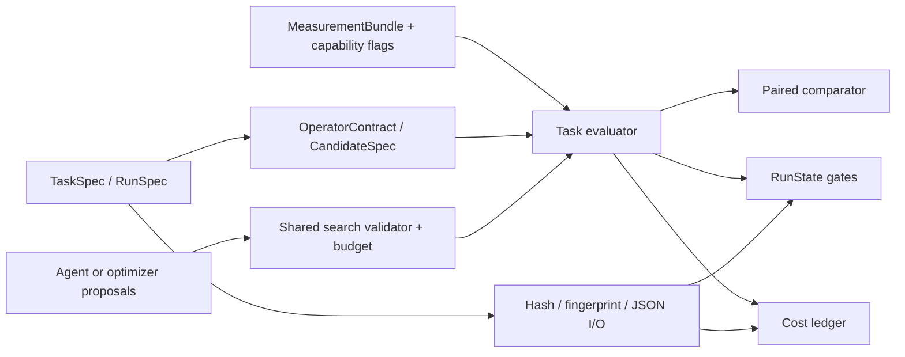

# LatticeArena framework: verified extension map

This note maps the extension points present in the current checkout and separates
working interfaces from integration work that a new task still needs. It is a
source review, not a claim that all modules already form one generic runtime.

## Current component map

The boxes are reusable components, while the arrows show a useful task-level
assembly. The Pion pipeline is the implemented end-to-end example. New task
folders still need to connect their own measurement and estimator to these
contracts; declaring a schema alone does not create an evaluator.

## Extension points confirmed in source

| Need | Existing hook | What a new task must add |
|---|---|---|
| Describe a scientific problem | [`core/specs.py`](../core/specs.py): `task_spec` includes observable, geometry, boundary, source, splits, reference, metric, budget, dependencies | Freeze units, operator conventions, split identity, reference and invalid-result rules; strengthen checks for disjoint splits and permitted data capabilities where needed |
| Declare an operator/candidate | `operator_contract` and `candidate_spec` bind axes, dtype, transformation, support, parameters, builder and dependencies | Add an explicit versioned contract and builder validator. The current candidate registry only accepts `pion-kernel-v1` and `wilson-kernel-v1`; Optimize needs its own candidate schema before production integration |
| Add a measurement backend | [`core/measurement.py`](../core/measurement.py): arrays, manifest, dtype and declared `linear_response`, `cross_matrix`, `new_source` capabilities | Implement the task-owned CPU/GPU/MPI measurement route, bind inputs and software identity in the manifest, and reject unavailable capabilities before measurement. Current bundle validation checks finite nonempty arrays; it does not provide storage isolation or verify all provenance hashes by itself |
| Add a search method | [`core/search.py`](../core/search.py): common validate → budget → evaluate → record path | Adapt LLM, deterministic optimizer, evolutionary search or learned initializer to emit proposals; count invalid attempts according to the frozen budget and retain every rejection reason |
| Add a score or paired estimand | [`core/comparator.py`](../core/comparator.py): shared draw-length checks, optional unique draw IDs, positive paired risk ratio and a log lower bound | Implement the task estimand and failure policy; preserve common draw/configuration identity, planned denominators and multiplicity. A new formula must not silently inherit the current ratio's positivity or interval semantics |
| Track evidence readiness | [`core/state.py`](../core/state.py): operator, reference, numerical, statistical and comparison states; validation observation is permanent; a score is available only when all states have hash-bound validation | Provide evidence hashes and allowed transitions for each task. Keep diagnostic/physical output labels explicit and make abstention a first-class terminal result |
| Account for compute | [`core/ledger.py`](../core/ledger.py): setup, solve, residual, kernel, I/O and analysis phases; device, precision, parallelism and cold/warm cache | Extend phases for task-specific costs such as training, model selection, inference, optimizer objective/gradient calls, checkpoint/recovery, or device teardown; compare only compatible hardware and precision receipts |
| Preserve artifacts | [`core/io.py`](../core/io.py): content digest, canonical fingerprint and JSON writing | Bind protocol, code, environment, input, output, plot and report identities; use no-clobber run directories and retain failure receipts |

`agents/operator_search.py` illustrates repeated agent proposals against the
Pion development evaluator. `agents/optimization_benchmark.py` illustrates
paired synthetic episodes with development selection and a separate test draw.
These are task examples, not automatic plug-ins for every task family.

## Task-specific opportunities

- **Pion:** retain the current `MeasurementBundle` and sink-builder boundary;
  add an independent dependence/anchor evidence contract before any physical
  score gate can validate. The accepted bounded block-risk calibration belongs
  behind a versioned score specification, not in the generic comparator.
- **Optimize Gaussian:** add a task-specific run specification that binds the
  same objective, reference, fit IDs, W/v/c constraints, SLSQP comparison,
  fixed spectral baseline, dual budgets and full failure receipts. The generic
  optimizer hook can compare proposals, but it does not define those scientific
  choices.
- **Wilson loop:** add versioned estimand contracts for finite-`T` Creutz and
  ground-state discrete force separately. Both can share block IDs and paired
  draws while using different systematic-error gates; the generic `RunState`
  does not infer spectral or thermal contamination bounds.

## Practical implementation order for a new task

1. Define its observable, units, geometry, boundary/source convention, splits,
   reference, budget and failure states in a versioned task protocol.
2. Add operator/candidate and measurement-capability contracts; reject malformed
   plans before opening data or initializing a device.
3. Implement a task evaluator that emits raw measurements, paired draws,
   planned/valid/failed/abstained denominators and source-bound receipts.
4. Connect candidate generators through the shared validator and explicit cost
   ledger; keep training, search, measurement and inference costs separable.
5. Add CPU contract tests and synthetic checks for mathematical/software
   behavior, then authorize and verify the actual backend separately. CPU tests
   do not certify GPU/MPI physics behavior.
6. Add task-specific comparison and reporting; verify formulas, interval
   assumptions, identities, plots, artifact hashes and negative results.

## Current integration boundary

The current `main` has a full Pion pilot. The Optimize and Wilson additions in
this PR are isolated CPU diagnostics and theory artifacts; neither is a
production measurement pipeline. Their TODOs remain until the open scientific
reference, effect/tolerance, confirmation-family and data/compute authorization
gates are resolved.
