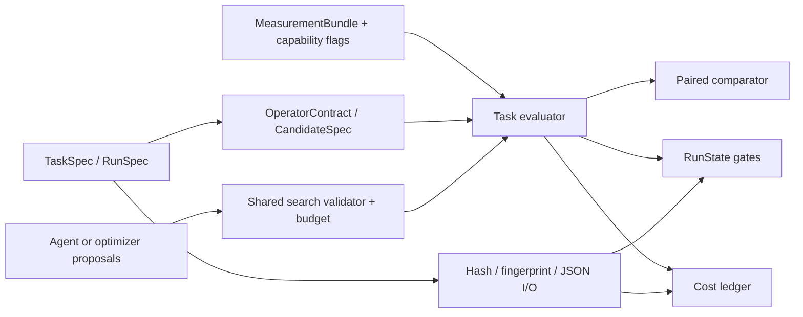

# LatticeArena framework: verified extension map

This note maps the extension points present in the current checkout and separates
working interfaces from integration work that a new task still needs. It is a
source review, not a claim that all modules already form one generic runtime.

## Current component map

The boxes are reusable components, while the arrows show a useful task-level
assembly. The Pion pipeline is the implemented end-to-end example. New task
folders still need to connect their own measurement and estimator to these
contracts; declaring a schema alone does not create an evaluator.

## Extension points confirmed in source

| Need | Existing hook | What a new task must add |
|---|---|---|
| Describe a scientific problem | [`core/specs.py`](https://github.com/Greyyy-HJC/LatticeArena/blob/3b9c77201be97d300dfce98b0c3e0d67dc57146f/core/specs.py): `task_spec` includes observable, geometry, boundary, source, splits, reference, metric, budget, dependencies; it validates inclusive integer ranges and rejects overlap | Freeze units, operator conventions, split identity, reference and invalid-result rules; declared range disjointness still does not authenticate data IDs or prove statistical independence |
| Declare an operator/candidate | `operator_contract` and `candidate_spec` bind axes, dtype, transformation, support, parameters, builder and dependencies | Pion and Wilson retain their task schemas; Optimize now registers `optimize-chebyshev-diagnostic-v1` through a task-owned validator. This schema is diagnostic only: it does not freeze D11, create a complete Optimize `TaskSpec`, or connect production evaluation |
| Add a measurement backend | [`core/measurement.py`](../core/measurement.py): arrays, manifest, dtype and declared `linear_response`, `cross_matrix`, `new_source` capabilities | Implement the task-owned CPU/GPU/MPI measurement route, bind inputs and software identity in the manifest, and reject unavailable capabilities before measurement. Current bundle validation checks finite nonempty arrays; it does not provide storage isolation or verify all provenance hashes by itself |
| Add a search method | [`core/search.py`](../core/search.py): common validate → budget → evaluate → record path | Adapt LLM, deterministic optimizer, evolutionary search or learned initializer to emit proposals; count invalid attempts according to the frozen budget and retain every rejection reason |
| Add a score or paired estimand | [`core/comparator.py`](../core/comparator.py): shared draw-length checks, optional unique draw IDs, positive paired risk ratio and a log lower bound | Implement the task estimand and failure policy; preserve common draw/configuration identity, planned denominators and multiplicity. A new formula must not silently inherit the current ratio's positivity or interval semantics |
| Plan diagnostics and retain denominators | [`core/receipts.py`](https://github.com/Greyyy-HJC/LatticeArena/blob/f209015337b08f26e34b733771d56142a5288806/core/receipts.py) adds versioned `ScenarioSpec`, stage-specific denominators and `RunReceipt` with source/output SHA-256 references and exact reason accounting. Optimize's candidate-contract report is the first consumer; Wilson's lane-contract report is the second. Both retain text-flow diagnostics and distinguish contract checks from physical work | Add consumers at task-specific units (panel, measurement, optimizer fit, stencil or contract check). Keep cap-stop/non-success, failure, abstention and not-run counts distinct; receipt hashes identify bytes but do not prove provenance, independence or scientific validity |
| Track evidence readiness | [`core/state.py`](https://github.com/Greyyy-HJC/LatticeArena/blob/710eeb27b5d94de37a646ee52ec743be18894786/core/state.py): operator, reference, numerical, statistical and comparison states; validation observation is permanent; a score is available only when all states have hash-bound validation; `abstained` is a terminal no-certificate state | Bind task receipts and evidence hashes to these states. Keep diagnostic/physical labels explicit; Pion, Optimize and Wilson task evaluators still need to connect their task-specific abstention rules to this generic state |
| Compare learned/iterative methods fairly | `core/ledger.py` has generic setup/solve/residual phases; the Optimize stress report keeps call cap, optimizer seconds, fit selection and postchecks separate | Add `BudgetSpec` fields for objective/gradient calls, setup, training, inference, I/O, recovery and amortization count. Enforce shared fit/heldout IDs, initialization policy and restart count; report call-budget and total-walltime estimands separately |
| Preserve artifacts | [`core/io.py`](../core/io.py): content digest, canonical fingerprint and JSON writing; [`core/receipts.py`](https://github.com/Greyyy-HJC/LatticeArena/blob/f209015337b08f26e34b733771d56142a5288806/core/receipts.py) binds declared source/output hash maps and reason-accounted denominators; CPU diagnostics retain text/figure explanations and snapshots | Extend receipts with environment and authorized input provenance only when a task defines those fields. Use no-clobber run directories and retain failure receipts. A manifest proves byte identity, not scientific validity or input independence |

`agents/operator_search.py` illustrates repeated agent proposals against the
Pion development evaluator. `agents/optimization_benchmark.py` illustrates
paired synthetic episodes with development selection and a separate test draw.
These are task examples, not automatic plug-ins for every task family.

The generic split preflight is `split name + inclusive integer [start,end] -> valid endpoint order -> reject overlap`; it checks declared ranges only, not source data IDs or independence. The generic run-state transition for a missing gate is `not_run/draft -> abstained(reason) -> terminal`; abstention cannot be upgraded in place to a validated result, and `score_or_null()` remains null unless every state has hash-bound validation. This distinguishes insufficient evidence from a demonstrated failure. The task-specific Pion, Optimize and Wilson evaluators do not yet route their contracts through this shared object.

## Task-specific opportunities

- **Pion:** retain the current `MeasurementBundle` and sink-builder boundary;
  add an independent dependence/anchor evidence contract before any physical
  score gate can validate. The accepted bounded block-risk calibration belongs
  behind a versioned score specification, not in the generic comparator. Its
  finite planned-block denominator, failure-as-worst rule, `alpha_s/alpha_A`
  split and graph-color/mixing assumptions should be explicit contract fields.
  `tasks/pion_projection/bounded_block_risk_score.py` implements the blockwise
  clipping, fixed failure denominator, and conditional lower-bound arithmetic
  as a pure CPU helper; it is not wired into the evaluator and always leaves
  `physical_score` null. The versioned draft at
  `tasks/pion_projection/bounded_block_risk_contract_v1.md` collects the
  estimand, transform, conditional bound and open decision fields while leaving
  every study-specific threshold, block-dependence value and anchor receipt
  unset. The synthetic coverage MCs compare a known finite-
  dependence graph with an IID misspecification and add an independent,
  known-variance anchor interval with explicit `alpha_score/alpha_anchor`
  allocation. A separate exact two-point enumeration contrasts the known-
  variance Gaussian z radius with a distribution-free Hoeffding radius when
  anchor support is known. An optional color-class empirical-Bernstein bound
  is compared with graph-color Hoeffding only under the known synthetic graph;
  it may help at low chromatic number but loses certificate rate as classes
  shrink, so it remains a sensitivity lane. These diagnostics show calibration choices and
  utility costs only under their declared models; they do not establish the
  real score graph, E-anchor coverage/support, common-bias bound, or conditional
  independence. The plots and reports retain separate paired-block,
  family-score, hypothetical anchor-observation, and exact-outcome denominators.
  A second dependence route is now explicit: Paulin's Markov-chain
  pseudo-spectral-gap Bernstein theorem can be applied conditionally to a
  stationary chain of predeclared block states. Its 40-cell worst-case-radius
  sensitivity is highly conservative at the 20-block planning point and does
  not estimate the block-chain gap. A reusable Pion calibration extension
  should therefore expose a typed dependence contract (graph-color bound or
  Markov-gap bound), bind the block-map hash and theorem/assumption receipt,
  record the bound's unit and confidence level, preserve separate anchor and
  score error budgets, and fail closed when the receipt is absent. Clipping
  changes the estimand and must be frozen before confirmation data.
- **Optimize Gaussian:** a standalone versioned draft inspector now retains the
  two selected contrasts (trainable-W versus same-budget SLSQP; trainable-W
  versus fixed degree-4 Chebyshev) and lists unset D04 reference, D06 `r_star`,
  D11 operator and fairness-budget fields. The degree-4 Bernstein/Chebyshev
  candidate now has a versioned diagnostic adapter in
  [candidate_contract.py](https://github.com/Greyyy-HJC/LatticeArena/blob/f209015337b08f26e34b733771d56142a5288806/tasks/optimize_gaussian/candidate_contract.py)
  and a [hashed text-flow report](https://github.com/Greyyy-HJC/LatticeArena/blob/f209015337b08f26e34b733771d56142a5288806/results/optimize_gaussian/framework_candidate_contract_20261124_v3/README.md).
  It validates the illustrative Bernstein controls against the generic candidate
  schema and a shared receipt with separate `schema_fixture=1/1/0/0` and
  `coefficient_fit=0/0/0/0` units. Receipt status `complete` means all planned
  units are accounted for, not that a fit or method succeeded. Its complete
  synthetic fixture only reaches
  `CONTRACT_COMPLETE_REQUIRES_HUMAN_REVIEW`; it does not create a complete
  Optimize `TaskSpec` or connect a measurement route/evaluator. The
  36-panel synthetic grid demonstrates how to retain a paired heldout-loss plot
  and separate solver stops from failed fits; a separate 12-train/12-eval pooled
  initialization replay separates train-only prior fitting, identical online
  SLSQP budgets, and heldout scoring. Its synthetic break-even count is call
  accounting, not a production timing claim. These descriptive cells do not
  resolve the physical reference or minimum effect size. The generic optimizer
  hook does not define those choices.
- **Wilson loop:** add versioned estimand contracts for finite-`T` Creutz and
  ground-state discrete force separately. Both can share block IDs and paired
  draws while using different systematic-error gates. The fixed q/h/x toy and
  randomized positive-spectrum stress validate the four-point algebra and
  envelope propagation over the declared synthetic ranges, but supply no
  physical contamination envelope. The versioned lane-contract inspector
  fixes the finite-`T` Creutz sign and candidate-minus-reference force direction,
  checks precision units before adding statistical and systematic budgets, and
  rejects malformed shared kernel lists. Synthetic mutations exercise these
  fail-closed paths. It also checks alpha allocation and evidence-receipt shape
  while keeping `CONTRACT_COMPLETE_REQUIRES_HUMAN_REVIEW` separate from
  readiness. The [v4 report](https://github.com/Greyyy-HJC/LatticeArena/blob/f209015337b08f26e34b733771d56142a5288806/results/wilson_loop/lane_contract_diagnostic_20261124_v4/README.md)
  uses the shared receipt API: 14 fixture-lane checks have denominator
  `14/6/8/0`, and each failed check has a text reason. Its complete status means
  all checks are accounted for; it does not authenticate receipts or provide
  physics evidence. The generic `RunState` does not infer spectral, thermal or
  mixed-sector bounds.

## Practical implementation order for a new task

1. Define its observable, units, geometry, boundary/source convention, splits,
   reference, budget and failure states in a versioned task protocol.
2. Add operator/candidate and measurement-capability contracts; reject malformed
   plans before opening data or initializing a device.
3. Implement a task evaluator that emits raw measurements, paired draws,
   planned/valid/failed/abstained denominators and source-bound receipts.
4. Connect candidate generators through the shared validator and explicit cost
   ledger; keep training, search, measurement and inference costs separable.
5. Add CPU contract tests and synthetic checks for mathematical/software
   behavior, then authorize and verify the actual backend separately. CPU tests
   do not certify GPU/MPI physics behavior.
6. Add task-specific comparison and reporting; verify formulas, interval
   assumptions, identities, plots, artifact hashes and negative results.

Each diagnostic or confirmation report should include either a figure or a
textual data-flow/decision diagram, plus planned/valid/failed/abstained
denominators at every relevant unit of analysis. Solver cap-stops, statistical
failures and protocol abstentions are distinct states and should stay visible.

## Current integration boundary

The current `main` has a full Pion pilot. Pion dependence calibration and the
Optimize/Wilson additions are isolated analytic/synthetic CPU diagnostics and
theory artifacts; none is a production measurement pipeline. A shared receipt
API now has Optimize and Wilson consumers; Pion is not yet migrated. Pion's bounded
risk reports include a 1,728-scenario feasibility surface, a known-graph
coverage MC, a joint score/anchor coverage MC, an exact anchor-distribution
robustness comparison, and a color-class empirical-Bernstein sensitivity grid.
The companion Optimize/Wilson PR reports the 36-panel trainable-W stress grid,
12-panel pooled-initialization replay, Wilson lane-contract completeness and
four fail-closed mutation fixtures, finite-`N_t` Creutz toy identity check, and
randomized positive-spectrum four-point stress over 4,000 cases, all with
figures or text flow, denominators and source/artifact hashes. Optimize and
Wilson now also exercise shared receipt generation with explicit count/reason
semantics; Pion still uses task-local reports. Their TODOs remain until task-specific
references, effect/tolerance or spectral-error contracts, dependence/anchor
bounds, lane protocols, and data/compute authorization gates are resolved. CPU
tests establish software/algebra behavior only, not GPU/MPI physics validation.
