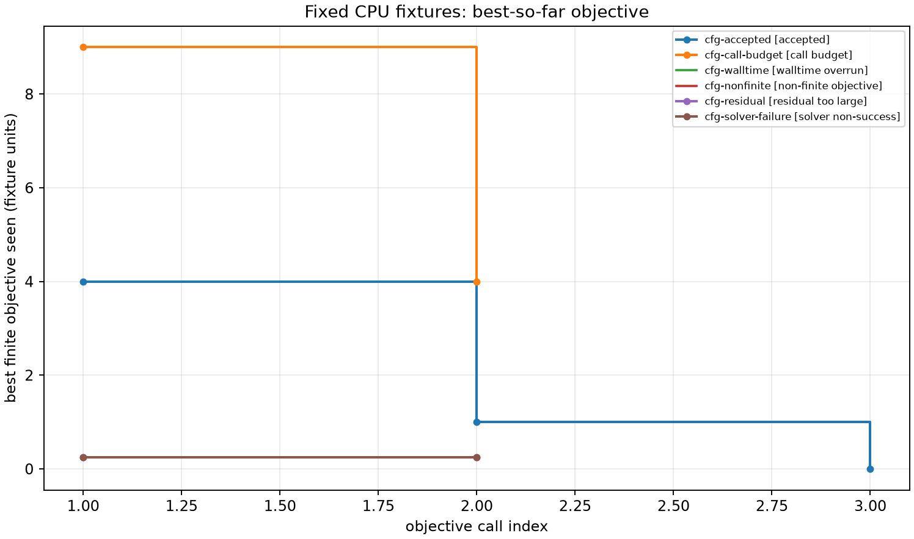
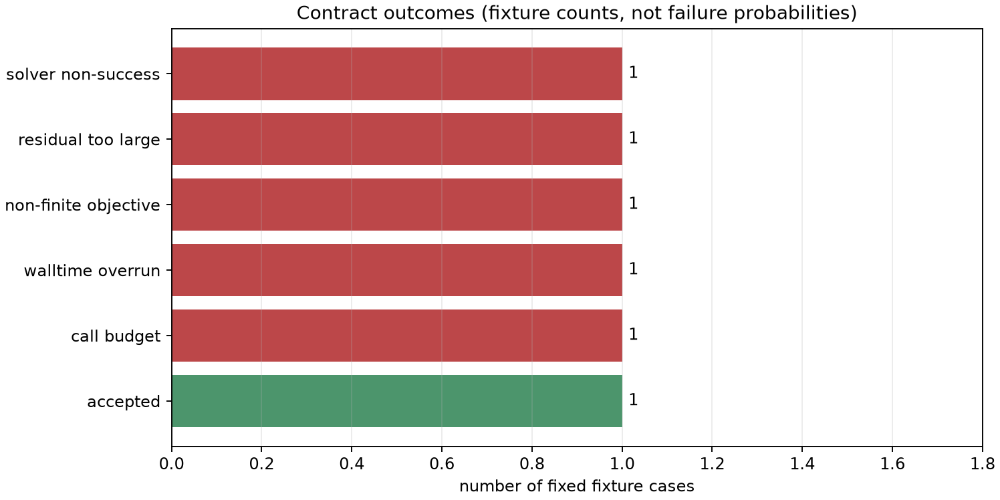

# optimize_gaussian P3：最小有判别力实验（预注册 + 停止规则）

本文件记录 P3 第二步（GPU）的设计草案；**执行 NOT_RUN，生产预注册尚未冻结**。下表中的待定参数
必须在读取 shared holdout 前确定并绑定分析/代码 hash。现有 CPU 结果均为 `diagnostic_only`。CPU 第一步的 teacher 结果见
[`results/optimize_gaussian/p3_teacher_v1/`](../results/optimize_gaussian/p3_teacher_v1/README.md)。

## 1. 假设

H1：在七幂扩散类之外加入一个 gauge-covariant、O_h 投影、非对易的 $Q$ 修正
（$K=P_u(H)+\sum_j\theta_j B_jQ_jB_j$）能在**新数据**上降低预注册的主终点。
H2：收益来自类本身，而不是优化器（SLSQP vs Powell）或训练集过拟合。

## 2. 主终点与比较族

- 主终点：新留出数据上的配对 risk 比（强谱类 baseline / 新类候选），block bootstrap 95% 区间；
- 比较族：2 类（七幂、嵌套 $Q$）× 2 优化器（SLSQP、Powell）= 4 个候选，冻结后再看 validation；
- 成功的候选规则：配对 risk 比的区间下界超过实际意义阈值 $r_\star>1$；
  $r_\star$ 的数值及是否使用 multiplicity-adjusted 下界均待冻结。旧示例 1.2 不是已批准阈值；
- 反证：真实与 shuffled 无差别、强谱基解释全部收益、或新类只降低训练误差；
- 证据不足：区间跨 1 → INCONCLUSIVE，不能称等效。

## 3. 数据与样本量

- 新 gauge/propagator 必须独立于已反复观察的 v1 70–99；旧数据只辅助开发；
- 同样本同时测强谱类、uniform、real、shuffled 四臂；
- 样本数由块方差与目标效应的 power simulation 决定（不是固定 30/60）；预注册模拟脚本与种子；
- 每臂记录 inversion、setup、apply、训练、measurement、total time 与硬件/精度/残差。

## 4. 成本账本（预注册字段）

`setup / solve / kernel apply / 训练 / 测量 / IO / 分析 / total`，区分冷/热缓存、精度、设备、并行度；
不使用未定义的“risk×秒”。

## 5. 停止规则

完成预定预算/轮次后：

1. 无新数据收益（配对区间跨 1 或下界低于阈值）；
2. 有效秩不增加；
3. 成本超过预注册容忍界；
4. 资源不可用（无 GPU 授权）。

任一成立即结束本轮，分别归档负结果、证据不足或资源不可用；**不无限加模型/调 loss 追求正结果**。

## 6. 当前状态

| 项 | 状态 |
| --- | --- |
| CPU teacher 跨样本实验 | `diagnostic_only`（`p3_teacher_v1/`；构造性表达能力，不是物理 PASS） |
| class×optimizer 2×2（GPU） | ⛔ NOT_RUN（需要新 GPU 生产与授权） |
| real/uniform/shuffled 消融（GPU） | ⛔ NOT_RUN |
| 新盲测与 power simulation | ⛔ NOT_RUN |

## 7. 生产前待冻结参数表

本表区分可先在 CPU 完成的设计工作与必须由研究者确定的物理取舍。`TBD` 不得自动回填为
旧 pilot 数值、示例阈值或默认统计设置；表未闭合时只能开展开发诊断，不能发布物理 score。

| 字段 | 当前可确认的约束 | 待用户/实验冻结的值与记录 | CPU 前置交付 |
| --- | --- | --- | --- |
| 主张/主比较 | P3 是 class×optimizer 2×2，独立于 trainable-W/initializer 主张 | 主 contrast、候选选择规则、是否同时宣称 optimizer/class 交互；`TBD` | 列出四候选与 real/uniform/shuffled 的比较矩阵，标识 confirmatory/exploratory |
| 物理效应 | 比值方向为 baseline/candidate，风险定义须相同 | 最小实际意义 $r_\star>1$、成本/失败率容忍界；`TBD`，由研究者决定 | 仅列所需参数，禁止自行选 1.2 或由观察到的效果倒推阈值 |
| reference/objective | D 开发 reference gate FAIL；沿用它只支持 `diagnostic_only` | 新 reference 模型、窗、gate、幅度估计量、质量不确定度传播、score 定义；`TBD` | 保存 reference 诊断表和不认证原因；不以训练低 risk 认证 reference |
| 样本/功效 | D0–59 fit、60–99 development；100–139 embargo，140–199 shared holdout 不读 | 有效独立 block 单位、block length/敏感性、目标功效或 CI 精度、样本数、模拟 seed/模型；`NOT_RUN` | 功效/精度对样本数的表或曲线与 MC 不确定度；开发相关结构的来源、外推假设及失败情形 |
| paired CI | 各臂同配置、source/probe、target；共享重采样索引；optimizer draws 不充当独立配置 | ratio/difference 主统计量、bootstrap 层级、置信水平、零分母处置、失败时 estimand；`TBD` | ID/order/hash 核对表；每臂相同有效集合；无法配对时拒绝而非静默取交集 |
| multiplicity | 四候选与消融不等于一个检验；W seed/超参不能在 test 选优 | confirmatory family、是否一个主 contrast、校正方法/整体错误率及探索性区间标记；`TBD` | 完整检验族表；未经校正的现有 toy CI 标 descriptive，不能替代 familywise 证据 |
| abstain/failure | reference 未通过不能产生物理 score；预算截断与 solver failure 分开 | 每臂数值门槛、gate失败/缺配对/NaN/未收敛/预算耗尽的逐样本与整run处置；`TBD` | 失败/截断/弃权表，保留分母、失败 ID 和所有起点；不得只汇报成功子集 |
| 双预算与成本 | objective calls 与 walltime 是两个独立比较；解析梯度/谱解费用不能隐去 | 总调用数、是否计梯度/预处理、重启分配、独立 walltime cap、训练摊销部署数；`TBD` | 两套预算定义与账本；best-so-far 对 calls/time 图，setup/train/inference/solve/total 分解 |
| 数值/输入身份 | 复用已核验 D0–99 point propagator；不重复 inversion | source/sink、geometry、boundary、precision、residual/KKT门槛、缓存/receipt/代码 hash 和实际设备；`TBD` | Optimize-specific RunSpec 与 preflight 清单；历史未知设备字段保留未知 |

共享 holdout 只可在 Pion/Optimize/Wilson 全部候选与分析 hash 共同锁定、生产执行解锁后按冻结计划使用一次。
P3 负结果、INCONCLUSIVE、reference/数值弃权和资源不可用 `NOT_RUN` 分别报告；后两者不能冒充已完成的负物理实验。

## 8. CPU 接口核查（solver 接线前快照）

本节表格记录 nested contract 接入前的接口状态，当前 train-path 接线结果见下方 §10 的“Optimize 训练路径接线”。

以下为接口行为诊断，不是生产 RunSpec 或物理 gate。相关 focused tests 位于
`tests/test_optimize_gaussian.py` 与 `tests/test_optimize_solver_contract.py`；不访问生产 gauge/cache 或 shared holdout。

| 检查 | 当前接口实际行为 | 证据与尚缺能力 |
| --- | --- | --- |
| 搜索预算 | `core.search.Budget` 在 validate 前消耗 proposal 配额；无效提案也消耗，`evaluations` 只计有限成功结果；零配额不求值 | 测试验证 evaluator 不超调用数；这是 proposal cap，不是嵌套 solver 的 objective-call 或 walltime cap |
| 非有限/异常 | search 拒绝 None/NaN/±Inf 与 evaluator exception，保存 reason；validate 拒绝时不求值 | focused tests；拒绝日志不能当作有效物理样本 |
| inversion residual 超界 | `train.validate_inputs(..., trusted=True)` 超残差拒绝，diagnostic 入口降级 | 已有 `test_validate_inputs_status`；只认证输入，不认证 optimizer 收敛 |
| solver 未收敛/截断 | CPU `_solver_trial` 保留状态；新增 task-specific `search_gated_receipts` 只把 contract-accepted receipt 的有限 final objective 送入 generic search | focused tests 覆盖 solver failure/call truncation；`train.optimize` 与生产 RunSpec 尚未接入此 wrapper |
| paired IDs | comparator 保留现有 draw-ID 检查；新增 `validate_paired_configuration_ids` 核对每臂完整有序配置 ID、拒绝重复并返回 hash | focused tests；新工具只认证 ID 序列相同，不测风险配对，也未把 hash 绑定进生产 RunSpec |

当时这些 CPU 测试尚未将 residual-aware contract 接入 `train.optimize`。该接线现由 §10 的新测试覆盖，但仍不是 production gate：没有设置实际阈值、没有执行真实逐臂配对风险比较，也没有实现 in-process walltime hard-stop。
每次实际比较仍须交 paired-risk 区间图、calls/time 收敛图、成本/摊销图、KKT/residual 与失败表及文字边界；
目前没有物理效应可作图，本节旧表与 §10 新增文本轨迹都只记录 `diagnostic_only` 行为和缺项。

2026-11-20 定向 CPU 检查：`python3 -B -m pytest -q -p no:cacheprovider tests/test_optimize_gaussian.py
-k 'optimize_search or optimize_solver_diagnostic or optimize_paired_draw_identity or validate_inputs_status or hash_bound_pion_propagator_receipt'`
得到 **11 passed, 25 deselected**。检查仅使用固定微型数组、受控 solver 状态与 pytest 临时输入；未扩充 synthetic benchmark、未运行 GPU 或读取 holdout。新增 contract wrapper 的单独 CPU 检查见 §10。

## 9. Powell 只记录 receipt（CPU 实现诊断）

`train.optimize()` 保留 `risk/theta/nfit`，额外返回 `optimizer_receipt`。它随每个 grid 点及 best
写入**新运行**的 `results.json`；不回填旧结果、不改变 loss、Powell 选项、dev-val 选优或 generic search。
`risk` 仍是原先包含 L2 的 `fit.fun`，不是新增的物理终点。

```text
固定微型 CPU 输入 / 受控 optimizer 状态
    → optimize(): 原 Powell 调用 + 观测计数/计时/逐调用轨迹
    → risk/theta/nfit + optimizer_receipt (diagnostic_only)
    → 每个 grid 点 → dev-val 原规则选 best → 新 results.json
```

| 字段 | 记录语义 | 不能据此推出的结论 |
| --- | --- | --- |
| schema / classification / method | `optgauss-powell-diagnostic-v1` / `diagnostic_only` / Powell | 不是 production convergence certificate |
| success / status / message | 原 optimizer 返回状态和文字；缺 status 为 null | success 不是 KKT/residual gate；false 不自动等于预算截断 |
| nfev / nit / objective_calls | solver 声称的调用数/迭代数与 loss 入口自计数；缺 nit 为 null | 保留两种调用计数，不将两者强制认作相同；不含额外 dev-val 求值 |
| elapsed_seconds / maxiter | minimize 调用包围的 CPU walltime 与原 maxiter 设置 | 不是 setup/训练全成本；不实施 walltime hard-stop 或新的 objective-call cap |
| objective_trace | 每次正常完成 loss 调用的 1-based index、从 minimize 开始到本次求值完成的 elapsed_seconds、原 loss value、finite、best_so_far | finite值记数值；非finite值用 `nan`/`inf`/`-inf` 字符串编码以保存严格 JSON；optimizer收到的原数值不变 |
| nonfinite_objective_calls / nonfinite_parameter_calls | 已完成 loss 求值中的非有限目标计数；loss 入口的非有限 theta 计数 | 仅观测、不替换/截断目标或自动弃权 |
| final_objective_finite / final_theta_finite | 返回值的 finite 状态 | 不是收敛或 reference 有效性判定 |
| bounds / lower_bound_hit_indices / upper_bound_hit_indices | 原参数界与最终 theta **精确相等**的索引 | 未引入 isclose/可行性容差；近边界不判命中 |
| out_of_bounds_indices | 最终 theta 严格小于下界或大于上界的索引 | NaN 不满足大小比较，必须同时读取 final_theta_finite；不是新拒绝门 |
| box_kkt_diagnostic | Powell终点的有限差分梯度、盒约束活动边界与KKT violation；探针调用和计时单列 | diagnostic-only近似，不改变risk/选优，不是收敛证明或gate |

正常 receipt/trace 覆盖 optimizer 正常返回的结果（包括 `success=False`）；main 现在为每次 optimize 提供
绑定当前 run 的 failure context。`scipy.minimize` 自身或 loss 抛 `Exception` 时，先尝试保存下述失败收据，再原样重抛，
不返回 partial fit，不让失败候选参加选优。直接调用 optimize 而没有 failure context 时，仅原样重抛，不写文件。
历史 risk/theta 允许非有限值的行为保留；新 receipt 使用有限数值、字符串与布尔字段（有限协议 bounds 前提下），
不能因有一份 JSON 就把非有限候选变成合格样本。KKT 目前只有下述有限差分诊断，solver 停止原因分类、失败/弃权策略、逐臂 ID 对齐及把数值状态接入 production gate 的规则仍待协议冻结。

### 盒约束 KKT 残差诊断（CPU 接口）

每次 Powell 正常返回后，receipt 现在附加 `box_kkt_diagnostic`。对目标
`risk_of + lam2 * mean(theta[1:]**2)` 在最终参数处做相对步长 `1e-5 * max(1, |theta_i|)` 的有限差分；
盒边界活动容差为十倍探针步长。内部点用中心差分，接近下界用前向差分，接近上界用后向差分。
振幅/参数界的已有 `*_bound_hit_indices` 仍是**精确相等**观察，不受这项活动容差改变。

对最小化的盒约束问题，内部点 violation 为 `|g_i|`；下界活动时只罚 `g_i < 0)，上界活动时只罚
`g_i > 0)。收据分别保存梯度、活动边界索引、无量纲/原单位无穷范数 violation、探针次数和时间。
探针 objective calls 不并入 Powell 的 `objective_calls/objective_trace`，避免诊断试探点改变 best-so-far 曲线；
也不改变返回 risk、theta、nfit 或 dev-val 选择。

此项**没有阈值，threshold=null**。若终点非法、探针出现异常/非有限值或区间退化，明确记录状态而不拒绝 fit。
风险函数可能在质量/阈值位置非光滑，有限差分还依赖尺度；因此该 residual 只能用来比较/发现可疑终点，
不能解释成Powell的严格KKT certificate、QUDA residual或生产收敛门。若未来想把它用于接受/弃权，须先冻结探针尺度、
活动边界容差、阈值及对非光滑目标的稳健性研究，并与梯度-free独立停止准则对照。

best_so_far 只取截至本次调用的**有限 loss**的最小值，首个有限值出现前为 null；NaN/±Inf 不更新它。
它是包含 L2 的原搜索目标，不是 dev-val/test 的 physical risk，也不代替最终 `fit.fun`。新 run 可用 index 或
elapsed_seconds 为横轴绘制 best-so-far 图，并另标非有限调用；内存/序列化开销随调用次数线性增长，计时包含这项观测开销。
本轮不生成伪物理收敛图。历史 run 没有逐调用 trace，无法从最终 risk/nfev 反推；只有在以后授权的新目录运行中才能取得新轨迹，
不得把新轨迹回填为旧 run 的测量记录或覆盖旧结果。

### 异常 failure receipt（CPU 实现诊断）

新 run 的 `optimizer_failure.json` 仅在既有输出保护通过的未完成目录中发布；已完成 results/manifest 目录被拒绝，
已有 failure 文件绝不覆盖。写入流程为同目录唯一临时文件 → 严格 JSON 完成并 fsync → hard-link 原子发布 → 删除临时文件。
若目标存在、权限/IO 失败，给**原异常**添加未写入原因并继续重抛原异常，不隐藏数值失败或退回 partial fit。
已存在失败文件的目录不能作为新 run 复用，basis-only resume 规则也会拒绝它。

| 失败字段 | 内容与边界 |
| --- | --- |
| schema/classification/status/physical_score | `optgauss-optimizer-failure-v1` / `diagnostic_only` / `optimizer_exception` / null |
| run_protocol/protocol_fingerprint/source_hashes/statistics_sha256 | 当前输入协议与代码身份，不替代生产 gauge/solver receipt 或设备证明 |
| seed/lam2/completed_grid | 失败候选身份、此前完成的 grid 项；不包含本次 partial fit，不另选一个候选继续 test |
| exception | module-qualified 类型和原始 message |
| optimizer_diagnostics | 已进入/已完成 objective 调用数、已完成 trace、非有限计数、elapsed/maxiter；在 loss 内抛异常时 entered 数可大于 completed 数 |

此前完成的 grid 项或协议中的非有限浮点值在失败 JSON 中用 `nan`/`inf`/`-inf` 明确编码，不能悄悄丢弃失败信息。
覆盖范围仅为 minimize/loss 的 `Exception`；输入读取、collect/GPU、dev-val/test、结果写入、进程被杀、KeyboardInterrupt/SystemExit
不在该收据保证内。IO 故障时收据可能写不出，但原异常仍传播；因此不能称为全部失败覆盖。

新增 focused tests 用 monkeypatch optimizer 记录 success/非成功、原始返回文字、缺省可选字段、非有限目标/参数、
精确/近似边界和新结果中 grid/best receipt 保留；受控结果不代表真实 Powell 收敛。2026-11-20 执行
`python3 -B -m pytest -q -p no:cacheprovider tests/test_optimize_gaussian.py -k 'powell_receipt or preserves_each_optimizer_receipt'`
得到 **4 passed, 36 deselected**。未读取生产数据、未运行 GPU、未扩样。
随后连同已有预算/配对/输入残差/cache/manifest 检查的定向运行得到 **17 passed, 23 deselected**。
追加 trace 后，定向执行 `python3 -B -m pytest -q -p no:cacheprovider tests/test_optimize_gaussian.py
-k 'powell or preserves_each_optimizer_receipt'` 得到 **7 passed, 36 deselected**。测试验证 mixed finite/nonfinite
逐调用记录完整、有限 best-so-far 单调不增、原 loss/最终返回值不变，以及 minimize/loss 的异常都原样传播；不是实际生产收敛验证。
再与现有预算/配对/输入残差/cache/manifest 检查合并定向执行，得到 **20 passed, 23 deselected**。
追加 failure receipt 后，`-k 'powell or preserves_each_optimizer_receipt or optimizer_exception or failure_write_refusal or failure_receipt_rejects'`
得到 **11 passed, 36 deselected**；再与原预算/配对/输入残差/cache/manifest 检查合并为 **24 passed, 23 deselected**。
测试分别模拟 minimize/loss 异常，核对同一异常对象、完整身份/此前 grid/trace、原子发布和拒绝覆盖；另测已完成目录拒绝、
缺身份拒绝、发布 IO 失败与临时文件清理。成功路径没有 failure 文件，原选择行为保持；这些都是 CPU 接口验证。

源码改变后，旧 adapter、basis cache 与 provenance 冻结的 train.py hash 仍代表历史版本；需要当前代码身份的新运行
须重新绑定 hash，不能修改历史收据冒充已验证新版本。

2026-11-20 本轮新增 box-KKT finite-difference diagnostic 后，`tests/test_optimize_gaussian.py` 全文件 **53 passed**；
新增测试覆盖 interior stationarity、lower/upper 活动边界的梯度符号、违反KKT的一侧界、非有限/异常探针，
并确认 Powell trace 与诊断探针分开计数。它们是受控CPU数学/接口案例，不是物理优化器收敛验证。

## 10. Nested solver contract（CPU 固定样例，diagnostic-only）

新增 [`solver_contract.py`](../tasks/optimize_gaussian/solver_contract.py) 把 solver status、最终 `x` 的独立 objective 重评估、有限值、显式 residual 字段/阈值、objective-call cap 与 elapsed cap 聚合成一份 receipt。只有 `contract_accepted` 的 receipt 才能经 task-specific `search_gated_receipts` 进入现有 `core.search`；通用 `core.search` 本身仍保持 scalar evaluator 接口。`validate_paired_configuration_ids` 对多臂的有序 ID 序列作相等/重复检查并给出 hash，但尚未把它绑定到生产 RunSpec 或任何风险行。

执行流程为：

```text
solver(objective)
  → 受保护 objective：有限值 + calls/time trace + best-so-far
  → 独立重评估返回的 x（同样计入双预算）
  → solver success + residual + 两类预算联合接受/拒绝
  → 仅 accepted receipt 进入 core.search；拒绝原因逐项留存
```

固定 CPU fixture、原始收据、失败计数表与文字解释见[诊断报告](../results/optimize_gaussian/cpu_solver_contract_v1/README.md)。六个确定性软件场景中 1 个通过，5 个分别覆盖 objective-call 截断、walltime 越界、非有限目标、residual 超界与 solver 非成功；这只是设计覆盖计数，不是概率或性能统计。paired identity fixture 核对 6 个有序 ID；外层 proposal cap=3 的单独重放消费 3 项（接受1、拒绝2），另3项未进入。该原始独立 adapter 快照中 `tests/test_optimize_solver_contract.py` 为 **11 passed**；之后增加两项 residual-probe budget 测试，目前该模块 **13 passed**，并在下方训练接线报告中复核。测试和报告不加载 gauge、propagator、reference、GPU 或 holdout。

### Optimize 训练路径接线（CPU 合成验证）

CPU 接线现已进入 `train.optimize`、hash-bound `train.main` 和 Optimize RunSpec builder。显式训练协议必须给出 `objective_call_cap`、`walltime_cap_seconds`、`residual_field=kkt_residual`、`residual_tolerance` 与 `require_solver_success`；RunSpec builder 在绑定文件之前拒绝缺失/无效策略，child 再校验协议 hash 与策略。显式 Optimize fit 的调用顺序为：

```text
协议 hash + 完整 solver policy
  → RunSpec / child 预检（不匹配则停止）
  → Powell objective（计入 calls 与 solver best-so-far）
  → 返回点 objective 独立重算（同样计入双预算）
  → KKT 有限差分探测（计入双预算，但不能改善 best-so-far）
  → accepted：允许计算候选 dev-val 分数并进入网格比较
  → rejected：原子写 diagnostic-only rejection receipt，并停止在 test 评估之前
```

复现细节、合成轨迹计数与边界见[训练接线 CPU 报告](../results/optimize_gaussian/solver_contract_train_integration_cpu_v1/README.md)。定向 Powell fixture 的接受路径计 7 次 objective：1 次 solver 调用、1 次返回点重算、5 次二维 KKT 探测；拒绝 fixture 将 cap 设为 2，第三次 KKT 请求被拒绝，训练入口写出 `physical_score=null` 收据且不写 `results.json` / `manifest.json`，也不计算 learned candidate dev-val 或 test 分数。RunSpec fixture 同时验证显式策略被源码 hash 绑定、缺策略时在输入绑定前拒绝。四个 solver/train 模块 **87 passed**；加入 hard-timeout 与 worker receipt 模块后，六模块合计 **113 passed**。worker 只将进程组已稳定后的 optional rejection diagnostic hash 记在独立字段；child 非零退出仍是失败，不会把它当成功训练 artifact。上述均为确定性软件场景，不是 solver 性能、物理风险或失败率；没有读取生产 gauge/cache/reference、GPU、QUDA 或 blind IDs。`train.main` 拒绝路径和父级失败诊断 hash 由分开的 CPU fixture 覆盖，尚未在单个子进程中端到端联跑真实 `train.main`。

**现状边界**：CPU gate 接线已完成，但生产阈值仍未冻结，v9 bundled protocol 仍是历史诊断路径且没有 solver contract；新显式 RunSpec 不接受此缺项。现有 KKT 值是 `box_kkt_diagnostic` 的 scaled finite-difference stationarity estimate，阈值必须由研究者基于适当 solver/reference 分析冻结，不能从上述 fixture 推导。训练入口中的 reject-before-selection 只验证了 CPU stub 路径。真实 protocol、输入哈希、训练结果和 GPU/QUDA 上的 walltime/设备回收均未生成或验证。





**walltime 边界**：当前同步 wrapper 在目标函数开始前、返回后和最终点重评估前检查 elapsed cap。它不能中断正在运行的目标函数、SciPy/native code 或任意 solver 内部步骤；慢调用可超限一次，结果会被记录并拒绝。因此这是 cooperative walltime guard，不是 hard stop。若生产协议要求不可越界的 walltime，后续应评估可终止子进程/作业级超时，并为中断/部分输出定义原子 receipt；本项尚未实现。

生产仍缺研究者冻结的实际改善阈值、残差阈值、失败/弃权政策、objective-call 统计口径、walltime 计时范围、paired-risk estimand、multiplicity 和样本量。CPU 接入只提供策略门与诊断收据，不提供 production score，也不说明 learned smear 是否超过 SLSQP。reference gate 未通过时仍必须将任何风险标为 `diagnostic_only`。

## 11. 冻结 worker RunSpec 的 CPU preflight（执行闭环，不是生产训练）

新增 [`worker_runspec.py`](../tasks/optimize_gaussian/worker_runspec.py) 为独立执行入口：先严格解析 no-duplicate-key JSON，再验证 protocol/source/input 文件 SHA-256、split ID 不重叠、worker argv 与新输出路径；通过后才启动独立进程组，并将原 RunSpec 文件 hash、文件身份、split、日志/退出码与 hard-timeout 状态绑定到 no-clobber receipt。RunSpec schema v2 要求显式 child environment，子进程不会继承未绑定的 parent environment，receipt 只记录 environment hash 和变量名。文本流程和本地 synthetic 案例见[诊断报告 v3](../results/optimize_gaussian/worker_runspec_cpu_v3/README.md)。`tests/test_optimize_worker_runspec.py` 与 hard-timeout 测试合计 **17 passed**；协议/源码/输入漂移、split overlap 均在创建日志前被拒绝，环境隔离案例也已执行。v1/v2 报告保留为历史快照，不覆盖。

此项关闭的是**generic worker 的执行边界及 Optimize-specific RunSpec builder 的 CPU 构造/预检路径**。随后 `train.main` 增加了 `--protocol PATH --protocol-sha256 SHA256` 成对参数：child 在准备输出和读取输入前重算原始 protocol bytes hash；错误/缺失绑定会退出。当前 [`runspec_builder.py`](../tasks/optimize_gaussian/runspec_builder.py) 可从显式冻结 protocol 构造 schema v2 RunSpec，绑定 protocol、训练依赖源码、manifest、每个配置的 gauge/propagator/sidecar、reference/bootstrap、可选 Pion 测量 receipt、split IDs、child environment、deadline、成功产物和 optional solver-rejection diagnostic，并在写入前做 no-launch preflight。成功训练产物仅在 worker 成功且进程组干净退出后接受 hash；rejection receipt 在进程组稳定后单独记录观察到的 hash，child 仍标失败且 `physical_score=null`。`tests/test_optimize_runspec_builder.py` 为 **12 passed**；hard-timeout / worker / builder 相关测试合计 **38 passed**。builder→supervisor fixture 用假 child，没有执行 `train.main`、读取生产缓存或初始化 GPU/QUDA；初版图文见 [RunSpec CPU 报告](../results/optimize_gaussian/task_runspec_preflight_cpu_v1/README.md)，新增 rejection 数据流见 §10 报告。

因此，**构造器、合成输入 CPU 预检与 solver gate 的 train.optimize 接线已完成，真实 production RunSpec / training receipt 尚未生成**。当前 Pion reference gate 失败，实际 source/split、reference/objective、双预算、停止/弃权阈值和执行授权也未冻结；v9 已观察 ID 不能重新作为 blind。CPU 接线报告只证明受控 fixture 的调用和拒绝顺序。GPU/QUDA 中断后的设备回收、basis cache恢复与真实训练 walltime 未验证；worker walltime 从 child 启动开始计，不含前置 RunSpec hash 检查。下一步先冻结 reviewed protocol、允许输入/输出及统计决策，再由 builder 生成绑定真实文件的 RunSpec；研究者授权 GPU 后，做短时启动/中断 smoke，记录设备回收、显存、setup/training/inference/solve/teardown walltime。不得把合成 CPU receipt解释为训练结果或物理得分。
