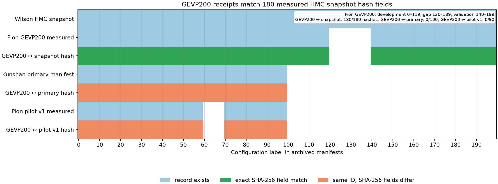

# Pion GEVP200 and Wilson HMC snapshot crosswalk

This read-only audit compares archived provenance hash fields by configuration ID. It does not read or regenerate gauge configurations.

## Directly observed

- The Wilson snapshot contains 200 IDs (0–199). The Pion GEVP200 receipts contain 120 development records (0–119) and 60 validation records (140–199), with a declared gap 120–139. Saved NPZ ID arrays agree with the provenance record IDs.
- Pion GEVP200 and the Wilson snapshot have identical recorded gauge SHA-256 strings for 180/180 overlapping measured IDs. Plaquettes also agree for 180/180; all 180 measured residuals are at or below 1e-10, with maximum 9.99635e-11.
- For IDs 0–99, Pion GEVP200 and the primary Kunshan manifest have matching plaquettes for 100/100 IDs but matching gauge hash fields for 0/100. The older Pion pilot v1 matches the primary manifest for 90/90 rows.
- Pion GEVP200 and pilot v1 reuse 90 numeric ID labels, but their recorded gauge hashes match for 0 IDs. Thus configuration labels alone do not identify the gauge field across these archived runs.
- Pion GEVP200 records measurement source SHA-256 6c41481e21640e88742054abdeda83843601bcfa8e97412f58b4e940665b03d4. A byte-identical historical measure.py blob exists in local Git at tasks/pion_projection/measure.py; its current file has hash 6cef0bb58da70e33ce7f6a8db506e5075e97b6df86dfa39d870a45b234804a0a. The recorded kernel SHA-256 matches the current kernel: True.

## Interpretation and limits

The exact 180/180 digest-field agreement is direct evidence that the archived Pion GEVP200 measurement provenance used the same declared gauge hashes as the Wilson snapshot for its measured IDs. This partially corroborates the snapshot's identity history. It does not rehash gauge bytes, prove the HMC SAVED files had those bytes, explain the primary-manifest conflict, or fully establish that the Wilson production log and Pion measurement were the same run.

The Pion GEVP200 validation report has reference_passed=False and score_status=unscored_reference_failed. Its 60 validation records therefore do not supply an accepted physical anchor or official score. The measurements are already archived and analyzed; do not call them a fresh blind validation for another model.

Per-ID values are in crosswalk.csv. Frozen input, source, and output hashes are in provenance.json; protocol rules are in protocol.json.
