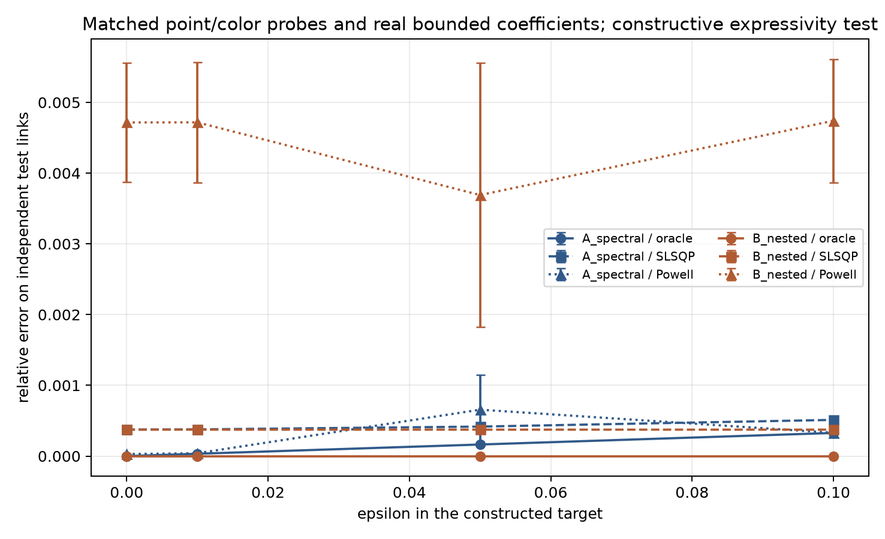

# Matched cross-link operator-class diagnostic（包 C）

生成：`python -m tasks.optimize_gaussian.p3_crosslink_fair`；数据：`crosslink_fair.json`；
图：`fig_crosslink_fair.png`。

## 配对设计

- 周期 $3^3$ 空间格点上的全空间色荷协变 Laplacian $H$；$B$ 是六个空间面、四个方向取向平均的
  traceless Hermitian clover 乘法算子。
- 目标 $Q=H^2+\epsilon BHB$。类 A 为 $H^0,\ldots,H^7$；类 B 在 A 上加入 $BHB$ 与
  $\{BHB,H\}/2$。所有模型使用同一组**实标量系数**，系数限制在 $[-5,5]$。
- 每个 seed 有 3 个 train links configuration、2 个独立 test links configuration；每个 configuration
  分别使用 20 个 train 或 12 个 test 点源/color basis probes。A/B 两类使用完全相同的 links 与 probes；
  同一 seed 的不同 $\epsilon$ 也使用相同随机 links/probes。
- bounded real least-squares oracle、SLSQP、Powell 使用同一目标函数和可行域。JSON 保存系数、有效秩、
  nfev/迭代、可行性、训练目标和投影梯度残差。

## Oracle 的独立 test error（三个 seed 的均值）

| $\epsilon$ | 类 A：谱基 $H^n$ | 类 B：嵌套基 | 类 B SLSQP | 类 B Powell |
| ---: | ---: | ---: | ---: | ---: |
| 0 | $4.2\times10^{-16}$ | $8.4\times10^{-16}$ | $3.7\times10^{-4}$ | $4.7\times10^{-3}$ |
| 0.01 | $3.3\times10^{-5}$ | $7.8\times10^{-16}$ | $3.7\times10^{-4}$ | $4.7\times10^{-3}$ |
| 0.05 | $1.63\times10^{-4}$ | $6.4\times10^{-16}$ | $3.7\times10^{-4}$ | $3.7\times10^{-3}$ |
| 0.1 | $3.27\times10^{-4}$ | $6.6\times10^{-16}$ | $3.7\times10^{-4}$ | $4.7\times10^{-3}$ |

## 结论边界

这是**构造性的表达能力诊断**：目标显式含 $BHB$，类 B 也显式含这个 feature，因此 oracle 的零误差是
代数可表示性结果，不是训练学到了 $Q[U]$，更不是 B 实际优于 A 的物理实证。独立 test links 只检查同一
系数规则的迁移。三 seed 很少，误差线只描述 seed 间散布。

几何/算子检查：$H,B,Q$ 的 Hermitian 残差为 0；link determinant 残差 $1.21\times10^{-15}$；全算子 gauge
covariance 残差分别为 $2.1\times10^{-14}$、$1.3\times10^{-15}$、$1.7\times10^{-13}$。

实用优化器仍未达到 oracle：SLSQP 的 test error 约 $4\times10^{-4}$，Powell 对嵌套类约 $4\times10^{-3}$；
`success=True` 不代表收敛到全局最优。要比较 learned optimizer 与 SLSQP，下一步必须使用多个独立 gauge
configurations、相同 probe/预算、多起点强基线，并报告训练/测试误差、KKT 残差和总成本。
