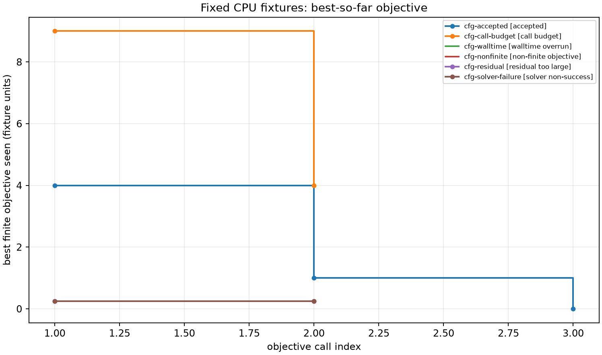
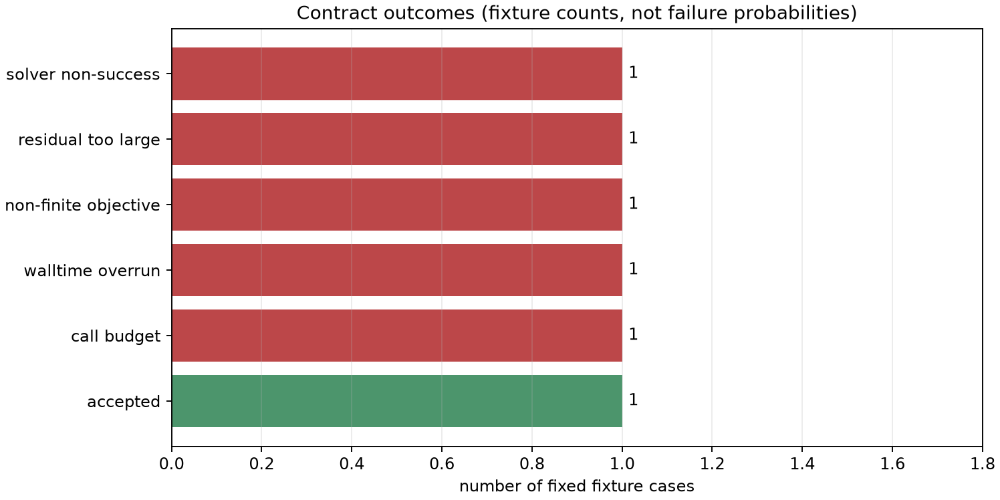

# Nested solver contract：CPU 固定样例诊断

**状态：`diagnostic_only`。** 这里验证 contract adapter 对 solver 成功标记、最终点重评估、objective-call 预算、协作式 walltime、非有限目标、残差门与外层 proposal 预算的行为。六行是人为构造的确定性软件样例，不是随机样本、经验失败率、优化器 benchmark 或物理风险比较；所有 `physical_score` 都是 `null`。

## 收据与失败计数

| 配置 fixture | 结果 / 拒绝原因 | calls / cap | elapsed / cap (s) | solver | residual / tolerance |
|---|---|---:|---:|---|---:|
| `cfg-accepted` | `accepted` | 3 / 8 | 0.600 / 10.000 | True | 0.01 / 0.1 |
| `cfg-call-budget` | `objective_call_budget_exhausted;solver_non_success;missing_finite_final_objective;missing_or_non_finite_residual` | 2 / 2 | 0.400 / 10.000 | None | None / 0.1 |
| `cfg-walltime` | `walltime_exceeded_during_objective;solver_non_success;missing_finite_final_objective;missing_or_non_finite_residual` | 1 / 8 | 1.250 / 1.000 | None | None / 0.1 |
| `cfg-nonfinite` | `non_finite_objective;solver_non_success;missing_finite_final_objective;missing_or_non_finite_residual` | 1 / 8 | 0.200 / 10.000 | None | None / 0.1 |
| `cfg-residual` | `residual_exceeds_tolerance` | 2 / 8 | 0.400 / 10.000 | True | 0.2 / 0.1 |
| `cfg-solver-failure` | `solver_non_success` | 2 / 8 | 0.400 / 10.000 | False | 0.01 / 0.1 |

轨迹纵轴是 fixture objective，不能解释为 smear risk。budget fixture 在第 3 次调用请求处截断，最多只进入 2 次目标函数；非有限 fixture 没有有限 best-so-far 点；walltime fixture 的单次调用耗时超过 cap 后被记录并拒绝。接受 fixture 使用两次搜索点评估，再独立重算 solver 返回的 `x`，所以最终点重算也计入 objective-call 预算与 trace。

## paired ID 与 SearchAdapter

`paired_identity.json` 对两个标签提交了相同有序 ID 列，得到 count=6、SHA-256 `0c15dc8a6690f2e594a867e50761f93bf707241df0452f92b6f1dbfd2bcb6750`。这是 ID 顺序身份检查，不是两臂配对风险测量。

独立重放已生成的收据后，外层 `core.search` 配额为 3 个 proposal：消费 3 个，接受 1 个，拒绝 2 个，另有 3 个未进入；`budget_exhausted=True`。这与每个 solver 内部的 objective-call cap 是两层不同预算。

## 执行边界

- `walltime_cap_seconds` 是同步包装器的**协作式**限制：在目标函数开始前、目标函数返回后和最终点重评估前检查。它不能中断正在运行的函数、SciPy 内部原生计算或任意 solver 步骤；一次慢调用可能越界，越界结果会计入后拒收。若需要真正 hard timeout，需用可终止的子进程/作业级调度器并设计可审计的进程间收据。
- 残差字段名与阈值由调用方显式提供。本诊断使用玩具 `kkt_residual <= 0.1`，它不是经研究者批准的 Optimize 收敛阈值，也不等价于 QUDA inversion residual。
- solver 的 `success`、有限目标、最终点重评估、残差、objective-call 和 walltime 要同时满足 policy；这些规则仅验证接口 fail-closed 行为，不证明生产 RunSpec 已冻结。
- 没有加载 gauge、propagator、reference、盲测 ID 或 GPU；没有训练 learned-$W$、测量 smear 风险或声称其优于 SLSQP。

## 复现身份

- 脚本与 contract 源码 SHA-256：`a6eea8fa43513d47d25be7f46be7b41a6e000ccbc30d0ac02c285c89e74d7b0e`、`4703548684f761aa6ab9c197f1480e2b1f5cd46722107a481bfab7fd1dbc97cf`。
- 原始收据在 `case_receipts.json`，逐例计数在 `failure_counts.csv`，外层预算记于 `search_adapter_summary.json`。
- `summary.json` 记录 fixture 范围、paired identity hash 与 walltime 限制。
