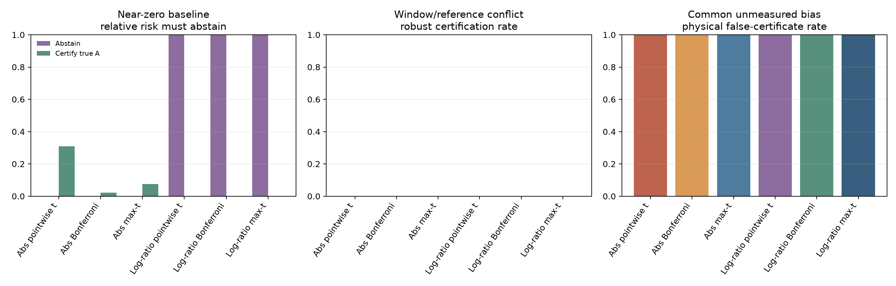

# Pion family-wise robust-score synthetic calibration

This is a new, independent CPU method experiment. It does not modify the production score, does not validate the pion physical state, and does not use amendment02/amendment03 trials as independent data.

## Frozen design

- 2500 independent outer trials per scenario; each trial contains 30 independent synthetic datasets.
- Four candidates are compared across four frozen branches: two fit windows times two reference models. Candidate branches are correlated within each dataset.
- A robust certificate requires every branch for that candidate to clear the same frozen minimum improvement.
- Compare dataset-level paired absolute risk differences and log risk ratios. For each, compare unadjusted one-sided Student-t bounds, Bonferroni bounds over all 16 candidate/branch contrasts, and a dataset-level Rademacher max-t multiplier bootstrap.
- The relative method abstains when median baseline risk is at or below 0.05. The absolute margin is 5% of the predeclared scenario risk scale; this scale-relative choice is a controlled synthetic comparison, not a physical margin.
- Every interval below is a 95% exact Clopper-Pearson Monte Carlo interval across outer trials. It is not a physical coverage interval.

## Results

| Scenario | Method | Any null candidate falsely certified | Power for each truly improved candidate | Abstain |
| --- | --- | --- | --- | --- |
| gaussian_boundary_null | Abs pointwise t | 9/2500=0.004 [0.002, 0.007] | not applicable | 0/2500=0.000 [0.000, 0.001] |
| gaussian_boundary_null | Abs Bonferroni | 0/2500=0.000 [0.000, 0.001] | not applicable | 0/2500=0.000 [0.000, 0.001] |
| gaussian_boundary_null | Abs max-t | 1/2500=0.000 [0.000, 0.002] | not applicable | 0/2500=0.000 [0.000, 0.001] |
| gaussian_boundary_null | Log-ratio pointwise t | 11/2500=0.004 [0.002, 0.008] | not applicable | 0/2500=0.000 [0.000, 0.001] |
| gaussian_boundary_null | Log-ratio Bonferroni | 0/2500=0.000 [0.000, 0.001] | not applicable | 0/2500=0.000 [0.000, 0.001] |
| gaussian_boundary_null | Log-ratio max-t | 1/2500=0.000 [0.000, 0.002] | not applicable | 0/2500=0.000 [0.000, 0.001] |
| one_candidate_improved | Abs pointwise t | 2/2500=0.001 [0.000, 0.003] | candidate_0: 762/2500=0.305 [0.287, 0.323] | 0/2500=0.000 [0.000, 0.001] |
| one_candidate_improved | Abs Bonferroni | 0/2500=0.000 [0.000, 0.001] | candidate_0: 50/2500=0.020 [0.015, 0.026] | 0/2500=0.000 [0.000, 0.001] |
| one_candidate_improved | Abs max-t | 0/2500=0.000 [0.000, 0.001] | candidate_0: 148/2500=0.059 [0.050, 0.069] | 0/2500=0.000 [0.000, 0.001] |
| one_candidate_improved | Log-ratio pointwise t | 7/2500=0.003 [0.001, 0.006] | candidate_0: 943/2500=0.377 [0.358, 0.397] | 0/2500=0.000 [0.000, 0.001] |
| one_candidate_improved | Log-ratio Bonferroni | 0/2500=0.000 [0.000, 0.001] | candidate_0: 79/2500=0.032 [0.025, 0.039] | 0/2500=0.000 [0.000, 0.001] |
| one_candidate_improved | Log-ratio max-t | 0/2500=0.000 [0.000, 0.001] | candidate_0: 221/2500=0.088 [0.078, 0.100] | 0/2500=0.000 [0.000, 0.001] |
| heavy_tail_boundary_null | Abs pointwise t | 8/2500=0.003 [0.001, 0.006] | not applicable | 0/2500=0.000 [0.000, 0.001] |
| heavy_tail_boundary_null | Abs Bonferroni | 0/2500=0.000 [0.000, 0.001] | not applicable | 0/2500=0.000 [0.000, 0.001] |
| heavy_tail_boundary_null | Abs max-t | 0/2500=0.000 [0.000, 0.001] | not applicable | 0/2500=0.000 [0.000, 0.001] |
| heavy_tail_boundary_null | Log-ratio pointwise t | 15/2500=0.006 [0.003, 0.010] | not applicable | 0/2500=0.000 [0.000, 0.001] |
| heavy_tail_boundary_null | Log-ratio Bonferroni | 0/2500=0.000 [0.000, 0.001] | not applicable | 0/2500=0.000 [0.000, 0.001] |
| heavy_tail_boundary_null | Log-ratio max-t | 2/2500=0.001 [0.000, 0.003] | not applicable | 0/2500=0.000 [0.000, 0.001] |
| one_dataset_outlier_boundary_null | Abs pointwise t | 7/2500=0.003 [0.001, 0.006] | not applicable | 0/2500=0.000 [0.000, 0.001] |
| one_dataset_outlier_boundary_null | Abs Bonferroni | 0/2500=0.000 [0.000, 0.001] | not applicable | 0/2500=0.000 [0.000, 0.001] |
| one_dataset_outlier_boundary_null | Abs max-t | 0/2500=0.000 [0.000, 0.001] | not applicable | 0/2500=0.000 [0.000, 0.001] |
| one_dataset_outlier_boundary_null | Log-ratio pointwise t | 10/2500=0.004 [0.002, 0.007] | not applicable | 0/2500=0.000 [0.000, 0.001] |
| one_dataset_outlier_boundary_null | Log-ratio Bonferroni | 0/2500=0.000 [0.000, 0.001] | not applicable | 0/2500=0.000 [0.000, 0.001] |
| one_dataset_outlier_boundary_null | Log-ratio max-t | 0/2500=0.000 [0.000, 0.001] | not applicable | 0/2500=0.000 [0.000, 0.001] |
| near_zero_baseline | Abs pointwise t | 4/2500=0.002 [0.000, 0.004] | candidate_0: 774/2500=0.310 [0.292, 0.328] | 0/2500=0.000 [0.000, 0.001] |
| near_zero_baseline | Abs Bonferroni | 0/2500=0.000 [0.000, 0.001] | candidate_0: 57/2500=0.023 [0.017, 0.029] | 0/2500=0.000 [0.000, 0.001] |
| near_zero_baseline | Abs max-t | 0/2500=0.000 [0.000, 0.001] | candidate_0: 187/2500=0.075 [0.065, 0.086] | 0/2500=0.000 [0.000, 0.001] |
| near_zero_baseline | Log-ratio pointwise t | 0/2500=0.000 [0.000, 0.001] | candidate_0: 0/2500=0.000 [0.000, 0.001] | 2500/2500=1.000 [0.999, 1.000] |
| near_zero_baseline | Log-ratio Bonferroni | 0/2500=0.000 [0.000, 0.001] | candidate_0: 0/2500=0.000 [0.000, 0.001] | 2500/2500=1.000 [0.999, 1.000] |
| near_zero_baseline | Log-ratio max-t | 0/2500=0.000 [0.000, 0.001] | candidate_0: 0/2500=0.000 [0.000, 0.001] | 2500/2500=1.000 [0.999, 1.000] |
| reference_window_conflict | Abs pointwise t | 4/2500=0.002 [0.000, 0.004] | not applicable | 0/2500=0.000 [0.000, 0.001] |
| reference_window_conflict | Abs Bonferroni | 0/2500=0.000 [0.000, 0.001] | not applicable | 0/2500=0.000 [0.000, 0.001] |
| reference_window_conflict | Abs max-t | 0/2500=0.000 [0.000, 0.001] | not applicable | 0/2500=0.000 [0.000, 0.001] |
| reference_window_conflict | Log-ratio pointwise t | 5/2500=0.002 [0.001, 0.005] | not applicable | 0/2500=0.000 [0.000, 0.001] |
| reference_window_conflict | Log-ratio Bonferroni | 0/2500=0.000 [0.000, 0.001] | not applicable | 0/2500=0.000 [0.000, 0.001] |
| reference_window_conflict | Log-ratio max-t | 0/2500=0.000 [0.000, 0.001] | not applicable | 0/2500=0.000 [0.000, 0.001] |
| common_bias_null | Abs pointwise t | 2500/2500=1.000 [0.999, 1.000] | not applicable | 0/2500=0.000 [0.000, 0.001] |
| common_bias_null | Abs Bonferroni | 2500/2500=1.000 [0.999, 1.000] | not applicable | 0/2500=0.000 [0.000, 0.001] |
| common_bias_null | Abs max-t | 2500/2500=1.000 [0.999, 1.000] | not applicable | 0/2500=0.000 [0.000, 0.001] |
| common_bias_null | Log-ratio pointwise t | 2500/2500=1.000 [0.999, 1.000] | not applicable | 0/2500=0.000 [0.000, 0.001] |
| common_bias_null | Log-ratio Bonferroni | 2500/2500=1.000 [0.999, 1.000] | not applicable | 0/2500=0.000 [0.000, 0.001] |
| common_bias_null | Log-ratio max-t | 2500/2500=1.000 [0.999, 1.000] | not applicable | 0/2500=0.000 [0.000, 0.001] |

## Interpretation

The Gaussian boundary table places every true branch exactly at log(1.05), the least-favorable boundary of the composite null that the robust score must exceed a 5% improvement. This is the direct family-wise calibration check. Pointwise testing leaves the candidate family unadjusted; Bonferroni gives a conservative reference; max-t uses observed branch correlation and must be judged by its repeated-trial CP interval. The partial-null scenario reports power for candidate A separately from false certification among boundary-null candidates B–D.

The heavy-tail and one-dataset-outlier scenarios are stress tests at the 5% null boundary. If a mean-based rule certifies an outlier-contaminated candidate, multiplicity correction has not made the score robust to influential datasets; the next CPU method comparison should add a predeclared robust estimator such as a trimmed paired mean or Huber score, recalibrated on independent datasets.

At the near-zero baseline, relative methods must abstain under the frozen risk floor. The conflict scenario checks whether a certificate survives every window/reference branch. The common-bias scenario deliberately makes all candidates look improved while the physical truth is null; no statistical correction can detect that without an independent anchor or model-validity diagnostic.

The absolute threshold is proportional to the synthetic baseline scale. A production study must choose an absolute risk margin from physical units before seeing outcomes, and must use independent anchor data to test common reference bias. Until then physical_score remains null.

## Reproduction and provenance

Run commands: first register the frozen protocol with python -m tasks.pion_projection.familywise_score_mc_v2 --preregister, then execute python -m tasks.pion_projection.familywise_score_mc_v2 --run. Verify saved hashes and raw archive shapes with python -m tasks.pion_projection.familywise_score_mc_v2 --verify.

The protocol and source hashes were frozen before simulation. Raw paired baseline/candidate risk arrays are saved in the scenario NPZ files; trial-level certification outcomes are in trial_outcomes.csv.gz. The output hashes and runtime versions are listed in execution_provenance.json.

Protocol SHA-256: 7243dde7a157e8ab04ab5c5994b10359336f5d05c32678c727552850b84bd009
Source SHA-256: 9580dcf6dc1607972bffa080774a631dc870fed559cb3dbb760c18e7d53b2a63
