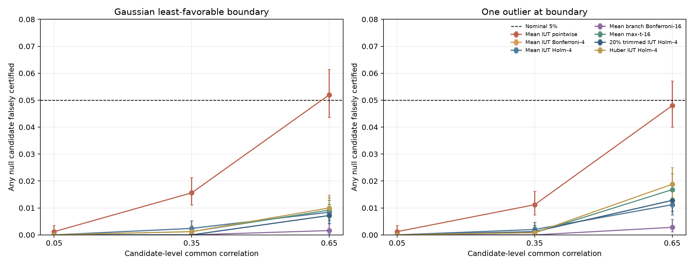
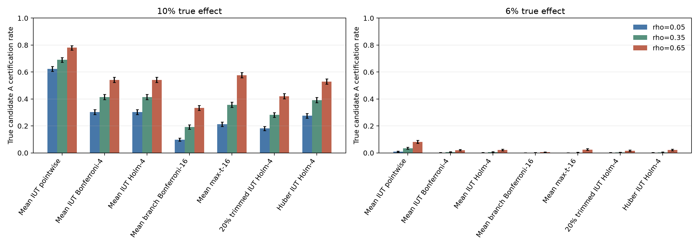
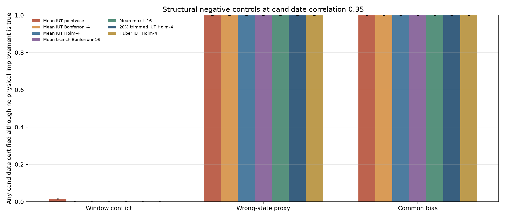

# Pion family-wise robust-score extensions

This independently pre-registered CPU experiment extends v2. It compares candidate-level intersection-union inference, Holm/Bonferroni selection correction, candidate-correlation sensitivity, and robust paired estimators. It does not modify the production score or validate a physical anchor.

## Frozen design and candidate inference

- Each cell uses 2500 outer trials; each trial contains 30 independent synthetic dataset-level paired log-risk improvements for 4 candidates and 4 frozen window/reference branches.
- Candidate common correlations are 0.05, 0.35, and 0.65. All primary null effects are exactly log(1.05), the boundary of the requirement to exceed a 5% improvement.
- For each candidate, the intersection-union p-value is the maximum of the four branch p-values. Compare no candidate-family correction, Bonferroni-4, Holm-4, branch Bonferroni-16, and max-t-16.
- Compare the arithmetic mean with a 20% trimmed mean and a Huber M-location. Robust methods use predeclared approximate Yuen/sandwich standard errors; their empirical size and power are measured by the outer simulation.
- All event-rate intervals are exact 95% Clopper-Pearson Monte Carlo intervals. Independent datasets, not branches, are the sampling units.

## Boundary error and candidate dependence

| Candidate correlation | Scenario | Method | Family-wise false certification |
| ---: | --- | --- | --- |
| 0.05 | gaussian_boundary_null | Mean IUT pointwise | 3/2500=0.001 [0.000, 0.004] |
| 0.05 | gaussian_boundary_null | Mean IUT Bonferroni-4 | 0/2500=0.000 [0.000, 0.001] |
| 0.05 | gaussian_boundary_null | Mean IUT Holm-4 | 0/2500=0.000 [0.000, 0.001] |
| 0.05 | gaussian_boundary_null | Mean branch Bonferroni-16 | 0/2500=0.000 [0.000, 0.001] |
| 0.05 | gaussian_boundary_null | Mean max-t-16 | 0/2500=0.000 [0.000, 0.001] |
| 0.05 | gaussian_boundary_null | 20% trimmed IUT Holm-4 | 0/2500=0.000 [0.000, 0.001] |
| 0.05 | gaussian_boundary_null | Huber IUT Holm-4 | 0/2500=0.000 [0.000, 0.001] |
| 0.05 | heavy_tail_boundary_null | Mean IUT pointwise | 4/2500=0.002 [0.000, 0.004] |
| 0.05 | heavy_tail_boundary_null | Mean IUT Bonferroni-4 | 1/2500=0.000 [0.000, 0.002] |
| 0.05 | heavy_tail_boundary_null | Mean IUT Holm-4 | 1/2500=0.000 [0.000, 0.002] |
| 0.05 | heavy_tail_boundary_null | Mean branch Bonferroni-16 | 0/2500=0.000 [0.000, 0.001] |
| 0.05 | heavy_tail_boundary_null | Mean max-t-16 | 0/2500=0.000 [0.000, 0.001] |
| 0.05 | heavy_tail_boundary_null | 20% trimmed IUT Holm-4 | 0/2500=0.000 [0.000, 0.001] |
| 0.05 | heavy_tail_boundary_null | Huber IUT Holm-4 | 0/2500=0.000 [0.000, 0.001] |
| 0.05 | one_dataset_outlier_boundary_null | Mean IUT pointwise | 3/2500=0.001 [0.000, 0.004] |
| 0.05 | one_dataset_outlier_boundary_null | Mean IUT Bonferroni-4 | 0/2500=0.000 [0.000, 0.001] |
| 0.05 | one_dataset_outlier_boundary_null | Mean IUT Holm-4 | 0/2500=0.000 [0.000, 0.001] |
| 0.05 | one_dataset_outlier_boundary_null | Mean branch Bonferroni-16 | 0/2500=0.000 [0.000, 0.001] |
| 0.05 | one_dataset_outlier_boundary_null | Mean max-t-16 | 0/2500=0.000 [0.000, 0.001] |
| 0.05 | one_dataset_outlier_boundary_null | 20% trimmed IUT Holm-4 | 0/2500=0.000 [0.000, 0.001] |
| 0.05 | one_dataset_outlier_boundary_null | Huber IUT Holm-4 | 0/2500=0.000 [0.000, 0.001] |
| 0.35 | gaussian_boundary_null | Mean IUT pointwise | 39/2500=0.016 [0.011, 0.021] |
| 0.35 | gaussian_boundary_null | Mean IUT Bonferroni-4 | 6/2500=0.002 [0.001, 0.005] |
| 0.35 | gaussian_boundary_null | Mean IUT Holm-4 | 6/2500=0.002 [0.001, 0.005] |
| 0.35 | gaussian_boundary_null | Mean branch Bonferroni-16 | 0/2500=0.000 [0.000, 0.001] |
| 0.35 | gaussian_boundary_null | Mean max-t-16 | 3/2500=0.001 [0.000, 0.004] |
| 0.35 | gaussian_boundary_null | 20% trimmed IUT Holm-4 | 0/2500=0.000 [0.000, 0.001] |
| 0.35 | gaussian_boundary_null | Huber IUT Holm-4 | 3/2500=0.001 [0.000, 0.004] |
| 0.35 | heavy_tail_boundary_null | Mean IUT pointwise | 44/2500=0.018 [0.013, 0.024] |
| 0.35 | heavy_tail_boundary_null | Mean IUT Bonferroni-4 | 2/2500=0.001 [0.000, 0.003] |
| 0.35 | heavy_tail_boundary_null | Mean IUT Holm-4 | 2/2500=0.001 [0.000, 0.003] |
| 0.35 | heavy_tail_boundary_null | Mean branch Bonferroni-16 | 0/2500=0.000 [0.000, 0.001] |
| 0.35 | heavy_tail_boundary_null | Mean max-t-16 | 2/2500=0.001 [0.000, 0.003] |
| 0.35 | heavy_tail_boundary_null | 20% trimmed IUT Holm-4 | 2/2500=0.001 [0.000, 0.003] |
| 0.35 | heavy_tail_boundary_null | Huber IUT Holm-4 | 3/2500=0.001 [0.000, 0.004] |
| 0.35 | one_dataset_outlier_boundary_null | Mean IUT pointwise | 28/2500=0.011 [0.007, 0.016] |
| 0.35 | one_dataset_outlier_boundary_null | Mean IUT Bonferroni-4 | 5/2500=0.002 [0.001, 0.005] |
| 0.35 | one_dataset_outlier_boundary_null | Mean IUT Holm-4 | 5/2500=0.002 [0.001, 0.005] |
| 0.35 | one_dataset_outlier_boundary_null | Mean branch Bonferroni-16 | 0/2500=0.000 [0.000, 0.001] |
| 0.35 | one_dataset_outlier_boundary_null | Mean max-t-16 | 2/2500=0.001 [0.000, 0.003] |
| 0.35 | one_dataset_outlier_boundary_null | 20% trimmed IUT Holm-4 | 3/2500=0.001 [0.000, 0.004] |
| 0.35 | one_dataset_outlier_boundary_null | Huber IUT Holm-4 | 2/2500=0.001 [0.000, 0.003] |
| 0.65 | gaussian_boundary_null | Mean IUT pointwise | 130/2500=0.052 [0.044, 0.061] |
| 0.65 | gaussian_boundary_null | Mean IUT Bonferroni-4 | 21/2500=0.008 [0.005, 0.013] |
| 0.65 | gaussian_boundary_null | Mean IUT Holm-4 | 21/2500=0.008 [0.005, 0.013] |
| 0.65 | gaussian_boundary_null | Mean branch Bonferroni-16 | 4/2500=0.002 [0.000, 0.004] |
| 0.65 | gaussian_boundary_null | Mean max-t-16 | 23/2500=0.009 [0.006, 0.014] |
| 0.65 | gaussian_boundary_null | 20% trimmed IUT Holm-4 | 18/2500=0.007 [0.004, 0.011] |
| 0.65 | gaussian_boundary_null | Huber IUT Holm-4 | 25/2500=0.010 [0.006, 0.015] |
| 0.65 | heavy_tail_boundary_null | Mean IUT pointwise | 140/2500=0.056 [0.047, 0.066] |
| 0.65 | heavy_tail_boundary_null | Mean IUT Bonferroni-4 | 33/2500=0.013 [0.009, 0.018] |
| 0.65 | heavy_tail_boundary_null | Mean IUT Holm-4 | 33/2500=0.013 [0.009, 0.018] |
| 0.65 | heavy_tail_boundary_null | Mean branch Bonferroni-16 | 7/2500=0.003 [0.001, 0.006] |
| 0.65 | heavy_tail_boundary_null | Mean max-t-16 | 41/2500=0.016 [0.012, 0.022] |
| 0.65 | heavy_tail_boundary_null | 20% trimmed IUT Holm-4 | 15/2500=0.006 [0.003, 0.010] |
| 0.65 | heavy_tail_boundary_null | Huber IUT Holm-4 | 30/2500=0.012 [0.008, 0.017] |
| 0.65 | one_dataset_outlier_boundary_null | Mean IUT pointwise | 120/2500=0.048 [0.040, 0.057] |
| 0.65 | one_dataset_outlier_boundary_null | Mean IUT Bonferroni-4 | 28/2500=0.011 [0.007, 0.016] |
| 0.65 | one_dataset_outlier_boundary_null | Mean IUT Holm-4 | 28/2500=0.011 [0.007, 0.016] |
| 0.65 | one_dataset_outlier_boundary_null | Mean branch Bonferroni-16 | 7/2500=0.003 [0.001, 0.006] |
| 0.65 | one_dataset_outlier_boundary_null | Mean max-t-16 | 42/2500=0.017 [0.012, 0.023] |
| 0.65 | one_dataset_outlier_boundary_null | 20% trimmed IUT Holm-4 | 32/2500=0.013 [0.009, 0.018] |
| 0.65 | one_dataset_outlier_boundary_null | Huber IUT Holm-4 | 47/2500=0.019 [0.014, 0.025] |

## Power and robust estimators

| Candidate correlation | True effect | Method | Candidate A power | Null-candidate FWER |
| ---: | --- | --- | --- | --- |
| 0.05 | one_candidate_improved | Mean IUT pointwise | 1558/2500=0.623 [0.604, 0.642] | 4/2500=0.002 [0.000, 0.004] |
| 0.05 | one_candidate_improved | Mean IUT Bonferroni-4 | 757/2500=0.303 [0.285, 0.321] | 0/2500=0.000 [0.000, 0.001] |
| 0.05 | one_candidate_improved | Mean IUT Holm-4 | 757/2500=0.303 [0.285, 0.321] | 0/2500=0.000 [0.000, 0.001] |
| 0.05 | one_candidate_improved | Mean branch Bonferroni-16 | 245/2500=0.098 [0.087, 0.110] | 0/2500=0.000 [0.000, 0.001] |
| 0.05 | one_candidate_improved | Mean max-t-16 | 529/2500=0.212 [0.196, 0.228] | 0/2500=0.000 [0.000, 0.001] |
| 0.05 | one_candidate_improved | 20% trimmed IUT Holm-4 | 453/2500=0.181 [0.166, 0.197] | 0/2500=0.000 [0.000, 0.001] |
| 0.05 | one_candidate_improved | Huber IUT Holm-4 | 688/2500=0.275 [0.258, 0.293] | 0/2500=0.000 [0.000, 0.001] |
| 0.05 | weak_candidate_improved | Mean IUT pointwise | 21/2500=0.008 [0.005, 0.013] | 6/2500=0.002 [0.001, 0.005] |
| 0.05 | weak_candidate_improved | Mean IUT Bonferroni-4 | 1/2500=0.000 [0.000, 0.002] | 0/2500=0.000 [0.000, 0.001] |
| 0.05 | weak_candidate_improved | Mean IUT Holm-4 | 1/2500=0.000 [0.000, 0.002] | 0/2500=0.000 [0.000, 0.001] |
| 0.05 | weak_candidate_improved | Mean branch Bonferroni-16 | 0/2500=0.000 [0.000, 0.001] | 0/2500=0.000 [0.000, 0.001] |
| 0.05 | weak_candidate_improved | Mean max-t-16 | 0/2500=0.000 [0.000, 0.001] | 0/2500=0.000 [0.000, 0.001] |
| 0.05 | weak_candidate_improved | 20% trimmed IUT Holm-4 | 1/2500=0.000 [0.000, 0.002] | 0/2500=0.000 [0.000, 0.001] |
| 0.05 | weak_candidate_improved | Huber IUT Holm-4 | 2/2500=0.001 [0.000, 0.003] | 1/2500=0.000 [0.000, 0.002] |
| 0.35 | one_candidate_improved | Mean IUT pointwise | 1725/2500=0.690 [0.671, 0.708] | 23/2500=0.009 [0.006, 0.014] |
| 0.35 | one_candidate_improved | Mean IUT Bonferroni-4 | 1036/2500=0.414 [0.395, 0.434] | 3/2500=0.001 [0.000, 0.004] |
| 0.35 | one_candidate_improved | Mean IUT Holm-4 | 1036/2500=0.414 [0.395, 0.434] | 6/2500=0.002 [0.001, 0.005] |
| 0.35 | one_candidate_improved | Mean branch Bonferroni-16 | 479/2500=0.192 [0.176, 0.208] | 0/2500=0.000 [0.000, 0.001] |
| 0.35 | one_candidate_improved | Mean max-t-16 | 893/2500=0.357 [0.338, 0.376] | 2/2500=0.001 [0.000, 0.003] |
| 0.35 | one_candidate_improved | 20% trimmed IUT Holm-4 | 704/2500=0.282 [0.264, 0.300] | 1/2500=0.000 [0.000, 0.002] |
| 0.35 | one_candidate_improved | Huber IUT Holm-4 | 980/2500=0.392 [0.373, 0.411] | 5/2500=0.002 [0.001, 0.005] |
| 0.35 | weak_candidate_improved | Mean IUT pointwise | 86/2500=0.034 [0.028, 0.042] | 41/2500=0.016 [0.012, 0.022] |
| 0.35 | weak_candidate_improved | Mean IUT Bonferroni-4 | 14/2500=0.006 [0.003, 0.009] | 7/2500=0.003 [0.001, 0.006] |
| 0.35 | weak_candidate_improved | Mean IUT Holm-4 | 15/2500=0.006 [0.003, 0.010] | 7/2500=0.003 [0.001, 0.006] |
| 0.35 | weak_candidate_improved | Mean branch Bonferroni-16 | 1/2500=0.000 [0.000, 0.002] | 0/2500=0.000 [0.000, 0.001] |
| 0.35 | weak_candidate_improved | Mean max-t-16 | 5/2500=0.002 [0.001, 0.005] | 5/2500=0.002 [0.001, 0.005] |
| 0.35 | weak_candidate_improved | 20% trimmed IUT Holm-4 | 6/2500=0.002 [0.001, 0.005] | 0/2500=0.000 [0.000, 0.001] |
| 0.35 | weak_candidate_improved | Huber IUT Holm-4 | 10/2500=0.004 [0.002, 0.007] | 7/2500=0.003 [0.001, 0.006] |
| 0.65 | one_candidate_improved | Mean IUT pointwise | 1951/2500=0.780 [0.764, 0.796] | 128/2500=0.051 [0.043, 0.061] |
| 0.65 | one_candidate_improved | Mean IUT Bonferroni-4 | 1355/2500=0.542 [0.522, 0.562] | 29/2500=0.012 [0.008, 0.017] |
| 0.65 | one_candidate_improved | Mean IUT Holm-4 | 1355/2500=0.542 [0.522, 0.562] | 44/2500=0.018 [0.013, 0.024] |
| 0.65 | one_candidate_improved | Mean branch Bonferroni-16 | 832/2500=0.333 [0.314, 0.352] | 5/2500=0.002 [0.001, 0.005] |
| 0.65 | one_candidate_improved | Mean max-t-16 | 1441/2500=0.576 [0.557, 0.596] | 34/2500=0.014 [0.009, 0.019] |
| 0.65 | one_candidate_improved | 20% trimmed IUT Holm-4 | 1050/2500=0.420 [0.401, 0.440] | 38/2500=0.015 [0.011, 0.021] |
| 0.65 | one_candidate_improved | Huber IUT Holm-4 | 1324/2500=0.530 [0.510, 0.549] | 43/2500=0.017 [0.012, 0.023] |
| 0.65 | weak_candidate_improved | Mean IUT pointwise | 203/2500=0.081 [0.071, 0.093] | 114/2500=0.046 [0.038, 0.055] |
| 0.65 | weak_candidate_improved | Mean IUT Bonferroni-4 | 51/2500=0.020 [0.015, 0.027] | 20/2500=0.008 [0.005, 0.012] |
| 0.65 | weak_candidate_improved | Mean IUT Holm-4 | 53/2500=0.021 [0.016, 0.028] | 22/2500=0.009 [0.006, 0.013] |
| 0.65 | weak_candidate_improved | Mean branch Bonferroni-16 | 11/2500=0.004 [0.002, 0.008] | 5/2500=0.002 [0.001, 0.005] |
| 0.65 | weak_candidate_improved | Mean max-t-16 | 61/2500=0.024 [0.019, 0.031] | 25/2500=0.010 [0.006, 0.015] |
| 0.65 | weak_candidate_improved | 20% trimmed IUT Holm-4 | 38/2500=0.015 [0.011, 0.021] | 19/2500=0.008 [0.005, 0.012] |
| 0.65 | weak_candidate_improved | Huber IUT Holm-4 | 54/2500=0.022 [0.016, 0.028] | 25/2500=0.010 [0.006, 0.015] |

## Wrong-state and shared-bias controls

At rho=0.35, the wrong-state scenario gives candidate A a strong apparent risk improvement while its ground-state physical effect remains null. The common-bias scenario shifts every candidate together. These controls distinguish candidate-specific proxy failure from a shared reference shift; neither can be resolved by a risk-only score without an independent state/anchor check.

| Scenario at rho=0.35 | Method | Any physically null candidate certified |
| --- | --- | --- |
| reference_window_conflict | Mean IUT pointwise | 36/2500=0.014 [0.010, 0.020] |
| reference_window_conflict | Mean IUT Bonferroni-4 | 2/2500=0.001 [0.000, 0.003] |
| reference_window_conflict | Mean IUT Holm-4 | 2/2500=0.001 [0.000, 0.003] |
| reference_window_conflict | Mean branch Bonferroni-16 | 0/2500=0.000 [0.000, 0.001] |
| reference_window_conflict | Mean max-t-16 | 1/2500=0.000 [0.000, 0.002] |
| reference_window_conflict | 20% trimmed IUT Holm-4 | 2/2500=0.001 [0.000, 0.003] |
| reference_window_conflict | Huber IUT Holm-4 | 2/2500=0.001 [0.000, 0.003] |
| wrong_state_proxy_improvement | Mean IUT pointwise | 2500/2500=1.000 [0.999, 1.000] |
| wrong_state_proxy_improvement | Mean IUT Bonferroni-4 | 2500/2500=1.000 [0.999, 1.000] |
| wrong_state_proxy_improvement | Mean IUT Holm-4 | 2500/2500=1.000 [0.999, 1.000] |
| wrong_state_proxy_improvement | Mean branch Bonferroni-16 | 2500/2500=1.000 [0.999, 1.000] |
| wrong_state_proxy_improvement | Mean max-t-16 | 2500/2500=1.000 [0.999, 1.000] |
| wrong_state_proxy_improvement | 20% trimmed IUT Holm-4 | 2500/2500=1.000 [0.999, 1.000] |
| wrong_state_proxy_improvement | Huber IUT Holm-4 | 2500/2500=1.000 [0.999, 1.000] |
| common_bias_null | Mean IUT pointwise | 2500/2500=1.000 [0.999, 1.000] |
| common_bias_null | Mean IUT Bonferroni-4 | 2500/2500=1.000 [0.999, 1.000] |
| common_bias_null | Mean IUT Holm-4 | 2500/2500=1.000 [0.999, 1.000] |
| common_bias_null | Mean branch Bonferroni-16 | 2500/2500=1.000 [0.999, 1.000] |
| common_bias_null | Mean max-t-16 | 2500/2500=1.000 [0.999, 1.000] |
| common_bias_null | 20% trimmed IUT Holm-4 | 2500/2500=1.000 [0.999, 1.000] |
| common_bias_null | Huber IUT Holm-4 | 2500/2500=1.000 [0.999, 1.000] |

## Interpretation and limits

Read Holm/Bonferroni-4 as correction over candidate-level intersection-union claims; branch Bonferroni-16 is more conservative because it corrects every branch as a separate claim. The max-t line uses the empirical covariance of all 16 mean contrasts. Selection rates can move with candidate correlation, so one covariance setting cannot support a general FWER claim.

The outlier and heavy-tail rows show whether trimming/Huber reduces false certification while preserving power. The reference-window conflict requires all four branches to pass, so a robust candidate should not be certified. The common-bias case is intentionally unidentifiable statistically: methods may certify a biased score, which still requires an independent physical anchor.

This synthetic experiment tests estimator and multiplicity behavior only. It does not resolve wrong-state contamination, physical calibration, or correlated correlator noise in the archive. See scenario-specific outcomes in familywise_score_summary.json and trial_outcomes.csv.gz.

## Reproduction and provenance

Register with python -B -m tasks.pion_projection.familywise_score_robust_extensions --preregister, execute with --run, and verify hashes with --verify. The exact source/protocol/output hashes are in execution_provenance.json.
Protocol SHA-256: a8d2d5b26ca28d4e07f416770523dcdae558b01dff2c5390e96e688409c7854f
Source SHA-256: 68ff4ccbf668dc2be065feee87dc31f332bd344c886c8483d206cb9308307580
