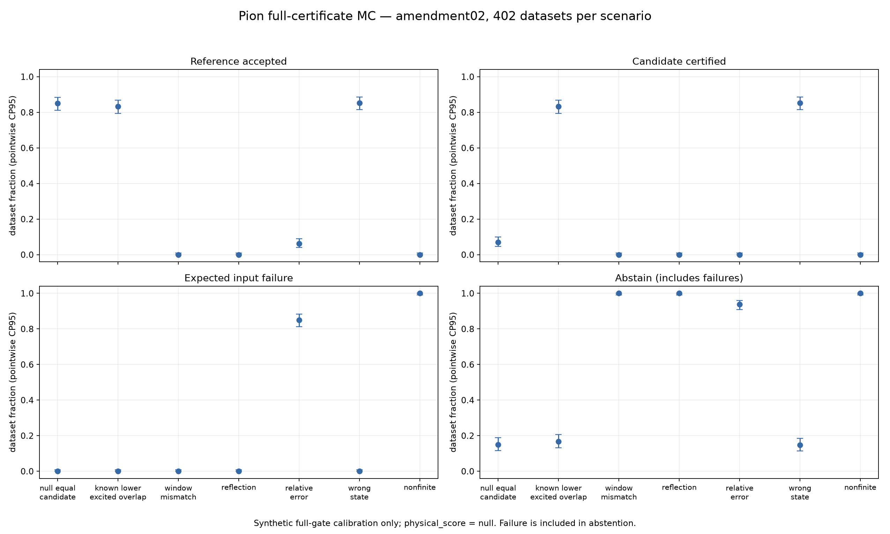

# Amendment02 full-gate MC: audit and interpretation

The completed run is the seven-scenario, 402-dataset-per-cell synthetic full-certificate calibration. `aggregate.json` and the immutable per-dataset receipts are the numerical source of truth. The figure below is a post-run rendering of that aggregate; it changes no rates or intervals.

## Receipt and protocol audit

- The driver reports `COMPLETE`, with 2814/2814 planned worlds and 402 rows in each of the seven frozen scenarios. The run took 4761.8 seconds (about 79 minutes).
- All 2814 scenario/dataset seeds match the preregistered rule. The driver reports `source_hashes_match=true`; it checked every hash in `executor_spec.json` before running. All 2814 receipts report the adapter hash listed in that execution spec, matching the current source. There were no alpha, draw-parity, or mutation-rejection mismatches.
- The 2070 `PASS` adapter receipts all use `smear_alpha=0.2` and statistical `score_spec.alpha = metric_results.level = 0.05`; direct gate parity passed with maximum draw difference 0, and all five identity mutations were rejected. The remaining 744 are expected input rejections: 342 relative-error worlds and 402 nonfinite worlds. There were no `BLOCKED` receipts or unexpected computational failures.
- `physical_score` remains `null`. All rates below are synthetic, pointwise Clopper–Pearson 95% intervals; they are not family-wise intervals or physical coverage claims.

## Source-hash reconciliation required

The high-level `preregistration.json` records `synthetic_adapter.py` as `206cce77df19375fe79a02bc796806d572775c0f6a0e8df18b0b7ff0a9aa9f7d`; `executor_spec.json`, all 2814 receipts, and the current source record `26e76a5ecad5a56b7c2bf867715d4b68a237437953e0820981ca76b5ac6b3a41`. All other overlapping source hashes agree. The execution spec is what the driver checked and bound in `parallel_driver_spec.json`, but the duplicate high-level preregistration hash is stale. The old source bytes are not available here, so the hash difference cannot be classified as metadata-only or behavior-changing.

Therefore the run is **execution-complete and tied to a verified execution-spec hash**, but has a **partial strict-preregistration provenance reconciliation**. Keep the results as synthetic diagnostics; do not claim the high-level preregistration and executed source list are fully consistent. Detailed disposition is in [RUN_REVIEW](RUN_REVIEW.md).

## Marginal outcomes at the planned denominator

| Scenario | Reference accepted | Candidate certified | Expected input failure | Abstain | Interpretation |
| --- | ---: | ---: | ---: | ---: | --- |
| null equal candidate | 342/402 (CP95 [0.812, 0.884]) | 28/402 (CP95 [0.0468, 0.0991]) | 0/402 | 60/402 | The null false-certificate interval contains the nominal 5% level. It does not establish that the rate is at or below 5%; its upper bound is about 9.9%. |
| known lower excited overlap | 335/402 (CP95 [0.793, 0.868]) | 335/402 (CP95 [0.793, 0.868]) | 0/402 | 67/402 | Synthetic candidate-detection rate is 83.3% in this scenario. |
| window mismatch | 0/402 (CP95 [0, 0.0091]) | 0/402 (CP95 [0, 0.0091]) | 0/402 | 402/402 | The gate abstained for every generated mismatch world. |
| reflection | 0/402 (CP95 [0, 0.0091]) | 0/402 (CP95 [0, 0.0091]) | 0/402 | 402/402 | The gate abstained for every generated reflection world. |
| relative error | 25/402 (CP95 [0.0406, 0.0904]) | 0/402 (CP95 [0, 0.0091]) | 342/402 (CP95 [0.812, 0.884]) | 377/402 | The unconditional rates meet the marginal interval-width target, but the valid-only reference-acceptance rate is imprecise; see below. |
| wrong state | 343/402 (CP95 [0.815, 0.886]) | 343/402 (CP95 [0.815, 0.886]) | 0/402 | 59/402 | Structural false pass: the certificate often accepts a synthetic excited-only state. The score does not identify the ground state. |
| nonfinite | 0/402 (CP95 [0, 0.0091]) | 0/402 (CP95 [0, 0.0091]) | 402/402 (CP95 [0.991, 1]) | 402/402 | Nonfinite input is rejected in every planned world. |

Failure is a subset of abstention and should not be added to the abstention count. “Expected input failure” here is the frozen fail-closed behavior, not a failed Monte Carlo execution.

## Conditional-valid denominators

The preregistration requires conditional rates to use their own denominator and forbids post-hoc top-up. Define a valid world as one without the recorded expected input failure. All scenarios except relative-error and nonfinite have 402 valid worlds, so their valid-only rates equal the marginal rates above.

- Relative-error has 60 valid worlds. Candidate certification is 0/60 (CP95 [0, 0.0596], half-width 0.0298). Reference acceptance is 25/60 (CP95 [0.2907, 0.5512], half-width 0.1302), so that conditional acceptance rate is **INCONCLUSIVE** under the frozen half-width ≤0.05 rule. Do not add worlds to this run after observing the result; a higher-precision conditional study needs a new amendment and directory.
- Nonfinite has zero valid worlds. Conditional rates are undefined; only the unconditional rejection result is estimable.

## Consequence for the score and next work

The corrected null result does not show a decisive exceedance of the nominal 5% event rate, but it also does not prove ≤5% false certification. The wrong-state result is the more important structural limit: 343/402 certificates pass when the synthetic ground-state overlap is zero. A more conservative paired score can reduce sensitivity to noisy draws, outliers, and model/window branches; it cannot establish that the chosen reference state is the physical ground state. Keep the physical score null until independent anchor data or an independently validated state-identification method exists.

The other remaining path is production measurement: collect independent development, validation, and anchor configurations with full RunSpec, source/sink and boundary conventions, gauge/propagator/QUDA identity, all 12 RHS residuals, raw correlators, hashes, and failure records. Plot fit residual and mass versus window, then candidate risk versus the independent anchor. This requires the GPU/production environment; the CPU Monte Carlo is complete and does not substitute for that measurement.

The original `candidate_rates_progress.png` is retained as generated. Its eight-panel layout left unused axes and crowded the scenario labels; `candidate_rates_diagnostic.png` is the readable post-run rendering linked above. `candidate_rates_diagnostic_provenance.json` records the aggregate, plot-script, and output hashes.
