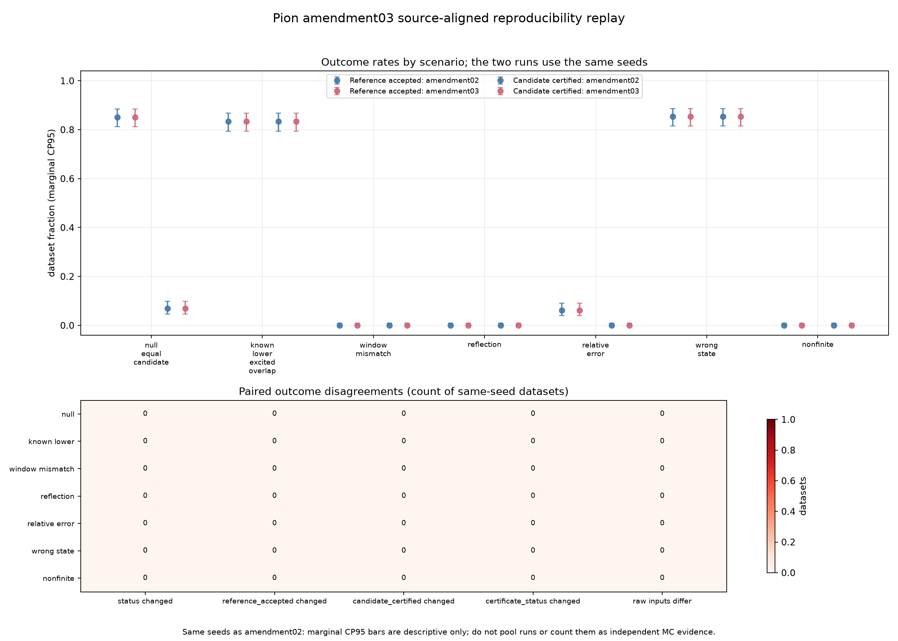

# Amendment03 source-aligned replay: analysis

## 目的与样本关系

此轮按 amendment02 的相同 seed、场景与 402/cell 设计重放当前代码，只用于检查来源 hash 闭合和同种子结果复现。相同 seed 标签本身不保证原始数组相同，因此下文另行逐 dataset 比较 development / validation arrays。无论数组是否完全一致，两轮都不是独立 Monte Carlo 样本；不得合并分子/分母、缩窄区间或称作独立复验。

## 结果

下表逐场景并列 amendment02 / amendment03 的参考接受数、候选认证数；CP95 只显示 amendment03 当前 replay 的单次边际二项区间。同 seed 配对差由图下方的字段不一致矩阵直接给出。EXPECTED_REJECTION 是计划中的输入拒绝，不计为意外执行失败。

| 场景 | ref accept A02 | ref accept A03 | certified A02 | certified A03 | A03 cert CP95 | expected reject A03 | unexpected execution failure A03 | 主字段不一致 | 其他确定性字段不一致 | raw input 不一致 |
| --- | ---: | ---: | ---: | ---: | --- | ---: | ---: | ---: | ---: | ---: |
| `null_equal_candidate` | 342/402 | 342/402 | 28/402 | 28/402 | [0.047, 0.099] | 0 | 0 | 0 | 0 | 0 |
| `known_lower_excited_overlap` | 335/402 | 335/402 | 335/402 | 335/402 | [0.793, 0.868] | 0 | 0 | 0 | 0 | 0 |
| `window_mismatch` | 0/402 | 0/402 | 0/402 | 0/402 | [0.000, 0.009] | 0 | 0 | 0 | 0 | 0 |
| `reflection` | 0/402 | 0/402 | 0/402 | 0/402 | [0.000, 0.009] | 0 | 0 | 0 | 0 | 0 |
| `relative_error` | 25/402 | 25/402 | 0/402 | 0/402 | [0.000, 0.009] | 342 | 0 | 0 | 0 | 0 |
| `wrong_state` | 343/402 | 343/402 | 343/402 | 343/402 | [0.815, 0.886] | 0 | 0 | 0 | 0 | 0 |
| `nonfinite` | 0/402 | 0/402 | 0/402 | 0/402 | [0.000, 0.009] | 402 | 0 | 0 | 0 | 0 |

## 来源核验与限制

- Frozen source manifest 包含 13 个文件；preregistration、executor spec 与 manifest 内容相同。
- 当前源文件、launch validation、parallel driver spec 与逐例 receipt 中的核心代码 hash 均匹配：True。
- 三个 plan artifact 的 SHA256：manifest `cd20915db78f07f315eb3d62ff892fe7824ebc98cad199cb9292e9dc791f156d`，preregistration `e2499b32e8ecbb3f841ed0714d337790e6cfa63feb400779b3f6856d5a5a8096`，executor `71d1aaad5fdef117305e51ed55be5b43e3281f85d6b981b7c2392af0a88d4ed2`。
- amendment03 与 amendment02 使用同一 seed：True；primary outcome differences：0/2814，other deterministic field differences：0/2814。
- Same-seed raw inputs exact comparison: 2814/2814 datasets match across `development` and `validation`; mismatches by scenario: `{'null_equal_candidate': 0, 'known_lower_excited_overlap': 0, 'window_mismatch': 0, 'reflection': 0, 'relative_error': 0, 'wrong_state': 0, 'nonfinite': 0}`.
- 执行并发最终为 10 workers；6-worker 到 10-worker 的断点调整及保留的旧配置见 `execution_amendment_01.json` / `parallel_driver_spec_workers06.json`。并发只改变 walltime 和 receipt elapsed time，不改变每条 seed 的生成规则、输入或评分代码。
- Receipt 审计：2814 个 receipt 文件均存在并与汇总行一致；status 计数 `{'PASS': 2070, 'EXPECTED_REJECTION': 744}`。`physical_score` 保持 null；本实验不含物理 gauge data、独立 anchor、真实相关函数、GPU/MPI 执行或 production calibration。
- amendment02 原先的高层 prereg adapter hash 冲突仍然是历史事实；本轮为新 plan 下的 source-aligned replay，不能回写或修复旧 receipt 的来源链。
