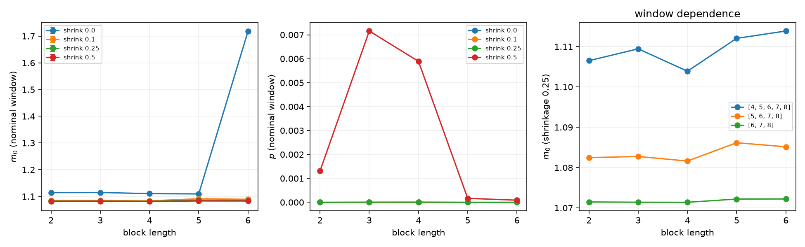
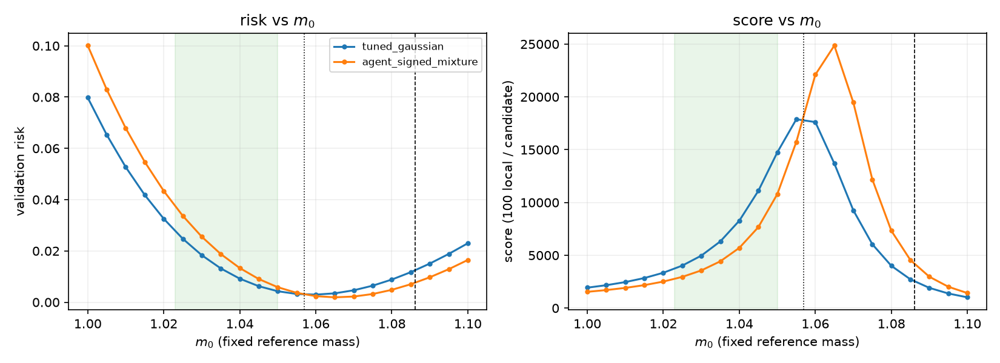

# pion_projection：归档只读诊断（Phase B）

2026-11-18 由 `python -m tasks.pion_projection.audit` 生成。**只读**：不修改、不覆盖
`s16t16_v1`、`s16t16_twostate`、`s16t16_t32` 的任何历史文件。本轮没有 GPU 重测。

## 文件

| 文件 | 内容 |
| --- | --- |
| `inventory.json` | 每个 run 的 `development/validation` NPZ：shape、dtype、finite、sha256、IDs |
| `reference_scan.json` | 单 cosh 参考在 3 个窗口的 mass/SE/χ²/dof/p，以及原始样本协方差的谱、condition number、触及 floor 的个数 |
| `reflection_check.json` | 按真实 `C(t)-C(T-t)` 重算的反射对称 z，与归档值对照 |
| `folded_vs_raw_*.png` | 原始关联函数与折叠后的对照（每个通道一条线） |

## 关键数字

单 cosh 参考（`s16t16_v1`，60 开发组态、12 blocks）：

| 窗口 | m0 | χ²/dof | p | 协方差 condition number | 触及 floor 的维数 |
| --- | ---: | ---: | ---: | ---: | ---: |
| 4–8 | 1.1120 | 299.5/11 | 1.1e-57 | 4.3e296 | 4 |
| 5–8（名义） | 1.0862 | 52.0/8 | 1.7e-8 | 1.0e18 | 1 |
| 6–8 | 1.0722 | 6.3/5 | 0.281 | 8.4e6 | 0 |

- 5 点窗口是 3 通道 × 5 时间 = 15 维，而只有 12 个 block：样本协方差秩 ≤ 11，
  所以有 4 个零特征值；4 点窗口 12 维，有 1 个零特征值。**收缩 + 特征值 floor 让逆可算，
  不等于信息足够**——这正是参考不可识别的一部分。
- 6–8 窗口的 χ² 可以接受，但 mass 已经从 1.112 漂到 1.072；窗口偏移门（2.5σ）不过。

## T=32 的反射假警报

| run | 时间长度 | 归档 z | 按 `C(t)-C(T-t)` 重算 z |
| --- | ---: | ---: | ---: |
| s16t16_v1 | 16 | 1.529 | 1.529 |
| s16t16_t32 | 32 | **274.269** | **2.398** |

归档的 274.27 来自 `experiment.py` 里硬编码的 `raw[..., 1:8] - raw[..., 15:8:-1]`（T=16 专用），
在 T=32 上把两段前向数据相减。修复后 z=2.398 通过阈值 4。

**但这不改变 T=32 的参考结论**：χ²=120.2/11（p=1.6e-20）、窗口偏移 20.3σ/16.3σ 仍然失败，
所以“T=32 没有让参考站住”成立；“T=32 的反射对称失败”不成立。

## 没做的事（NOT_RUN）

- 没有重新做 GPU 反演/测量，所有数字来自归档 NPZ 的 CPU 重算；
- 没有用两态参考重扫三个窗口（`s16t16_twostate` 的 `reference_scan` 这里用的是单 cosh，
  两态结果见 `results/pion_projection/s16t16_twostate/validation_results.json`）；
- 没有对 12 维/15 维协方差做预声明网格的 shrinkage/block 长度扫描（todo Phase B 第 5 条）。

## block 长度 / shrinkage 扫描（预声明网格）

网格在运行前固定：`block_length ∈ {2,3,4,5,6}`，`shrinkage ∈ {0, 0.1, 0.25, 0.5}`；
只用于看参考的可识别性，不用于挑 validation 的最佳值。名义窗口 $[5,6,7,8]$：

| block | 收缩 | blocks | $m_0$ | SE | χ²/dof | p |
| ---: | ---: | ---: | ---: | ---: | ---: | ---: |
| 2 | 0.00 | 30 | 1.1144 | 0.0022 | 1082.8/8 | 2e-228 |
| 2 | 0.25 | 30 | 1.0825 | 0.0027 | 46.3/8 | 2.1e-7 |
| 2 | 0.50 | 30 | 1.0816 | 0.0027 | 25.4/8 | 0.0013 |
| 3 | 0.50 | 20 | 1.0820 | 0.0034 | 21.0/8 | 0.0072 |
| 5 | 0.25 | 12 | 1.0862 | 0.0030 | 52.0/8 | 1.7e-8 |
| 6 | 0.00 | 10 | 1.7173 | 0.0017 | 7687.5/8 | 0 |
| 6 | 0.25 | 10 | 1.0852 | 0.0032 | 54.7/8 | 5e-9 |

- 整个预声明网格里，名义窗口的 p 最大只有 **0.0072**（block 3、shrink 0.5），仍然低于 0.01 的门槛；
  **没有任何一个 block/shrinkage 组合能让参考通过**；
- shrinkage=0 时协方差秩亏，block 6 直接给出 $m_0=1.72$ 的伪解；收缩是“让逆可算”的必要手段，
  但它同时也在掩盖信息不足；
- 在 shrinkage ≥ 0.25 时 $m_0$ 对 block 长度不敏感（1.081–1.086），但**对窗口仍然敏感**
  （4–8 ≈ 1.11，5–8 ≈ 1.085，6–8 ≈ 1.072）。所以失败是模型偏差，不是 block 选择不当。

完整数据见 `stability_scan.json`；这张图由 `tasks/pion_projection/stability_scan.py` 生成。

## block 级校准（todo B9/B10）：一次失败的尝试

`tasks/pion_projection/calibration_blocks.py`：从拟合模型生成 **block 级** 样本（12 个 block），
重建块均值、重新估计协方差（同样的 shrinkage + floor）、重拟合，得到经验 p 值，并用
$(1+k)/(N_{\rm sim}+1)$ 加 Wilson 区间。

| 窗口 | 观测 cost | dof | 渐近 p | 模拟零分布中位数 | 重建 metric p |
| --- | ---: | ---: | ---: | ---: | ---: |
| 4–8 | 299.49 | 11 | 0 | 0.80 | 0.0033 |
| 5–8 | 52.00 | 8 | 0 | 0.39 | 0.0033 |
| 6–8 | 6.26 | 5 | 0.281 | 0.11 | 0.0033 |

**这组 p 值不能用**：模拟用的协方差是从**同一批 12 个 block** 估出来的，零分布因此被压得
远小于 $\chi^2_{\rm dof}$（dof=5 的中位数只有 0.11），p 值退化成 $1/(N_{\rm sim}+1)$。
根因是 15 维数据只有 12 个 block：协方差秩 ≤ 11，而且 $d=15>n=12$ 时 inverse-Wishart
后验本身不是 proper 的，没法给协方差一个合法的先验。

结论：**p 值不是这里的瓶颈**。在 12 个 block、15 维的名义窗口上，参考的可识别性本身就不成立；
要么增加 block（更多组态 / 更小 block 长度），要么换更少参数的参考模型。覆盖检查里的
0/100 误判率同样被这个循环性污染，不能当作校准证据。

## 模型平均与 profile likelihood（todo C1/B7）

`tasks/pion_projection/model_average.py`，权重只用开发集（名义窗口 $[5,6,7,8]$，12 个数据点）：

| 模型 | 参数数 | $m_0$ | bootstrap SE | χ²/dof | AIC 权重 | BIC 权重 |
| --- | ---: | ---: | ---: | ---: | ---: | ---: |
| 单 cosh | 4 | 1.0862 | 0.0031 | 52.0/8 | $2.9	imes10^{-10}$ | $7.6	imes10^{-10}$ |
| 两态 | 8 | 1.0570 | 0.0098 | 0.06/4 | $pprox1$ | $pprox1$ |

验证集上的候选 risk（固定冻结权重）：

| 模型 | local | tuned | SLSQP | 排序 |
| --- | ---: | ---: | ---: | --- |
| 单 cosh | 0.3127 | 0.01256 | 0.00770 | SLSQP 更好 |
| 两态 | 0.5592 | 0.00470 | 0.00484 | **tuned 略好** |

**排序翻转**。BIC 平均后几乎完全等于两态（权重 $pprox1$），但这不是可信的模型平均：

- 单 cosh 的 χ² 太大，权重被压到 $10^{-9}$；两态有 8 个参数对 12 个点、χ²=0.06，
  是**过拟合**，它的低 χ² 不是“模型正确”的证据；
- 两个模型都失配（一个欠拟合、一个过拟合），它们的平均不会自动变可靠——这正是 todo 里
  警告的情况。

**Profile likelihood（B7）**：固定 $m_0$、对 $m_1$ 与幅度做 profile：

$$
\Delta\chi^2(m_0)<1 \;\Longrightarrow\; m_0\in[1.025,\ 1.065],
$$

最佳点 $m_0=1.055$、$m_1-m_0\approx0.82$。这个 $1\sigma$ 宽度约 **0.04**，是 bootstrap SE（0.0098）
的 **4 倍**——两态模型在 $m_0$ 方向有一个“sloppy”方向，$m_1$ 可以补偿 $m_0$ 的变化。
所以两态给出的 $m_0$ 不确定度被 bootstrap 严重低估，不能用于正式评分。

结论：**模型平均和两态参考都不能救这个系综**。参考的可识别性问题是结构性的（12–15 维、12 blocks、
模型失配），要么增加数据/block，要么换一个参考更稳的可观测量。

## legacy 重放验证

`s16t16_v1/submission.json` 早于 reference spec 字段。用 `LATTICEARENA_LEGACY_REFERENCE=1` 在临时目录
重放 `evaluate`：没有 flag 时按契约拒绝，有 flag 时精确复现归档数值（local 0.312670、tuned 0.0125564、
SLSQP 0.0077027，agent/tuned 1.6301 [1.3963, 2.1905]），确认向后兼容路径没有改变统计。

## 分数对参考质量的敏感度（$m_0$ 扫描）

`tasks/pion_projection/m0_scan.py`：固定冻结的候选权重与 late-time metric，把参考质量 $m_0$
从 1.00 扫到 1.10，看 risk 和分数怎么变（不重抽参考质量，只隔离 $m_0$ 的系统误差）：

| $m_0$ | tuned risk | SLSQP risk | tuned score | SLSQP score | risk(tuned/SLSQP) |
| --- | ---: | ---: | ---: | ---: | ---: |
| 1.0862（单 cosh） | 0.01256 | 0.00770 | 2728 | 4556 | 1.670（SLSQP 更好） |
| 1.0570（两态） | 0.00470 | 0.00484 | 17880 | 15737 | 0.880（tuned 更好） |
| 1.0350（GEVP） | 0.01226 | 0.00873 | 6314 | 4431 | 0.702（tuned 更好） |

- 分数在 $m_0\\approx1.06$–$1.07$ 处达到峰值（约 25,000），在两端掉到 1,000–5,000：
  **绝对分数随 $m_0$ 变化约 7 倍**；
- 两个候选的 risk 曲线在 $m_0\\approx1.06$ 附近交叉：低于它 tuned 更好，高于它 SLSQP 更好；
- 结合 GEVP 的 $m_0\\approx1.02$–$1.05$，**排序偏向 tuned**；但单 cosh 的 1.086 给出相反结论。

这说明：在参考质量本身不确定（1.02–1.09）的情况下，pion 的“谁更好”与“多少分”都不是稳定的量。
任何正式分数都必须把 $m_0$ 的系统误差传播进去，或者先认证 $m_0$。

## 固定 $m_0$ 的端到端评分（诊断）

`tasks/pion_projection/evaluate_fixed_m0.py`：把参考质量固定为某个值，只对 validation 做配对
block bootstrap（200×128），得到“如果 $m_0$ 正好是 X，分数会是多少”：

| 参考 | $m_0$ | tuned score | SLSQP score | SLSQP/tuned risk | 结论 |
| --- | ---: | ---: | ---: | ---: | --- |
| 单 cosh | 1.0862 | 2504 | 4098 | 1.629 [1.398, 2.192] | SLSQP 显著更好 |
| 两态 | 1.0570 | 18214 | 18119 | 1.089 [0.659, 2.288] | 打平 |
| GEVP | 1.0350 | 6305 | 4425 | **0.701 [0.679, 0.731]** | tuned 显著更好 |

- 单 cosh 这一行与原始 `evaluate` 的 1.630 [1.396, 2.190] 一致，说明方法正确；
- 两态质量下两者打平，GEVP 质量下 tuned 显著更好；
- 结合 GEVP 的 $m_0\approx1.02$–$1.05$，**排序偏向 tuned**；单 cosh 的 1.086 是唯一给出
  “SLSQP 更好”的参考。

产物：`results/pion_projection/fixed_m0_scores.json`。
