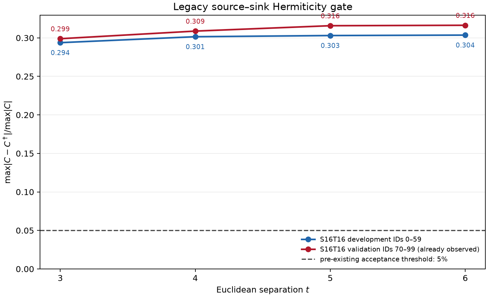

# Legacy source–sink Hermiticity diagnostic

This read-only CPU diagnostic reuses the saved `s16t16_ms` arrays. It does not change the measurement, symmetrize the matrix, rerun a fit, or assign a physical score.

## Result

The pre-existing gate requires `max|C-C†|/max|C| < 0.05`. All evaluated ensemble-mean matrices fail by a wide margin:

| Split | Configurations | t=3 | t=4 | t=5 | t=6 | Gate |
|---|---:|---:|---:|---:|---:|---|
| legacy_development | 60 (IDs 0–59) | 0.2938 | 0.3015 | 0.3030 | 0.3036 | FAIL |
| observed_validation | 30 (IDs 70–99) | 0.2989 | 0.3088 | 0.3158 | 0.3164 | FAIL |

## Interpretation and limits

The plotted values reproduce the existing convention in `gram_identity_check.py`: select sink powers H0/H4/H16, average configurations, transpose to rows=sink and columns=source, then compare `C` with `C†`. The validation split is already observed, so it is displayed only as an observed cross-check and must not be called blind.

These are ratios from the ensemble-mean matrices, not per-configuration estimates; the figures therefore show no statistical error band. Their size establishes that the saved matrices do not satisfy the stated 5% identity gate. It does not establish why the historical mismatch occurred. The source/sink smearing-parameter mismatch documented in the TODO is a testable candidate cause, while the old receipt lacks the software/source hashes needed to prove unique attribution.

Input NPZ and provenance SHA-256 values are recorded in `summary.json`. No new GPU measurement, E anchor, new D validation, or shared holdout data were accessed.
