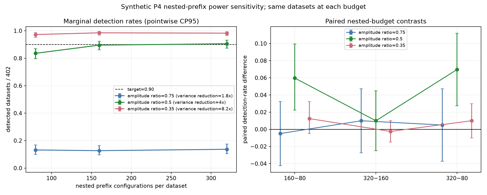

# Wilson P4 nested-prefix paired budget sensitivity

Status: **COMPLETE**; 402 independent synthetic datasets per effect.

Unlike the earlier independent-cell scan, each dataset is generated once at 320 paired configurations. The 80- and 160-configuration cells are literal prefixes of that same dataset. Budget contrasts therefore use paired dataset IDs and do not confuse independent-cell noise with a budget effect.

The dataset is a known single-state signal with an exact synthetic E0 anchor. These results test only the gate and this generator; they do not measure real gauge fields, physical autocorrelation, stout/APE kernels, GPU time, or common model bias.

## Marginal detection rates

| amplitude ratio | variance reduction | configs | detected | CP95 | both gates pass | any abstain | failures |
|---:|---:|---:|---:|---|---:|---:|---:|
| 0.75 | 1.78x | 80 | 53/402 (0.132) | [0.100, 0.169] | 391/402 | 11/402 | 0/402 |
| 0.75 | 1.78x | 160 | 51/402 (0.127) | [0.096, 0.163] | 396/402 | 6/402 | 0/402 |
| 0.75 | 1.78x | 320 | 55/402 (0.137) | [0.105, 0.174] | 397/402 | 5/402 | 0/402 |
| 0.5 | 4x | 80 | 336/402 (0.836) | [0.796, 0.871] | 393/402 | 9/402 | 0/402 |
| 0.5 | 4x | 160 | 360/402 (0.896) | [0.861, 0.924] | 396/402 | 6/402 | 0/402 |
| 0.5 | 4x | 320 | 364/402 (0.905) | [0.873, 0.932] | 396/402 | 6/402 | 0/402 |
| 0.35 | 8.16x | 80 | 391/402 (0.973) | [0.952, 0.986] | 394/402 | 8/402 | 0/402 |
| 0.35 | 8.16x | 160 | 396/402 (0.985) | [0.968, 0.995] | 396/402 | 6/402 | 0/402 |
| 0.35 | 8.16x | 320 | 395/402 (0.983) | [0.964, 0.993] | 395/402 | 7/402 | 0/402 |

## Paired budget differences

Positive values mean the larger budget detected more datasets. The interval is a percentile bootstrap over paired independent dataset IDs; it is not a binomial interval and is not family-wise adjusted.

| amplitude ratio | contrast | difference | paired bootstrap CI95 | higher-only / lower-only / ties |
|---:|---|---:|---|---|
| 0.75 | 80→160 | -0.005 | [-0.042, 0.032] | 28/30/344 |
| 0.75 | 160→320 | 0.010 | [-0.027, 0.047] | 33/29/340 |
| 0.75 | 80→320 | 0.005 | [-0.037, 0.047] | 41/39/322 |
| 0.5 | 80→160 | 0.060 | [0.022, 0.100] | 45/21/336 |
| 0.5 | 160→320 | 0.010 | [-0.025, 0.045] | 28/24/350 |
| 0.5 | 80→320 | 0.070 | [0.027, 0.112] | 54/26/322 |
| 0.35 | 80→160 | 0.012 | [-0.005, 0.032] | 10/5/387 |
| 0.35 | 160→320 | -0.002 | [-0.015, 0.010] | 3/4/395 |
| 0.35 | 80→320 | 0.010 | [-0.010, 0.030] | 10/6/386 |

## Interpretation and limits

The primary follow-up is the weak 1.78x input-variance reduction. The left panel gives its marginal power by budget; the right panel directly estimates how detection changes on the same dataset IDs. A contrast interval spanning zero means this synthetic run does not resolve the budget difference. The 402 datasets remain Monte Carlo realizations, not physical gauge configurations.

Failures remain in every planned denominator as non-detections. Gate abstention, ratio-CI non-detection, and exceptions are kept separate in raw rows. The exact seed, full source manifest, per-dataset budget outcomes, and protocol hash are saved beside this report. `physical_status` remains `NOT_RUN`.
