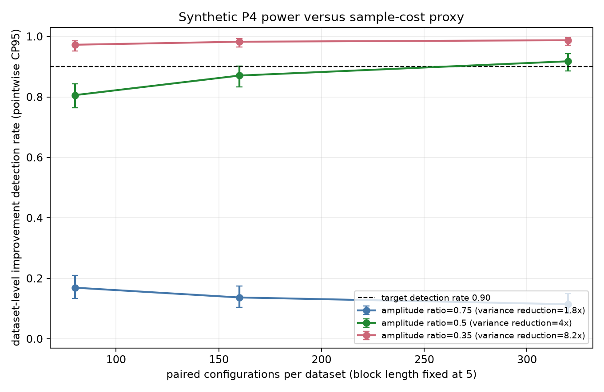

# P4 power-cost scan: interpretation and limits

This note interprets the frozen nine-cell CPU scan in `README.md`; the primary
records remain `raw.json`, `summary.json`, and `protocol.json`.

## What the scan resolves

For the preregistered fourfold **input-noise variance** reduction (candidate
noise-amplitude ratio 0.50), dataset-level detection rises from 324/402
(0.806; CP95 [0.764, 0.843]) at 80 paired configurations, to 350/402
(0.871; [0.834, 0.902]) at 160, and 369/402 (0.918; [0.887, 0.943]) at
320. The frozen target was a point rate of at least 0.90 and a pointwise CP95
lower bound of at least 0.85. Thus 320 configurations is the smallest tested
budget meeting that rule. The final two settings have 399/402 datasets with
both estimator gates passing and zero computational failures; the missed
comparisons are chiefly cases whose risk-ratio lower bound does not clear one.

The stronger 8.16-fold input-variance reduction is already detected in
391/402, 395/402, and 397/402 datasets at 80, 160, and 320 configurations.
The weaker 1.78-fold reduction is detected in 68/402, 55/402, and 46/402;
its pointwise CP95 intervals are [0.134, 0.209], [0.105, 0.174], and
[0.085, 0.150]. The intervals overlap. Both estimator gates pass in
386/402, 396/402, and 400/402 datasets, so most misses at this effect size
come from the comparative interval rather than estimator abstention.

For the weak effect, median point risk ratios are 1.70, 1.77, and 1.75, while
the median per-dataset bootstrap lower bounds are 0.700, 0.718, and 0.734.
The observed detection point estimates are not monotone because the nine cells
use independently generated datasets. Their overlapping MC intervals do not
show that a larger configuration budget lowers power. A nested-prefix scan
would be needed to estimate paired marginal changes in power precisely.

## Scope

The cells use independent synthetic datasets, fixed block length 5, an exact
single-state signal, and an oracle-known $E_0$. The plot and table describe
this generator and the existing gate only. They do not estimate production
power for real gauge configurations, noisy anchors, stout/APE, or HMC. CP95
intervals are pointwise across cells, not family-wise. The configuration count
is a sample-cost proxy; measured CPU seconds are local diagnostics and cannot
be extrapolated to GPU production cost.

The 100 outer bootstrap draws were kept to match the primary positive-control
protocol. The separate 100-versus-1000-draw check found 16 per-dataset
detections gained and 17 lost, with only one fewer detection overall; this
addresses quantile-resolution sensitivity, not independent-configuration
power. `physical_status` remains `NOT_RUN`.
