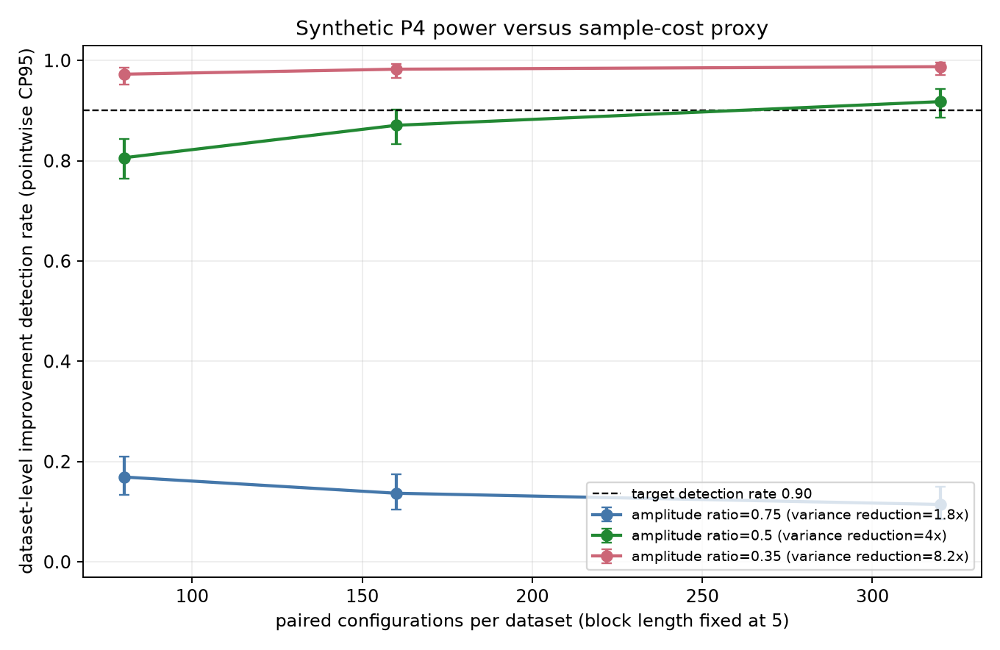

# Wilson P4 power-versus-cost scan (CPU synthetic control)

Status: **COMPLETED**. The preregistration and source hashes are in `protocol.json`; per-dataset gate outcomes, ratio intervals, seeds and failures are in `raw.json`; exact cell summaries are in `summary.json`.

This is a new synthetic oracle-anchor method study, independent of the primary positive-control datasets. It scans 16, 32 and 64 blocks at fixed block length 5 (80, 160 and 320 paired configurations per dataset) and candidate noise-amplitude ratios 0.75, 0.50 and 0.35. Those correspond to input-noise variance reductions of about 1.78x, 4x and 8.16x. Each of the nine cells has 402 independent datasets. The target rule, generator seeds, bootstrap counts and source hashes were frozen before simulation.

The primary planning question is whether the known 4x input-variance reduction reaches a dataset-level detection rate of at least 90%, with a pointwise Clopper-Pearson 95% lower bound of at least 85%, at the smallest tested configuration budget. **For the primary fourfold input-variance-reduction effect, the smallest tested budget meeting the preregistered rule is 320 paired configurations per dataset (64 blocks of length 5).**

| Blocks | Block length | Configurations / dataset | Candidate amplitude ratio | Input variance reduction | Detected | CP95 | Both gates pass | Any gate abstains | Failures | Cell seconds |
|---:|---:|---:|---:|---:|---:|---:|---:|---:|---:|---:|
| 16 | 5 | 80 | 0.75 | 1.78x | 68/402 (0.169) | [0.134, 0.209] | 386/402 | 16/402 | 0/402 | 10.4 |
| 16 | 5 | 80 | 0.50 | 4.00x | 324/402 (0.806) | [0.764, 0.843] | 396/402 | 6/402 | 0/402 | 10.4 |
| 16 | 5 | 80 | 0.35 | 8.16x | 391/402 (0.973) | [0.952, 0.986] | 393/402 | 9/402 | 0/402 | 10.6 |
| 32 | 5 | 160 | 0.75 | 1.78x | 55/402 (0.137) | [0.105, 0.174] | 396/402 | 6/402 | 0/402 | 12.6 |
| 32 | 5 | 160 | 0.50 | 4.00x | 350/402 (0.871) | [0.834, 0.902] | 396/402 | 6/402 | 0/402 | 12.7 |
| 32 | 5 | 160 | 0.35 | 8.16x | 395/402 (0.983) | [0.964, 0.993] | 396/402 | 6/402 | 0/402 | 12.5 |
| 64 | 5 | 320 | 0.75 | 1.78x | 46/402 (0.114) | [0.085, 0.150] | 400/402 | 2/402 | 0/402 | 17.2 |
| 64 | 5 | 320 | 0.50 | 4.00x | 369/402 (0.918) | [0.887, 0.943] | 399/402 | 3/402 | 0/402 | 17.0 |
| 64 | 5 | 320 | 0.35 | 8.16x | 397/402 (0.988) | [0.971, 0.996] | 397/402 | 5/402 | 0/402 | 16.9 |

Cost is reported both as paired configurations per dataset (the planned sample-cost proxy) and measured local CPU walltime per cell. The plot shows how detection rate and pointwise dataset-level intervals vary with budget and effect size. All CI bands are per-cell; there is no family-wise guarantee across the nine comparisons. Failures remain in their planned denominator.

Limits: the signal is exactly single-state and the $E_0$ anchor is known by construction. This does not model estimated-anchor uncertainty, autocorrelation beyond the fixed block model, common physical bias, real gauge fields, stout/APE kernels, HMC, or GPU runtime. It supports only a synthetic planning statement about this gate and this generator; `physical_status` remains `NOT_RUN`.
