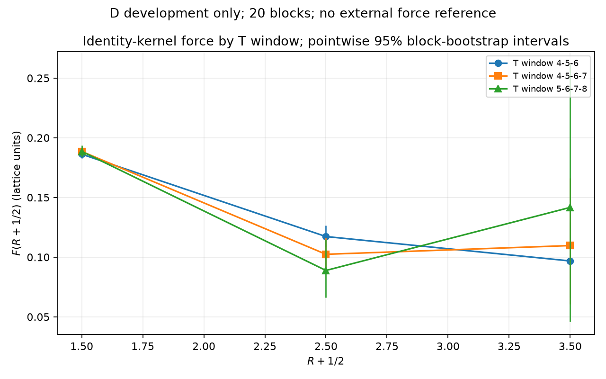
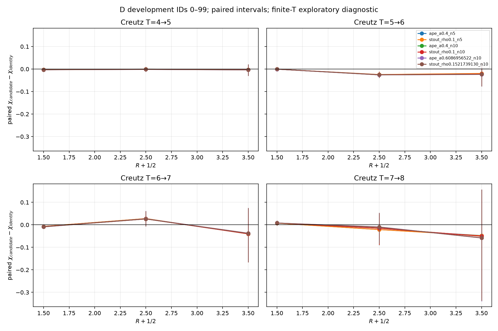

# Wilson D development: offset-insensitive force diagnostics

**Status:** `development_diagnostic_only`; `physical_score=null`; no production gate or estimand was changed.

## Data and frozen identity

- Complete frozen D development transaction only: IDs 0–99; validation, gap, and shared holdout were not read.
- Generation: `dd38c39f21982307c5abc2d5093b93c2aa12ef8848d6f9136519b1f8054b619e`; measurement protocol SHA-256: `e861d2c05e690567cc023cb2929647cbf24465a44faa1cf7b02f19690da56b6c`.
- Protocol file SHA-256: `bf8048ff570df1eed251c4518ea1d4e4a224ee985d4aa4dd0ae0f342de65ced0`; analysis source SHA-256: `128684986808a04f399de1e991805238032a28206a2237525e866214752df989`.
- Block design: 20 contiguous blocks of 5 configurations; 5000 shared block-bootstrap draws; seed 2026112121.
- Complete positive draws: 5000/5000; invalid: 0 (indices `[]`).
- The same resampling rows are used for every kernel, R, T window, and both estimators. Invalid draws are retained in the denominator and are not silently replaced.

## Estimators

- T-window slope: $V_w(R)=-\mathrm{slope}_w[\log\langle W(R,T)\rangle]$, then $F(R+1/2)=V_w(R+1)-V_w(R)$ using the same window and draw.
- Creutz ratio: $\chi(R,T)=-\log\{W(R+1,T+1)W(R,T)/[W(R+1,T)W(R,T+1)]\}$, which approaches the same discrete force in the single-exponential limit.
- Intervals are pointwise percentile intervals over 20 configuration blocks. The 5,000 draws reduce Monte Carlo noise in the bootstrap calculation; they do not create 5,000 independent gauge samples or provide family-wise coverage.

## Identity-kernel T-window sensitivity

| T window | R midpoint | F point | pointwise 95% interval |
|---|---:|---:|---:|
| 4-5-6 | 1.5 | 0.186242 | [0.182784, 0.189838] |
| 4-5-6 | 2.5 | 0.117258 | [0.108628, 0.126466] |
| 4-5-6 | 3.5 | 0.096813 | [0.066103, 0.129294] |
| 4-5-6-7 | 1.5 | 0.188555 | [0.185108, 0.191979] |
| 4-5-6-7 | 2.5 | 0.102391 | [0.088719, 0.116172] |
| 4-5-6-7 | 3.5 | 0.109699 | [0.060511, 0.166121] |
| 5-6-7-8 | 1.5 | 0.188589 | [0.183897, 0.193528] |
| 5-6-7-8 | 2.5 | 0.088838 | [0.066108, 0.114427] |
| 5-6-7-8 | 3.5 | 0.141671 | [0.045839, 0.261250] |

## Paired kernel differences

The paired candidate-minus-identity curves and intervals are in `window_force_paired.csv` and `creutz_force_paired.csv`; figures show them by T window and Creutz time. These differences describe the opened development sample only. A shift in measured force does not identify which kernel is closer to the continuum or ground-state value.

## Interpretation and limits

This diagnostic supplies actual-data evidence for reviewing the static-force branch. It demonstrates how much the candidate force estimates and the identity force depend on the selected T window / Creutz time on this D development sample. It does not establish a plateau, control finite-T excited states, remove R-dependent common bias, calibrate the many (kernel, R, T) comparisons, or provide an external force anchor. The current reference proposal remains unfrozen and D0–99 has already been used for development; therefore this analysis cannot authorize D120–139, open IDs 140–199, claim APE/stout superiority, or assign a physical score.

If the research target is accepted as an additive-constant-insensitive force, freeze the estimator, T window or Creutz rule, finite-T control, multiplicity family, and failure/abstention policy before any new validation. If the target remains absolute V(R), this diagnostic does not supply the missing independent zero-point anchor.

All raw point estimates, paired intervals, draw counts, and resampling indices are preserved beside this report.
