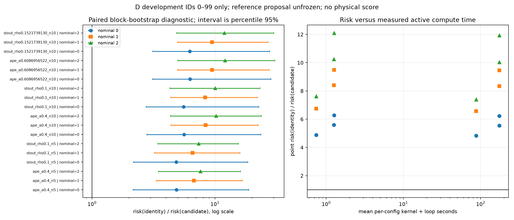

# Wilson D development paired risk/cost diagnostic

**状态：** `development_diagnostic_only`；参考门提案仍 `PROPOSAL_NOT_FROZEN`；`production_score=null`。

## 输入与定义

- 仅使用已提交 D development IDs 0–99；generation `dd38c39f21982307c5abc2d5093b93c2aa12ef8848d6f9136519b1f8054b619e`；同一组loops同时包含identity、APE与stout候选。
- 测量文件sha：NPZ `da8cc5d72481475a8cd6d821692db2e21555c0bd5b1849747dc75a946dbd7209`；provenance `082ad7060e776f6e724ee02ac1de9c94e706332eb875019f3b9d1c45d4e9e82b`；commit `0ff2766e4550d0a687d051f44376af5528cb047b05c556912b50ad5c9833951a`。
- 按冻结 `block_length=5` 聚成 20 个配置块；500 次外层配对块bootstrap、每次 500 个共享内层bootstrap draws，seed=2026112121。两层索引以二进制原样保存。
- 风险沿用 `precision + spread` 定义；每个候选和 identity 使用相同 block/bootstrap draws。表中比值为 `risk(identity)/risk(candidate)`，大于 1 表示该风险泛函在此开发样本上较低。
- nominal reference 分别取三个预声明 T 窗口；这是一项参考窗口敏感性扫描，不以任一窗口选择生产 reference。

## 配对结果

| 候选 | nominal T 窗口（顺序同下列比值） | point ratio [paired bootstrap 95% interval] | 有效外层draw/总数 |
| --- | --- | --- | --- |
| ape_a0.4_n5 | 4–5–6, 4–5–6–7, 5–6–7–8 | 4.875 [2.162, 18.87]; 6.74 [3.338, 16.7]; 7.628 [3.484, 16.1] | 498/500; 498/500; 498/500 |
| stout_rho0.1_n5 | 4–5–6, 4–5–6–7, 5–6–7–8 | 4.84 [2.177, 18.5]; 6.562 [3.22, 16.01]; 7.388 [3.441, 15.53] | 498/500; 498/500; 498/500 |
| ape_a0.4_n10 | 4–5–6, 4–5–6–7, 5–6–7–8 | 5.601 [2.797, 23.6]; 8.405 [4.392, 22.47]; 10.25 [4.36, 23.85] | 498/500; 498/500; 498/500 |
| stout_rho0.1_n10 | 4–5–6, 4–5–6–7, 5–6–7–8 | 5.553 [2.765, 22.77]; 8.342 [4.378, 22.17]; 10.04 [4.29, 23.24] | 498/500; 498/500; 498/500 |
| ape_a0.6086956522_n10 | 4–5–6, 4–5–6–7, 5–6–7–8 | 6.279 [3.107, 28.59]; 9.489 [4.962, 27.66]; 12.11 [4.987, 30.8] | 498/500; 498/500; 498/500 |
| stout_rho0.1521739130_n10 | 4–5–6, 4–5–6–7, 5–6–7–8 | 6.231 [3.125, 27.91]; 9.462 [4.965, 27.04]; 11.94 [4.892, 30.03] | 498/500; 498/500; 498/500 |

## 成本和边界

- 图右侧使用每配置实测 `kernel_seconds_by_candidate + loop_seconds_by_candidate` 的均值；同一单配置测量记录中的 host read、device transfer 与 setup 是共享开销，图中未把它们重复分摊给每个候选。表 `candidate_costs.csv` 同时给出这些共享时间。
- 所有候选在同一 GPU job 顺序测量，所示单配置时间不等价于独立 arm 的 matched-walltime benchmark；job 全程耗时和 setup 规则见关联 scheduler/provenance receipt。
- 这 100 个 development IDs 已用于算法开发，不能作 blind confirmation。风险的分母来自 identity reference，而 reference-window runner 在同一数据上给出 A/B 诊断通过、C joint-max 诊断拒绝；该提案未冻结、也没有 family-wise calibration。共同偏差仍可能同时移动所有窗口。
- 因此结果不能选定生产窗口、认证 ground-state accuracy、证明 APE/stout 物理优劣或产生 `physical_score`；gap 100–119、validation 120–139 和 shared holdout 140–199 均未读取。无效 outer draw 在 CSV 中保留原因，不当作通过。
