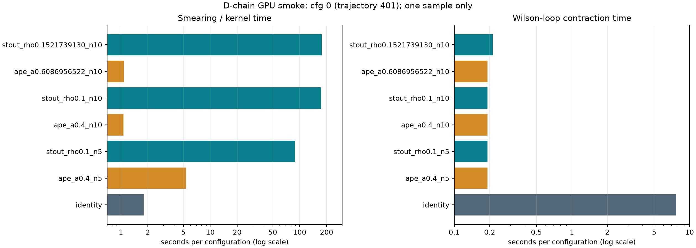

# Wilson D-chain GPU smoke

**Status: one-configuration execution smoke passed; no physics comparison.**

- Configuration `0`, HMC trajectory `401`.
- NERSC checksum: `verified`; raw SHA-256 `955b9a6bc2dd7ceb65236dd8954a873d66f17416fd9fd8503d06f77ffd97fd06`.
- Input manifest SHA-256: `1ab67540cafe1ee12cafb3df653c47f30480e75b41b6b633dd7334c69cdd7f4d`.
- Total `463.45s` = setup `7.14s`, smearing/kernel `447.45s`, loop contraction `8.85s`.

The two 10-step stout candidates dominate runtime at 173.34 s and 176.38 s for this configuration; APE candidates take 1.08–5.35 s. These are single-configuration timings on one DCU, so they estimate execution cost only and do not establish a stable average or a physics preference. The development job should record full wall time and all configuration-specific timings.

The full frozen D development measurement covers IDs 0–99. D IDs 100–119 remain a gap, IDs 120–139 stay gated on the development reference check, and shared IDs 140–199 remain sealed.
