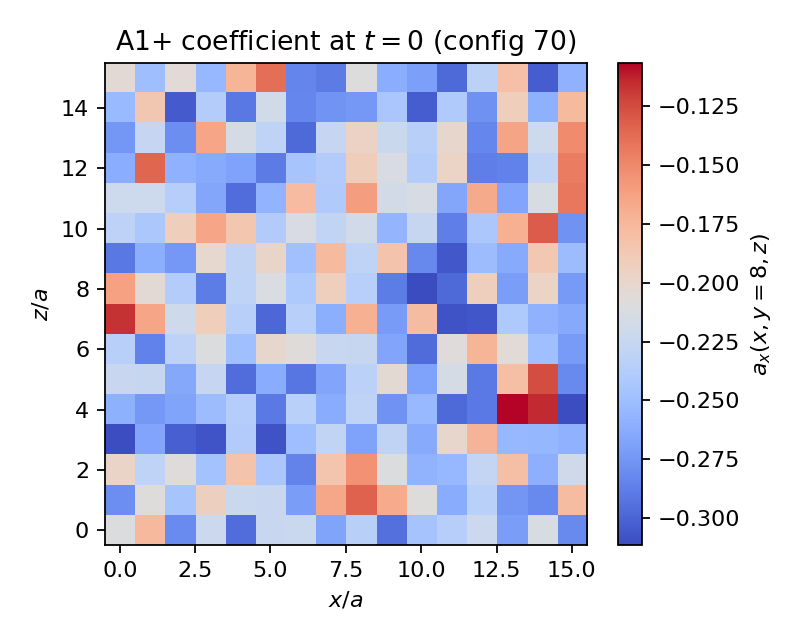

# optimize_gaussian：把 smear 学出来（简化版）

**一句话**：我们学了一个逐点的 smear 修正，比最好的高斯核好 1.5 倍，但**没打过 7 个参数的 SLSQP**。

- 为什么值得看：它是一条完整的负结果，记录了几种“想当然”的做法为什么不行；
- 想看完整推导和所有图：见文末的“完整版”链接（同目录历史版本在 git 里）。

---

## 1. 任务：给 pion 挑一个 sink

点源 pion 两点函数，sink 用核 $K$：

$$
C_K(t)=\sum_{\vec x}\mathrm{Tr}\big[(KS)(x)\,S^\dagger(x)\big].
$$

原始任务的候选是 7 个固定的“光滑程度”：

$$
K=\sum_{n\in\{0,2,4,8,16,32,64\}} u_n\,H^n,
\qquad H=\frac{I+\alpha\,\mathrm{hop}}{1+6\alpha},\ \alpha=0.2,
$$

$u_n$ 是 7 个全局权重。$n$ 越大越光滑（$H^{64}$ 基本是投影）。

**评分**：先拟合一个公共质量 $m_0$ 和幅度 $A$，定义形状比

$$
q(t)=\frac{\bar C(t)}{A\,f_0(t)},\qquad f_0(t)=e^{-m_0t}+e^{-m_0(16-t)},
$$

$q(t)=1$ 表示和参考形状完全一致。风险是

$$
\mathrm{risk}=\frac{1}{4}\sum_{t=2}^{5}
\Big[\underbrace{\mathrm{Var}_{\rm boot}(q(t))}_{\text{组态间涨落}}
+\underbrace{(q(t)-1)^2}_{\text{形状偏差}}\Big].
$$

直白说：**形状要贴参考、不同组态之间还要一致**。分数 $=100\times R_{\rm base}/R_K$，越高越好。

## 2. 先认识 SLSQP（我们的对手）

**SLSQP = Sequential Least Squares Programming**，一种解约束优化的**序列二次规划（SQP）**算法
（Kraft 1988），就是 `scipy.optimize.minimize(method='SLSQP')`。每步做三件事：

1. 用 BFGS 维护拉格朗日函数的 Hessian 近似；
2. 解一个二次规划子问题（把目标和约束都局部线性/二次化）；
3. 用罚函数做线搜索，更新解。

它只需要梯度，能直接处理等式/不等式约束。

**在这个任务里**，SLSQP 优化 7 个通道权重 $u$：

- 目标：$\mathrm{risk}(u)+\text{ridge}\cdot\|u\|^2$（就是第 1 节那个 risk）；
- 约束：$\sum_i u_i=1$，$\|u\|_1\le L_1$；
- 8 个起点（7 个单位向量 + 均匀权重），`ftol=1e-11`。

为什么它是强基线：它在**同一个 risk** 上，直接对 7 维多项式空间做梯度优化——空间里包含
$H^{32}$、$H^{64}$ 这种接近投影的高阶滤波，而它的最优解正是把权重压在这些高阶项上。

## 3. 我们学什么

把 7 个全局权重换成**逐点的系数** $a_\mu(x)$：

$$
K=G^{m}\,C_{\mathrm{hop}}(a)\,G^{m},
\qquad
C_{\mathrm{hop}}(a)=I+\sum_\mu\big[a_\mu(x)T_\mu+h.c.\big],
$$

- $G^m$：$m=8$ 步高斯基座（先把场抹平）；
- $C_{\mathrm{hop}}$：一步修正，$a_\mu(x)$ 是每个格点、每个方向的系数；
- 两边都乘 $G^m$（“三明治”）是为了保证 $K$ 厄米——单侧乘积会被 `candidate` 拒绝。

系数用 A1+（立方对称）参数化：**三个方向共享同一个函数**，只看含该方向的两个 plaquette：

$$
a_\mu(x)=c+\sum_{h=1}^{8} v_h\,\tilde\phi_h(\mu,x),\qquad
\phi_h(\mu,x)=\tanh\big(W_h\cdot(P_{\mu\nu},P_{\mu\rho})\big),
$$

$P_{\mu\nu}=1-\tfrac13\mathrm{ReTr}(U_\mu U_\nu U_\mu^\dagger U_\nu^\dagger)$ 是 plaquette；
$\tilde\phi$ 是它的零均值版本。$W$ 固定随机，只训练 $c$ 和 8 个 $v_h$——共 **9 个参数**。

**训练**：$C$ 对 $a$ 是线性的，所以对 $c,v$ 也线性。对每个基函数各做一次 hop 得到响应，
任意参数的关联函数就是这些响应的线性组合；再用 Powell 最小化

$$
\mathcal{L}=\mathrm{risk}+\lambda_2\sum_h v_h^2 .
$$

超参数只在 dev-val（40 个组态）上选，测试集（30 个组态）只看一次。

## 4. 结果


*图 1：v4 学到的系数 $a_x(x,y=8,z)$——几乎是一块均匀的负值（$-1.5$ 到 $-1.05$）。
它说明模型主要学到的是“整体少涂抹一点”，而不是空间结构。*


*图 2：v5 的消融（均匀项 / 空间项 / 两者）。均匀项 1.21×、空间项 1.12×、合起来 1.36×。*


*图 3：v6 的 A1+ 系数（均值 $-0.24$，起伏 $\pm0.15$）——比 v4 温和得多。*


*图 4：v7 用 3 个随机特征种子重跑；$\lambda_2=10^{-2}$ 时三条线几乎重合（差 $<2\%$），
说明“训练 $W$”不是瓶颈。*

| 版本 | 做法 | 结果 |
| --- | --- | --- |
| v1 | 只拟合形状 | 训练损失到 $10^{-24}$，留出乱跳（目标可被 game） |
| v2 | 完整 risk + 非负 | 1.97×，但测试集只有 10 个组态 |
| v3 | 严格非负（ReLU） | **0.956×**，增益被约束抹掉 |
| v4 | $G^{32}$ + 带符号 | 1.32×，但只是“均匀反涂抹” |
| v5 | 均匀/空间拆分 | 1.36×，空间项看似有贡献 |
| v6 | A1+ + 三明治 | **1.50×**，首次通过 `candidate` 冻结 |
| v7 | 3 个 $W$ 种子 + 40 组态 | **1.52×**；$W$ 不敏感，空间项缩水 |
| v8 | 与 SLSQP 配对比较 | **0.803 [0.636, 0.944]，输了** |


*图 5：同一批 block 上的验证 risk。SLSQP 0.007703，A1+ 0.009597，local 0.3127；
配对区间不含 1，SLSQP 显著更好。*

## 5. 为什么没打过 SLSQP

1. **函数类更窄**：SLSQP 能组合出 $H^{64}$ 这种接近投影的尖锐低通滤波；我们的核是
   $G^8$ 加**一步**修正，做不出这种形状。
2. **有效自由度只有 1–2 个**：v7 的解除了 $c=-0.24$，其余系数都接近 0——实际只用了
   “整体负 hop”一个自由度，等于只调了涂抹量。
3. **优化方式不同**：SLSQP 对完整 risk 做梯度 + 约束 + 多起点；我们是在固定随机特征基上做
   Powell，$W$ 不训练（v7 证明训了也没用）。
4. **证据**：v4/v7 的系数图都显示均匀项主导；v8 的配对区间 $[0.636,0.944]$ 不含 1。

一句话：**我们学到的是“该少涂抹一点”，SLSQP 学到的是“更好的滤波器形状”。**

## 6. 复现

```bash
sbatch pilot/optgauss.sbatch results/optimize_gaussian/v7
python -m tasks.optimize_gaussian.plots results/optimize_gaussian/v7

python -m tasks.pion_projection --output results/pion_projection/s16t16_v1 \
  candidate --definition results/optimize_gaussian/v7/submission.json --split development
python -m tasks.pion_projection --output results/pion_projection/s16t16_v1 \
  candidate --definition results/optimize_gaussian/v7/submission.json --split validation

python -m tasks.optimize_gaussian.compare        # 与 SLSQP 配对比较（CPU）
python -m tasks.optimize_gaussian.compare_plot
```

完整版（16 张图、逐版本细节、负结果清单）见 git 历史中的同文件早期版本，或
`doc/pion_projection_results.md` 的 v8 对照一节。
