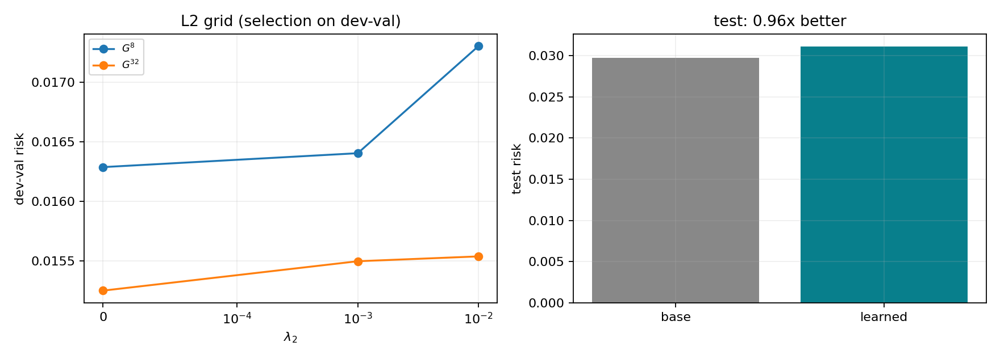
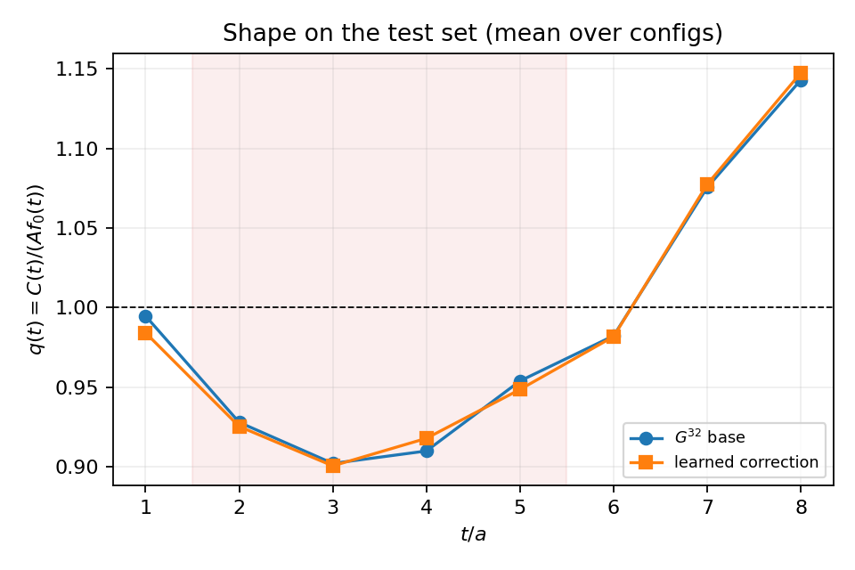
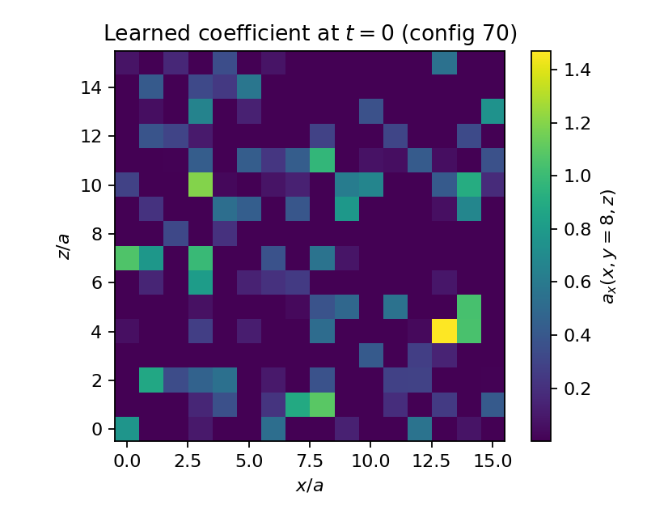
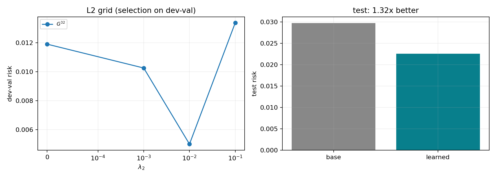
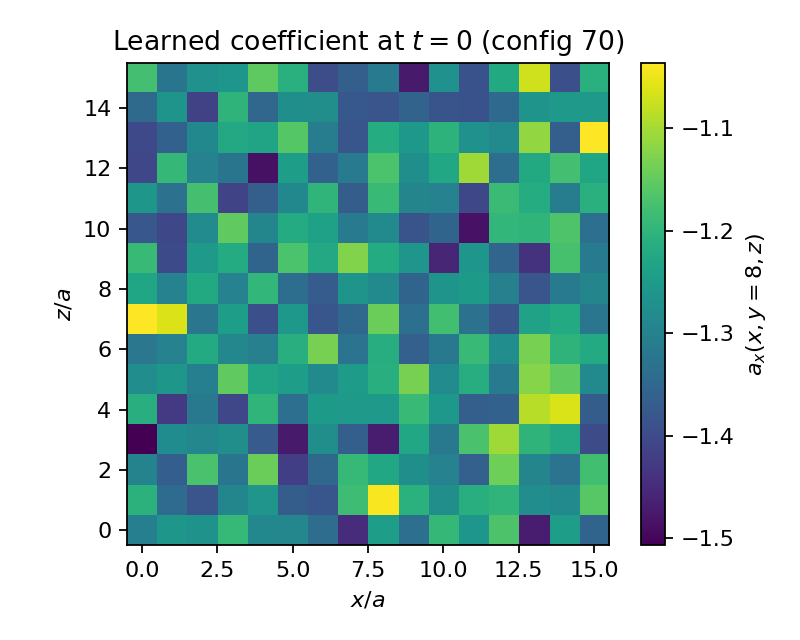
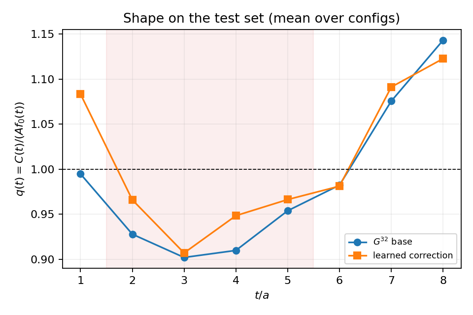
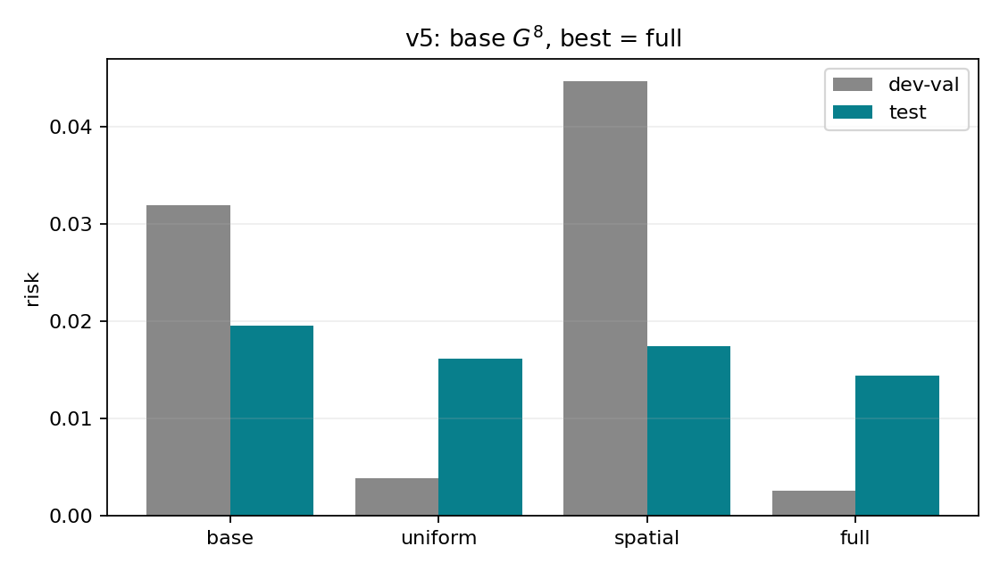
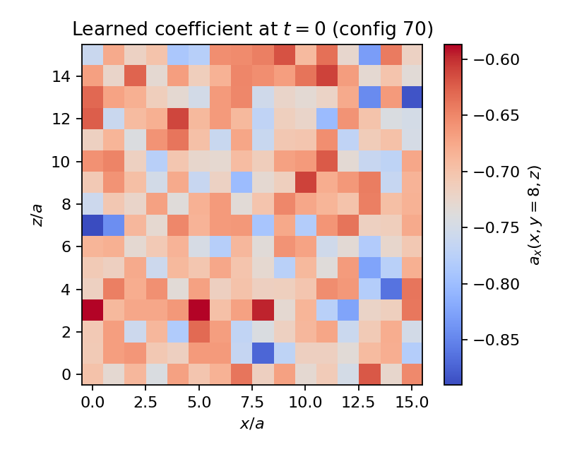
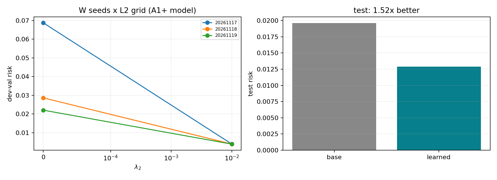
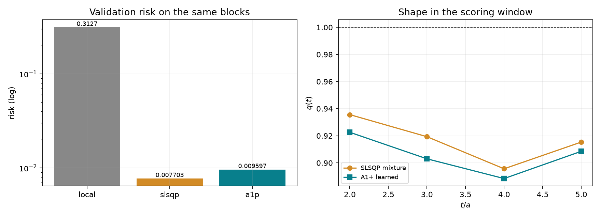

# optimize_gaussian：把 smear 学出来（完整记录）

这个目录记录了一条完整的负结果：**用神经网络学一个 gauge-invariant 的 smear 核，能不能超过
固定多项式 $H^n$ 和 SLSQP 优化出来的混合核？** 结论是：能超过高斯基座（约 1.5 倍），但
**打不过 7 个参数的 SLSQP 混合**。

本文按版本记录每次做了什么、生成了哪些图、以及为什么最后输给 SLSQP。所有数字都来自
`results/optimize_gaussian/` 下的产物。

---

## 1. 任务背景

$p=0$ 的 pion 两点函数，源是点源，sink 是候选核 $K$：

$$
C_K(t)=\sum_{\vec x}\mathrm{Tr}\Big[\big(K S\big)(x)\,S^\dagger(x)\Big],
$$

候选族在原始任务里是 7 个固定的幂次 $H^n$（$n=0,2,4,8,16,32,64$），

$$
H=\frac{I+\alpha\,\mathrm{hop}}{1+6\alpha},\qquad \alpha=0.2,
$$

提交形式是 7 个全局权重 $u_n$ 的混合 $K=\sum_n u_n H^n$。评分风险是

$$
\mathrm{risk}(K)=\frac{1}{|W|}\sum_{t\in W}
\Big[\mathrm{Var}_{\mathrm{boot}}\big(q_K(t)\big)+\big(q_K(t)-1\big)^2\Big],
\qquad
q_K(t)=\frac{\bar C_K(t)}{A_K f_0(t)},
$$

$$
f_0(t)=e^{-m_0 t}+e^{-m_0(16-t)},\qquad m_0=1.0861669,
$$

$W=\{2,3,4,5\}$ 是评分窗，$A_K$ 由 $t=6,7,8$ 的幅度窗口拟合。分数 $=100\,R_{\rm base}/R_K$。

**我们的问题**：把 $u_n$ 换成**逐点的、依赖 gauge 场的系数** $a_\mu(x)$，让网络自己学 smear。

---

## 2. 学习核的模型

### 2.1 核的形式

在时间片内定义一步协变跳跃的修正算子，用**三明治**形式夹在多步高斯基座中间：

$$
K = G^{m}\,C_{\mathrm{hop}}(a)\,G^{m},\qquad G = I + a_0\,\mathrm{hop},\qquad a_0=\frac{\alpha}{1+6\alpha},
$$

$$
C_{\mathrm{hop}}(a) = I + \sum_{\mu}\Big[\,a_\mu(x)\,T_\mu + b_\mu(x)\,T_\mu^{\dagger}\,\Big],
\qquad (T_\mu q)(x)=U_\mu(x)\,q(x+\mu),
\qquad b_\mu(x)=a_\mu(x-\mu).
$$

### 2.2 为什么必须三明治

单侧乘积 $G^m C_{\mathrm{hop}}$ **一般不是厄米算子**：$G$ 是平移协变的，而 $a_\mu(x)$ 依赖格点，
二者不对易。`candidate` 会直接拒绝非厄米核（“Non-Hermitian/complex correlator”）。
训练里的关联函数本来就是

$$
\langle G^m S,\,C_{\mathrm{hop}}\,G^m S\rangle=\langle S,\,G^m C_{\mathrm{hop}}G^m S\rangle,
$$

所以提交时必须写 $G^m C_{\mathrm{hop}}G^m$。这是 v6 被官方路径抓到的 bug。

### 2.3 A1+ 参数化

三个方向共享同一个函数，且只依赖“含该方向的两个 plaquette”：

$$
a_\mu(x) = c + \sum_{h} v_h\,\tilde\phi_h(\mu,x),\qquad
\tilde\phi_h(\mu,x)=\phi_h(\mu,x)-\frac1V\sum_{x'}\phi_h(\mu,x'),
$$

$$
\phi_h(\mu,x)=\tanh\!\Big(W_h\cdot\big(P_{\mu\nu}(x),\,P_{\mu\rho}(x)\big)\Big),
\qquad
P_{\mu\nu}=1-\tfrac13\mathrm{ReTr}\,U_\mu U_\nu U_\mu^\dagger U_\nu^\dagger,
$$

$\nu,\rho$ 是另外两个方向。这样在立方旋转下三个 $a_\mu$ 一起置换，属于 A1+ 通道；
$W$ 固定随机，$c$ 与 $v_h$ 训练——一共 **9 个参数**（$H=8$）。

### 2.4 为什么必须 A1+

v5 允许逐方向独立的 $c_\mu$，优化器给出

$$
(c_x,c_y,c_z)=(-0.70,\ 0.0007,\ 0.0003),
$$

纯 $x$ 方向的修正，破坏立方对称。这是对有限样本各向异性噪声的过拟合；约束回 A1+ 之后
测试集反而从 1.36× 提升到 1.50×。

---

## 3. 训练

$C_\theta(t)$ 对 $a$ 线性，因此对 $c,v$ 也线性。对 identity、常数项、$H$ 个零均值特征项各做一次
hop 得到响应 $D_p(t)$，任意参数下

$$
C_\theta(t)=C_0(t)+c\,D_c(t)+\sum_{h=1}^{H} v_h D_h(t),
$$

训练就是在预计算基上用 Powell 最小化

$$
\mathcal{L}(\theta)=\mathrm{risk}\big(C_\theta\big)+\lambda_2\sum_h v_h^2,
$$

参数有界 $|c|,|v_h|\le 3$。超参数只在 dev-val 上选，测试集只看一次。

---

## 4. 逐版本记录

### v1：只拟合形状 → 退化

最初的目标是“让 $C(t)$ 尽量贴近参考的 $\cosh$ 形状”，24 个逐点参数，10 个训练组态。
训练损失从 0.256 降到 $6\times10^{-24}$，但留出损失在 0.05 / 0.34 / 0.65 之间乱跳。

**教训**：线性基足以用负权重把 $C(t)$ 拼成任何形状（包括参考的 $\cosh$），而这个目标本身
可以被 game。当时没有保存关联函数，所以没有图，只有 `results/optimize_gaussian/smoke*/` 的 JSON。

### v2：完整 risk + 单步基座 + 非负

改成完整 risk，基座 $G^8$，$v\ge0$，$\lambda_2$ 网格，dev-val 10 组态：

$$
\mathrm{risk}_{\rm base}=0.03844,\qquad
\mathrm{risk}_{\rm learned}=0.01952\ (1.97\times).
$$

但测试集只有 10 个组态、block=2，且权重撞到上界。只保存了 JSON，没有图。

### v3：两个基座 + 严格非负 → 增益消失


*图 v3-1：左为 $G^8/G^{32}\times\lambda_2$ 的 dev-val 网格，右为测试集 base vs learned。*

| 基座 | $\lambda_2=0$ | $10^{-3}$ | $10^{-2}$ |
| --- | ---: | ---: | ---: |
| $G^8$ | 0.01629 | 0.01640 | 0.01731 |
| $G^{32}$ | 0.01525 | 0.01550 | 0.01554 |

$$
\mathrm{risk}_{\rm base}=0.02973,\qquad
\mathrm{risk}_{\rm learned}=0.03109,\qquad
\frac{\rm base}{\rm learned}=0.956.
$$

**结论**：严格非负（ReLU 特征 + $v\ge0$）把增益抹掉了，学到的修正反而略差。


*图 v3-2：测试集上的 $q(t)=C/(A f_0)$；learned 曲线在评分窗内离 1 更远。*


*图 v3-3：$t=0$、组态 70 上的学到的 $a_x(x,y=8,z)$。换成 ReLU 后非负（$4.5\times10^{-5}$ 到 1.47），但只在一部分格点激活。*

> 这一版还抓到一个真 bug：最初用 $\tanh$ 特征却声称 $\phi\ge0$，图里一片负值（低到 $-1.5$）。
> 换成 ReLU 后非负才真正成立。

### v4：$G^{32}$ + 带符号 → 1.32×，但只是反涂抹

允许 $v\in[-3,3]$，4 个 $\lambda_2$：

| $\lambda_2$ | 0 | $10^{-3}$ | $10^{-2}$ | $10^{-1}$ |
| --- | ---: | ---: | ---: | ---: |
| dev-val | 0.011906 | 0.010256 | **0.004991** | 0.013380 |

$$
\mathrm{risk}_{\rm base}=0.029732,\qquad
\mathrm{risk}_{\rm learned}=0.022552,\qquad
\frac{\rm base}{\rm learned}=1.318.
$$


*图 v4-1：$\lambda_2$ 网格与测试集对比。*


*图 v4-2：学到的 $a_x$ 几乎是一块均匀的负值（$-1.5$ 到 $-1.05$，起伏只有 $\pm0.2$）。*

**结论**：1.32× 主要来自“整体负 hop”，即在过涂抹的 $G^{32}$ 之后做一步反涂抹（sharpening）；
逐点自适应只占很小一部分。


*图 v4-3：$q(t)$ 形状对比。*

### v5：均匀项 vs 空间项消融 → 两者都有一点

把系数拆成均匀项 $c$ 加零均值空间项，分别在 $G^8$ 上训练三个模型：

| 模型 | 参数 | dev-val | 测试 | 相对基座 |
| --- | ---: | ---: | ---: | ---: |
| base $G^8$ | — | 0.031973 | 0.019600 | 1.000 |
| uniform（只 $c$） | 3 | 0.003866 | 0.016165 | 1.212 |
| spatial（只 $v$） | 24 | 0.044755 | 0.017460 | 1.123 |
| **full（$c+v$）** | 27 | **0.002574** | **0.014457** | **1.356** |


*图 v5-1：base / uniform / spatial / full 的 dev-val 与 test risk。*


*图 v5-2：v5 的系数图——均值约 $-0.7$、起伏约 $\pm0.4$，但注意它是**逐方向独立**的（这就是后来被 A1+ 否掉的原因）。*


*图 v5-3：$q(t)$ 形状。*

**结论**：均匀项 1.21×、空间项 1.12×、合起来 1.36×——空间项看起来有独立贡献，但 v7 在更大的
选择集上发现这部分会缩水。

### v6：A1+ + 三明治 → 1.50×，首次通过 `candidate` 冻结

$$
\theta=[-0.236,\ 0.026,\ 0.047,\ 0.054,\ 0.003,\ -0.157,\ -0.116,\ 0.171,\ -0.066],
$$

$$
\mathrm{risk}_{\rm base}=0.019600,\qquad
\mathrm{risk}_{\rm learned}=0.013087,\qquad 1.498\times.
$$


*图 v6-1：A1+ 模型的 $\lambda_2$ 网格与测试集对比。*


*图 v6-2：A1+ 系数图（$a_x\in[-0.34,-0.05]$，均值 $-0.236$）：温和的负 hop 加 $\pm0.15$ 的空间调制。*


*图 v6-3：$q(t)$ 形状。*

正式 `candidate` 冻结：risk 0.009811，诊断比 31.9 [15.8, 91.3]，`score = null`（参考 gate 未过）。

> 官方路径抓到两个 bug：NumPy 的 `links` 与 CuPy 的 `field` 混用；单侧乘积非厄米。

### v7：3 个 W 种子 + 40 组态 dev-val → 1.52×，W 不是瓶颈

| seed | $\lambda_2=0$ | $\lambda_2=10^{-2}$ |
| --- | ---: | ---: |
| 20261117 | 0.068726 | 0.003973 |
| 20261118 | 0.028620 | 0.003953 |
| 20261119 | 0.022049 | **0.003906** |

$$
\mathrm{risk}_{\rm base}=0.019600,\qquad
\mathrm{risk}_{\rm learned}=0.012870,\qquad 1.523\times.
$$

$$
\theta=[-0.236,\ -0.000,\ 0.010,\ 0.022,\ -0.019,\ -0.014,\ -0.027,\ -0.150,\ -0.012].
$$


*图 v7-1：三个随机特征种子 × $\lambda_2$ 的 dev-val；$\lambda_2=10^{-2}$ 时三者几乎重合（差 $<2\%$）。*


*图 v7-2：v7 的系数图——几乎是纯均匀项，空间调制很弱。*


*图 v7-3：$q(t)$ 形状。*

正式冻结：risk 0.009597，诊断比 32.6 [16.1, 95.2]，`score = null`。

**结论**：$W$ 的随机种子几乎不影响结果（dev-val 差 $<2\%$），说明“训练 $W$”不是瓶颈；
同时 40 组态上选出的解几乎只有均匀项，v5 的“空间项贡献”被证明主要是噪声。

### v8：与 SLSQP 混合的配对比较 → 输了

把 A1+ 候选和 pion run 的 7 个通道拼成 8 通道数组，在同一批 block、同一个参考质量、同一组
bootstrap 抽样上比较（200×128 嵌套 bootstrap）：

| 候选 | 验证 risk |
| --- | ---: |
| local | 0.312670 |
| SLSQP 混合（7 参数） | **0.007703** |
| A1+ learned（9 参数） | 0.009597 |

$$
\frac{\mathrm{risk}_{\rm SLSQP}}{\mathrm{risk}_{\rm A1+}}=0.803,
\qquad 95\%\ \text{区间}\ [0.636,\ 0.944].
$$

区间不含 1：**SLSQP 显著更好**（A1+ 的 risk 高约 25%）。


*图 v8-1：左为同批 block 上的验证 risk（对数轴），右为评分窗内的 $q(t)$。*

---

## 5. 图目录

| 图 | 文件 | 内容 |
| --- | --- | --- |
| v3-1 | `results/optimize_gaussian/v3/fig_risk.png` | 两个基座 × $\lambda_2$ 网格 + 测试对比 |
| v3-2 | `results/optimize_gaussian/v3/fig_q.png` | 测试集 $q(t)$ |
| v3-3 | `results/optimize_gaussian/v3/fig_coeff.png` | 非负系数图（ReLU） |
| v4-1 | `results/optimize_gaussian/v4/fig_risk.png` | $\lambda_2$ 网格 + 测试对比 |
| v4-2 | `results/optimize_gaussian/v4/fig_coeff.png` | 近乎均匀的负系数 |
| v4-3 | `results/optimize_gaussian/v4/fig_q.png` | $q(t)$ |
| v5-1 | `results/optimize_gaussian/v5/fig_models.png` | uniform/spatial/full 消融 |
| v5-2 | `results/optimize_gaussian/v5/fig_coeff.png` | 逐方向系数图 |
| v5-3 | `results/optimize_gaussian/v5/fig_q.png` | $q(t)$ |
| v6-1 | `results/optimize_gaussian/v6/fig_risk.png` | A1+ 网格 + 测试对比 |
| v6-2 | `results/optimize_gaussian/v6/fig_coeff.png` | A1+ 系数图 |
| v6-3 | `results/optimize_gaussian/v6/fig_q.png` | $q(t)$ |
| v7-1 | `results/optimize_gaussian/v7/fig_risk.png` | 3 个 $W$ 种子 × $\lambda_2$ |
| v7-2 | `results/optimize_gaussian/v7/fig_coeff.png` | 几乎均匀的 A1+ 系数 |
| v7-3 | `results/optimize_gaussian/v7/fig_q.png` | $q(t)$ |
| v8-1 | `results/pion_projection/s16t16_v1/candidates/f686a72d9c868716/fig_compare.png` | 与 SLSQP 的配对比较 |

---

## 6. SLSQP 是什么

**SLSQP** = Sequential Least Squares Programming，是 Dieter Kraft（1988）提出的一种
**序列二次规划（SQP）** 算法，`scipy.optimize.minimize(method='SLSQP')` 就是它。

### 6.1 算法本身

要在约束下最小化 $f(x)$：

$$
\min_x f(x)\quad \text{s.t.}\quad c_i(x)=0,\ \ d_j(x)\ge 0,
$$

SQP 在每一步 $x_k$ 处：

1. 用 BFGS 更新拉格朗日函数的 Hessian 近似 $B_k$；
2. 解一个**二次规划子问题**（QP）：

$$
\min_p\ \nabla f(x_k)^Tp+\tfrac12 p^TB_kp
\quad\text{s.t.}\quad
\nabla c_i(x_k)^Tp+c_i(x_k)=0,\ \
\nabla d_j(x_k)^Tp+d_j(x_k)\ge 0;
$$

3. 用 L1 罚函数做线搜索，得到步长，更新 $x_{k+1}=x_k+\alpha p$。

“Least Squares”指的是子问题里用最小二乘解 QP。它的优点是能直接处理**等式和不等式约束**，
且只需要梯度（不需要 Hessian 的解析式）。

### 6.2 在这个任务里它优化什么

`develop` 里的 SLSQP 优化的是 7 个**归一化通道权重** $u\in\mathbb{R}^7$：

- **目标**：$\mathrm{risk}(u)+\text{ridge}\cdot\|u\|^2$，其中 risk 就是上面的完整风险
  （bootstrap 方差项 + 偏离项），在按通道幅度归一化后的关联函数上计算；
- **约束**：$\sum_i u_i=1$（等式），$\|u\|_1\le L_1$（不等式）；
- **边界**：$|u_i|\le L_1$；
- **多起点**：7 个单位向量 + 均匀权重，共 8 个起点，`ftol=1e-11`；
- 最后把 $u$ 按通道幅度缩放回去，得到提交权重。

换句话说，SLSQP 在**同一个 risk** 上、用**梯度 + 约束 + 多起点**，把 7 维多项式空间
$\mathrm{span}\{H^0,H^2,\dots,H^{64}\}$ 搜了一遍。

---

## 7. 为什么学习核没有 SLSQP 好

### 7.1 函数类更窄（最根本的原因）

SLSQP 的搜索空间是 7 个 $H^n$ 的任意线性组合，其中包含 $H^{32}$、$H^{64}$ 这种**接近投影算子**
的高阶滤波。它的最优解把绝大部分权重放在高阶项上（归一化权重约
$[-0.16,-0.03,0.04,0.13,0.23,0.34,0.45]$，$H^{32}/H^{64}$ 占主导），也就是
“投影到低能子空间”的滤波。

我们的核是 $K=G^8\,C_{\mathrm{hop}}(a)\,G^8$：基座只有 8 步，修正只有**一步** hop，
且系数被 A1+、零均值、9 个参数限制住。它**做不出 $H^{64}$ 那种尖锐的低通投影**——
最多只能把 $G^8$ 的涂抹量整体调一调、再加一点局域调制。

### 7.2 有效自由度只有 1–2 个

v7 在 40 个 dev-val 组态上选出的参数是

$$
\theta=[-0.236,\ -0.000,\ 0.010,\ 0.022,\ -0.019,\ -0.014,\ -0.027,\ -0.150,\ -0.012],
$$

除了 $c=-0.236$，特征系数全在 $|\cdot|\le0.15$。v4 的系数图更直接：$a\approx-1.3$ 几乎是一块
常数。也就是说，优化器实际只用了“整体负 hop”这一个自由度（把涂抹量调对），
9 个参数里真正起作用的只有 1 个。

### 7.3 优化方式不同

- SLSQP 直接对**完整 risk** 做梯度优化，有约束、多起点、收敛到 $10^{-11}$；
- 我们是在**固定的随机特征基**上做 Powell 搜索：$W$ 不训练（v7 证明训练它也没用），
  基函数是 $\tanh(W_h\cdot f)$ 的线性组合，表达能力受限于随机特征；
- 我们的“线性响应”技巧让训练很便宜，但也把模型锁在“单步修正”的线性族里。

### 7.4 证据

- v8 的配对比较：$\mathrm{risk}_{\rm SLSQP}/\mathrm{risk}_{\rm A1+}=0.803$，
  95% 区间 $[0.636,0.944]$，不含 1；
- v4 与 v7 的系数图都显示“均匀项主导”；
- v5 的“空间项贡献 11%”在 v7 的 40 组态选择集上缩水到几乎为零。

**一句话**：我们学到的不是“更好的滤波器形状”，而是“该少涂抹一点”；而 SLSQP 在 7 维里
已经把这个形状（包括高阶投影项）优化好了。

---

## 8. 负结果清单

| 版本 | 尝试 | 结果 |
| --- | --- | --- |
| v1 | 只拟合形状 | 目标可被 game，训练到 $10^{-24}$，留出乱跳 |
| v2 | 完整 risk + 非负 | 1.97×，但测试集太小、权重撞界 |
| v3 | 严格非负（ReLU） | 0.956×，增益被约束抹掉 |
| v3′ | $\tanh$ 特征却声称非负 | bug：系数低到 $-1.5$，图里一眼看出 |
| v4 | $G^{32}$ + 带符号 | 1.32×，但只是均匀反涂抹 |
| v5 | 逐方向独立 | 1.36×，但破坏 A1+（$c_x\neq c_{y,z}$） |
| v6 | A1+ + 三明治 | 1.50×，通过 `candidate` 冻结；抓到两个接口 bug |
| v7 | 3 个 $W$ 种子 + 40 组态 | 1.52×；$W$ 不敏感，空间项很弱 |
| v8 | 与 SLSQP 配对 | 0.803 [0.636, 0.944]，**没有超过** |

---

## 9. 复现

```bash
# 在 kunshan DCU 节点上（需要 PyQUDA + cupy + pion 传播子缓存）
sbatch pilot/optgauss.sbatch results/optimize_gaussian/v7
python -m tasks.optimize_gaussian.plots results/optimize_gaussian/v7

# 用官方 candidate 流程冻结（v7 的模型）
python -m tasks.pion_projection --output results/pion_projection/s16t16_v1 \
  candidate --definition results/optimize_gaussian/v7/submission.json --split development
python -m tasks.pion_projection --output results/pion_projection/s16t16_v1 \
  candidate --definition results/optimize_gaussian/v7/submission.json --split validation

# 与 SLSQP 的配对比较（CPU 即可）
python -m tasks.optimize_gaussian.compare
python -m tasks.optimize_gaussian.compare_plot
```

单次 v7 约 20 分钟：3 个种子 × 60 个组态 × 16 时间片 × (8 步基座 + 10 个基响应)。
