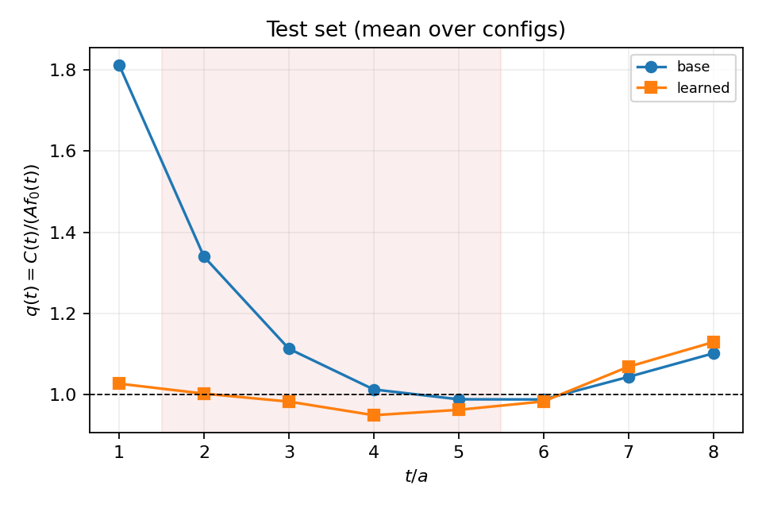
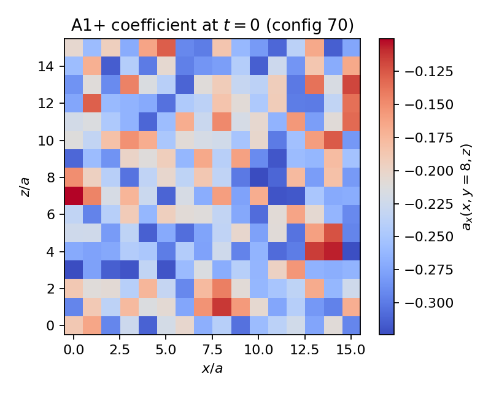

# optimize_gaussian: learned gauge-invariant smear

$p=0$ pion sink：把候选从固定的 $H^n$ 多项式换成**学出来的**逐点 hopping 系数，并且能通过
LatticeArena 的正式 `candidate` 冻结流程提交。

## 模型（A1+，三明治形式）

$$
K = G^{m}\,C_{\mathrm{hop}}(a)\,G^{m},\qquad G = I + a_0\,\mathrm{hop},\qquad a_0=\frac{\alpha}{1+6\alpha}
$$

$$
C_{\mathrm{hop}}(a) = I + \sum_{\mu}\Big[\,a_\mu(x)\,T_\mu + b_\mu(x)\,T_\mu^{\dagger}\,\Big],
\qquad (T_\mu q)(x)=U_\mu(x)\,q(x+\mu),
\qquad b_\mu(x)=a_\mu(x-\mu)
$$

系数在 **A1+ 立方通道**里参数化（三个方向共享同一个函数）：

$$
a_\mu(x) = c + \sum_{h} v_h\,\tilde\phi_h(\mu,x),\qquad
\tilde\phi_h(\mu,x)=\phi_h(\mu,x)-\frac1V\sum_{x'}\phi_h(\mu,x'),
$$

$$
\phi_h(\mu,x)=\tanh\!\Big(W_h\cdot\big(P_{\mu\nu}(x),\,P_{\mu\rho}(x)\big)\Big),
\qquad \nu,\rho\ \text{是另外两个方向},
$$

$P_{\mu\nu}=1-\tfrac13\mathrm{ReTr}\,U_\mu U_\nu U_\mu^\dagger U_\nu^\dagger$。$W$ 固定随机，$c$ 与 $v_h$ 训练
（$1+H=9$ 个参数，$H=8$）。

> **为什么必须是三明治**：单侧乘积 $G^m C_{\mathrm{hop}}$ 一般非厄米，`candidate` 会以
> “Non-Hermitian/complex correlator” 拒绝。训练里的关联函数本来就是
> $\langle G^m S,\,C_{\mathrm{hop}}\,G^m S\rangle=\langle S,\,G^m C_{\mathrm{hop}}G^m S\rangle$。

> **为什么必须是 A1+**：v5 允许逐方向独立的 $c_\mu$，优化器给出 $(-0.70,\,0.0007,\,0.0003)$——
> 纯 $x$ 方向，破坏立方对称，是过拟合；约束回 A1+ 后测试反而更好。

## 训练目标

用 pion 的完整 risk（bootstrap 方差项 + 偏离项）：

$$
\mathrm{risk}(\theta)=\frac{1}{|W|}\sum_{t\in W}
\Big[\mathrm{Var}_{\mathrm{boot}}\big(q_\theta(t)\big)+\big(q_\theta(t)-1\big)^2\Big],
\qquad
q_\theta(t)=\frac{\bar C_\theta(t)}{A_\theta f_0(t)},
$$

$$
f_0(t)=e^{-m_0 t}+e^{-m_0(16-t)},\qquad m_0=1.0861669 .
$$

因为 $C_\theta(t)$ 对 $a$ 线性，它对 $c,v$ 也线性：对 identity、常数项、$H$ 个零均值特征项各做一次
hop 得到响应 $D_p(t)$，则

$$
C_\theta(t)=C_0(t)+c\,D_c(t)+\sum_{h=1}^{H} v_h D_h(t).
$$

训练是预计算基上的 Powell 搜索，不需要反传。

## v7 结果

- 三个随机特征种子 $W$，$\lambda_2\in\{0,10^{-2}\}$；
- 拟合集 20 组态（0–19），dev-val 扩到 **40 组态（20–59）**，测试 30 组态（70–99）只看一次。

| seed | $\lambda_2=0$ | $\lambda_2=10^{-2}$ |
| --- | ---: | ---: |
| 20261117 | 0.068726 | 0.003973 |
| 20261118 | 0.028620 | 0.003953 |
| 20261119 | 0.022049 | **0.003906** |

选中 seed 20261119、$\lambda_2=10^{-2}$：

$$
\mathrm{risk}_{\text{base}}=0.019600,\qquad
\mathrm{risk}_{\text{learned}}=0.012870,\qquad
\frac{\mathrm{risk}_{\text{base}}}{\mathrm{risk}_{\text{learned}}}=1.523 .
$$

$$
\theta=[\,c,\;v_1..v_8\,]=[-0.236,\ -0.000,\ 0.010,\ 0.022,\ -0.019,\ -0.014,\ -0.027,\ -0.150,\ -0.012\,]
$$






## 怎么读 v7

1. **$W$ 几乎不重要**：三个随机种子的 dev-val 在 $0.00391$–$0.00397$ 之间（差 $<2\%$）。这说明
   “训练 $W$”（完整反传）大概率不是瓶颈——随机特征已经够用。
2. **空间项变弱了**：40 组态上选出的 $\theta$ 几乎是纯均匀项 $c=-0.236$，特征系数都在
   $|\cdot|\le0.15$。v5 里“空间项贡献 11%”在更大的选择集上缩水，说明那部分有很大噪声成分。
3. **主效应始终是“把涂抹量调对”**：v4–v7 都收敛到同一个结论——在一个过/欠涂抹的基座上，
   最赚的修正是均匀的负 hop；逐点自适应只有很小、且不稳定的边际贡献。

## 正式提交（v7）

```bash
python -m tasks.pion_projection --output results/pion_projection/s16t16_v1 \
  candidate --definition results/optimize_gaussian/v7/submission.json --split development
python -m tasks.pion_projection --output results/pion_projection/s16t16_v1 \
  candidate --definition results/optimize_gaussian/v7/submission.json --split validation
```

结果（`candidates/f686a72d9c868716/results.json`）：

| 量 | 值 |
| --- | --- |
| candidate risk | **0.009597** |
| 方差项 / 偏离项 | 0.000545 / 0.009052 |
| 相对 local 的诊断比 | **32.6**，95% 区间 [16.1, 95.2] |
| 官方 `score` | `null`（参考 gate 未通过） |

比 v6（0.009811，31.9）略好；仍**没有**官方分数。

## 版本演进

| 版本 | 参数化 | 测试 | 结论 |
| --- | --- | --- | --- |
| v1 | 逐点系数，无约束 | 10 组态 | 只拟合形状 → 退化 |
| v2 | $G^8$+修正，$v\ge0$ | 10 | 1.97×（测试集小） |
| v3 | $G^8/G^{32}$，$v\ge0$ | 30 | 0.956×（非负约束抹掉增益） |
| v4 | $G^{32}$，带符号 | 30 | 1.32×，系数几乎均匀 |
| v5 | $G^8$，带符号，逐方向 | 30 | 1.36×，但破坏 A1+ |
| v6 | $G^8$，A1+，带符号 | 30 | 1.50×，通过 `candidate` 冻结 |
| **v7** | **A1+ + 3 个 W 种子 + 40 组态选择** | 30 | **1.52×；W 不敏感，空间项很弱** |

## 限制与下一步

- dev-val 与 test 的风险水平不同（基座 0.032 vs 0.0196），选择集仍有噪声；
- 测试 block=2，忽略自相关；绝对 risk 不能和 pion run（60/30、block=5）直接比；
- $W$ 固定随机、只训 9 个参数；学到的核整体为负（$A<0$），分数不变但物理解读要小心。

**v8 的判断**：既然 $W$ 不敏感、空间项很弱，继续“训练更大的网络”性价比很低。更值得做的是
（1）修好 pion 的参考 gate，让这个核能拿到**官方分数**；（2）换更大/更轻的系综重测“该涂抹多少”；
（3）把 A1+ 核与 SLSQP 混合放进同一次冻结，做**配对比较**。

## 运行

```bash
sbatch pilot/optgauss.sbatch results/optimize_gaussian/v7
python -m tasks.optimize_gaussian.plots results/optimize_gaussian/v7
```

v7 约 20 分钟：3 个种子 × 60 个组态 × 16 时间片 × (8 步基座 + 10 个基响应)。
