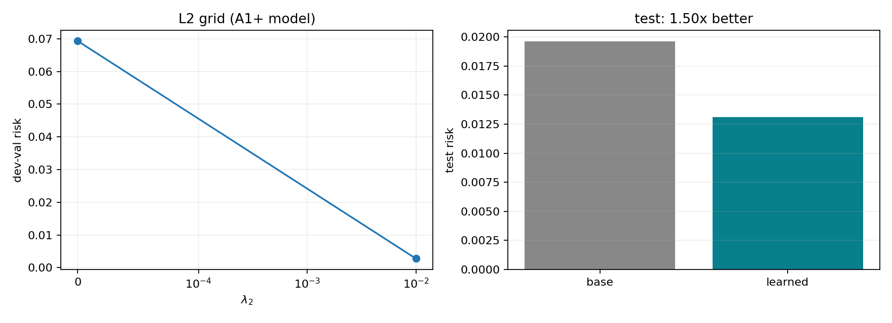
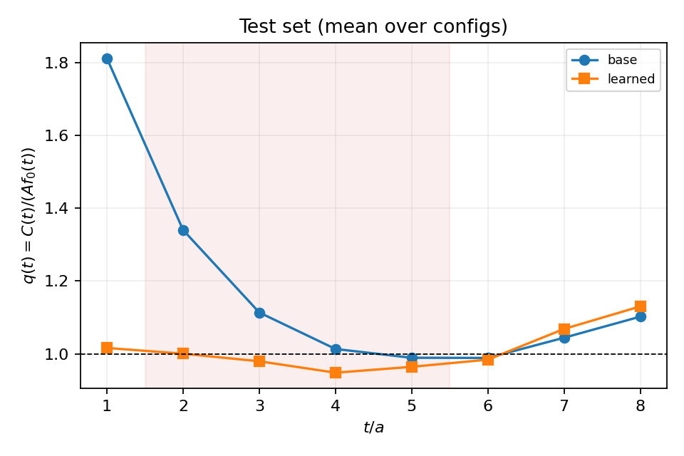

# optimize_gaussian: learned gauge-invariant smear

$p=0$ pion sink：把候选从固定的 $H^n$ 多项式换成**学出来的**逐点 hopping 系数，并且已经能通过
LatticeArena 的正式 `candidate` 冻结流程提交。

## 模型（A1+，v6）

在时间片内定义一步协变跳跃的修正算子，用**三明治**形式夹在多步高斯基座中间：

$$
K = G^{m}\,C_{\mathrm{hop}}(a)\,G^{m},\qquad G = I + a_0\,\mathrm{hop},\qquad a_0=\frac{\alpha}{1+6\alpha}
$$

$$
C_{\mathrm{hop}}(a) = I + \sum_{\mu}\Big[\,a_\mu(x)\,T_\mu + b_\mu(x)\,T_\mu^{\dagger}\,\Big],
\qquad (T_\mu q)(x)=U_\mu(x)\,q(x+\mu)
$$

$$
b_\mu(x) = a_\mu(x-\mu)\qquad\text{(Hermiticity)}
$$

> 三明治是必须的：$G^m C_{\mathrm{hop}}$ 这个单侧乘积一般不是厄米算子，`candidate` 会直接以
> “Non-Hermitian/complex correlator” 拒绝。训练里的关联函数本来就是
> $\langle G^m S,\,C_{\mathrm{hop}}\,G^m S\rangle=\langle S,\,G^m C_{\mathrm{hop}}G^m S\rangle$。

系数在 **A1+ 立方通道**里参数化（三个方向共享同一个函数）：

$$
a_\mu(x) = c + \sum_{h} v_h\,\tilde\phi_h(\mu,x),\qquad
\tilde\phi_h(\mu,x)=\phi_h(\mu,x)-\frac1V\sum_{x'}\phi_h(\mu,x'),
$$

$$
\phi_h(\mu,x)=\tanh\!\Big(W_h\cdot\big(P_{\mu\nu}(x),\,P_{\mu\rho}(x)\big)\Big),
\qquad \nu,\rho\ \text{是另外两个方向},
$$

其中 $P_{\mu\nu}=1-\tfrac13\mathrm{ReTr}\,U_\mu U_\nu U_\mu^\dagger U_\nu^\dagger$ 是含方向 $\mu$ 的两个空间
plaquette。$W$ 固定随机，$c$ 与 $v_h$ 训练（共 $1+H=9$ 个参数，$H=8$）。

**为什么必须是 A1+**：v5 允许每个方向独立的 $c_\mu$，优化器给出
$(c_x,c_y,c_z)=(-0.70,\,0.0007,\,0.0003)$——纯 $x$ 方向的修正，破坏立方对称。那是过拟合：
把它约束回 A1+ 之后，测试集反而更好（1.50× vs 1.36×）。

## 训练目标

用 pion 的完整 risk（bootstrap 方差项 + 偏离项），而不是只拟合形状：

$$
\mathrm{risk}(\theta)=\frac{1}{|W|}\sum_{t\in W}
\Big[\mathrm{Var}_{\mathrm{boot}}\big(q_\theta(t)\big)+\big(q_\theta(t)-1\big)^2\Big],
\qquad
q_\theta(t)=\frac{\bar C_\theta(t)}{A_\theta f_0(t)},
$$

$$
f_0(t)=e^{-m_0 t}+e^{-m_0(16-t)},\qquad m_0=1.0861669 .
$$

**为什么能高效训练**：$C_\theta(t)$ 对 $a$ 线性，因此对 $c,v$ 线性。对 identity、常数项、$H$ 个零均值
特征项各做一次 hop，得到响应 $D_p(t)$，任意参数下

$$
C_\theta(t)=C_0(t)+c\,D_c(t)+\sum_{h=1}^{H} v_h D_h(t).
$$

训练就是预计算基上的 Powell 搜索，不需要反传。

## v6 结果

基座 $G^8$，dev-val 30 组态（20–49）选参数，测试 30 组态（70–99）只看一次。

| $\lambda_2$ | dev-val risk |
| --- | ---: |
| 0 | 0.069294 |
| $10^{-2}$ | **0.002787** |

选中 $\lambda_2=10^{-2}$：

$$
\mathrm{risk}_{\text{base}}=0.019600,\qquad
\mathrm{risk}_{\text{learned}}=0.013087,\qquad
\frac{\mathrm{risk}_{\text{base}}}{\mathrm{risk}_{\text{learned}}}=1.498 .
$$

$$
\theta=[\,c,\;v_1..v_8\,]=[-0.236,\ 0.026,\ 0.047,\ 0.054,\ 0.003,\ -0.157,\ -0.116,\ 0.171,\ -0.066\,]
$$

学到的系数：$a_x\in[-0.34,\,-0.05]$，均值 $-0.236$——一个温和的负 hop 加 $\pm0.15$ 的空间调制。






## 正式提交：通过 `candidate` 冻结流程

把 $K$ 包成 LatticeArena 的提交接口（`tasks/optimize_gaussian/submission.py`），在 kunshan 上跑：

```bash
python -m tasks.pion_projection --output results/pion_projection/s16t16_v1 \
  candidate --definition results/optimize_gaussian/v6/submission.json --split development
python -m tasks.pion_projection --output results/pion_projection/s16t16_v1 \
  candidate --definition results/optimize_gaussian/v6/submission.json --split validation
```

结果（`candidates/c14ef76920ec897d/results.json`）：

| 量 | 值 |
| --- | --- |
| candidate risk | 0.009811 |
| 方差项 / 偏离项 | 0.000515 / 0.009296 |
| 相对 local 的诊断比 | **31.9**，95% 区间 [15.8, 91.3] |
| 官方 `score` | `null`（参考 gate 未通过，符合预期） |
| 幅度 | $A=-5.90$，$z=29.1$（带符号核，整体符号为负，分数对它不变） |

这比 pion run 里的 $H^{32}$（risk 0.01256）好，接近 SLSQP 混合（0.00770）；但注意它**没有**官方分数，
所有比较都是诊断口径。

**这一步还抓到了两个真 bug**：

1. `candidate` 传进来的 `links` 是 NumPy 而 field 是 CuPy，提交模块里需要 `xp.asarray(links)`；
2. 单侧乘积 $G^m C_{\mathrm{hop}}$ 非厄米，必须写成三明治 $G^m C_{\mathrm{hop}}G^m$。

## 版本演进

| 版本 | 参数化 | 约束 | 测试 | 结论 |
| --- | --- | --- | --- | --- |
| v1 | 逐点系数 | 无 | 10 组态 | 只拟合形状 → 训练到 $10^{-24}$，留出乱跳 |
| v2 | $G^8$+修正 | $v\ge0$ | 10 | 1.97×（测试集小） |
| v3 | $G^8/G^{32}$ | $v\ge0$ | 30 | 0.956×（非负约束抹掉增益） |
| v4 | $G^{32}$ | 带符号 | 30 | 1.32×，但系数几乎均匀（反涂抹） |
| v5 | $G^8$ | 带符号 + 逐方向 | 30 | 1.36×，但 $c_x\neq c_{y,z}$ 破坏 A1+ |
| **v6** | $G^8$ | **A1+ + 带符号** | 30 | **1.50×，且通过 `candidate` 冻结** |

## 限制

- dev-val 与 test 的风险水平不同（基座 0.032 vs 0.0196），30 组态的选择集仍有噪声；
- 测试 block=2，忽略自相关；绝对 risk 不能和 pion run（60/30、block=5）直接比；
- $W$ 仍是固定随机特征，只训 9 个参数；不是完整反传；
- 学到的核整体为负（$A<0$），分数虽不变，但物理解读要小心。

## 下一步（v7）

训练 $W$（需要 torch/autograd 环境）；把选择集扩到 60 个开发组态；对 $a$ 加平滑正则而不是只靠 $L_2$。

## 运行

```bash
sbatch pilot/optgauss.sbatch results/optimize_gaussian/v6
python -m tasks.optimize_gaussian.plots results/optimize_gaussian/v6
```

v6 约 8 分钟：50 个组态 × 16 时间片 × (8 步基座 + 10 个基响应)。
