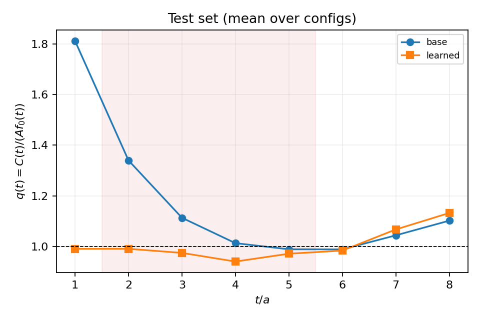

# optimize_gaussian: learned gauge-invariant smear

$p=0$ pion sink：把候选从固定的 $H^n$ 多项式换成**学出来的**逐点 hopping 系数。

## 模型

在时间片内定义一步协变跳跃的修正算子，叠在一个多步高斯基座上：

$$
K = C_{\mathrm{hop}}(a)\,G^{m},\qquad G = I + a_0\,\mathrm{hop},\qquad a_0=\frac{\alpha}{1+6\alpha}
$$

$$
C_{\mathrm{hop}}(a) = I + \sum_{\mu}\Big[\,a_\mu(x)\,T_\mu + b_\mu(x)\,T_\mu^{\dagger}\,\Big],
\qquad (T_\mu q)(x)=U_\mu(x)\,q(x+\mu)
$$

厄米条件（没有它关联函数会出现虚部，v1 的 `candidate` 会直接拒绝）：

$$
b_\mu(x) = a_\mu(x-\mu)
$$

v5 把系数拆成**均匀部分**加**零均值空间部分**：

$$
a_\mu(x) = c_\mu + \sum_{h} v_{\mu h}\,\tilde\phi_h(x),\qquad
\tilde\phi_h(x)=\phi_h(x)-\frac{1}{V}\sum_{x'}\phi_h(x'),\qquad
\phi_h(x)=\tanh\!\left(W_h\cdot f(x)\right)
$$

$$
f_i(x)=1-\tfrac13\,\mathrm{ReTr}\,P_i(x)\ \ge 0
$$

$W$ 固定随机，$c_\mu$ 与 $v_{\mu h}$ 训练，二者都有界 $[-3,3]$。这个拆分的用途是**消融**：
分别只看均匀项、只看空间项、以及两者一起，判断“逐点自适应”到底有没有独立贡献。

## 训练目标

用 pion 的完整 risk（bootstrap 方差项 + 偏离项），而不是只拟合形状：

$$
\mathrm{risk}(\theta)=\frac{1}{|W|}\sum_{t\in W}
\Big[\mathrm{Var}_{\mathrm{boot}}\big(q_\theta(t)\big)+\big(q_\theta(t)-1\big)^2\Big],
\qquad
q_\theta(t)=\frac{\bar C_\theta(t)}{A_\theta f_0(t)},
$$

$$
f_0(t)=e^{-m_0 t}+e^{-m_0(16-t)},\qquad m_0=1.0861669 .
$$

**为什么能高效训练**：$C_\theta(t)$ 对 $a$ 是线性的，因此对 $c$ 和 $v$ 也是线性的。对每个基函数
（identity、3 个常数方向项、$3H$ 个零均值特征项）各做一次 hop，得到响应 $D_p(t)$，任意参数下

$$
C_\theta(t)=C_0(t)+\sum_\mu c_\mu D^{c}_{\mu}(t)+\sum_{\mu h} v_{\mu h} D^{v}_{\mu h}(t).
$$

训练因此是预计算基上的 Powell 搜索，不需要反传。

## v5 结果：均匀项 vs 空间项

基座 $G^8$，dev-val 30 组态（20–49）选参数，测试 30 组态（70–99）只看一次，$L_2=10^{-2}$。

| 模型 | 参数 | dev-val risk | 测试 risk | 相对基座 |
| --- | --- | ---: | ---: | ---: |
| base $G^8$ | — | 0.031973 | 0.019600 | 1.000 |
| uniform（只 $c_\mu$） | 3 | 0.003866 | 0.016165 | 1.212 |
| spatial（只 $v_{\mu h}$） | 24 | 0.044755 | 0.017460 | 1.123 |
| **full（$c+v$）** | 27 | **0.002574** | **0.014457** | **1.356** |





## 怎么读

**空间项确实有独立贡献**：均匀项单独给出 $1.21$ 倍，加上空间项后到 $1.36$ 倍——在均匀项基础上再降
约 $11\%$。这和 v4（$G^{32}$ 基座、系数几乎均匀）形成对照：**基座越强，空间自适应的边际收益越小**。

学到的系数图（$t=0$、组态 70）：

$$
\langle a_x\rangle \approx -0.7,\qquad a_x\in[-0.91,\,0.38],
$$

即“一片负的均匀 hop + 约 $\pm0.4$ 的空间调制”。负号的物理解释和 v4 一样：这个 $m_0$ 对应的
参考形状比 $G^8$ 更“瘦”，修正主要在把涂抹拉回来；空间调制则是在此基础上做局部微调。

注意 v5 的 dev-val 与测试风险水平不同（基座：0.032 vs 0.0196），说明两个 30 组态子集的统计
并不等价；选择仍只依赖 dev-val，但**绝对数值**不能跨子集比较，只能比同一子集内的排序。

## 版本对比

| 版本 | 基座 | 约束 | 测试集 | 结果 |
| --- | --- | --- | --- | --- |
| v1 | 单步 | 无 | 10 | 训练到 $10^{-24}$，留出乱跳（退化） |
| v2 | $G^8$ | $v\ge0$ | 10 | 1.97×（测试集小） |
| v3 | $G^8/G^{32}$ | $v\ge0$（ReLU） | 30 | 0.956×（非负约束抹掉增益） |
| v4 | $G^{32}$ | 带符号有界 | 30 | 1.32×，但系数几乎均匀（主要是反涂抹） |
| **v5** | $G^8$ | 带符号有界 + 零均值拆分 | 30 | **1.36×，均匀 1.21× + 空间 1.12×，两者互补** |

## 限制与下一步

- dev-val 与 test 的风险水平不同（0.032 vs 0.0196），30 组态的选择集仍有噪声；
- 测试 block=2，忽略自相关；绝对 risk 不能和 pion run（60/30、block=5）直接比；
- 随机特征层固定、只训读出（$3+24$ 个参数），不是完整反传；
- 修正只有一步；基座承担半径。

**v6 方向**：把 $W$ 也训起来（需要 torch/autograd 环境）；用 60 个开发组态做选择集；
把选中的 $K$ 接 `candidate` 冻结流程，走正式评分（`score` 仍为 `null`，因为参考 gate 没过）。

## 运行

```bash
# kunshan DCU 节点（需要 PyQUDA + cupy + pion 传播子缓存）
sbatch pilot/optgauss.sbatch results/optimize_gaussian/v5
python -m tasks.optimize_gaussian.plots results/optimize_gaussian/v5
```

单次 v5 约 20 分钟：30 个训练 + 30 个 dev-val 组态 × 16 时间片 × (8 步基座 + 28 个基响应)。
