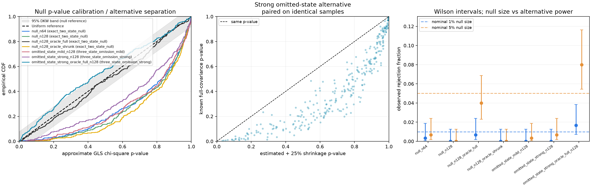

# D04 approximate chi-square GOF calibration pilot

**Status:** synthetic CPU diagnostic. It measures null rejection size and an omitted-state alternative for the current `gof_p_approx`; it is not a candidate-blind E-chain reference or a physical GO decision.

## Frozen procedure

- Seven cells, `300` independent panels each: exact two-state null with 64 or 128 configurations; the 128-configuration null and strong three-state alternative include paired known-full-covariance contrasts; the null also includes a known 25%-shrunk metric; mild and strong three-state truths are fit by the fixed two-state primary model.
- The mild omitted-state truth uses third-state PP overlaps 0.11–0.18 and A4P overlap 0.022; the strong stress uses PP overlaps 0.45–0.75 and A4P overlap 0.085. Both are distinct from the two-state null.
- Oracle cells reuse the exact sample panels of their estimated-covariance comparison; sample SHA-256 values are checked before paired summaries are calculated. The full oracle removes covariance estimation and shrinkage; the shrunk oracle isolates the shrinkage metric under this known full-covariance generator. These are diagnostic contrasts, not available production procedures.
- Each configuration is a 27-component multivariate Gaussian around folded PP-even/A4P-odd correlator means; feature covariance is fixed from 0.65 temporal AR correlation and 0.2 cross-channel correlation, with relative noise `0.03`.
- Each panel uses the existing D04 fit path (`tmin=3`, two states, three starts); the default covariance is estimated from the same panel with 25% diagonal shrinkage and relative eigenvalue floor `1e-10`. Paired oracle cells substitute known full covariance or, for the null only, its exact 25%-shrunk version. All p-values use the approximate chi-square survival probability with 13 nominal degrees of freedom.
- All panel fits remain in the planned denominator. The null cells estimate the false rejection frequency at p<0.01 and p<0.05; the omitted-state cell is a misspecification power diagnostic.
- The strong omitted-state cell was added after the initial mild-alternative pilot showed weak separation. It is an exploratory power stress, not a preregistered confirmatory test; null thresholds and seeds were not changed.

The left panel compares each empirical p-value CDF with the uniform reference; the gray band is a 95% Dvoretzky–Kiefer–Wolfowitz band for a 300-panel null sample. The middle panel compares strong-alternative p-values for identical samples under estimated/shrunk and known full covariance. The right panel gives observed rejection fractions and Wilson intervals at 1% and 5%, with a y-axis scaled to the largest interval. For null cells, a well-calibrated p-value should track the diagonal and rejection rates should be compatible with nominal sizes. Alternative rejection fractions are power, not type-I error.

## Interpretation limits and next step

This isolates finite-sample behavior under an independent Gaussian generator and an estimated/shrunk covariance. It does not model HMC dependence, channel/source convention errors, non-Gaussian tails, fit-window selection, optimizer-start selection, or a real E-chain. The 300-panel size gives MCSE about 0.0056 at a 1% event and 0.0126 at 5%, so the 1% size estimate is coarse. Results must not be used to tune and validate a replacement threshold on the same panels. A next step should preregister a larger independent panel set, add stationary AR(1) dependence and heavy-tailed innovations, and compare the approximate chi-square reference with a parametric bootstrap that refits covariance and spectra on each simulated panel. Keep `D04 NOT_READY/UNCERTIFIED` and `physical_score=null` until an authorized independent E-chain package and review exist.

## Run denominators

- `null_n64`: P/V/F/A = `300/300/0/0`; rejection summaries `{'median': 0.8280833727382348, 'mean': 0.7461778016217486, 'ks_distance_to_uniform': 0.3700562584955978, 'rejection': {'0.01': {'count': 1, 'rate': 0.0033333333333333335, 'wilson_95': [0.0005886577218511581, 0.018636693694531237], 'nominal_rate': 0.01, 'mcse': 0.005744562646538029}, '0.05': {'count': 2, 'rate': 0.006666666666666667, 'wilson_95': [0.0018301483579117855, 0.023977583250306973], 'nominal_rate': 0.05, 'mcse': 0.012583057392117916}}}`.
- `null_n128`: P/V/F/A = `300/300/0/0`; rejection summaries `{'median': 0.8482653130421038, 'mean': 0.7607195763508298, 'ks_distance_to_uniform': 0.38788308505898883, 'rejection': {'0.01': {'count': 0, 'rate': 0.0, 'wilson_95': [0.0, 0.012642971224546034], 'nominal_rate': 0.01, 'mcse': 0.005744562646538029}, '0.05': {'count': 0, 'rate': 0.0, 'wilson_95': [0.0, 0.012642971224546034], 'nominal_rate': 0.05, 'mcse': 0.012583057392117916}}}`.
- `null_n128_oracle_full`: P/V/F/A = `300/300/0/0`; rejection summaries `{'median': 0.5065795016894917, 'mean': 0.5191591288543819, 'ks_distance_to_uniform': 0.057418606090310575, 'rejection': {'0.01': {'count': 2, 'rate': 0.006666666666666667, 'wilson_95': [0.0018301483579117855, 0.023977583250306973], 'nominal_rate': 0.01, 'mcse': 0.005744562646538029}, '0.05': {'count': 12, 'rate': 0.04, 'wilson_95': [0.023027321487942308, 0.06860421203864003], 'nominal_rate': 0.05, 'mcse': 0.012583057392117916}}}`.
- `null_n128_oracle_shrunk`: P/V/F/A = `300/300/0/0`; rejection summaries `{'median': 0.8562912764839317, 'mean': 0.7829186816327453, 'ks_distance_to_uniform': 0.4267998434070631, 'rejection': {'0.01': {'count': 0, 'rate': 0.0, 'wilson_95': [0.0, 0.012642971224546034], 'nominal_rate': 0.01, 'mcse': 0.005744562646538029}, '0.05': {'count': 0, 'rate': 0.0, 'wilson_95': [0.0, 0.012642971224546034], 'nominal_rate': 0.05, 'mcse': 0.012583057392117916}}}`.
- `omitted_state_mild_n128`: P/V/F/A = `300/300/0/0`; rejection summaries `{'median': 0.828622469759848, 'mean': 0.7430301620966113, 'ks_distance_to_uniform': 0.3636025226803681, 'rejection': {'0.01': {'count': 0, 'rate': 0.0, 'wilson_95': [0.0, 0.012642971224546034], 'nominal_rate': 0.01, 'mcse': 0.005744562646538029}, '0.05': {'count': 1, 'rate': 0.0033333333333333335, 'wilson_95': [0.0005886577218511581, 0.018636693694531237], 'nominal_rate': 0.05, 'mcse': 0.012583057392117916}}}`.
- `omitted_state_strong_n128`: P/V/F/A = `300/300/0/0`; rejection summaries `{'median': 0.759881752990113, 'mean': 0.6891620831800491, 'ks_distance_to_uniform': 0.27970849815281285, 'rejection': {'0.01': {'count': 0, 'rate': 0.0, 'wilson_95': [0.0, 0.012642971224546034], 'nominal_rate': 0.01, 'mcse': 0.005744562646538029}, '0.05': {'count': 2, 'rate': 0.006666666666666667, 'wilson_95': [0.0018301483579117855, 0.023977583250306973], 'nominal_rate': 0.05, 'mcse': 0.012583057392117916}}}`.
- `omitted_state_strong_oracle_full_n128`: P/V/F/A = `300/300/0/0`; rejection summaries `{'median': 0.4112221560333851, 'mean': 0.4478588274596556, 'ks_distance_to_uniform': 0.10344982546295739, 'rejection': {'0.01': {'count': 5, 'rate': 0.016666666666666666, 'wilson_95': [0.00713947735063333, 0.0384153948330945], 'nominal_rate': 0.01, 'mcse': 0.005744562646538029}, '0.05': {'count': 24, 'rate': 0.08, 'wilson_95': [0.054346855395144764, 0.11627324043347391], 'nominal_rate': 0.05, 'mcse': 0.012583057392117916}}}`.

## Paired fit-metric contrasts

- `null_n128` → `null_n128_oracle_full`: `{'left_cell': 'null_n128', 'right_cell': 'null_n128_oracle_full', 'interpretation': 'right minus left; identical simulated panel samples verified by SHA-256', 'planned_pairs': 300, 'valid_pairs': 300, 'failed_or_missing_pairs': 0, 'mean_delta_gof_p_approx': -0.24156044749644784, 'median_delta_gof_p_approx': -0.24699695121374737, 'fraction_right_pvalue_lower': 1.0, 'mean_delta_chi2': 3.9637149905647235}`.
- `null_n128` → `null_n128_oracle_shrunk`: `{'left_cell': 'null_n128', 'right_cell': 'null_n128_oracle_shrunk', 'interpretation': 'right minus left; identical simulated panel samples verified by SHA-256', 'planned_pairs': 300, 'valid_pairs': 300, 'failed_or_missing_pairs': 0, 'mean_delta_gof_p_approx': 0.022199105281915498, 'median_delta_gof_p_approx': 0.009689154452503068, 'fraction_right_pvalue_lower': 0.29, 'mean_delta_chi2': -0.3411077919741489}`.
- `omitted_state_strong_n128` → `omitted_state_strong_oracle_full_n128`: `{'left_cell': 'omitted_state_strong_n128', 'right_cell': 'omitted_state_strong_oracle_full_n128', 'interpretation': 'right minus left; identical simulated panel samples verified by SHA-256', 'planned_pairs': 300, 'valid_pairs': 300, 'failed_or_missing_pairs': 0, 'mean_delta_gof_p_approx': -0.2413032557203935, 'median_delta_gof_p_approx': -0.2504660404197006, 'fraction_right_pvalue_lower': 1.0, 'mean_delta_chi2': 4.213698219913875}`.
