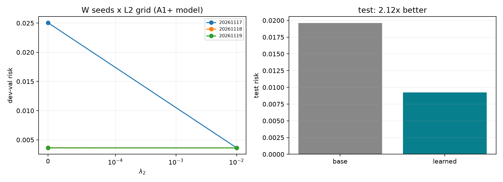

# optimize_gaussian：下一轮可执行研究清单

审计基线：`dfa63fe`，2026-11-18。**未全部完成，保留本 todo。**
本轮仅更新本文件；源码、数据和历史结果不变。
目标是可证伪地回答学习型 smear 是否提供强谱滤波基线之外的收益；负结果也可完成研究。
不得把“必须取得正收益”设为无限工作条件。

## 已完成证据与边界

| 项目 | 已有证据 | 能得出的结论 |
| --- | --- | --- |
| plaquette/gauge 修复 | `features.py`；`tests/test_optimize_gaussian.py` | 闭环、link-centred 特征与 gauge 测试已实现，旧 bug 不再是现行待办 |
| 零动量立方对称 | 同测试文件的 24 proper rotations、parity、交换测试 | 当前小格点测试覆盖 A1+ 要求；不推广到非零动量 |
| 基本 Hermitian/响应 | 不同场 apply_kernel 测试、固定 W 线性响应测试 | 还需完整 submission BCB 的直接交叉验证 |
| CPU suite | 主 agent 本机复跑 51 tests 全过 | Python3.13.12 / NumPy2.5.1 / SciPy1.18.0 / pytest9.1.1；不是新 GPU 证明 |
| 当前环境 | cupy/mpi4py/pyquda 不可用 | 本次不覆盖 GPU/MPI；后续实施后按受影响范围重测 |
| v9 重训档案 | `results/optimize_gaussian/v9/results.json`、data/basis NPZ | raw/block2 risk：0.0092357620 vs Gaussian base 0.0196001510，比值 2.122201826 |
| 正式接口配对诊断 | `results/pion_projection/s16t16_v1/candidates/63c33e619e06704a/compare.json` | folded/block5：SLSQP 0.0077027080、learned 0.0077207899 |
| 配对区间 | 同 compare.json | R_SLSQP/R_learned=0.9976580312，95% CI [0.7799244162,1.1756779868]，未检出差异；不是等效性证明 |
| run 身份记录 | v9/manifest.json | 四模块 hash 本轮审计与当前文件相符；不代表 basis 读取时完整校验 |
| 旧版 v1–v8 | 历史 JSON/NPZ | 条件数值档案；不能反推所有历史版本具有同一源码 bug |



此图展示三份固定随机 W 与 λ 的开发风险，不是三个独立数据样本。
2.12× 比较的是 Gaussian base，不是 SLSQP。fit=0–19、dev_val=20–59、历史 test=70–99。
70–99 已反复观察，v9 不是新盲测；参考 gate 未过时正式 score 仍应为 null。
训练 raw/block2 与正式 folded/block5 是不同口径，不能混合展示为同一个风险。

## 开工契约与代码地图

`features.py` 构造规范特征；`kernels.py` 实现边输运；`submission.py` 执行 K=BC(a)B。
`train.py` 收集固定 W 响应并用 Powell 训练 theta；`compare.py` 使用正式接口历史数据。
`audit.py` 是当前需修正的历史汇总工具，虽称 read-only 实际会写 audit.json。
上游 `pion_projection/statistics.py`、reference factory 和 frozen 数据负责共同统计契约。

所有新增路径均为**拟议**：`results/optimize_gaussian/audit_next_<runid>/`。
该目录独立保存 config、inputs 摘要、原始表、图、文字解释和失败记录，不覆盖旧 results。
每种诊断提供 fig+data+文字；适合少量残差/身份项时可用充分文字表代替图。
未经新资源授权不提交 GPU/远程任务。

## P0：完成执行一致性和身份校验

### P0.1 完整 BCB 算子验证（CPU）

当前证据：已有测试比较 base 上 quadratic correlator 与线性响应，未直接闭环到 submission。
动作：在独立小 SU(3) 场上比较响应合成与 vdot(f,build_kernel(...).apply(f))。
覆盖 m=0/1/8、zero/c-only/v-only/full theta、非立方轴测试与立方群测试。
用 f≠g 验证完整 BCB Hermitian；不以取 real 隐藏虚部。
产物：seed/geometry/dtype/残差文字表与失败样本描述。
验收：双精度相对误差约 1e-10 内；若失败先定位算子，不训练新模型。
资源：CPU NumPy；只运行新增相关测试。

### P0.2 basis 与输入身份闭包（CPU；文件读取）

当前 basis_key 含 protocol/W/IDs/feature version，但漏依赖内容及输入内容摘要。
run_manifest 有模块 hash，不能阻止同路径输入更换后命中旧 basis。
动作：basis key 纳入依赖、输入 manifest、propagator 映射/内容；训练/评估身份另绑定 reference 与 masses 摘要。
依据数学依赖分层：原始线性响应若不依赖 reference，换参考无需重测响应，但必须重建对应分析身份。
collect/evaluate 复用上游 gauge/propagator 内容、残差与 metadata 校验。
记录 precision、boundary、软件版本、硬件和计时；未知字段显式 unknown。
产物：identity 覆盖矩阵和逐项 mutation 测试文字表。
验收：改变依赖、输入内容、ID 顺序或缓存映射即拒绝复用；legacy 只读迁移。
资源：CPU；大文件摘要允许分块读取；禁止静默覆盖旧缓存。

### P0.3 修正 audit 和结论措辞（CPU）

audit.py 当前会把遍历到的 v9 统一标 legacy，且总述仍称新 GPU NOT_RUN。
动作：按 manifest/schema 分类；显式输出目录；修 dev_val 缺失时误用 best_lam2。
README/报告中“打平/追平”改为“未检出差异”，除非另有预注册等效检验。
不能从 v 系数大小推断空间信息贡献；不能断言只有更强函数类才可能超越。
产物：版本 inventory 表、旧/新统计口径文字解释；校正引用图的说明。
验收：v9 正确归类、没有默认覆盖、历史数字与来源逐行可追溯。

## P1：统一统计与完整 fold-local 评测

当前只有固定 fit/dev split；m0 和 bootstrap masses 来自旧上游参考。
动作：统一 fold、block、reference draws、amplitude fit 与 late inverse 策略。
同时保留 raw/block2 和 folded/block5 的旧值用于解释，不挑较好口径。
输出 variance、bias²、amplitude Z、SNR、q、gate、失败比例与配对 CI。
产物：风险分解图+数值表+口径说明；区间图标明历史重复观察。
验收：相同候选在统一入口得到一致结果；gate 失败则 diagnostic_only。
资源：现有 CPU NPZ；不足输入标 PARTIAL/NOT_RUN，不捏造统一重测。

nested CV 必须包括整条数据依赖链：

- outer training 内拟合 reference、质量 draws、通道归一化 A_n、base amplitudes。
- late inverse、谱范围、白化/QR/SVD、正则与 seed 选择均在相应内层完成。
- reference 曾用全 development 60cfg 时，不能仅重训练 theta 称独立 CV。
- 固定物理常数/人工预设窗口可以共享；数据估计量必须记录来源。
- 不按赢家选择性丢弃 reference 失败 fold。

产物：fold 数据流图、fit-state 身份表、fold 风险/失败率图。
验收：无 outer-held-out ID 进入任何数据估计状态；不能恢复输入时标 conditional diagnosis。
新参考/稳健指标由上游提供，Gaussian 不另造有利 loss。

## P2：函数类与优化器分开检验

SLSQP 是优化算法，当前基线函数类是七通道扩散多项式。
fixed random W + Powell 没有测试可训练 W 网络的上限。
对 H=V diag(h)V†，p(H) 只能改变谱权重，共享本征向量。
空间/gauge-conditioned 非对易 Q 可混合 H 模式，但也可能增加噪声。
先排除稀疏七幂覆盖不足，再讨论不可替代的空间信息。

### 三条理论路线

| 优先级/结构 | 实现动作与理论边界 | 必要资源与验收 |
| --- | --- | --- |
| A：嵌套强基线 | K=P_u(H)+Σ theta_j B_j Q_j[U]B_j；Q 为 Hermitian、gauge-covariant、O_h 投影；theta=0 恢复基线 | 固定特征可缓存线性响应，CPU 优化；先1–3特征，测新有效秩 |
| B：强谱/独立路径 | 较宽 polynomial/Chebyshev、谱放大约束；逆路径配对与完整群轨道产生独立路径修正 | CPU teacher 后 GPU 响应；谱区间/QR均训练内估计；区别谱类与新模式方向 |
| C：训练 W | gauge-only 网络输出实边系数，保持 quark field 严格线性；边配对/BCB/群处理保持物理约束 | raw density 缓存或动态可微收缩；先小网络、有限差分梯度验证 |

A 的包含关系仅保证相同约束/正则下训练全局 infimum 不更差。
不保证有限预算优化、泛化、物理指标或成本改善；identity 及原基线必须保留为可行点。
B 的 Chebyshev 只是更强谱基线；若已解释收益，不应夸大空间机制。
C 改 W 会改 tanh 特征，不能从固定 W 的 C_fit 学任意 W。
可缓存 raw gauge features 与 B S 局域边双线性密度，或动态读取冻结 propagator。
若 B 也训练，需重新推导缓存；无需对 Dirac inversion 反传。
产物：类定义/约束文字、响应奇异值图、谱/commutator图、梯度误差表、缓存体积与成本表。
验收：各候选通过 OperatorContract 后才能进入物理比较。

### 最低 class × optimizer 2×2

| 类 | SLSQP/约束梯度 | Powell |
| --- | --- | --- |
| 七通道及较宽谱基 | 强基准 | 检验优化器效应 |
| 固定特征嵌套空间类 | 检验类收益 | 接轨已有训练 |

真正训练 W 另做带梯度小网络；不强行把大网络交给 Powell。
同时给 parameter/effective-rank matched 与 budget matched 两组口径。
共享样本、预测信息、参考、inner split、seed 列表与 constraints。
记录起点、nfev、wall-time、success、边界饱和及失败样本。
产物：class×optimizer 风险/成本矩阵图和每个格子的原始表。
验收：收益可归因于类或优化器；只改优化器获益就报告优化收益。

### 真实空间信息消融

比较 real、uniform、spatial-off、shuffled 四臂，用同样网络及搜索预算。
只 shuffle gauge-invariant scalar 特征，不能打乱 links/颜色矩阵。
优先用同一配置上的预声明周期平移，再按 O_h 轨道处理，并固定共同的对照分布。
对照也要通过群/gauge/平移测试；fixed permutation 不自动对称。
跨配置移用固定 scalar map 不能只靠旋转平均保证当前配置的平移协变，本轮不把它作为合法核对照。
产物：配对改善 CI、variance/bias² 分解图、系数空间图及充分机制说明。
验收：real 优于 shuffled 才支持局部 gauge 信息；无差别是可接受反证。

## P3：最小有判别力实验与停止规则

第一步 CPU teacher：p(H) 与 p(H)+epsilon BQB 两类 teacher，独立 links/probes。
输出 epsilon–误差曲线、有效秩、commutator、对称性残差和2×2优化表。
验收：epsilon=0 谱类恢复；epsilon>0 新类在新 probes 降低误差；否则先调试。
附录的单样本表达能力证据不替代这一跨样本学习实验。

第二步只用一个小空间候选做新 GPU 配对：

- 先封存类、超参数、参考/指标、主终点、sample-size/power 规则。
- 同一新 gauge/propagator 同时测强谱类、uniform、real、shuffled。
- 新样本必须独立；旧70–99只能辅助开发。
- 样本数由块方差与目标效应 power simulation 决定，不承诺固定30/60足够。
- 分别记录 inversion、setup、apply、训练、measurement、total time与硬件/精度/残差。

产物：power图、主终点配对CI、种子/块长敏感性图、总成本分解图和文字结论。
成功：预注册的新数据改善区间下界>1且超过实际意义阈值，参考/块长稳定。
反证：真实与 shuffled 无差别、强谱基解释全部收益、或新增类只降低训练误差。
证据不足：区间跨1；不能称等效，也不证明所有学习smear无效。
停止：完成预定预算/轮次后无新数据收益、有效秩不增加或成本超过预注册容忍界。
负结果归档并完成本轮，不无限加模型/调loss追求正结果。
资源：GPU生产须另列授权与预算，本机依赖缺失时 NOT_RUN。

## 公共框架适配义务

公共框架设计由主总纲负责，本任务仅适配：

- OperatorContract：geometry/axes/boundary、field线性、Hermitian、gauge、O_h属性及参数identity。
- MeasurementBundle：IDs、响应/精确correlator、输入与参考摘要、计时/精度/失败样本。
- SearchAdapter：固定响应搜索或可训练W接口、constraints、budget、seed、收敛/失败状态。

产物：三个适配schema与一个CPU端到端例子的文字/JSON验证表。
验收：参考/评分与搜索解耦，无task-specific隐式全局状态。
多动量扩展另立协议：little group、复相位与±p关系不能沿用零动量A1+。

## 关闭条件与第一轮交付

先完成 P0 的完整算子/身份反例和版本审计，再交 P1 的统一统计与 fold 身份报告，随后做 P2/P3 的 CPU 判别实验。
新 GPU 主终点与成本计划应在测量前冻结；本机不能执行的生产明确独立移交。
每条图/文字报告记录代码和输入 hash、运行命令、seed、独立 blocks、区间含义及 PASS/FAIL/NOT_RUN/INCONCLUSIVE。
不要把条件 q-risk 的 departure_squared 自动命名为真实能量偏差。
当已承诺的必做项目有证据，研究实验达到预算和停止条件、未执行扩展已明确移交后，才关闭本开工单。
保留它的原因是尚有具体实现与研究缺口；不是要求一定战胜 SLSQP 才允许结束。

## 附录：历史 CPU 非对易 teacher 证据

在3³随机SU(3)场上，取同一Hermitian扩散矩阵H；用闭合plaquette的四角平均、三个空间平面平均构造实标量s(x)，去均值并归一化。
定义V为颜色单位矩阵乘s(x)，`Q=(VH+HV)/2`。s的clover与空间平均构造用于保持gauge与立方变换规则；后续实现仍需完整属性测试。
Q为Hermitian，且通常`[H,Q]≠0`，属于空间非均匀修正。
取人为teacher `K*=I+0.2H+0.1Q`。在H本征基中，任意`f(H)`均为对角矩阵，所以

\[
\min_f\|K_*-f(H)\|_F
\geq 0.1\|\operatorname{offdiag}(V_H^\dagger QV_H)\|_F.
\]

这里`V_H`是H的本征向量矩阵，与前面的对角算符V不同；退化本征值情形该式仍是下界，不必声称可达。
此前记录的 NumPy、complex128、seed321实际得到：

| 检查 | 结果 |
| --- | ---: |
| H、Q的最大Hermitian残差 | 均0（当前浮点构造） |
| `||[H,Q]||_F` | 1.09810309 |
| 任意谱滤波相对Frobenius误差下界 | 0.04421517 |
| 七个偶次幂无约束最小二乘误差 | 0.04463029 |
| 加入H与Q后的线性类误差 | 4.63e-16 |

这是刻意包含非对易项的teacher，证明的是**存在可表达性优势**，不是学到真实QCD最优核或新数据泛化优势。
七幂比较还放宽了实际SLSQP的L1/幅度约束，因而不能把表中数值直接当实际训练收益。
它排除了“任意空间学习都等价于把H多项式加宽”的一般断言；这些方向是否有实际收益，仍由 P3 的新 links/probes 与物理配对实验回答。

复现命令（只读，无GPU；正确plaquette在本进程显式构造，不修改当前源码）：

```sh
python -B - <<'PY'
import numpy as np
from tasks.pion_projection.kernels import build_kernel
from tasks.optimize_gaussian.features import shift, dagger
rng=np.random.default_rng(321)
shape=(3,3,3)
a=rng.normal(size=(3,*shape,3,3))+1j*rng.normal(size=(3,*shape,3,3))
u,_=np.linalg.qr(a)
u=u/np.linalg.det(u)[...,None,None]**(1/3)
s=np.zeros(shape)
for mu,nu in ((0,1),(0,2),(1,2)):
    p=np.trace(u[mu]@shift(u[nu],1,mu)@dagger(shift(u[mu],1,nu))@dagger(u[nu]),axis1=-2,axis2=-1).real/3
    s+=p+shift(p,-1,mu)+shift(p,-1,nu)+shift(shift(p,-1,mu),-1,nu)
s=s/12
s-=s.mean()
s/=np.sqrt(np.mean(s*s))
n=3*np.prod(shape)
probe=np.eye(n,dtype=complex).reshape(*shape,3,n)
H=build_kernel(u,dict(powers=[1],weights=[1.],alpha=.2)).apply(probe).reshape(n,n)
V=np.diag(np.repeat(s.ravel(),3))
Q=(V@H+H@V)/2
teacher=np.eye(n)+.2*H+.1*Q
_,VH=np.linalg.eigh(H)
qt=VH.conj().T@Q@VH
floor=.1*np.linalg.norm(qt-np.diag(np.diag(qt)))/np.linalg.norm(teacher)
A=np.stack([np.linalg.matrix_power(H,k).ravel() for k in [0,2,4,8,16,32,64]],axis=1)
def error(A):
    c=np.linalg.lstsq(A,teacher.ravel(),rcond=None)[0]
    return np.linalg.norm(A@c-teacher.ravel())/np.linalg.norm(teacher)
print('Hermitian',np.max(abs(H-H.conj().T)),np.max(abs(Q-Q.conj().T)))
print('commutator',np.linalg.norm(H@Q-Q@H))
print('spectral floor / seven powers / augmented',floor,error(A),error(np.column_stack([A,H.ravel(),Q.ravel()])))
PY
```

与实际统计效率有关的原始入口：[Detmold–Endres, 1404.6816](https://arxiv.org/abs/1404.6816)。此前读取摘要，支持source/sink优化可能改进信噪比且收益依赖体系及算符基；它未证明本任务的空间网络一定胜过强多项式基线。
