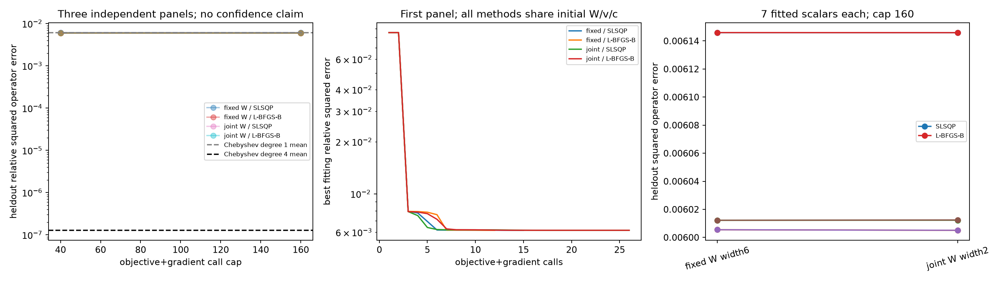

# optimize_gaussian: trainable-W smear 对照研究 handoff

## 决策状态与问题

- 用户要求同时比较学习型 smear 对同预算 SLSQP 与强谱基线；确认族为 `F=2`。
- 保留“学习型 smear 是否有机会优于 SLSQP”作为研究问题。当前维持 `NOT_READY/UNCERTIFIED`、`physical_score=null` 和数据封存；不读取 gap、validation、shared holdout，也不运行生产 GPU/QUDA。
- trainable-W 是算符参数化；SLSQP/L-BFGS-B 是求解器。确认分析须分别回答“可学习 W 是否增加有限预算下的搜索能力”和“是否优于已固定强谱算符”，不可将二者混成一个结论。

## 已完成的 CPU 诊断

主产物是 [2026-11-23 source-closed replay](https://github.com/DianjunZhao/LatticeArena/blob/6f1aa442d4f8b1121899fb6515bcd5b51501b161/tasks/optimize_gaussian/trainable_w_operator_cpu_replay_20261123_v1/README.md)，包含协议、独立合成输入、逐调用原始 trace、代码快照和图。旧的 [`trainable_w_operator_cpu_20261121_final`](https://github.com/DianjunZhao/LatticeArena/blob/6f1aa442d4f8b1121899fb6515bcd5b51501b161/tasks/optimize_gaussian/trainable_w_operator_cpu_20261121_final/README.md) 保留为历史结果：其 `trainable_w.py` 哈希与同目录源不一致且漏掉导入的 SU(3) fixture helper，因此不能作为闭合 provenance 的主收据。新 replay 修复 source hash 缺口，但不增加独立样本。

| 确认维度 | CPU 诊断内容 | 直接观察到的结果 | 可支持的结论 |
|---|---|---|---|
| 同预算局部搜索 | 三个独立合成 panel；每 panel 3 fit + 3 heldout SU(3)-like links；固定 W 与 joint trainable-W；SLSQP/L-BFGS-B；每次 40/160 次 objective+gradient 调用上限 | 36/36 planned solver runs 有返回，4 次触预算/非成功，0 样本排除。cap=160 的 joint-W SLSQP heldout loss 分别约 `0.00614590, 0.00600509, 0.00601227`；固定 W width-2 SLSQP 分别约 `0.00614590, 0.00600511, 0.00601227` | 这个构造目标上 joint W 的增益至多约 `2.5e-8` 量级；没有稳定、实用的学习 W 优势。三个 panel 不足以给总体区间。 |
| 强谱算符 | 同一固定热核目标上的 degree-1/degree-4 Chebyshev 直接最小二乘；不调 heldout | degree-4 heldout loss 为 `2.40e-7, 3.34e-8, 1.11e-7`，比一跳学习参数化约低四至五个数量级 | 该 fixture 的目标按定义就是 `exp(tau H)` 谱函数，因此强谱基占优是结构性负诊断；不能外推为所有物理 smearing 都由谱基胜出。 |
| 数值正确性 | 压缩二次 loss 对照 dense operator loss；W/v/c 梯度对有限差分；在独立 heldout links 复查 | 最大梯度差约 `1.3e-11`，压缩/dense loss 差低于 `2e-16` | 验证此 CPU 实现和 fixture 的代数一致性，不验证 GPU、物理风险或实现耗时优势。 |



文字数据流：`protocol + 固定 seed -> 3 个独立合成 link panel -> 每 panel 切分 3 fit / 3 heldout -> 同一初始化/参数边界/调用上限拟合 -> 仅 fit 选择 -> heldout + KKT/梯度残差作诊断`。优化秒数不含算符/目标构造和后检；因此它是 call-budget 对照，不是 walltime 或训练摊销基准。

### 扩展 CPU 压力测试（已完成，见 companion PR #6）

[Trainable-W stress report](https://github.com/DianjunZhao/LatticeArena/blob/6f1aa442d4f8b1121899fb6515bcd5b51501b161/results/optimize_gaussian/trainable_w_stress_20261123_v4/README.md) 扩展到 36 个合成 panel：三种 link generator、谱热核/非谱局域环境两类目标、0/2% 相对 Frobenius 算符噪声、每格 3 个 replicate。每个 panel 使用相同 fit/heldout links、初始化和边界，对照 joint-W SLSQP、joint-W L-BFGS-B、fixed-W width-2 SLSQP，以及 **同为 7 个拟合标量**的 fixed-W width-6 SLSQP；预算为 32/128 次 objective+gradient call。谱目标另与固定 degree-4 Chebyshev 强基线比较，局域目标另报匹配其构造的 degree-2 基线。后者只是容量诊断，不代替选定的强谱基线。

planned/valid/failed/abstained panel = `36/36/0/0`；solver fit = `288/288` returned，其中 93 次达到调用上限或 solver non-success，均保留，未排除样本。三次重复/格只支持描述性 stress test。width-6 等参数量对照中，六个局域环境 cell 的 joint-W/fixed-W heldout loss ratio 中位数均不小于 1（`log10` 比值中位数均为非负），谱目标则接近持平；强 Chebyshev 基线在谱目标下明显较低。图中单点、cell 中位线、budget 曲线、conditioning 和基线误差均明确标为合成/描述性结果。这不证明固定 W 普遍更优，也不否证学习 W 在真实目标上的可能性；它只没有显示稳定的等参数量优势。

复核材料包括 paired loss 图、32/128-call 收敛图、feature conditioning/基线图、逐 panel 输入与 solver trace、源码快照、哈希清单。输出目录内部 `artifact_hashes.json` 已核对，脚本哈希与报告 source manifest 相符。没有 production 或 sealed data/GPU 输入。

### 跨任务 pooled initialization + 同预算 SLSQP（CPU，companion PR #6）

[新增报告](https://github.com/DianjunZhao/LatticeArena/blob/7d05b0e779eba91a175bb333e91751ee5187eee3/results/optimize_gaussian/trainable_w_meta_init_20261123_v5/README.md) 补查了 per-panel stress 未覆盖的可复用初始化机制：12 个训练 panel 的 fit links 只训练一个 joint-W width-2 共享初值；另 12 个独立 eval panel 对比 pooled learned init、随机冷启动和固定非零初值，然后三组均跑同一个 joint-W SLSQP，调用上限 `8/32/128`。Heldout links 不参与 prior 训练或停止/选择。每个 eval panel 同时拟合 degree-4 Chebyshev（指定谱基线）和固定 degree-2 local-polynomial（该合成教师族的 target-matched control）。

planned/valid/failed/abstained 训练 panel=`12/12/0/0`，评估 panel=`12/12/0/0`，在线 solver run=`108/108/0/0`；其中 36 次达到预算、36 次 solver non-success，两个诊断分别保留，未删样本。pooled SLSQP 使用 15 次跨 24 个训练 link cases 的 optimizer objective/gradient 调用；成本折成每任务调用数是 180，再加一次初值诊断等于 192 panel-equivalent evaluations。以每个 panel 冷启动初始 fit loss 的共同 10%/1% 作为合成收敛目标，pooled init 平均分别用 3.58/4.25 次，cold SLSQP 用 4.58/6.92 次；若未来任务真来自同一分布，按已观测调用节省严格覆盖训练成本的最小 K 分别为 193/73。它们是 12-panel 的算术描述，不是置信下界、物理 `r_star` 或墙钟收益证明。

最大预算下 heldout loss 中位数：pooled init `1.44e-10`、cold SLSQP `1.96e-10`、固定非零初值 `9.13e-10`、degree-4 Chebyshev `7.30e-8`，target-matched local degree-2 为 `3.17e-33`。由于本诊断的教师本来就是局域二次多项式，Chebyshev 在此并非匹配的 oracle family，故报告同时提供了 target-matched local control；后者几乎精确恢复教师。结果只支持“在这组窄合成任务里 warm-start 略省 SLSQP calls”，不证明学习型 smear 胜过物理谱算符，也未比较生产 walltime。

图、逐运行原始 trace、训练/评估输入、两种 baseline、分母表、协议、源码快照与哈希在 companion PR #6。仍缺独立物理 reference、事前 `r_star`、固定的 D11 谱算符/约束、可比 production total-walltime 和授权 GPU 确认，因此状态不变。

### Task-specific contract inspector（结构诊断，companion PR #6）

[合约检查器](https://github.com/DianjunZhao/LatticeArena/blob/031fa1498d5101d7501eca531aefb4837a7866cc/tasks/optimize_gaussian/contract.py) 将已选的两条对照写入 versioned contract：trainable-W 对同预算 SLSQP，以及 trainable-W 对固定 degree-4 Chebyshev 强谱基线；[text diagnostic](https://github.com/DianjunZhao/LatticeArena/blob/031fa1498d5101d7501eca531aefb4837a7866cc/results/optimize_gaussian/contract_diagnostic_20261124_v1/README.md) 列出 D04/D06/D11 与公平预算的缺项。五个 fixture 的 contract-check 分母 planned/valid/failed/abstained=`5/1/4/0`：一个全 `SYNTHETIC_ONLY` 完整形状只到 `CONTRACT_COMPLETE_REQUIRES_HUMAN_REVIEW`；当前 null 草案和三个错误变体保持 `NOT_READY`。5/5 artifact hashes 通过；新增测试 5 passed，PR #6 全套 CPU suite 103 passed。

该检查器不读取数据、不执行 search/evaluator、不认证 reference，也不设置 `physical_score`。当前只把字段和失败条件机械化；它没有替研究者冻结任何物理数值。

## 理论上学习型 smear 可能获益的情形

1. **有限预算搜索：**在同一目标和同一函数族下，精确全局优化器不会被另一个方法理论保证优于；学习器可以通过 warm start、低成本代理、预条件或 proposal policy 更快接近可行解，但需在冻结的 call 与 walltime 预算下实测。
2. **跨任务摊销：**如果一个训练好的 proposal 在多组独立 gauge/operator 实例复用，可摊销训练成本。至少应报告训练总成本、每任务推理成本，并比较 `K*(C_SLSQP-C_infer) > C_train` 是否成立；只有 `C_SLSQP>C_infer` 时才有 break-even 区间。
3. **表达能力与物理约束：**若物理目标依赖非谱局域结构、配置依赖系数、Gaussian sandwich、正定性或可实现的测量风险，learning parameterization 可能以更适合的 inductive bias 优于当前固定 Chebyshev 族。但这需要证明 gauge/cubic covariance、Hermiticity、positivity、归一化和真实 measurement gradients；现有代码没有这些生产合同。

这些是可检验假设。热核合成结果只说明：对谱目标，若不增加谱域/阶数或匹配生产约束，增加同一 synthetic generator 的样本不会改变问题的识别缺口。

## 下一位 agent 的工作顺序

1. **D04 reference：**填写 contract 中独立物理目标、单位、关联量、数据来源/receipt、通过与失败门，并完成独立审阅。原有 reference gate 未通过时，所有对照只能写 diagnostic；不能把 proxy loss 改名为物理 improvement。
2. **D06 `r_star`：**由研究者预先填写最小有意义效应、单位、方向和物理解释；不得根据这三个合成 panel、标准误或 optimizer 残差反推。
3. **D11 强谱基合同：**填写 degree-4 Chebyshev 的 operator `H`、谱区间/缩放映射、恒等项和归一化、系数约束、正性/投影约束、失败处理，以及它与学习族之间允许不同的参数维数。当前 artifact 的 degree-4 系数是无约束实数最小二乘，只适用于诊断目标。
4. 冻结完整公平预算：同一 objective、输入实例、fit/heldout ID、初始化规则、候选/重启数；分别计训练、setup、objective/gradient calls、求解、推理、I/O、失败恢复与总 walltime。训练数据不能与确认 panel 重叠。
5. **CPU stress grid 与 null contract diagnostic 已完成**（见上方 companion PR #6）。不要重复同一热核/局域教师网格来增加“样本量”；三个 panel/cell 不支持总体推断。如继续纯 CPU 方法学工作，只新增能区分具体机制的预注册对照，并给出 paired loss、预算/耗时定义、KKT/residual、planned/valid/failed/abstained 分母和图/流程描述。
6. 物理合同与阈值通过审阅并另行授权后，再用独立配置/ensemble 做 `F=2` paired confirmation：trainable-W 对同预算 SLSQP；trainable-W 对固定 strong spectral baseline。两条对照都要报告多重性调整的单侧区间、失败/abstain 和训练摊销；只有两条均越过事前效应阈值才支持双重优势。

## 停止规则与扩展接口

若 trainable-W 只优于同预算 SLSQP、没有优于固定谱基，应表述为有限预算优化/摊销结果，不能称为更优物理 smear；若差异低于事前 `r_star` 或跨独立 panel 不稳定，停止扩大同一 fixture。当前已有独立的 Optimize contract inspector，但尚未接入通用 `TaskSpec`、candidate/operator registry、measurement capability 或 evaluator；框架侧扩展顺序见[可扩展部分地图](../../doc/framework_extensibility.md)。

任何物理结论前都需要保留 `NOT_READY/UNCERTIFIED` 与 `physical_score=null`，直到 reference、效应阈值、operator contract、两条比较预算及数据/GPU 授权全部闭合。

### D11：从现有代码提取的合成算符候选（供审阅，不冻结物理合同）

在 companion PR #6 的 [operator diagnostic](https://github.com/Greyyy-HJC/LatticeArena/blob/75537cbbbef0e1234dbb53a71c81b3a0476ef2f4/tasks/optimize_gaussian/trainable_w_operator_diagnostic.py)、[kernel](https://github.com/Greyyy-HJC/LatticeArena/blob/75537cbbbef0e1234dbb53a71c81b3a0476ef2f4/tasks/optimize_gaussian/kernels.py) 与 [shift convention](https://github.com/Greyyy-HJC/LatticeArena/blob/75537cbbbef0e1234dbb53a71c81b3a0476ef2f4/tasks/optimize_gaussian/features.py) 中，CPU 对照实际构造

```text
H psi(x) = sum_mu [U_mu(x) psi(x+mu) + U_mu†(x-mu) psi(x-mu)]
X = H / 6
P4(X) = sum_{k=0}^4 c_k T_k(X),  T_0=I, T_1=X, T_k=2 X T_{k-1}-T_{k-2}
```

这里 U 是三维、周期边界的合成 SU(3) links，空间轴顺序为 z/y/x，d=0,1,2 分别对应 x/y/z；H 是正反向最近邻平行移动项之和。若 link 矩阵严格 unitary，则每个方向的正向/反向平移算符范数为 1，故由三角不等式 `||H||_2 <= 6`，`X` 的谱落在 `[-1,1]`。这解释了当前代码的 Chebyshev 映射，但结论依赖 unitary links、相同三方向权重和当前周期移位约定；各向异性、非 unitary 的有效链接或不同边界需重算界。

当前系数由 fit rows 上的 `np.linalg.lstsq` 一次性拟合成共享实数 `c_0...c_4`；loss 是对合成、trace-normalized heat-kernel teacher `G=exp(0.18 H)/(tr exp(0.18 H)/dim)` 的平均相对平方 Frobenius operator error。`T_0=I` 只说明恒等基函数被包含，**不表示输出被 trace/行和归一化**。当前系数无约束，代码没有 PSD 投影；它记录设计矩阵 rank，但没有 rank-deficiency failure rule。由于教师本身是 `H` 的谱函数，这只是一个与教师家族匹配的合成谱对照，不证明它是生产中最强或可用的 smearing。

文字流程：`production links + boundary/axis convention -> 明确 Hermitian H 和可证谱区间 -> 固定 affine map 与 degree-4 basis -> 冻结系数是否跨配置共享、如何只用 fit/reference 拟合 -> 冻结输出 normalization 与 positivity 规则 -> 计入 coefficient-fit/setup/inference 全成本 -> 在 untouched confirmation 上比较`。

可供用户审阅的物理合同草案可沿用上述 basis family，但必须另行选择：生产 `H` 的方向权重/链接/边界及谱界；系数是否固定、如何用独立 D04 reference 拟合；是否要求 `p_4(x)>=0` 对全部 `x∈[-1,1]`（当前代码不保证）；输出是否另作 normalization；rank/非有限系数/正性失败如何处理。当前 contract inspector 保持这些字段为 null 是正确的，本节只把合成基线定义显式化，不填充 null、重命名物理 reference 或关闭 D11 gate。

### D11 正性诊断：现有 degree-4 系数的连续区间检查

我对 [source-closed replay 的原始系数](https://github.com/DianjunZhao/LatticeArena/blob/75537cbbbef0e1234dbb53a71c81b3a0476ef2f4/tasks/optimize_gaussian/trainable_w_operator_cpu_replay_20261123_v1/raw.json) 做了只读复核；输入 SHA-256 为 086f17a9ac7da9869014b554b0a1d364922a0b116d95745d9f9384936031fb9e。对应的 [可复现报告与图](https://github.com/Greyyy-HJC/LatticeArena/blob/337bc99b87952c4c866c6f55ea000427c00273b5/results/optimize_gaussian/chebyshev_interval_positivity_20261124_v1/README.md)、[诊断脚本](https://github.com/Greyyy-HJC/LatticeArena/blob/337bc99b87952c4c866c6f55ea000427c00273b5/tasks/optimize_gaussian/chebyshev_positivity_diagnostic.py)、[区间函数](https://github.com/Greyyy-HJC/LatticeArena/blob/337bc99b87952c4c866c6f55ea000427c00273b5/tasks/optimize_gaussian/chebyshev_interval.py) 与 [专项测试](https://github.com/Greyyy-HJC/LatticeArena/blob/337bc99b87952c4c866c6f55ea000427c00273b5/tests/test_optimize_chebyshev_interval.py) 已提交到 companion PR #6。对每组 Chebyshev 系数求 p4'(x) 的全部实根，再和区间端点 x=±1 一起计算 p4(x)，不靠有限网格采点估最小值：

| panel seed | min p4(x), x in [-1,1] | argmin x | p4(-1) | p4(1) |
|---:|---:|---:|---:|---:|
| 2026112201 | 0.313406899943 | -1 | 0.313406899943 | 2.669528094588 |
| 2026112202 | 0.313027858941 | -1 | 0.313027858941 | 2.670170688984 |
| 2026112203 | 0.313506535758 | -1 | 0.313506535758 | 2.670263798375 |

因此，对这三个 fit 得到的多项式，若 `H` Hermitian 且 `spec(H/6)⊂[-1,1]`，谱定理给出 `p_4(H/6) ⪰ 0`；观测到的最小值约 0.313。该连续区间结论只针对这三组 synthetic heat-kernel panel 的 fitted coefficients，浮点求根结果留有很大正裕量。它没有改变实现事实：`np.linalg.lstsq` 没有施加 positivity constraint，也没有投影；因此不能推出任意配置、物理 `H` 或未来重新拟合的系数保持正性。

文字流程：`frozen fit coefficients -> endpoints + every real stationary point in [-1,1] -> interval minimum -> conditional PSD statement for Hermitian H -> retain physical gate`。若后续合同要求 PSD，可评估把连续区间最小值检查写成 fail-closed rule；容差、舍入裕量和生产谱区间仍需冻结，不能把本次三 panel 结果写成普遍保证。

## 2026-11-24 本轮复核记录

- 在 companion PR #6 源码/测试提交 [f25acaba](https://github.com/Greyyy-HJC/LatticeArena/tree/f25acababd490729328af1189a5934f56bde7f89) 上，Optimize/Wilson 9 个专项 CPU 测试模块：**65 passed**；这不是完整仓库套件，也不验证物理排序或生产 walltime。后续报告提交为 [337bc99b](https://github.com/Greyyy-HJC/LatticeArena/tree/337bc99b87952c4c866c6f55ea000427c00273b5)。
- PR #5 Pion 的 8 份已跟踪报告 manifest / 67 个 payload 文件，以及 PR #6 Optimize 的 4 份 manifest / 38 个文件和 Wilson 的 6 份 manifest / 32 个文件，SHA-256 全部匹配；新增正性报告分母为 3/3/0/0，8 个文件哈希通过。
- Pion 新增的 [bounded block-risk contract inspector](../pion_projection/bounded_block_risk_contract.py) 与 [文字诊断报告](../../results/pion_projection/bounded_block_risk_contract_diagnostic_20261124_v4/README.md) 是 CPU-only schema check；8 个 Pion bounded-risk/dependence 专项模块共 65 passed。它不读取物理数据，也不改变三个 task 的 readiness。
- 本轮重新核对三份 task TODO：34 个相对链接均指向 tracked 文件；28 个 GitHub commit/tree 链接跨 7 个 commit tree 均存在。
- 本轮未读取封存数据或运行 GPU/QUDA；两个比较族保持 trainable-W vs same-budget SLSQP 和 trainable-W vs fixed degree-4 Chebyshev，NOT_READY/UNCERTIFIED 与 physical_score=null 不变。
- Optimize 仍待冻结的研究者输入包括 D04 独立物理 reference、D06 事前 r_star、D11 经审阅的算符/约束，以及生产公平预算与数据/GPU 授权；不得用合成目标填写这些字段。纯 CPU 网格和 null contract diagnostic 已覆盖，不要重复同一教师族增加样本数。
