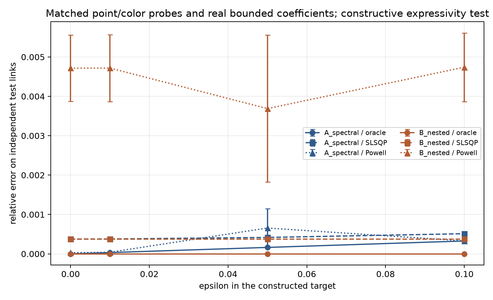

# optimize_gaussian：CPU 验收结论与后续研究

### 2026-11-25：D06 percentile hull synthetic coverage pilot 显示欠覆盖

实现 [`d06_bootstrap_coverage_diagnostic.py`](d06_bootstrap_coverage_diagnostic.py)，用已知平稳 Gaussian AR(1) 生成三臂配对 `q_theta(t)`（trainable-W、同预算 SLSQP、degree-4 Chebyshev），以精确 AR(1) 有限样本 `Var(mean)` 作风险比真值。每个外层 circular-block panel 内，D04 风险采用经验 circular-block bootstrap 的解析无限内抽样矩；外层再重抽 L=2/5/10 的配置块，构造 comparator/trainable-W 风险比及每长度 0.025 lower quantile，取 hull 最低值，同时评估 F=2 familywise coverage。已分别做 40/60/100 配置、phi=0/0.4/0.8 的 1,000-draw pilot，以及 `(n=60, phi=0.8)` 的合同 10,000 draws 复核：全量表、Wilson Monte Carlo 区间、分长度诊断与 denominator 见[样本量敏感度报告 v7](../../results/optimize_gaussian/d06_percentile_hull_coverage_cpu_20261125_v7/README.md)及[10,000-draw 欠覆盖复核 v8](../../results/optimize_gaussian/d06_percentile_hull_coverage_cpu_20261125_v8/README.md)。两包的 artifact hashes 和模拟脚本 hash 均匹配。

结果**不支持将当前 bootstrap percentile hull 当作已校准推断**：每格 250 个 simulated panels，P/V/F/A=`250/250/0/0`。`n=60` 的 F=2 joint coverage 在 phi=0、0.4、0.8 分别为 `95.6% [92.3%,97.5%]`、`91.6% [87.5%,94.4%]`、`75.6% [69.9%,80.5%]`；phi=0.8 时 n=40/100 也仅 `79.2% [73.7%,83.8%]` / `78.8% [73.3%,83.4%]`。合同 10,000 outer draws 的 n=60、phi=0.8 复核仍为 `76.4% [70.8%,81.2%]`；SLSQP/Chebyshev 的 marginal lower-bound coverage 为 `86.8%` / `85.6%`，都低于单比较 97.5% 目标。L=2/5/10 的 F=2 coverage 分别为 `64.4% / 72.0% / 76.0%`，最低值 hull 只小幅改善到 76.4%。因此该欠覆盖不是把 outer draws 从 1,000 增到 10,000 就能消除的本模拟现象。

解释边界：这证明的是**本报告具体的嵌套 block-bootstrap 实现**在所选 AR(1) 生成器/风险真值下欠覆盖；它不是实际 gauge 链的 phi 估计，也不能自动否定未来不同的 production estimator。但它足以让 D06 percentile 规则保持 `UNCALIBRATED/NOT_READY`，即使数组 reducer 算术正确也不能报告确认性 PASS。继续工作应保留同一 D04 风险比 estimand、F=2 alpha 与 r_star，对更长 block / studentized 或经偏差校准的区间做事前比较，扩展 MC 误差预算并让独立统计审阅者确认风险真值/嵌套算法；只有在已知 AR(1)、强尾/方差差异及配对相关情景下均恢复名义覆盖后，才把所选方法接入真实 evaluator。不得用本模拟调参后直接读取 sealed IDs。

### 2026-11-25：D06 配对 influence-HAC 候选与全网格覆盖诊断

为同一 `D04` 风险比写出有限 `L` empirical-risk 的解析 influence，并构造配对比值 Newey–West/Bartlett 单侧下界；HAC 方差的带宽 `2/5/10/20/30` 与 D04 `L=2/5/10` 全部取最低下界。先在和 v8 相同的 250 个 `(n=60, phi=0.8)` 面板、相同随机种子上，用 10,000-draw percentile hull 作同样本比较，见[定向比较 v4](../../results/optimize_gaussian/d06_hac_coverage_cpu_20261125_v4/README.md)：percentile 与 HAC 的 F=2 覆盖率为 `76.4%` 与 `93.2%`；HAC-minus-percentile 配对差 `+16.8 pp`，面板 bootstrap 95% 区间 `[+12.0,+21.6] pp`。HAC 的自身 Wilson 95% 蒙特卡洛区间为 `[89.4%,95.7%]`，未证明达到 95% familywise target。

随后扩展到已归档的 `n=40/60/100 × phi=0/0.4/0.8` 网格，每 cell 250 面板，同种面板同时对比 HAC 与 1,000-draw percentile hull，图文和全量配对变化见[九格覆盖报告 v2](../../results/optimize_gaussian/d06_hac_grid_coverage_cpu_20261125_v2/README.md)。HAC F=2 覆盖率按 `phi=(0,0.4,0.8)` 分别为：`n=40: 98.4%,97.6%,95.2%`；`n=60: 94.4%,96.8%,94.4%`；`n=100: 90.0%,90.8%,82.8%`。相对 percentile 的 familywise 配对变化分别为 `+3.2,+8.0,+16.0 pp`、`−1.2,+5.2,+18.8 pp`、`−4.8,−2.4,+4.0 pp`。每格 P/V/F/A=`250/250/0/0`。因此 HAC 在部分中高相关 cell 改善明显，但在 `n=100` 各 cell 和 `n=60,phi=0` 没有改善；它不是全网格稳定校准的替代方法。

解析风险梯度通过逐配置有限差分核对，新增 HAC/grid 汇总测试 5 项；本报告仍是 Gaussian AR(1) 合成方法比较。全网格 percentile 基线只有每长度 1,000 draws，目标合同为 10,000；HAC 又依赖未被证明的渐近线性化、弱依赖与矩条件，当前没有 heavy-tail、非平稳、D04 reference-fit 不确定度或 optimizer failure 覆盖。故 D06 继续 `UNCALIBRATED/NOT_READY`。后续应冻结更广 DGP 与 Monte Carlo 停止规则，比较 studentized / bias-corrected / conservative ratio bounds，并由独立统计审阅者复核后，才考虑真实 evaluator 接线；不能根据这 9 格选出最优带宽，也不读 sealed IDs。

### 2026-11-25 D06 HAC 对比反演（Fieller-style）未修复欠覆盖

新增 [`d06_hac_fieller_diagnostic.py`](d06_hac_fieller_diagnostic.py)：把 `R_comparator/r - R_trainableW` 的 HAC-studentized 单侧检验直接对 `r` 反演，构造风险比下界；同一套输入上与 influence-ratio delta HAC 对照，保留 `L=2/5/10`、bandwidth `2/5/10/20/30` 的下界 hull 与 `F=2` familywise rule。精确有限样本风险真值来自高斯 AR(1)、有限四阶矩 Student-t5 AR(1)、period-2 异方差 AR(1)；另外扫描配置相关 `phi=0/0.4/0.8`、cross-arm common loading `0/0.8`、`n=40/60/100`，每 cell 1,000 个独立面板。报告含逐 cell Wilson Monte Carlo 区间、两种方法 coverage/release 图、raw paired panels、协议和哈希，见[图文 stress v1](../../results/optimize_gaussian/d06_hac_fieller_stress_cpu_20261125_v1/README.md)。分母 `54,000/54,000/0/0`；名义 95% coverage 的 MCSE 约 `0.0069`。

结果未支持 Fieller-style 反演作为替代：全部 54 个 cell 中，ratio-delta 的 familywise coverage Wilson 下界在 `15/54` 个 cell 达到 `0.95`，contrast-inversion 在 `1/54` 个 cell 达到；**两者都没有达到全网格要求**。跨每个 DGP 的等权平均 family coverage，ratio-delta / contrast-inversion 分别是 Gaussian `0.9424/0.9143`、Student-t5 `0.9447/0.9138`、periodic volatility `0.9409/0.9119`；各 DGP 的最差 cell 约为 `0.882–0.894` 与 `0.822–0.849`。Fieller-style 有略高 release rate，但与更差 coverage 同时出现，不能解释为检出能力提高。结论仅限这组已声明风险定义与 DGP；没有包括 D04 reference-fit uncertainty、mean drift、solver failures 或 lattice 数据。新增方法测试 **7 passed**；本 checkout `tests/test_optimize*.py` 总计 **88 passed**。

下一步不要把 ratio-delta 或 contrast inversion 接入确认 evaluator。现已对**不同的 bounded block-risk estimand**实现并压力测试有限样本界，见本文件末尾；它只在 independent macroblocks 假设下有效，未替代当前 D04/D06 合同。需要独立审阅后决定是否版本化为新 estimand，并先取得独立 block 或有效依赖校正凭据；否则维持 `ABSTAIN/NOT_READY`。之后仍需同预算 SLSQP 与 degree-4 Chebyshev 同时保留，真实 trainable-W、reference-fit 传播及盲测 gate 不因 CPU 诊断而改变。

### 2026-11-25：D04/D06 风险统计量的 fail-closed CPU reducer

新增 [`risk_statistics.py`](risk_statistics.py)，将已选择的 D04/D06 公式做成纯数组 reducer：D04 按 `t=(2,3,4,5)`、`ddof=1` 计算每时刻 `Var_boot(q)+[E_boot(q)-1]^2` 并取平均；缺 draw、NaN/Inf 或 draw 数不足时保留计划分母并返回 `risk=null`。D06 固定 `F=2` 的每比较 `alpha=0.025`、`r_star=10/9`、`L=(2,5,10)`，要求 comparator/trainable-W 每个长度的风险 draw ID 一一相同且唯一，风险严格正；使用 linear 0.025 quantile 并对三种长度取最低值。任一配对缺失、零风险、非有限或除法溢出均 `ABSTAIN`；不丢弃坏 draw、不补 epsilon、不生成物理分数。

可复算文字诊断见 [`d04_d06_risk_statistics_cpu_20261125_v4`](../../results/optimize_gaussian/d04_d06_risk_statistics_cpu_20261125_v4/README.md)：D04 手算 fixture 分母 `3/3/0/0`、风险 `0.784722222`；D06 三个四-draw synthetic fixture 分别展示阈值通过、未通过、零风险弃权，缺失/无效例保留 `12/11/1/0`。report JSON 绑定 reducer 和研究合同源码 SHA-256，artifact hashes 完整。`draft_plan_20261125_v6` 已把 reducer 加入 no-launch RunSpec 草案的源码依赖映射；该草案仍为 `DRAFT_NO_LAUNCH`，物理门 `5/0/0/5`，输入分母 `0/0/0/0`。

**此项完成的是统计公式的数组层实现和失败处理，不是 bootstrap 实施或校准：**外层按 block length 的 paired configuration 重抽样、每个外层 draw 内 D04 `q` 分布、参考拟合不确定性传播、draw ID 的配置来源证明、真实 evaluator/RunSpec 接线仍未做。纯统计 helper 现有 4 项 synthetic coverage tests 加四 draw arithmetic fixture，不能取代上段所示欠覆盖；正式确认仍需校准后的区间方法及真实合同 10,000 draws。加入影响函数梯度与九格覆盖汇总后，当前整个 Optimize 测试文件集 `tests/test_optimize*.py` 为 **81 passed**（CPU only）。

下一步：percentile hull 与 influence-HAC 都已在部分指定 AR(1) cell 中显示欠覆盖；先冻结涵盖强尾、异方差、跨臂相关、reference-fit 传播的校准网格、MCSE/停止门与 complete denominator，再比较 studentized、偏差校正和保守风险比界。独立统计审阅者需复核风险真值和区间实现。接入当前 task-specific trainable-W、同预算 SLSQP 与 degree-4 Chebyshev 三臂前，先交 CPU fixture 与 coverage 图/表，再申请 production/GPU。当前没有合格 D04 reference 或生产数据授权，因此任何中间结果继续 `diagnostic_only`、`physical_score=null`；不读 sealed IDs。

### 2026-11-25 本 checkout 的 TaskSpec/RunSpec 接线审计

新增 [`draft_plan.py`](draft_plan.py) 将已选 D04/D06/D11 默认值传入 `core.specs.task_spec` 和 `core.specs.run_spec`，生成了[数据-free 草案和文字数据流](../../results/optimize_gaussian/draft_plan_20261125_v2/README.md)（旧 v1 保留为历史快照）。合同及源码 SHA-256 已绑定；只登记已开放的 D0–59 fit 与 D60–99 development-selection 元数据，没有读取配置字节、生成输入 hash、启动训练或连接 evaluator。schema 计划分母 `1/1/0/0`；五个物理认证阶段 `5/0/0/5`，`launch_allowed=false`、`physical_score=null`。

新增 [`test_optimize_draft_plan.py`](../../tests/test_optimize_draft_plan.py) 锁定这个 no-launch 接线必须保留用户选定的 F=2 两项对照：trainable-W vs 同预算 SLSQP、trainable-W vs 固定 degree-4 Chebyshev 强谱基，并检查 D06 `r_star=10/9`、160-call arm budget、空 data hash、未授权 GPU/production、5 个 physical gate 全部 abstain。新增测试与四个相邻合同/基线测试共 **36 passed**。这是计划结构回归，不是 RunSpec runner 或物理比较。

**重要的分支核验：**上述 builder/runner 源码并非丢失；它们在另一条本地 `dianjun` 分支（快照 `54f0e97`），但没有进入 PR #6 checkout。只读检查发现那条分支的 `train.py::main` 用 `model_space(p, seed)` 生成固定随机 `W`，训练/优化的是 `theta`，所以并非当前 primary 的 trainable-W；其旧 `protocol.json` 还硬编码旧单态 `m0`，并采用已观察的旧 `fit/dev_val/test` 切分。直接复制它会把旧 estimator/reference 和非 trainable-W runner 带入新合同。故本轮不整支合并、不启动它；新模块只完成通用 schema 的计划层接线，不是生产 RunSpec，也不关闭 worker 集成项。后续若继续接线，应从 `trainable_w.py` 与当前 D04/D06/D11 出发，选择性复用经审查的 worker/hard-timeout 基础设施，重做 task-specific runner 和产物回执，再用独立 CPU fixture 验证。执行前仍须有独立 E-chain reference、production evaluator/operator review、完整且已授权的输入 manifest。不要把本草案的 `validation` 键误读成最终 blind confirmation。

文字流程：`research_contract + 源码 -> SHA-256 -> 通用 TaskSpec/RunSpec -> 空数据 hash + 无 runner + 无授权 -> launch_allowed=false -> 五个物理阶段 abstained`。

### 2026-11-25 最新交接：F=2、D04/D06/D11 默认值已给出；生产证据门仍未通过

用户已确定主比较保留两个 estimand 对照（`F=2`）：trainable-W 对同预算 SLSQP、以及 trainable-W 对固定强谱基。用户随后要求由执行者自行提出缺失规则。以下工作默认已写入 [`research_contract_v1.json`](research_contract_v1.json)，状态仍是 `DRAFT_NOT_READY` / `METHOD_DEFAULTS_SELECTED_EVIDENCE_NOT_READY`；它们是供独立审阅的明确提案，不是外部 reviewer 批准，也不表示 production 或 GPU 授权。旧段落中“等待用户给 D04/D06/D11 数值”的要求均由本节替代。

- **D04 reference / risk：**目标提案为 S16T16、quenched Wilson、`κ=0.14` 的零动量价夸克 isovector pseudoscalar 能量，单位 `a_t m_pi`；以独立 E-chain 作 reference。reference 采用候选盲的 joint two-state PP(`n=0,8,16`)+local A4P spectral fit，主窗 `[3,8]`，检查 `tmin=2,3,4` 及 2/3-state；PP even fold、A4P odd fold、shared states、diagonal shrinkage 0.25、eigenvalue floor `1e-10`，所有 arms 共用窗口、协方差、blocks 和 reference draws。风险为 `qθ(t)=Cθ(t)/(Aθ f0(t))`，`Rθ=mean_{t=2..5}[Var_boot(qθ(t))+|E_boot(qθ(t))-1|²]`，振幅窗 `[6,8]`。候选 gate 为相对质量误差 `≤0.05`、`p≥0.01`、PP/A4P 与窗口/模型位移 `≤2.5` paired SE、无边界命中。E-chain correlator receipt、拟合结果和独立 review receipt 均为空；因此 D04 仍未实测。
- **D06 最小效应：**提案 `r_star=10/9=1.111111…`，定义 `ρ=R_comparator/R_trainableW`，要求至少 10% 风险下降；两项比较共用 one-sided `α=0.05`，Bonferroni 每项 `0.025`，10,000 paired block-bootstrap draws，主 block length 5、敏感度 2/10。三种 block length 区间的 hull 下界都必须大于 `r_star`；零风险或比值无定义则 `ABSTAIN_RATIO_UNDEFINED`，不得加 epsilon。
- **D11 强谱臂：**提案为 degree-4 Bernstein/Chebyshev 家族。对周期三维、等权、unitary 3×3 links，`H=Σ_i(T_i+T_i†−2I)`，`spec(H)⊂[-12,0]`，`y=I+H/12∈[0,1]`；这里 U(3) unitarity 足以证明谱界，真实 QCD production 仍需独立 SU(3) provenance/determinant 收据。`P4(y)=Σ_i b_i C(4,i)y^i(1−y)^(4−i)`，`0≤b0≤…≤b4=1`，故 `0≤P4≤1`、单调，且谱端点 `P4(y=1)=1`；这不表示任意 gauge 场都有 `H=0` 本征态。共同外层为未逐步归一化的 `G²P4(H)G²`，`G=I+0.10Σ_i(T_i+T_i†)=1.6I+0.1H`，`spec(G)⊂[0.4,1.6]`；`6.5536=1.6^4` 仅在存在 `H=0` 本征态时才是该态响应，不是配置级归一化因子。合同拒绝非幺正 links、错误形状/边界、非有限值和不可行控制点；D11 独立 review 仍为空。
- **预算提案：**每臂单一预注册起点，最多 160 objective/gradient calls；训练、setup、solve、inference、I/O、失败恢复和 total walltime 都须计账，目前真实秒数与 instance/fit/heldout/seed hashes 为空，amortization task count 暂按 1。

**已归档的图文诊断及可支持结论：**

### 2026-11-25：D11 与实际 hopping / Clenshaw 实现的合同交叉审计

源代码和代数交叉审计见[报告](../../results/optimize_gaussian/d11_operator_contract_audit_20261125_v1/README.md)：planned/valid/failed/abstained=`9/7/0/2`。七项在当前周期 `(z,y,x)` 存储、`(x,y,z)` 方向索引、成对 Hermitian hopping、unitary links 谱界、Chebyshev 标度、Bernstein 正性及共同 Gaussian sandwich 上一致；两项 abstain 是物理 QCD SU(3) provenance 尚未单独核验、以及 production objective/RunSpec 未接通。报告绑定 `research_contract_v1.json`、`contract.py`、`candidate_contract.py`、`features.py`、`kernels.py`、`chebyshev_baseline.py` 和 `trainable_w.py` 的 hash。审计中发现并修订了旧措辞：U(3) 已足够支撑数学谱界，但 CPU helper 只验 `U†U≈I`；此外 `y=1` 是谱上端点，不保证为某个实际 gauge operator 的本征值。

同一更正已同步至 `research_contract_v1.json`、`contract.py`、candidate adapter 及 [约束谱基报告 v4](../../results/optimize_gaussian/chebyshev_constrained_baseline_20261125_v4/README.md)；[contract diagnostic v3](../../results/optimize_gaussian/contract_diagnostic_20261125_v3/README.md) 和 [candidate contract v6](../../results/optimize_gaussian/framework_candidate_contract_20261125_v6/README.md) 也由当前源重建。强谱方法合同现把零模因子写为条件项。所有都仍是 CPU/结构证据，不是物理比较。

1. [`trainable_w_stress_20261123_v4`](../../results/optimize_gaussian/trainable_w_stress_20261123_v4/README.md)含 paired heldout-loss 图、预算收敛图、conditioning/baseline 图和完整失败分母：36/36 synthetic panels、288/288 solver runs 返回，93 次到达预算上限且 solver 报 non-success，未排除样本。local-environment 的 6 个 cell 中 joint-W 的 cell median 都优于固定 width-2，但 0/6 优于等参数数目的固定 width-6；spectral-heat 的 paired cell medians 接近 1。样本只是每格 3 个 synthetic panels，不能推断总体或物理排序，也没有使用 D04 risk。
2. [`trainable_w_meta_init_20261123_v5`](../../results/optimize_gaussian/trainable_w_meta_init_20261123_v5/README.md)含训练/评估数据流图与成本诊断：12 个训练 panel、12 个独立评估 panel，108/108 solver runs 返回。学习得到的 warm start 仍与 SLSQP 联用；在该窄 synthetic 分布，10%/1% 初始拟合损失目标的 online calls 均值为 3.58/4.25，对 cold SLSQP 的 4.58/6.92；将 192 panel-equivalent 训练/诊断成本计入后，算术 break-even 是 K=193/73。它不是 learned-smear 优于物理 SLSQP 或强谱基的证据，也没有可比生产 walltime。
3. [`chebyshev_constrained_baseline_20261125_v4`](../../results/optimize_gaussian/chebyshev_constrained_baseline_20261125_v4/README.md)给出约束推导、响应图、dense/matrix-free 路径和 bounded-call SLSQP helper；只做 illustrative controls，objective fit 分母为 `0/0/0/0`，尚未接 `train.main` 或生产 evaluator。[`framework_candidate_contract_20261125_v6`](../../results/optimize_gaussian/framework_candidate_contract_20261125_v6/README.md)只是 schema flow，物理五阶段均 abstain（`5/0/0/5`）。旧的 unconstrained Chebyshev 三面板 positivity 图不证明新约束拟合在 production operator 上的数值稳定性。

**下一位 agent 的具体工作：**先按实际 `kernels.py` 与生产字段逐项复核 `H` 的维度/shift/边界、link unitarity、source 与 `a_t mπ` 约定，并由独立 reviewer 签署 D04/D11 合同；不一致则发新版本合同并保留旧快照。之后把合同接入真实 `RunSpec` / `train.main`，生成 hash-bound run plan 和 fail-closed physical `RunState`，交付图或文字数据流及 planned/valid/failed/abstained 分母。等 E-chain reference receipt 和数据授权到位后，先跑固定预算 CPU dry-run，再申请独立 GPU/QUDA smoke，最终才可做同配对的两项比较与盲测；报告须同时给风险区间、calls/time best-so-far、分项 walltime、residual/KKT、失败样本和成本摊销。任何一步未满足时维持 `NOT_READY/UNCERTIFIED`、`physical_score=null`，不读 gap/validation/sealed IDs。

### 2026-11-22 历史交接：F=2 与 degree-4 候选（下文早期 D04/D06 未定表述已被上方 2026-11-25 提案替代）

### 2026-11-21 完整性复核：保留 TODO

**历史边界确认（2026-11-21，已由上方2026-11-22 handoff细化）：**用户要求维持 `NOT_READY/UNCERTIFIED` 与数据封存状态。已选定的确认性对照仍为 trainable-W vs 同预算 SLSQP、trainable-W vs 固定强谱基（F=2）；D04 reference、D06 `r_star` 与生产阈值不代填。当前可完成的D11与C1/C2接口/文档一致性审计已完成；在研究值、物理reference与预算获审阅前，无需继续扩CPU toys或接入生产入口。不运行GPU/QUDA、不读gap/validation/sealed IDs、不生成物理score。

**实现状态：CPU parameterization prototype completed / production integration and physics comparison still NOT_RUN。**
隔离的 [`trainable_w.py`](trainable_w.py) 已实现共享实W/v/c、空间中心化与现有Hermitian hopping kernel的解析梯度训练；
[图文诊断](trainable_w_cpu_prototype_20261121/README.md)保留独立synthetic teacher、4 fit/3 heldout links、逐例误差/完整trace与失败分母。
新增测试 **9 passed**，相邻feature/kernel聚焦 **7 passed, 48 deselected**；覆盖梯度、实际W更新、gauge与48个含反向link-anchor处理的cubic/parity变换。
它仅是coefficient-fit原型，不是gauge-ensemble physics risk、不比较SLSQP，也不改变生产train.py或研究者TBD；TODO仍须保留。

**2026-11-21 历史交接（已由上方 2026-11-22 状态更新）：**D04 reference 与 D06 最小效应的可审阅备选表、D11 degree-4 candidate 和共享objective/预算流程现已列在[研究决策单](protocol_decision_review_20261121.md)与[`protocol_freeze_draft.md` §7](protocol_freeze_draft.md)。不重复起草；研究值仍未冻结，后续 agent 只按上方指令检查其与当前CPU算符接口的一致性。

当前核心问题仍未完成：真实生产数据上的 trainable-$W$ / learned initializer 与 Gaussian、同预算 SLSQP、强谱基的盲测尚未运行，P3 生产 2×2 也未运行，因此本文件不能删除。真实 D 链 point-propagator 输入、trajectory identity 和 residual 已由 adapter 100/100 核验；这只关闭输入集成，不等于重新采样模型 metadata、训练 learned $W$ 或完成生产 score。关于包 B 覆盖事故的报告已对照[`cpu_next_package_b/README.md`](../../results/optimize_gaussian/cpu_next_package_b/README.md)：`unified_v1/` 曾被同名输出覆盖，旧 fold 未纳入 Git 且该目录无法从当前仓库恢复；这是仓库内可恢复性的结论，不排除外部备份；不要重复本地恢复搜索。旧比值 1.719/2.014/0.810 仍作为三折描述值保留在[任务README](README.md)与[包B报告](../../results/optimize_gaussian/cpu_next_package_b/README.md)，其 reference gate 三折均失败且 fold 间不构成独立误差估计；它们只是历史说明，不是可复现的新 artifact 或当前方法排名。**历史全仓 CPU suite** 为 **274 passed, 1 skipped, 1 warning**（2026-11-20，`PYTHONDONTWRITEBYTECODE=1 python3 -B -m pytest -q -p no:cacheprovider -rs`）；同一历史快照的 Optimize 主测试文件为 **53 passed**、solver contract 为 **11 passed**。这不是当前源码下的全仓复跑。本轮已有较新的 Optimize 六模块定向 CPU suite **113 passed**（含 solver contract 当前 **13 passed**），以及 worker receipt focused **24 passed**、standalone hard-timeout **9 passed**；这些 pytest 主要使用隔离 CPU fixture，不证明 production 训练或 GPU/QUDA 中断安全。另见下方 synthetic `train.main` 子进程诊断，它只验证 CPU 控制流，不代表真实输入或物理比较。

**当前完整 CPU/GPU-free suite（2026-11-22）**：在 matrix-free Chebyshev/sandwich 更新后的工作树运行 `PYTHONDONTWRITEBYTECODE=1 python3 -B -m pytest -q -p no:cacheprovider -rs`，最终 **418 passed, 1 skipped, 1 warning**。跳过项是缺少 CuPy 的 stout parity test；warning 是 Wilson projection rejection 测试触发的 `RuntimeWarning`。这证明当前 CPU 路径的回归通过，不证明 QUDA/GPU 执行、reference validity 或物理结论。2026-11-21 的385 passed及本次增量前的413/415/417均为历史快照。

另一个已完成的 CPU 算符级桥接诊断见[报告与图](trainable_w_operator_cpu_20261121_final/README.md)：36/36 optimizer runs 均有收据，有限差分梯度误差最大约 `1.23e-11`，压缩与直接目标差最大约 `1.67e-16`；在该 heat-kernel 合成目标和三个小 panel 上，没有稳定的 trainable-$W$ 优势，degree-4 Chebyshev 谱基误差更低。此结果是条件性负诊断，不是生产排序；不要再扩相同目标/标签来替代冻结物理目标、reference 和确认性比较族。

复核结论：包 B 覆盖事故与 README 记录相符，但“当前 Git 无法恢复”只限定于仓库内，不排除外部备份。剩余事项也不能笼统写成“都需要 GPU”：RunSpec 与 `train.optimize` 的 solver gate CPU 接线已有独立测试闭环；待冻结的是研究者决策阈值、估计目标、成本边界及统计规则，并需将训练产物 receipt 带入真实 RunSpec/worker 审查。真实训练、metadata 复采、生产 2×2 与未观察 blind comparison需要相应生产输入、GPU 和 split 授权。任何 CPU 完成项都不替代真实 learned-$W$ 是否优于 SLSQP / 强谱基这一主问题。

**本次裁决与下一工作边界：**“所有未做项均需 GPU / 授权”不成立：研究决策选项和若干CPU接口检查已在封存下完成，但研究者要求保持 `NOT_READY/UNCERTIFIED`，因此不把TBD写入生产协议。C2/C3样本量警示属于Pion的不同模拟设计，不应用来汇总Optimize的C2/C3或物理证据。D04/D06仍是物理研究决策；D11候选与C1/C2接口一致性审计已完成。下一步要等物理reference、`r_star`、Chebyshev算符/约束和每臂预算获审阅后，才能接入真实 objective / RunSpec / paired production comparison。不要重复synthetic扩样、重建包B旧fold，或在reference gate失败时产生物理分数。若之后获批运行，诊断须含图或可查文字流程、planned/valid/failed/abstained分母及适用边界。

**后续生产阶段的历史开工顺序（当前不执行）：** task-specific [`runspec_builder.py`](runspec_builder.py) 的输入绑定、CLI no-launch 和 CPU preflight 已完成；builder→worker 有假 child artifact fixture，也新增了真实 `train.main` 在 worker 子进程中的 synthetic CPU integration（见[图文报告](../../results/optimize_gaussian/cpu_train_main_supervisor_v2/README.md)）。可审阅的 [`protocol_freeze_draft.md`](protocol_freeze_draft.md) 把 split/reference 边界与研究者需决定的最小效果、双预算、KKT 和统计门分开；其中的 `TBD` 按用户当前决定继续保持，不在本轮逐项冻结。待这些研究决策后续获审阅、reference可用且单独授权时，才用builder生成no-clobber RunSpec并运行训练/比较。届时所有诊断须有文字说明、身份/状态与适用边界；软件接线或preflight smoke报告数据流/receipt/trace，不伪造paired-risk或物理成本；实际方法对照提供paired CI、calls/time收敛、setup/training/inference/solve/total成本及KKT/residual、超时、失败/弃权分母。

### 2026-11-21：trainable-W 算符目标桥接与强基线负诊断（CPU 完成）

[图文、完整数值和失败分母](trainable_w_operator_cpu_20261121_final/README.md)及[`trainable_w_operator_diagnostic.py`](trainable_w_operator_diagnostic.py)已将目标从同模型族 coefficient labels 推进到完整算符作用量：新合成 SU(3) links 的 trace-normalized heat kernel，周期空间 L=3、完整 color/site identity probes，无随机 probe 误差。它和候选 K 共享空间/边界/trace=dim 约定，但不冻结生产 normalization。3 个独立 panel 各用 3 fit / 3 heldout links；每个 panel 运行 fixed-W width2（3 个拟合标量）、joint-W width2（7 个）与 fixed-W width6（7 个）× SLSQP/L-BFGS-B × 40/160 objective+gradient call cap。后两臂提供相同拟合参数数目的敏感性对照；它们函数族和初始化不同，不能称完全相同 capacity。SLSQP/L-BFGS-B 只作为每一参数化内部的求解器对照。完整36/36求解返回、4个预算截断/solver non-success、无样本排除；独立 fit/heldout links 的 gradient FD 最大差 `1.23e-11`，压缩二次目标与直接矩阵最大差 `1.67e-16`。原有模型测试 **9 passed**。

160-call 时 joint-W heldout relative squared Frobenius error 约 `0.006005–0.006146`，与 fixed width2 的差仅约 `1e-7` 绝对量级或更小。等7参数 fixed width6 在1个 panel略好、2个略差，未得到稳定 W 学习优势。degree4 Chebyshev 同 fit-target 的直接最小二乘误差为 `3.34e-8–2.40e-7`，degree1约 `0.0060`。该目标本来就是谱函数，谱基参数域、identity coefficient 和直接解成本也不同；结果支持这个目标下“扩大算符作用范围比微调单跳系数更有作用”的结构诊断，不能作为普适方法排名、物理 risk 或成本优势。图展示 heldout error、拟合 calls 曲线和等参数配对；原始JSON保存全部trace/参数/KKT连续诊断/失败状态，NPZ和protocol/source snapshot保存实际输入与源码身份。未运行GPU或生产数据，`physical_score=null`。

**接手决策：**不要继续用相同 heat-kernel 或同模型 coefficient labels 扩样争取学习优势。这两个实现门已经完成。若继续真实 learned smear，先冻结物理目标/reference、kernel归一化/正定性与强基线，选择多跳/ Gaussian sandwich/谱+局域修正中的有物理依据的算符族，再按下文生产决策单做训练接线及配对GPU开发。SLSQP和L-BFGS-B在每个模型内比较；模型之间另报告自由参数数、算符范围、setup/training/inference与solve总成本。当前CPU负诊断不解决失败的Pion reference，也不授权读取shared holdout。

### 2026-11-21：真实 `train.main` 在 worker 下的 synthetic CPU integration

[`train_main_supervisor_diagnostic.py`](train_main_supervisor_diagnostic.py) 已用一个隔离 worker 子进程实际调用 `train.main`，而不是仅在 builder 生成后用假 child 替换命令。保留真实 SciPy Powell、`train.optimize`、solver contract、protocol hash recheck、RunSpec worker supervision 和 parent artifact receipt；只把 collect/evaluate、risk observable 与 coefficient map 换为固定 synthetic fixture。结果见[报告和 best-so-far 图](../../results/optimize_gaussian/cpu_train_main_supervisor_v2/README.md)：worker=`completed`，训练产物 4/4 hash verified，3/3 synthetic inputs identity-verified；Powell success，32 objective calls，KKT diagnostic `computed`，残差约 $2.86\times10^{-19}$。没有初始化 GPU/QUDA，也没有读取 archived/production 数据；协议阈值只供 fixture 走通，全部标 `diagnostic_only` / `physical_score=null`。这关闭的是训练入口—外层 worker—产物 receipt 的合成 CPU 接线缺口，不是 production RunSpec、GPU hard-timeout、learned-$W$ 优势或物理 PASS。

### 2026-11-21 CPU preflight：训练入口支持 hash-bound protocol，生产 RunSpec 仍未闭环

`train.main` 现在接受成对参数 `--protocol PATH --protocol-sha256 SHA256`；子进程读取前重新计算 protocol 原始字节 hash，再解析 JSON。漏传任一参数或 hash 漂移均在准备输出目录、读取测量输入和 GPU 初始化前拒绝。文本数据流为：RunSpec 文件 hash 校验 → child 显式 protocol 路径/hash 再校验 → 新输出路径保护 → 输入/receipt 检查 → 才可能进入训练。新增 `tests/test_optimize_training_protocol.py` 与原 Optimize 主测试合计 **59 passed**；其中 6 项新用例验证正确 hash、错误 hash、参数配对和非 object JSON 拒绝。没有启动训练、读取生产缓存或初始化 GPU。

这关闭的是 protocol 传递/child recheck 的 CPU 接口缺口，不自动形成可运行的生产 RunSpec。worker RunSpec 现可在 `outputs.artifacts` 声明 `results.json`、`manifest.json` 等路径；这些产物可位于训练进程新建的输出目录下，预检只要求最近已有目录祖先存在并拒绝任何已存在目标。只有进程组完全退出且子进程正常结束后，父回执才逐项写入 SHA-256，失败/超时/残留子进程则标 `not_accepted` 且不计算产物 hash，声明产物缺失时为 `incomplete_or_unreadable`。文本数据流是：RunSpec/input hash preflight → frozen protocol child recheck → supervised child → 清理残留进程 → 成功产物逐文件 hash → parent receipt。`tests/test_optimize_hard_timeout.py tests/test_optimize_worker_runspec.py` 本轮 **24 passed**；7 个新增场景覆盖成功 hash 回链（含新建的 training output 目录）、失败产物拒收、成功但缺少产物、预存产物 no-clobber、leader 成功退出但留下子进程时拒绝其产物，以及 artifact 完整度对应的 CLI 退出码。没有启动训练、读取生产缓存或初始化 GPU。solver gate、预算阈值、可中断 GPU/QUDA 语义和物理 reference 仍须分别闭合。

任务专用 [`runspec_builder.py`](runspec_builder.py) 从显式 protocol 生成 worker schema v2 spec，推导互斥的 `fit/dev_val/test` 配置ID，绑定 manifests、逐配置 gauge/propagator/sidecar、reference/bootstrap、可选 Pion measurement receipt，以及 Optimize/统计/监督器源码 hash；child argv 绑定 protocol 原始字节 SHA，产物清单覆盖 `results.json`、`manifest.json`、`data.npz` 和各 seed 的 `basis_s*.npz`。新增 `tests/test_optimize_runspec_builder.py::test_built_runspec_crosses_supervisor_boundary_and_hashes_cpu_fixture_outputs`：确认 builder 生成的命令目标为 `tasks.optimize_gaussian.train`、协议路径/hash 成对绑定；随后仅在隔离 fixture 中用假 worker 替换命令，经过真实 `worker_runspec.run_frozen_worker` 完成输入 hash preflight、子进程监督和全部声明产物的 parent hash receipt。builder 测试 **11 passed**；连同 worker RunSpec 测试 **26 passed**。完整的文字数据流与限制见 [CPU preflight 报告](../../results/optimize_gaussian/task_runspec_preflight_cpu_v1/README.md)。这个测试没有执行 `train.main`，没有读生产缓存或初始化 GPU；当前 v9 protocol 不可复用作 blind，Pion reference 失败，真实 D 输入与允许运行的阈值/预算方案也未冻结。后续必须用新审阅 protocol 和实际生产输入生成一份新的 RunSpec，并在任何 GPU 启动之前完成 review/authorization；不得把 CPU orchestration fixture 当作训练或授权证据。

本轮定向跨任务复跑（Optimize builder / worker / training protocol / 主测试，Pion 主测试，Wilson force controls）**144 passed in 31.95 s**；该集合验证了本轮相关路径，不等同全仓 CPU suite。

本轮发现并关闭了同类的**代码级覆盖入口**：`unified.py` 原先固定写入已存在的包 B 目录，`train.py` 默认也会写入历史 v9 目录。现在两者都要求新输出路径；`train.py --resume` 只接受 basis 缓存目录，且缓存仍需通过既有 protocol/input identity 检查，包含最终结果或其他文件时一律拒绝。相应回归测试验证拒绝发生在数据读取和 GPU 初始化之前。历史产物未改写。

P3 的 CPU 前置设计与接口诊断已补充到 [`doc/optimize_p3_design.md`](../../doc/optimize_p3_design.md)。在下方“nested solver contract”新增接线之前，generic SearchAdapter 只消费 scalar risk，有限差分 KKT 也仅为 diagnostic-only 观察；两者的历史状态不能当作当前 solver gate。CPU solver gate 后续已按显式 protocol 接入 `train.optimize`，但 P3 方案仍未冻结，改善阈值、样本数/功效、multiplicity、abstain 与成本限制都待研究者确定。当前接线证据与边界见新增 CPU 接线报告，不等于 production 收敛/物理门。

### 2026-11-20 Powell 只记录 receipt：CPU 通过，生产 gate 未实现

`train.optimize()` 在保留原 `risk/theta/nfit`、loss、Powell 选项和 dev-val 选优的基础上，新增 `optimizer_receipt`，
在新运行的每个 grid 点与 best 中保存原 success/status/message、nfev/nit、自计 objective calls、elapsed、
精确边界命中/越界索引及非有限状态。字段表和文字流程见 [`P3 设计 §9`](../../doc/optimize_p3_design.md)。
新增四个 focused cases **4 passed, 36 deselected**，仅用固定微型输入、受控 optimizer 状态和 pytest 临时目录；没有 GPU、
生产数据读取、synthetic 扩样或历史结果修改。该实现是 `diagnostic_only` 的可观测性增强，不拒绝 optimizer 的有限失败结果，
也不实施 KKT/residual/逐臂ID/walltime 门槛。当前 main 为 optimizer/loss 异常增加下述失败收据，但仍原样传播异常。

receipt 现另含 `objective_trace`：每次正常完成 objective 调用的 index、elapsed、原 loss value/finite 与 finite-only
best-so-far（首个有限值前 null；非有限原值以明确字符串编码，但返回给 Powell 的 loss 不变）。新 run 可以据此画 calls/time
两套 best-so-far 图；历史 run 没有 trace，只有之后授权的新目录重跑才能得到新轨迹，禁止反推或回填旧记录。
trace/异常 focused tests **7 passed, 36 deselected**；包含 mixed NaN/±Inf/finite、单调best-so-far、原返回保持与
`scipy.minimize`/loss 异常原样传播。本轮另复跑完整 task 文件 `tests/test_optimize_gaussian.py`，**47 passed**；
连同 Pion / Wilson 任务的全仓 suite 为 **222 passed, 1 skipped, 1 warning**。
正常 receipt 记录 optimizer 返回；当前新增的 failure receipt 另记录异常，不返回 partial fit。

### 2026-11-20 Powell 盒约束 KKT 诊断（CPU，不是 gate）

每个正常 optimizer 返回后，receipt 现在独立记录 `box_kkt_diagnostic`：对 `risk + L2` 在最终theta处做相对步长
`1e-5*max(1,|theta_i|)` 的有限差分；内部用central、靠近下/上界用forward/backward；保存活动索引、梯度、原单位与缩放后的KKT violation、
探针调用数/时间。探针调用不记入Powell trace，避免best-so-far被诊断点改变；不影响 risk/theta/nfit、选择或结果门。
非法点、探针异常、非有限值和退化区间均有状态，`threshold=null`，不会因诊断失败拒绝候选。因为风险函数可能非光滑且有限差分依赖步长，
它不是严格KKT证明，也不是QUDA residual；production gate、solver停止/弃权阈值、双预算hard stop仍未实现。

定向测试覆盖内部二次目标、下/上界KKT符号、违反边界条件、非有限和异常探针；`tests/test_optimize_gaussian.py` 全文件 **53 passed**。
这些是CPU接口/受控数学验证；没有真实GPU、生产训练、walltime benchmark或物理score。

### 2026-11-20 optimizer/loss 异常的原子失败收据

main 在经输出保护的新/仅 basis 未完成目录内，为每次 optimize 绑定协议/代码 hash、seed/lam2 和此前完成 grid。
minimize/loss 抛异常时将已完成 objective_trace、进入/完成计数、耗时、异常类型/消息与上述身份原子写入
`optimizer_failure.json`（`diagnostic_only`，physical_score=null），再重抛**原异常对象**；不返回 partial fit、不继续选优或test。
同目录临时JSON完成并fsync后用no-clobber hard-link发布，已有failure文件和已完成结果目录均拒绝覆盖。
写盘失败会给原异常附加原因后继续抛原异常，临时文件清理；IO失败时不能保证有收据。直接调用 optimize 而未提供run context不写收据。
覆盖仅为 minimize/loss 的 Exception；输入/collect/GPU/dev-val/test/进程中断不在本项覆盖内，不能称为全部失败覆盖。
字段/状态表见 [`P3 设计 §9`](../../doc/optimize_p3_design.md)。历史结果未修改，新执行必须重新绑定当前源码hash。
失败/正常receipt相关定向测试 **11 passed, 36 deselected**；与原预算/配对/输入残差/cache/manifest 检查合并为
**24 passed, 23 deselected**。全部使用固定微型输入、模拟optimizer与pytest临时目录，无GPU、生产/holdout读取或benchmark扩样。

下一位 agent 先按 P3 待冻结参数表与研究者确定收敛/截断/弃权与双预算口径，再把已接入的 nested contract receipt 纳入真实 RunSpec/parent receipt 与结果审查；
不得从 `success=True` 或字段齐全推断物理通过。train.py 改动后旧 adapter/provenance 的冻结 source hash 仅代表历史代码；
新执行须绑定当前 hash，不能回写旧收据来制造当前版本的集成证据。真实 trainable-W/initializer、P3 生产 2×2 和盲测仍为 `NOT_RUN`，TODO 保留。

下一位 agent 先完成真实测量前的 protocol / feature / objective / 双预算 / source-sink / residual 门槛冻结，并生成绑定输入、代码、环境与设备的 RunSpec 和 receipt；为 D 链 0–99 复用已核验 point-propagator 时先冻结 Optimize RunSpec，再执行 P3 2×2 和真实学习型 smear 对照；不得重做相同 inversion。交付必须包括 paired-risk 区间图、best-so-far 收敛图、walltime 与训练摊销图、KKT/residual 和失败表，以及解释样本、预算截断和适用边界的文字报告。现有 CPU synthetic 路线已有诊断，不得只更换 seed 重复扩样来替代物理比较。

### 2026-11-20 receipt adapter 的真实输入集成通过

新 adapter 已在远端把真实 Pion NPZ/provenance 与实际 D-chain gauge/propagator cache 一起送入 `train.validate_inputs`：[报告](../../results/optimize_gaussian/d_chain_propagator_adapter_20261120/README.md)和[汇总收据](../../results/optimize_gaussian/d_chain_propagator_adapter_20261120/adapter_check.json)显示 **100/100 verified、0 failure、100 个非空 trajectory ID**；最大 residual `9.99751e-11`。`adapter_check.json` 不保存逐 ID 成功明细，其 `trajectory_join_count` 仅统计非空 trajectory 字段；实际 trajectory 与 HMC manifest 的等值 join 由独立的[propagator reuse audit](../../results/optimize_gaussian/d_chain_propagator_reuse_audit_20261120/README.md)核验。两份证据合并支持 D0–99 cache 身份与残差可复用；不能把 HMC crosswalk 归功于 adapter 单项。显式绑定的 receipt 对缺配置、缺 residual/trajectory 字段 fail closed；相关聚焦单测 **2 passed**。本验证不包含模型训练、P3 2×2、物理 score 或盲测。

### 2026-11-20 D 链 propagator 复用审计：输入可用，score 仍被 reference 阻断

Pion D development 已产生 IDs 0–99 的 point-source propagator 缓存。只读复用审计[报告](../../results/optimize_gaussian/d_chain_propagator_reuse_audit_20261120/README.md)核验 100/100 `.npy` 字节 SHA、100/100 gauge SHA 与 HMC manifest、trajectory join、`complex128`、geometry `16^4`、source `[0,0,0,0]`、boundary `-1`、`kappa=0.14`、tolerance `1e-10`、maxiter `10000`；最大记录 residual 为 `9.99751e-11`。Optimize 的 fit IDs 0–59 / development IDs 60–99 可避免重复 point inversion；新 RunSpec 仍须绑定这些 cache hashes 与 Pion generation/provenance。cache JSON 未写 residual 字段；`train.validate_inputs` 现支持由显式协议绑定 Pion NPZ / provenance 的 SHA、generation 和 protocol hash，并从 provenance 取每配置 residual。聚焦回归为 **2 passed**，真实 D0–99 adapter 集成为 **100/100 PASS**。这还不是 Optimize-specific RunSpec、训练 receipt 或得分，未改写 cache 或 Pion 结果。

**当前不可做物理 score**：Pion D development single-cosh reference gate FAIL，后续两态诊断也发现晚时间窗 excited mass 命中上界。Optimize 若继续用旧 `m0` 或该失败 reference，风险数字只能标为 `diagnostic_only`，不得作为 learned-smear 优势。先定义可验证的新 reference protocol，再冻结 Optimize-specific RunSpec、feature、objective、score、双预算和代码 hash；不访问任何 blind ID。D IDs 100–139 为 embargo/gap，140–199 仍是三任务共享封存区。

### 2026-11-20 本地续查：生产对照需要新的执行环境与 blind IDs

当前桌面无 CuPy、PyQUDA、mpi4py、torch 或本地 raw gauge 副本；Kunshan DCU 已成功完成两条新 HMC 链。2026-11-20 live audit 核验旧500个 NERSC 文件与各自 manifest 500/500匹配，且 `S16T16`/B/C 重叠 payload逐ID相同，B/C不能作为独立blind ensemble。新 `S16T16D` 数据在远端有200个manifest绑定配置；HMC receipt/逐轨迹和200/200 payload hash诊断保存在[主链报告](../../results/wilson_loop/hmc_production_20261120/diagnostic/README.md)。原始 gauge bytes 未复制到桌面；Pion D0–99 point propagator cache 已在远端生成并核验 100/100，Optimize receipt adapter 对实际100个ID集成 **PASS**，因此这些 fit/development ID 不需重做 inversion；独立 Optimize RunSpec / optimizer receipt 仍未生成。v9旧90个 gauge hashes可核验，但propagator原始字节和运行/设备receipt仍缺。P3 2×2、trainable-$W$ 与真实 held-out比较尚未运行；无需再找已存在的 gauge bytes，也不要重跑同一 synthetic generator。

审计基线：2026-11-20 当前工作树；此前全套 CPU / GPU-free 测试为161 passed；输出保护改动后复跑 `python3 -B -m pytest -q -rs` 得 **170 passed, 1 skipped, 1 warning**。唯一跳过项是本机缺少 CuPy 的 stout parity test；warning 是已知 Wilson projection rejection `RuntimeWarning`。CPU 包 A–D 与 C 收敛审计已有实现和诊断；本文件保留，
因为关键研究问题——**学习型 smear 是否能在独立物理数据上超过 SLSQP 与更强算子基线**——仍未回答。

### 2026-11-20 新 HMC 链完成，Optimize 生产比较尚未运行

Kunshan job **128526595** 的 `S16T16D` 链已完成1396条轨迹、400条热化、996条生产，200个保存配置的payload hash 200/200验证；图文质量诊断见[报告](../../results/wilson_loop/hmc_production_20261120/diagnostic/README.md)。冻结的 Optimize split 为train0–59、development60–99、embargo100–139、blind140–199。IDs140–199同时预留给Pion validation、Optimize blind test与可能的Wilson比较；shared holdout尚未打开。Wilson已冻结 [D 链 RunSpec](../wilson_loop/protocol_d_20261120.json)，只授权D0–99和D120–139且明确封存140–199。独立 `S16T16E` chain (job128528670) 是Pion anchor来源，不自动成为Optimize训练集。Pion D0–99 propagators 已由 Optimize adapter 对实际缓存集成 **100/100 验证**，但 Optimize 专属 RunSpec 和训练 receipt 尚未生成，trainable-$W$、生产 P3 2×2与 blind comparison 均为 `NOT_RUN`。

当前研究问题仍是学习型 smear 能否优于 SLSQP/强谱基；所有 production protocols、feature/parameterization、score与预算须先冻结。Pion、Optimize、Wilson共同消费 D IDs140–199时，三个分析必须在首次解盲前都锁定，后续结果在任务间相关，不能当作独立复现。输出paired-risk、KKT/residual、收敛/成本图和失败文字；任何真实 GPU测量都必须等生产工作解锁后再启动。

## 1. 当前证据和不能越界的结论

### A：可信输入与 reference 身份

`train.validate_inputs` 会检查 gauge / propagator 内容摘要、geometry、boundary、tolerance、iteration、precision 与
inversion residual。缺 metadata 降级为 `archived_diagnostic/unknown`，可信入口 residual 超界或输入不符时拒绝；
`reference_identity` 绑定实际消费的 bootstrap/reference 文件。历史 GPU environment 未知时不会拿当前机器信息回填。

### B：point / replica 同估计量和回归

- `risk_with_fixed_amplitude` 分开 training-frozen 与 validation-refit；fold artifact 保存 train/test block IDs、
  weights/scales/mass identity、search 预算与失败。
- [`cpu_close_20261119_B_regression_fitted`](../../results/optimize_gaussian/cpu_close_20261119_B_regression_fitted/README.md)
  是 60 datasets × 200 draws 的真实分块 synthetic regression。point−replica 偏差均与 0 相容；training-frozen
  四时间点同时覆盖 60/60，验证 refit 53/60，二项 CP 区间分别 [0.940,1] 与 [0.774,0.952]。
- 这是 toy conditional interval，训练幅度不确定度没有传播到验证区间；不可将其称为真实数据 calibration。
  `cpu_next_package_b/regression/` 仅是 5×20 smoke。测试已改为写 pytest 临时目录，防止小测试再次覆盖归档数字。

### C：公平 operator-class 表达能力测试

[`cpu_close_20261119_C_matched`](../../results/optimize_gaussian/cpu_close_20261119_C_matched/README.md) 使用全空间
色荷 covariant Laplacian $H$、Hermitian clover $B$、匹配的 point/color probes 和 train/test 独立 links；系数是同一
实数域 $[-5,5]$。$Q=H^2+\epsilon BHB$，类 B 又显式含 $BHB$，故 B oracle 在 $\epsilon>0$ 的零误差是
**构造性的可表示性**，不是模型从数据学到了 $Q[U]$，也不是物理学习优势。

三 seed mean：类 A oracle error 从 $\epsilon=0$ 的 $\sim4\times10^{-16}$ 增至 $\epsilon=0.1$ 的
 $3.27\times10^{-4}$；类 B oracle 约 $10^{-15}$。实际 SLSQP/Powell 在有限 probes / budget 下未达 oracle，
类 B Powell 约 $3.7\times10^{-3}$–$4.7\times10^{-3}$；`success=True` 不代表找到全局最优。图中误差线是三 seed
散布，远不足以作为发表级泛化区间。

### D：BCB—response—SearchAdapter

`adapt_v2.py` 的评价器直接调用真实 BCB kernel，SearchAdapter 与 OperatorContract / MeasurementBundle 已接通；
search 与 exact response 差为 0 是同一个函数被调用两次的构造结果，不是 surrogate 精度。见
[`cpu_close_20261119_D`](../../results/optimize_gaussian/cpu_close_20261119_D/README.md)。

### 已有 v9 GPU 重训和一次 held-out 评估

v9 用修正后的 link-centred A1+ 特征做过 GPU 重训：3 个 $W$ seed、$\lambda_2\in\{0,0.01\}$，并报告 test IDs 70–99 的结果。这里的 $W$ 是固定随机特征基、**没有训练**；拟合的是其系数 $\theta$。因此 v9 证明 GPU feature/系数重训与一轮 held-out evaluation 已执行，不等于用户关心的 trainable-$W$ 学习型 smear。test 风险相对 Gaussian base 为 2.12×；候选与 7 参数 SLSQP 的 $R_{SLSQP}/R_{learned}=0.998$，95% CI [0.78,1.18]，只是“未检出差异”，不是等效证明。reference gate 未通过，official candidate score 仍为 null。

v9 的 test IDs 已经评估并公开，不再是可以重复使用的 blind set。manifest 保存 protocol、feature、$W/\theta$、IDs、propagator cache 和 dependency hashes；引用的 provenance 还列出 PyQUDA/MPI 软件版本，但当前材料没有完整训练命令/设备型号与 driver receipt。Kunshan live byte audit 已把其 gauge 输入身份从“本地缺 raw 文件、尚不能验证”更新为“远端 90/90 raw-file hashes 匹配”；原始 propagator bytes 仍未恢复。后续应补齐可追溯的生产 receipt，并在新独立链或严格冻结且未参与调参的 held-out block 上评估，不要重跑或重命名 v9 test。历史 `unified_v1/` 在包 B 开发中曾被同名输出覆盖；
该 fold 目录未纳入 git，仓库内没有可恢复的旧文件。旧点值留档但旧 fold 内容不再有原身份，事故记录见
[`cpu_next_package_b/README.md`](../../results/optimize_gaussian/cpu_next_package_b/README.md)。此结论限于当前仓库，不代表检查过外部备份。

补充归档核验：`results/kunshan_logs/pipe_127946355.log` / `pipe_127946906.log` 是较早的 `s16t16-pilot-v1` signed-mixture GPU 测量记录，不是 trainable-$W$ 训练。90/90 配置行与 pion `s16t16_v1` development/validation provenance 完全相同；v9 manifest 明确复用同一 validation provenance，test IDs 仍为70–99。因此这些日志确认了历史测量 receipt，但不能补成新 blind comparison，也不能把已观察的30个 test IDs再用作独立检验。逐配置哈希、残差/耗时图和 crosswalk 见[Kunshan archive audit](../../results/kunshan_logs/archive_audit_v1/README.md)。

**GEVP200 不能补成独立 blind ensemble（2026-11-20，live byte audit 已解开 hash 差异）**：旧 crosswalk 中 GEVP200 的 180 条记录与 snapshot hash 字段相同、与主 manifest 同 ID hash 字段不同；新审计发现两套字段各自都与远端 raw-file bytes 对上（GEVP200/C 为 180/180，旧 pilot/S16T16 为 90/90），而 S16T16、B、C 的重叠 gauge payload bytes 逐 ID 完全相同。全量矩阵与图见 [live archive audit](../../results/kunshan_logs/live_archive_audit_v1/README.md) 和[身份图](../../results/kunshan_logs/live_archive_audit_v1/identity_and_duplicate_payloads.png)。因此这些 hash 差异来自 NERSC header，不是不同 gauge-link payload；GEVP200 validation 已公开分析且 reference gate 失败，不能用作新的独立物理验证或 fresh blind test。记录中的旧 `measure.py` 源码字节已从 Git 历史恢复；下一步不再索取已在 Kunshan 归档中的 gauge files，而是补 v9 propagator / run receipt，并冻结新独立链或未触碰的 blind block，完成 P3 2×2 和 trainable-$W$/initializer 对 Gaussian、同预算 SLSQP、强谱基的配对实验。

## 2. 下一步高优先级：trainable-$W$ 学习型 smear vs SLSQP / 强基线（需新的生产数据）

### 研究问题

是否存在一个从 gauge-local 特征训练出来的 smear / optimizer，在**新的独立 held-out gauge configurations** 上同时改善
物理 loss、收敛成功率或总成本？目前答案未知。学习可能帮助表达能力、参数初始化或预算有限时的优化；同一 feature family、
同一参数域下的精确 global optimum 不会因为用了 neural network 而更低，但有限样本泛化、局部最优和计算成本可能不同。

### 预注册对照

1. 固定 geometry、action、source/sink、精度、收敛残差和 stopping rule；train/dev/test gauge IDs 事先隔离，test 不回看。
2. 固定确认性比较族F=2：C1=trainable-W vs同预算SLSQP（预固定参数化/多起点）；C2=trainable-W vs一个固定强谱基（建议degree4 Chebyshev，精确contract待审）。所有臂同一frozen objective/reference、paired IDs与双预算口径。Gaussian diffusion和fixed-W为secondary/mechanism；若扩充确认性主张，先扩大family并冻结错误控制。
3. 若声称“学习型 optimizer”优势，明确区分：学习 kernel weights、训练 gauge→kernel 的网络、学习初始化、或学习搜索策略；
   不能用固定随机 $W$ 的 $C_{fit}$ 回归代替真实网络训练。
4. 同一 gauge configurations、probe/source、validation target 和资源预算做配对；匹配数值精度、残差和成功判据。
   分列 setup/training、inference、solve、总 walltime、GPU memory、失败率与有效样本数。
5. 预声明主效应量、最小有意义改善、block/bootstrap 层级与 sample-size/power；F=2建议Bonferroni各one-sided (1−α/2)下界（family-wise至少1−α），α及r_star/样本量仍待定；描述性未校正CI不能替代同时确认性界。paired CI 按独立 configurations，而非
   把 optimizer draws 当独立数据。
6. 消融 real / shuffled / symmetry-preserving shuffled features、W seed、hidden width、regularization、basis order；
   排名若被谱基或 Chebyshev baseline 解释掉，应如实作为反证。

现有 P3 的 class×optimizer 2×2 预注册见 [`doc/optimize_p3_design.md`](../../doc/optimize_p3_design.md)：七幂类 / 嵌套 $Q$ 类 × SLSQP / Powell。它检验算符类收益能否与求解器效应区分，**本身不等价于 learned $W$ vs SLSQP 的盲测**；真实学习型 smear 对照仍需单独保留 Gaussian、同预算多起点 SLSQP、学习得到的 $W$ 和强 Chebyshev/spectral 基线。

### 可证伪的学习实现路线

| 路线 | 可能带来的收益 | 必须对照的诊断 |
| --- | --- | --- |
| gauge-local invariant features → coefficient initializer → bounded projection → SLSQP polish | 复用相似 ensemble 配置，减少收敛所需目标调用 | 与零初值/随机多起点 SLSQP 同总 objective-call 和 walltime；画每配置残差轨迹与累计训练摊销成本 |
| learned restart / trust-region proposal selector | 固定总预算下更快找到低 risk 区域 | 由 evaluator 限制 proposal 次数；比较 best-so-far risk、成功率、失败 seed 和预算曲线 |
| symmetry-preserving learned operator basis / W | 扩大或重排 smear 函数族，可能改善跨配置迁移 | 与 Gaussian、同阶 Chebyshev/spectral、强手工协变基线配对；做 shuffled-feature 与 basis-order 消融 |

实现边界已在[冻结方案草稿 §1.1](protocol_freeze_draft.md)按当前源码具体化：v9 的 $W$ 按 seed 随机生成后固定，Powell 只优化 $(c,v)$；它不能充当 trainable-$W$ 结果。新的[`trainable_w.py`](trainable_w.py)与[CPU原型报告](trainable_w_cpu_prototype_20261121/README.md)已用实际 feature/kernel 接口验证共享实参数 $W,c,v$ 的梯度、更新、link-anchor signed-permutation 协变和 Hermiticity，但目标仅为同模型族的 synthetic coefficient fit。生产 `train.py` 仍未集成这条训练路径；下一步须在协议决策冻结后把特征/参数更新接入真实测量与候选评分，再和fixed-$W$机制对照、Gaussian、同预算 SLSQP及指定 Chebyshev/spectral 强基线比较。CPU原型的对称性/梯度检查只验证实现，不证明正定、真实 held-out gauge 泛化或物理优势；reference gate失败时不得报物理分数。

同一有限维凸二次目标和相同约束下，oracle 的全局训练最优值是下界；学习方法更可信的优势主张是有限预算收敛更快、跨
配置 amortized 总成本更低，或在明确扩大的函数族上改善 held-out 物理目标。所有路线都要交 paired test-risk / residual 图、
成本表和失败案例文字；不得把训练集更低目标或同一目标的 surrogate 误差为零当作学习优势。

### 交付与诊断

- 新目录 `results/optimize_gaussian/gpu_2x2_<id>/`，保存 protocol、seed、输入/代码/设备 hash、raw traces、训练状态、
  残差和失败样本；新 blind test 使用一次后即标记已观察。
- 图：每个独立 seed 的 paired test-risk 差及区间、收敛残差/迭代轨迹、总成本分解；另附 baseline × optimizer
  表格和失败文字说明。
- 开跑前的拒绝 / 回归检查：验证实际 $W$ 和 gauge/propagator provenance、geometry / boundary / precision / residual 与 source/sink 约定；断言 train/dev/test IDs 两两不交、blind test 不参与拟合或选参；逐臂校验输入 links、objective、参数域、收敛标准和固定预算一致。失败、NaN、预算截断与 solver flag 必须分开保存，不能只用 `success=True` 判收敛。
- 主图应同时给每配置 paired risk 差及 CI、best-so-far risk 对 objective calls 曲线、walltime 和训练摊销分解、残差 / KKT 与失败率；objective-call 预算与 walltime 预算分别比较，不把其中之一代替另一个。配一段文字解释样本排除、失败、弃权和边界。
- 只有真实 GPU RunSpec / receipts 与同预算 held-out 结果齐全后，才可讨论 learned smear 优势。

当前工作环境未安装 CuPy、mpi4py、PyQUDA / pyquda_utils、torch，且没有 `nvidia-smi`；本项没有真实 GPU 证据，标 `NOT_RUN`。

### v9 归档 provenance 复核（2026-11-20）

[v9 provenance audit](../../results/optimize_gaussian/v9_provenance_audit_v1/README.md)已从本地 Git 历史补齐可恢复的源码身份：manifest 声明的四个训练依赖有 4/4 个 hash 可在当前源码或 Git 历史中精确找回；features/kernels/submission 与当前文件相同，旧 train.py 的精确字节来自 commit `ea83f9e`；statistics.py 的 `statistics_sha256` 与当前文件相同。此后不再重复搜索这些源码 hash。

本轮对 `train.py` 加入输出保护后，v1 的冻结 audit `verify` 因源文件 hash 改变而正确拒绝把当前工作树冒充冻结输入；v1 历史产物保持原样。新的 [v2 audit](../../results/optimize_gaussian/v9_provenance_audit_v2/README.md) 在独立目录记录当前 source hash 并通过 `verify`：manifest 的4个依赖仍有4/4个能从当前源码或 Git 历史恢复，原 test IDs 仍与已观察的 Pion validation 重合30/30。

尚未解决的是真正的运行与输入来源：v9 manifest 没有 training environment、硬件、driver、package-lock 或命令 receipt；其 gauge IDs 70–99 的 raw-file hashes 已在 live archive audit 中与远端 S16T16 文件90/90匹配，但原始 propagator bytes 仍未恢复，原 manifest 也没有绑定其十个输出文件的 hash。fit/dev-val/test 划分互不重叠，但 test IDs 70–99 与已使用的 pion validation 30/30重合，不能称为 fresh blind test。v9 仍是固定随机 `W` 下拟合系数，不是 trainable-W 结果。下一步补齐运行 receipt 与 propagator 输入 provenance；若不可恢复，明确保留缺项，并按新协议采集独立数据，不要把当前 source hash closure 说成完整复现。

## 3. 后续 CPU 方法学工作

### 已完成：condition number / rank / KKT / multi-start / 固定预算曲线

[CPU 收敛诊断目录](../../results/optimize_gaussian/cpu_close_20261119_C_convergence/README.md)包含逐 seed、逐起点和逐
budget 原始记录、condition/rank 图、objective/KKT/test-error 预算曲线和文字说明。A 类设计为 8/8 满秩，B 类 10/10
满秩；列缩放后条件数 $5.52\times10^5$–$6.45\times10^5$，属于满秩但明显病态。每个 seed/class/epsilon 使用相同的
5 个起点，目标函数调用上限从每起点 12 到 400，并按 seed 汇总标准误。

在当前有限合成设计中，SLSQP 的 5 个起点均于最大预算内成功终止，KKT 残差约 $10^{-9}$，实际总调用约 380–510；
Powell 的 120 个最大预算起点都耗尽 400 次/起点，残差约 $10^{-2}$。预算耗尽单独记为截断，不算优化器内部失败。
此结果支持“当前 C 合成目标上 SLSQP 是更强的数值基线”，不证明 SLSQP 对真实物理 smear 总体最优。

### 可选的 CPU / 统计扩展（不阻塞真实 W 主问题）

- B 的 stress 已扩展到三个质量，但固定一种相对噪声结构；C 原有 20 个新 independent links/probes datasets 的最坏 Bernoulli MC SE 约 0.112。现已另做 N=100 独立 follow-up（seed 1100–1199），目标为最坏 Bernoulli MC SE 0.05；这仍不是 CP95 半宽 0.05 或发表级物理校准。后续 CPU 新噪声结构或更大 N 必须先预声明精度/功效，另开结果目录，给 dataset-level 区间、误差条、失败样本文字和图；不能把 synthetic 结果当作物理泛化或真实 $W$ 训练。

### 已完成：B 时间相关噪声 / 错误 reference / block length / train-amplitude propagation

[Package B stress 结果](../../results/optimize_gaussian/cpu_close_20261119_B_stress_v2/README.md)用 200 个独立 dataset/cell，
扫描 configuration AR(1) $\rho=0,0.5,0.8$、time AR(1) $\rho_t=0.5$、block length 2/5/10 和 reference mass 偏移 0/0.02/0.05；
训练与 validation 按原配置顺序切分，中间留两个 block embargo。每份 JSON 都有 dataset-level CP 区间和 q-profile/shape 检查图。
训练 amplitude 与 mass bootstrap draws 配对传播；错误 reference 下 true q profile 的 interval coverage 可仍高，但 q=1 shape
interval 全窗通过率变为 0/200，说明 coverage 与 reference 有效性需要不同判据。初版 v1 因随机交错相关 blocks 不合格，已在
自身 README 标为 superseded；保留产物供审计，不引用其点值。

- B stress 仍是单通道、固定相对噪声与质量已知的 synthetic 方法检验；若继续扩充噪声/相关结构，需先预注册 MC 精度，不覆盖 60×200 基线。此类扩展可在 CPU 完成，不需要 GPU；真实 $W$ 与 blind test 则仍需 GPU / 生产输入。

独立的 time-AR scan 现有 [400 datasets/cell 图文诊断](../../results/optimize_gaussian/cpu_close_20261119_B_timear_v1/README.md)：固定真实质量 $m=0.5$ 和 configuration $\rho=0.5$，扫描 time $\rho=0,0.5,0.8$ 与 reference offset $0,0.03$。正确 reference 的四时点同时覆盖率仅 0.6125–0.655（逐 cell CP95 已列），错误 reference 全部为 0/400；没有 gate，因此不得解释为 reference 认证或弃权率。此结果凸显相关 blocks 下当前 percentile intervals 欠覆盖，仍仅适用于声明的 synthetic amplitude fit。

### 已完成：C independent links/probes 扩样

[预注册、20 个新增数据集原始记录、两张诊断图与逐预算表](../../results/optimize_gaussian/cpu_close_20261119_C_expanded_v1/README.md)：seed 100–119、$\epsilon=0,0.1$、每起点目标调用预算 25/100/400、3 个共同起点；80/80 class×epsilon×dataset 设计满列秩，缩放条件数 $5.42\times10^5$–$7.31\times10^5$。在 $\epsilon=0.1$、最大预算下，A/SLSQP test error $4.16\times10^{-4}$、B/SLSQP $3.57\times10^{-5}$；Powell 对应 $8.14\times10^{-2}$ / $1.10\times10^{-1}$，60/60 起点预算截断。20 datasets 的 paired intervals 是有限描述；目标预算匹配不等于 walltime 匹配，因为 SLSQP 解析梯度不计为 objective call。仍不回答 learned smear 对 SLSQP 的物理比较。

### 已完成：N=100 独立 C CPU follow-up

[新 seed 预注册、200 个 class×epsilon cells 原始 trace、配对区间和两张图](../../results/optimize_gaussian/cpu_close_20261119_C_followup_n100_v2/README.md)使用 seed 1100–1199、$\epsilon=0,0.1$、3 个共同起点、25/100/400 objective calls/start。200/200 cells 成功；最大预算下没有 solver-before-budget failure 或 large-residual success，5165 个 budget exhaustion 均按截断保留。$\epsilon=0.1$ 时 Powell−SLSQP held-out error 在六个 class×budget 条件都为正且 dataset bootstrap CI95 不跨零；例如 A 类 400 calls/start 为 0.07974 [0.07855,0.08103]，B 类为 0.11097 [0.10991,0.11183]。该独立重复加强的是此 synthetic matched-link 目标上的 SLSQP/Powell 数值基线，不是 learned smear 优势，也不代替真实 GPU $W$。

第一次 N=100 follow-up 的 100 个 seed loops 在内存中完成，但写盘时错读 `protocol.json` 而未持久化任何 raw/summary；审计记录见 [v1 RUN_REVIEW](../../results/optimize_gaussian/cpu_close_20261119_C_followup_n100_v1/RUN_REVIEW.md)。修正后用新 seed 与独立 v2 目录完成，不复用失败 run 的结果。

### 已完成：B 多质量 reference-shape sensitivity

[三质量 preregistration、原始记录与两张图](../../results/optimize_gaussian/cpu_close_20261119_B_multimass_v1/README.md)按质量 $m=0.25,0.5,0.9$、reference mass offset $0,0.03$，每 cell 400 独立 datasets / 400 paired bootstrap draws 做配对对照。正确 reference 下四时点同时覆盖 $q=1$ 的比例为 0.730–0.770；错误 reference 下均为 0/400（CP95 上界 0.00918）。pointwise 覆盖仅 0.8975–0.9275，显示当前 percentile interval 本身欠覆盖；同时 q-profile 覆盖与 $q=1$ reference-shape 检查必须分开解释。此结论只适用于固定 mass、late-window unweighted amplitude 的 synthetic 设定，不等于生产 covariance fit 或 learned smear 优势。

### 已完成：有限预算 learned-initializer 可行性 toy（不等于 learned smear）

[预注册、逐实例结果与两张图](../../results/optimize_gaussian/cpu_initializer_toy_v1/README.md)在 8 维异质 SPD 二次目标上用 200 个训练实例、100 个 IID held-out 和 100 个分布偏移实例，比较 learned initializer + SLSQP、zero/random 多起点 SLSQP、Powell 与一个固定 schedule 的 Chebyshev 迭代；预算为 8/24/64 objective calls。IID 下 budget=8 时 comparator-minus-learned risk：zero/random SLSQP 为 0.763（paired CI95 [0.634,0.903]），Chebyshev 为 0.113 [0.077,0.154]；budget=64 时 shifted 组 SLSQP 与 learned 差约 $-7.3\times10^{-12}$，已到数值收敛尺度，不能称实质优势。训练约 0.00291 CPU 秒，成本按 100 次部署摊销，并单列推理/求解耗时。解析标签让该 toy 对学习器有利；当前 Chebyshev 实现非最优；多比较区间未校正。因此只说明某些异质目标的**有限预算初始化**有算法可行性，不能推出 learned smear、真实 gauge 数据或物理风险优越。

已进一步在[项目内 $H/B$ cross-link objective](../../results/optimize_gaussian/cpu_operator_initializer_v1/README.md)上做预注册测试：40 train / 10 validation / 40 IID held-out / 40 shift links，用 gauge-invariant traces/Frobenius summaries 学预测训练 links 上实际 SLSQP 得到的系数。预算 25 时，IID zero/random SLSQP minus learned error 为 0.04907（dataset CI95 [0.04508,0.05315]），shift 为 0.04868 [0.04431,0.05329]；但 IID strong spectral minus learned 为 $-1.90\times10^{-4}$ [$-2.16,-1.63]\times10^{-4}$，即该谱基线略优；shift 下差值为 $+4.08\times10^{-4}$ [$3.55,4.64]\times10^{-4}$，有限条件下 learned 略优。训练/选参约 1.339 CPU 秒；预算 400 时 SLSQP 误差已更低。谱基线不是最优约束 Chebyshev，shift 仅扩大 $\epsilon$。结论只限这一合成 operator objective：initializer 有时可改善低预算 SLSQP，但没有一致超过强谱基线或高预算 SLSQP；没有真实 $W$、learned smear kernel 或物理优势证据。

### 已完成：冻结 initializer 结果的训练成本摊销后处理

[独立成本图文与表](../../results/optimize_gaussian/cpu_initializer_amortization_v1/README.md)只后处理已有 `cpu_operator_initializer_v1/raw.json`，没有重跑或改写 synthetic 数据。一次训练/选择成本为1.339 CPU秒；按每个已观测 cell 40条 test links 的部署 wall time 均值，initializer 相对 zero/random SLSQP 的摊销 break-even 为192–5,203次重复部署。相对该实现中的 fixed spectral baseline，六个 cell 的 spectral 单例耗时都更低，因此 CPU 时间上没有 break-even。配对 risk 仍取决于 population：IID 下 spectral 略优于 initializer，epsilon-shift 下 initializer 略优；高预算时 SLSQP 的 held-out risk 更低。该结果说明有限预算 warm-start 有条件可行，但训练开销与谱基成本使它没有稳定的总成本优势。计时只来自一个 CPU toy、每 cell 40条已观察样本；epsilon-shift 不是一般 gauge 分布迁移，谱基也不是最优 Chebyshev。图和 CSV 均不构成 learned smear 或物理优势证据；不应重复同一 benchmark。

## 4. LatticeArena 可扩展部分

- **物理任务层**：新的 smear family、observable、momentum / irrep、边界条件通过 `OperatorContract` 和 frozen protocol 声明。
- **测量层**：`MeasurementBundle` 提供新响应矩阵/field capability；真实采集走 measurement plan、RunSpec 和 preflight。
- **求解层**：`SearchAdapter` 接 Powell/SLSQP/learned optimizer，外部预算、统一 stop rule、收敛 trace 不依赖模型自报。
- **统计层**：共享 independent/paired block resampling、reference gate、置信区间与 multiplicity spec；物理认证由 receipt 链驱动。
- **研究层**：扩展 basis、对称性保持的 feature ablation、multi-momentum / multi-volume test；每个方向都保留 blind split、
  strong baseline、成本与失败诊断。

## 5. 下一个 agent 开工顺序

D01 的C1/C2确认性族已经确定（F=2）。本节第一步沿 **D01 → D04 → D06** 选择reference与最小效应，并落实D11固定degree4 Chebyshev建议的物理contract，记录研究者所选方案及理由，再按D02–D19其余项目回填统计、数值和执行约束；未批准项继续保留TBD。所有后续诊断仍须给出输入、planned/有效分母、失败/弃权状态、图或清楚文字流程及证据边界，不能用方案文本冒充新实验。

先审阅新的 [Optimize 生产前研究决策单](protocol_decision_review_20261121.md)：其中D01–D19逐项区分现有证据已支持的约束与研究者仍须选择的TBD，提供建议/备选、估计量与成本后果、分母/失败状态和建议图表。所有建议仍是 `REVIEW_DRAFT_NOT_FROZEN`；r_star、reference、solver残差/预算、弃权与统计规则不得从旧pilot/toy回填。特别先明确fit/dev-only开发与sealed最终blind的RunSpec阶段表示，避免builder为全部test输入绑定hash时提前读取sealed bytes；当前fixed-W训练入口也不能仅因worker/preflight通过就宣称trainable-W。该决策单本轮只做文本/静态接口审阅，未运行测试、生产输入读取或训练。

1. 当前 CPU 通用 SPD 与项目 $H/B$ cross-link initializer 只显示短预算下对部分 zero/random SLSQP 的条件性改善；IID strong spectral 略优，高预算 SLSQP 更低。因此**尚无稳定超过强基线的证据**，不再以相同 synthetic labels 扩样。v9 GPU feature/系数重训、固定随机 $W$ 与 IDs70–99 的 held-out评估已经做过；不要把固定$W$说成训练所得$W$。先读[v9 provenance audit](../../results/optimize_gaussian/v9_provenance_audit_v1/README.md)：可恢复的源码 hash 已闭合；仍缺v9运行/设备receipt与原始propagator bytes。D链0–99的Pion propagator与receipt现已核验且可复用，Optimize下一步先冻结 Optimize-specific RunSpec、objective/reference/预算和代码hash；因Pion reference gate失败，未经独立确认的新reference只能支持明确标注的开发诊断，不能产生物理分数。任何模型/solver盲测须在共享holdout锁定后另行解盲。
2. **冻结 P3 决策量与真实 RunSpec，再运行 GPU 实验。** [`doc/optimize_p3_design.md`](../../doc/optimize_p3_design.md) 已将实用改善阈值和样本量/功效标为 `TBD/NOT_RUN`。RunSpec 生成的 worker 命令指向 `train.main`；外层 `worker_runspec` 通过 `hard_timeout` 监督完整训练子进程，并在成功终止后核验产物 hash。CPU 侧现已把 `solver_contract` 接入 `train.optimize`：显式协议必须冻结调用数、walltime、KKT residual 定义/阈值及 solver-success 要求；RunSpec builder 在绑定输入前拒绝缺失策略，child 核验 protocol hash；最终点重算与 KKT probes 同样计入预算；拒绝时写 no-clobber `diagnostic_only` 收据并在 learned-candidate dev-val/test 评分前停止。确定性调用轨迹和文字说明见[CPU 接线报告](../../results/optimize_gaussian/solver_contract_train_integration_cpu_v1/README.md)；相关四模块 **87 passed**。它只验证 CPU fixture，不代表已选好生产策略、GPU/QUDA 中断安全或物理 PASS。

   下一位 agent 的顺序：先请研究者冻结最小有意义效应、KKT residual 是否适用及其阈值、objective-call 口径、walltime 计时边界、失败/abstain、paired CI 层级、多重性、样本量与停止规则；不得从 CPU 玩具值回填。然后绑定真实每臂 configuration IDs、同一 links/probes/target 与双预算，生成 production RunSpec 并通过 hash preflight。reference FAIL 时所有风险仍标 `diagnostic_only`。获得 GPU 与数据 split 授权后，依序做短时启动/中断 smoke、七幂/嵌套$Q$ × SLSQP/Powell 2×2和real/uniform/shuffled消融；该2×2只分辨算符类与solver效应，不回答 trainable-$W$ 是否优于 SLSQP。每个诊断必须交付 paired CI、有效秩、calls/time best-so-far、成本拆分、KKT/residual、失败/弃权图或清楚文字解释。
3. 主候选固定为真正trainable-$W$，两个确认性contrast固定为同预算多起点SLSQP与固定强谱基（建议degree4 Chebyshev）；Gaussian/fixed-W为secondary/mechanism，initializer/restart单独定义不冒充learned smear。固定阶数来自偏谱类heat-kernel合成诊断，不能称物理最强或从blind调阶。匹配objective-call和walltime两种预算，分列setup/training、inference、solve、总成本、GPU memory、KKT/residual和失败率；输出paired-risk差/区间图、best-so-far收敛图、成本分解图和失败样本说明。每项实际对照同时报告planned/valid/failure/abstain分母和文字边界；软件预检交数据流/receipt与文字说明。CPU toy结果只支持有限预算算法可行性，不能替代真实smear结论。
4. D IDs140–199是Pion/Optimize/Wilson共同持有的60个未读配置；Wilson 已有封存该区间的 RunSpec，但 Pion/Optimize 的全部物理 candidates 与 score/endpoint 仍须在任何读取前共同冻结源码与分析 hash。一次 shared holdout 解盲后不可再用于调参或作为多份相互独立的验证。保存所有失败和预算截断；无GPU/生产输入或该holdout已被打开时，把相应实验标为`NOT_RUN`/已观察并说明边界，不得伪称blind。
5. 即使得到负结果，也保留结果图、区间、失败/弃权表和解释并关闭对应研究分支。production 2×2、真实trainable-$W$/initializer与新blind comparison完成前，本文件不得删除。

### 已完成：nested solver contract 的 CPU 固定样例与 Optimize 接线诊断

[`solver_contract.py`](solver_contract.py) 与[`诊断报告`](../../results/optimize_gaussian/cpu_solver_contract_v1/README.md)实现并检查 objective-call cap、协作式 walltime、非有限目标、solver success、显式 residual 阈值、最终参数独立重评估、逐臂有序 configuration ID 一致性，以及只把 accepted receipt 交给 `core.search`。原始独立 adapter 快照是 **11 passed**；加入 residual-probe 计数与 budget-exhaustion 传播用例后，`test_optimize_solver_contract.py` 当前为 **13 passed**。原报告中的六个确定性软件场景为1个accepted、5个拒绝；新增两个用例专门验证 KKT probes 不改善 best-so-far 以及 KKT probe 自身耗尽预算时 fail closed。这些是覆盖场景数，不是估计出的失败率。paired ID 检查只核对 ID/order/hash，没有实际 paired-risk 比较。

原独立 adapter 报告含 calls/time best-so-far 曲线、接受/拒绝计数图、原始逐例 receipt、CSV 失败表和边界说明。随后已将其接入 `train.optimize`、显式 hash-bound `train.main` 与 RunSpec preflight，并扩展定向 CPU 测试：接受样例为 1 次 solver 调用 + 1 次最终点重算 + 5 次二维 KKT 探测（共7次）；KKT 探测计入 calls/time 但不进入 optimizer best-so-far。预算仅容纳前两次调用时，第3次 KKT 请求触发拒绝，训练入口生成 no-clobber rejection receipt、`physical_score=null`，不写 `results.json` / `manifest.json`，也不对 learned candidate 继续 dev-val/test 评分。RunSpec 测试验证没有完整策略时在输入 hash 绑定之前拒绝。完整的固定样例、测试路径和范围限制见[训练接线 CPU 报告](../../results/optimize_gaussian/solver_contract_train_integration_cpu_v1/README.md)；`test_optimize_solver_contract.py`、`test_optimize_runspec_builder.py`、`test_optimize_training_protocol.py`、`test_optimize_gaussian.py` 合计 **87 passed**。

walltime 仍是同步的 cooperative guard，无法中断正在执行的 objective/native/GPU call；慢调用可超时一次后拒绝，不能称 hard stop。CPU gate 接线已完成，但 production RunSpec、策略阈值、reference/统计决策、paired risk 与真实 GPU/QUDA receipt 均未完成，故保留本 TODO。下一步先冻结研究策略及真实文件输入/输出和 hash，再生成 production RunSpec；授权后先完成 GPU 短时启动/中断与设备回收诊断，最后才能运行2×2和learned-smear比较。报告需同时提供图或可复查文字流程、paired 区间、calls/time best-so-far、成本、KKT/residual与失败/弃权解释。

**Walltime 语义与建议（阈值仍待研究者冻结）：**当前 `run_solver_with_contract` 的 walltime 是协作式软上限：objective 调用开始前检查，返回后若超限便拒绝该次候选并停止后续调用，但无法中断正在运行的 Python/native/GPU 求解；实际用时可超过上限一个调用时长。由于主对照要求匹配 walltime 和 objective-call 两种预算，我建议正式比较采用可终止的 hard walltime cap；保留当前 wrapper 作为 CPU/诊断 soft-cap 路径，并明确报告超限时长，不能把它称为严格匹配的生产预算。研究者仍须在 RunSpec 中冻结 cap 数值、startup/training/inference/solve/teardown 是否计入总时长和超限状态口径。

**Hard-cap 的可行实现：**由 parent 进程持有 deadline 和冻结 RunSpec，启动独立、可杀除的 worker/process group；worker 在子进程内初始化求解器/GPU，从只读输入路径执行一个完整 arm 或预先冻结的配置批次。每个 objective 完成后，worker 原子写入包含 source/input/arm identity、calls、累计时间、best-so-far 和最后成功候选的 checkpoint/receipt。deadline 到达时 parent 发送 TERM，宽限期后 KILL，并原子写 `hard_timeout` receipt，绑定退出码、elapsed、最后 checkpoint hash、完成调用数及被中断的 in-flight 调用；该调用不得被记为成功或纳入 risk。禁止 fork 已初始化的 CUDA/QUDA context；GPU setup、模型训练、worker启动和收尾按冻结规则计入各臂成本。

**Standalone CPU hard-timeout smoke 已完成，production 接线未完成（2026-11-20）：**[`hard_timeout.py`](hard_timeout.py) 现能为无 shell 的独立 worker 进程组实施 deadline、TERM/grace/SIGKILL、checkpoint/log 收据和 no-clobber 发布；清理未确认时返回 `termination_failed`，不对仍可能变化的 checkpoint/log 生成 hash。文本时间线和原始汇总见[hard-timeout CPU diagnostic v2](../../results/optimize_gaussian/hard_timeout_cpu_v2/README.md)及其`summary.json`。四个合成场景分别为正常退出（4次durable calls/0.253s）、TERM响应型超时（2次/ cap 0.220s、总0.239s）、忽略TERM后SIGKILL（4次/总0.314s）和worker exit 7；所有输出的`physical_score=null`。额外的定向用例注入SIGKILL拒绝且保留一个TERM-resistant descendant，监督器在有界时间内标`termination_failed`、不哈希可变文件，并由延迟marker证明子进程仍存活；该失败被正确保留，而非记作hard-timeout成功。聚焦测试 **9 passed**，覆盖正常/超时/异常/启动失败/进程组子进程/TERM-resistant worker/KILL拒绝/no-clobber/输入冲突。早期v1报告保留了初版SIGKILL `PermissionError` 的诊断截面，v2已按失败闭锁逻辑重跑。

这只证明 standalone CPU 进程监督器在这些合成条件下的执行控制；不证明SciPy/native/GPU/QUDA训练可以被正确中断，也未计生产初始化、训练或启动摊销。原下一步“先接入 frozen RunSpec”现已推进到**执行层 CPU 闭环**：[`worker_runspec.py`](worker_runspec.py) 在 worker 启动前解析无重复键的 RunSpec、校验协议/源码/输入文件 SHA-256、检查 split ID 不重叠及 no-clobber 输出，再把 RunSpec hash、文件身份、split 和 hard-timeout 结果写入执行收据。schema v2 还要求显式 child environment，避免继承未绑定的 parent environment；receipt 仅存环境 hash 和变量名。新增可选 `outputs.artifacts` 使 parent receipt 在子进程成功后记录训练产物 SHA-256；可声明位于 child 新建目录的产物路径，失败/超时/成功 leader 留下进程组子进程时不接受其产物，缺件和CLI非零退出也会显式标记。v3 的环境隔离与 preflight 图文仍见[worker RunSpec CPU 报告](../../results/optimize_gaussian/worker_runspec_cpu_v3/README.md)，新 receipt 行为的合成文字诊断与 **24 passed** 见[worker RunSpec CPU v4](../../results/optimize_gaussian/worker_runspec_cpu_v4/README.md)。v1、v2报告保留为历史快照，不覆盖。

流程级 launcher 已连接到 builder 生成的 `train.main` 命令，原 CPU builder→supervisor pytest fixture 仍用假 child 检验 parent artifact receipts；新增[synthetic CPU integration](../../results/optimize_gaussian/cpu_train_main_supervisor_v2/README.md)则在独立 worker 子进程中真正调用 `train.main`，保留 SciPy Powell 与 solver contract，并验证4项训练产物 hash。solver 拒绝 JSON 仍列入 RunSpec optional diagnostics，父级只在子进程组稳定后记录其 hash；该字段与成功 artifacts 分开，非零 child 仍保持失败状态。实际 Optimize production RunSpec/策略阈值尚未冻结，也未验证 GPU/QUDA context、设备回收、真实 basis cache 和 solver-arm checkpoint。下一位先冻结 Optimize-specific protocol、允许输入/输出、reference/statistical endpoint 与策略，再让 builder 生成真实文件 hash 绑定的 RunSpec；确认 `results.json` / `manifest.json` 等列入 `outputs.artifacts` 并由 parent receipt 核对成功产物 hash，同时审阅 `outputs.diagnostics` 中的 rejection receipt hash。CPU相关 6 模块合计 113 passed；新 integration 是单独的直接执行诊断，不是额外 pytest 通过数。之后仅在获授权 GPU 环境做短时启动/中断 smoke，记录设备回收、显存、setup/training/inference/solve/teardown walltime。不得把 synthetic fixture 当 production GPU hard-cap 或物理比较。若研究者选择软预算，保留 cooperative solver wrapper，但报告每个超限调用的 overshoot，不宣称 hard cap。真实比较仍需交付 paired-risk 区间、calls/time best-so-far、成本图、残差/失败/弃权表与解释；不得把 CPU fixture 当统计结果，也不得扩样相同 synthetic labels。

硬件范围说明：真实 $W$、P3 的生产数据 2×2、metadata 复采与 blind test 依赖 GPU/生产输入；§3 中新增噪声结构或 independent links/probes 的统计诊断仍可在 CPU 做。若选择这些 CPU 支线，必须独立预注册并配 paired 区间图、失败样本和文字解释；它们不能替代真实 learned-smear 对照。

### 2026-11-21 补充：实际 hopping correlator 的 trainable-W 链式梯度（CPU）

此前解析梯度只验证 synthetic coefficient-MSE。现在[`trainable_w.correlator_and_gradient`](trainable_w.py)将链式梯度接到真实 `features.directional_features` 与 `kernels.apply_kernel` 的 paired forward/backward hopping correlator，并明确包含每个方向独立空间中心化的伴随投影。新增[有限差分收敛报告与图](../../results/optimize_gaussian/trainable_w_operator_gradient_20261121_v1/README.md)：H=2合成fixture的9个步长×7个W/v/c参数共63项，63 valid、0 failed、0 abstained；固定测试步长2e-6的最大绝对误差约`3.52e-8`，步长扫描最佳约`3.24e-9`（步长`1e-4`）。输入是确定性合成SU(3) links与复probe field，空间存储(z,y,x)、方向(x,y,z)；没有使用生产gauge/propagator、GPU/QUDA、reference或sealed IDs。

该梯度报告本身完成的是“参数→实际CPU hopping correlator”局部算子导数核验，**没有**验证ensemble risk/reference的导数、训练选择、SLSQP对照或生产`train.main`。另一个独立D11 CPU候选现已覆盖Gaussian sandwich/positivity代数，但仍未接入生产训练。后续只有D04/D06及其他研究合同获审阅后，才把parameterized measurement evaluator接入RunSpec-bound `train.main`，用独立CPU fixture核验数据流/hash/failure receipt，再另行申请GPU验证。不得把63个有限差分点当作样本或物理证据。

### 2026-11-21 补充：确认性基线与下一步决策交接

Optimize 主比较必须同时保留同预算 SLSQP 与一个预先固定的强谱基线：用户已将确认性族定为 `F=2`，分别比较 trainable-W 对 SLSQP、trainable-W 对强谱基。现有[生产前研究决策单](protocol_decision_review_20261121.md)已含一页文字流程和 D04/D06/D11 备选审阅表；其中 degree-4 Chebyshev 只是待批准的固定基候选，operator、谱尺度、系数域/正则、共享 objective 和 calls+walltime 双预算仍须解盲前冻结。CPU heat-kernel 结果不能证明该谱基对物理问题最强。

当前最先决的是 D04 reference 与 D06 最小有意义物理效应：Pion reference 仍 FAIL 时，任何新风险都只能标 `diagnostic_only`，不得填造 `r_star` 或解封盲测。研究者决策与策略冻结后，执行者才生成真实文件/source/environment hash 绑定的 RunSpec，接入真正更新 W 的训练入口，交 CPU 接口/梯度图文；另行授权后再做设备 smoke 与真实比较。交付须含两项 paired-risk 区间图、calls/time best-so-far、成本拆分、residual/KKT、planned/valid/failure/abstain 分母及失败解释。本轮没有训练、GPU 或 sealed split 数据读取；TODO继续保留。

### 2026-11-25：bounded block-risk 的非渐近校准候选与依赖负控

按用户接受的“bounded block-risk 是不同 estimand”方向，新增 [`bounded_block_risk.py`](bounded_block_risk.py) 与 [`d06_bounded_block_risk_diagnostic.py`](d06_bounded_block_risk_diagnostic.py)，报告为[图文 calibration v4](../../results/optimize_gaussian/d06_bounded_block_risk_cpu_20261125_v4/README.md)。RNG seed=`20261125`，协议 JSON 同时存入分方法 planned/valid/failed/abstained 总数与关键覆盖/功效摘要；源与 artifact SHA-256 均复核匹配。定义每个**配对宏块**的有界分数

`X[b,a]=(1/4) Σ_{t=2..5} min((q[b,a,t]-1)^2, 1) ∈ [0,1]`，`μ_a=E[X[b,a]]`，

与 `D04 R_a=mean_t{Var_boot(q_a(t))+|E_boot(q_a(t))-1|²}` 不同，不能替换或混报。保持用户选定 `F=2`、`r_star=10/9`。每个比较直接检验配对差 `D[b]=X[b,comparator]-r_star X[b,W]` 是否正，同时要求 `μ_W` 的单侧下界大于 0；总 `α=0.05` 平均分给两个比较和一个共享正分母界（每界 `δ=1/60`）。Hoeffding 有界界为保守基线；empirical-Bernstein 候选使用 Maurer–Pontil 2009 Theorem 4，并按观测区间宽度缩放。其数学前提是宏块独立；[原始定理](https://arxiv.org/abs/0907.3740)不支持把相关 HMC 配置块自动视为独立样本。

IID 校准设计覆盖 3 个已知真值有界 DGP、低于/恰在/高于最小效应的三组双比较风险比、`n=200/1,000/5,000/20,000`、每 cell 1,000 个独立 synthetic panels。每方法计划 `36,000` 面板；Hoeffding valid/failed/abstained=`26,371/0/9,629`，empirical-Bernstein=`27,000/0/9,000`。IID 网格中，两方法都在 24 个 null/boundary cells 的合计 `24,000` panels 中观察到 `0` 次家族发布。empirical-Bernstein 的联合下界覆盖在 `n≤5,000` 每格为 `100%`；`n=20,000` 最低格为 `999/1,000`，Wilson 95% 下界 `99.44%`。在两项真实比值都超过 `r_star` 的设计中，它等格平均家族发布率从 `n=5,000` 的 `35.0%`（cell range `1.5%–100%`）升到 `n=20,000` 的 `98.4%`（`95.2%–100%`）；Hoeffding 到 `20,000` 仍无家族发布。该结果表示经验 Bernstein 在 IID 有界 synthetic risk 下兼具高覆盖和一定功效，而 Hoeffding 明显保守；它不等于统计 reviewer 批准，也不表示物理链满足 IID。

依赖负控另外计划每个 lag-1 `rho=0/0.5/0.8/0.9/0.95/0.98` 各 `10,000` 个、每 panel 1,000 宏块。empirical-Bernstein 联合下界覆盖从 `rho=0.8` 的 `98.61%` 降至 `rho=0.9/0.95/0.98` 的 `92.66%/82.22%/77.09%`；最高相关度的 Wilson 95% 区间为 `[76.26%,77.90%]`。Hoeffding 在 `rho=0.98` 也仅 `88.47%` 并大量 abstain。这一负控明确显示依赖会破坏所用有限样本定理的覆盖解释；不能从“块长为 5”或轨迹间隔声称 independence。图同时展示覆盖、false release、功效与依赖敏感性；protocol/source/artifact hashes 全部核对通过。

新增 bounded-risk 专项测试 **9 passed**；本 checkout 的完整 `tests/test_optimize*.py` 为 **97 passed**。当前只交付了候选统计规则和 synthetic calibration，不改写 `research_contract_v1.json` 的 D04 主风险，不接入 production evaluator，不读取 gauge/reference/sealed split，不产生 `physical_score`。

后续顺序：先由独立统计 reviewer 复核“配对对比 + 分母正性 + 三界 Bonferroni”的覆盖逻辑和代码；再正式决定是否将 clipped block-risk 作为新版本 estimand（需保留旧 D04 结果并行报告）。无论该决定如何，真实执行前都需要可审计的独立宏块证明，或另推导并校准适用于 Markov/依赖宏块的修正界；否则 fail closed 为 `ABSTAIN`。之后还要冻结 block 构造、`q` 的 reference-fit uncertainty 传播与 confirmation split，再用独立授权的开发数据接 evaluator。文字流程：`frozen reference/candidates -> paired block q -> bounded score -> simultaneous contrast and positive-denominator bounds -> dependency receipt check -> release or abstain`。

### 2026-11-26：Optimize bounded block-risk 的 optimizer failure 计分与分母

合同已要求每臂失败 run 留在 assigned-arm 分母，但此前 bounded-risk helper 没有定义缺失 `q` 如何与真实 solver failure 区分。现将候选规则补为：若冻结的 optimizer 流程在某个配对宏块中对某臂没有返回 accepted finite candidate（包括预算耗尽或 frozen residual gate 失败），该臂整个宏块记 `X=1`，其它臂照常评分，宏块仍在 `n`；无法归类为 optimizer failure 的非有限/损坏输入不填补、不记作优化损失，runner 必须 `ABSTAIN`。因此 `failed_blocks=0` 表示没有丢弃不可评分观测；已发生的算法失败另按臂计数并作为最大 bounded loss 纳入风险。

[`bounded_block_risk.py`](bounded_block_risk.py) 的 `bounded_block_scores(..., arm_failure_mask=...)` 现在只允许在明确标记失败的整个 arm-block 上接受缺失 `q`，并强制分数为 1；`bounded_block_risk_decision` 报告每臂算法失败数、含任一算法失败的宏块数及仍参与统计的 scored denominator。无失败掩码的 NaN、错误 mask shape/type、或把失败标记为低于 1 的分数都 fail closed。定向代码回归 `17 passed`（包含该 helper 与 bounded-risk diagnostic tests）。

[精确混合敏感度图文](../../results/optimize_gaussian/d06_failure_penalty_cpu_20261126_v1/README.md)用成功风险 `(.04,.08,.075)` 和 303 组 failure-probability × pattern 公式格（planned/valid/failed/abstained=`303/303/0/0`）说明它如何改变两项主比较；公式为 `mu_a=p_fail,a+(1-p_fail,a)*mu_success,a`。例如 trainable-W 独有 `5%` 失败时，两个期望风险比为 `0.909/0.852`；两 comparator 独有 `5%` 失败时为 `3.150/3.031`；三臂同为 `5%` 时为 `1.432/1.378`。这些风险与概率都是图中声明的示意输入，不是训练测得的失败率或统计覆盖结论。此评分仍在 `[0,1]`，但只有独立配对宏块假设成立时才能套用当前浓缩界；HMC 依赖校正、D04 reference uncertainty 与 trainable-arm selection 仍未解决。

文字流程：`预分配 arm + paired macroblock -> solver accepted: four-time clipped loss; solver failed: score=1 -> 保留全臂/全 block denominator -> missing/corrupt source not explained by solver status: ABSTAIN -> apply calibrated bound only after dependence and reference receipts`。当前没有 production solver receipt，主 D04 不变，`physical_score=null`；进入 evaluator 前仍须冻结 residual/timeout 的 failure 判定并校准真实失败过程。

实现后完整 Optimize 测试文件集 `tests/test_optimize*.py` 为 **105 passed**（CPU）；failure-penalty 报告 artifact hashes **4/4**、源文件 hashes **2/2** 匹配。此验证只覆盖计分接口和精确示意公式，不构成 production solver 或失败率测量。

### 2026-11-26：D06 有界 block-risk 的 Markov 依赖备选

独立 macroblock 假设当前没有证据；为此补了一个严格条件化的 Markov 路线，而不是把 HMC 间隔、经验自相关时间或 synthetic coverage 当成独立性证明。实现见 [`bounded_block_risk_markov.py`](bounded_block_risk_markov.py)，解析情景与 known-gap stress runner 见 [`d06_markov_dependence_diagnostic.py`](d06_markov_dependence_diagnostic.py)，[图文报告](../../results/optimize_gaussian/d06_markov_dependence_cpu_20261126_v1/README.md)。

该路线对三项同时事件作 union bound：trainable-$W$ 均值的正分母界，以及相对同预算 SLSQP 与 degree-4 Chebyshev 的两个固定对比。设任一 summand 的 support width 为 `w`，则使用 `Var_pi(f)≤w²/4`、`|f−E_pi f|≤w`；风险均值的 support 是 `[0,1]`，配对 contrast 的 support 是 `[-r_star,1]`。按 Paulin corrected arXiv v5 Theorem 3.11 / Eq. (3.25) 反解两侧 Bernstein 尾概率，再保守地用于 lower bound。若 burn-in 后的**完整 paired-block state** 初始律与 stationary law 的 TV 距离有上界 `δ_TV`，将其对三个事件的并集只支付一次，剩余 `alpha_total−δ_TV` 再平分三界；这对应 Proposition 3.15 / Eq. (3.29)，并需要针对该链和该 burn-in 的可审阅 TV receipt。采用的数学来源：[Paulin corrected arXiv v5](https://arxiv.org/html/1212.2015v5)。

[诊断图](../../results/optimize_gaussian/d06_markov_dependence_cpu_20261126_v1/markov_dependence_feasibility.png)左栏显示 support-only 半径随块数和假设 `gamma_ps` 的变化；144 个公式 scenario 的 planned/valid/failed/abstained=`144/144/0/0`，其中仅 `69/144` 在分母和 contrast 的最乐观支持端点下仍有理论放行空间。对假设 contrast margin `0.01–0.10`，所需 scored blocks 跨声明 gap/TV 网格为 `6,290–24,732,070`；这只是条件样本量，不是项目效应估计。

中、右栏是独立 two-state Markov toy 的已知 gap 覆盖压力测试：`n=250/2,000/20,000`，每 cell 4,000 个 panels，共 `36,000`；已知 `gamma_ps=1/0.36/0.0975`。joint lower-bound coverage 九格全为 `1.000`（每格 Wilson MC 95% 下界 `0.999`）；SLSQP 真比值恰在 `r_star` 时，家族误放行计数 `0/4,000` 每格，Wilson 上界约 `0.10%`。这验证的是实现对给定合成链的保守行为；不验证真实 HMC 链的齐次性、stationarity、gap 或统计 reviewer 的结论。生成器种类和块数覆盖有限，因此这组全覆盖结果不能当成广泛 coverage guarantee。

本轮 `tests/test_optimize*.py` 为 **122 passed**；Markov 报告 payload hashes **7/7**、源文件 hashes **3/3** 匹配，`git diff --check` 通过。D04 原 estimand 不改；bounded block-risk 已被用户接受为并列的不同 estimand，继续校准但不替代 D04。未拿到独立 paired-block `gamma_ps`、burn-in/TV、score-map 与 D04 reference receipts 前，不接 confirmation evaluator。最简流程：`冻结三臂和 bounded score -> 构造配对宏块链 -> 审查 homogeneity + gamma_ps + stationary/TV receipts -> 三个同时下界 -> 两项都通过才可申请下一 gate，否则 ABSTAIN/no release`。当前无真实 solver receipt、无数据授权、无 GPU/QUDA 运行，`physical_score=null`；TODO 保留。

### 2026-11-26 方法选择状态核对与下一步

回查当前 [`research_contract_v1.json`](research_contract_v1.json) 后，旧文中“D04 reference、D06 `r_star`、D11 operator 尚待研究者选择”的话只适用于早期草案，不能再作为当前交接。当前选择是：

- **D04 reference：**独立 E-chain、candidate-blind 的 PP-even/A4P-odd 联合两态谱拟合；主窗 `[3,8]`，`tmin=2,3,4` 与 2/3-state 检查，固定 covariance shrinkage/eigenvalue floor，reference gate 和失败规则均写入合同。E-chain 数据/拟合 receipt 和独立 review 仍为 null；旧 D0–99 单态 gate 失败，故当前风险仍只能是 `diagnostic_only`。
- **D06 主比较：**保留 `F=2`，trainable-$W$ 分别对同预算 SLSQP 和固定 degree-4 Chebyshev；`r_star=10/9`。新增 bounded block-risk 是另一个并列 estimand，用户已接受其不同于 D04；它不能替换 D04，也无需再次询问是否保留。Markov 界只在其 paired-block chain、score map、`gamma_ps` 与 burn-in/TV 收据被独立审阅后才可使用。
- **D11 强谱对照：**合同已记录三维周期空间 `H=sum_i(T_i+T_i^dagger-2I)`、`[-12,0]` 谱域、degree-4 Bernstein controls 到 Chebyshev 的固定映射、`0<=b0<=...<=b4=1`、共同未归一化 `G^2 P4(H) G^2` sandwich；CPU helper 的 U(3) 数学条件与生产 SU(3) identity receipt 分开。该 adapter 仍是 diagnostic schema；生产 links、独立 operator review 和 evaluator 均未闭合。

因此下一位不再让用户重复选择上述默认方法，也不把它们标成已认证。后续工作应交付一份独立 reviewer 的逐项公式/单位/失败规则审阅，再由 owner 提供身份绑定的、获授权 E-reference 与 paired solver receipts；通过 D04 gate 后，才可用固定 RunSpec 做配对训练与确认。160 objective/gradient-call cap、一次预设起点和所有训练/setup 成本计入单任务 walltime 已写入合同；真实硬件时间、设备回收和总成本仍待授权运行。框架层的可复用方向见 [`framework_extensibility.md`](../../doc/framework_extensibility.md)：把 paired-block chain 身份、bounded score map、支持域、`gamma_ps`/TV、confidence budget 和 reviewer/source hashes 作为 typed evidence envelope，但该跨任务 runtime 尚未实现。所有下一步图文都应分开报告诊断单位的 planned/valid/failed/abstained 与物理 lane 状态，保持 `NOT_READY/UNCERTIFIED`、`physical_score=null` 和封存 split closed。
