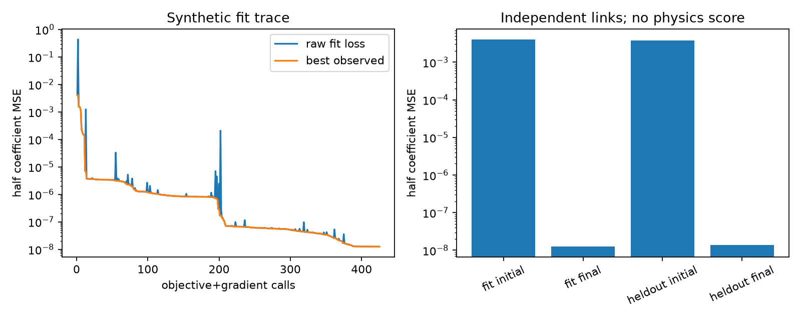

# Trainable-W CPU parameterization prototype

Status: **CPU parameterization prototype completed / production integration and physics comparison still NOT_RUN**.
Classification: `diagnostic_only`; physical_score=null. This is one new deterministic coefficient-fit fixture, not repeated initializer benchmarking.

The model uses the actual link-centered `directional_features`, real shared W/v/c, spatial mean centering per configuration/direction,
and the existing paired-forward/backward `apply_kernel`. Spatial storage is (z,y,x), directions (x,y,z), fields (...,color,probe),
color=3. Spatial boundaries are periodic. No temporal/gamma/propagator convention or Gaussian normalization is tested here.
Centering uses the whole spatial slice: the map is time-local but not strictly spatial-local. a_mu is an unoriented-edge scalar,
not an ordinary polar vector; reversing a link requires shifting its anchor, without multiplying a by a reflection sign.

Input flow: independent teacher seed → noiseless coefficient labels on 4 fit links → joint analytic-gradient L-BFGS-B → 3 independently
generated heldout links. Heldout data do not enter optimization/selection. Teacher is in the same model family by construction;
low error is implementation recovery, not discovery of a physical smear. Hidden permutations and (W_h,v_h)→(-W_h,-v_h)
are exact parameter non-identifiabilities; parameter recovery is not claimed. Initialization draws both W and v independently and nonzero:
W=v=0 makes both nonconstant gradients vanish. Cold/homogeneous links have zero centered features and cannot test W learning.

|metric|observed|
|---|---|
|fit initial/final half MSE|0.0040283486 / 1.2421724e-08|
|heldout initial/final half MSE|0.0038245518 / 1.3906647e-08|
|W update norm|1.7287988|
|solver success/status/message|True / 0 / CONVERGENCE: RELATIVE REDUCTION OF F <= FACTR*EPSMCH|
|objective+gradient calls/iterations|425 / 327|
|elapsed CPU wall seconds|0.0190772|
|gradient finite-difference max absolute error (7 components)|3.4392e-13|
|feature/coefficient gauge max abs|6.66134e-16 / 2.22045e-16|
|kernel gauge covariance relative error|2.47854e-16|
|Hermiticity relative error|3.35064e-17|
|48 cubic/parity signed permutations maximum relative error|1.00019e-16|
|48 cubic/parity coefficient anchor max abs error|5.55112e-17|

## Per-link denominators and failure state

Planned fits=1, returned fits=1, solver non-success=0; fit links=4, heldout links=3, excluded links=0,
nonfinite reported link metrics=0. Gradient components=7; cubic cases=48 (24 rotations plus 24 improper).
These are fixture coverage counts, not statistical failure probabilities. All per-call traces, final status, parameters,
gradient components and all 48 symmetry cases remain in raw.json; no case is silently excluded. Fatal exceptions propagate;
this diagnostic script does not promise a complete report on interruption.

|population|link index|initial half MSE|final half MSE|finite|
|---|---|---|---|---|
|fit|0|0.00348674|6.11965e-09|True|
|fit|1|0.00441918|2.54467e-08|True|
|fit|2|0.00452536|1.24093e-08|True|
|fit|3|0.00368211|5.71123e-09|True|
|heldout|0|0.00379286|6.53237e-09|True|
|heldout|1|0.00399207|2.71515e-08|True|
|heldout|2|0.00368873|8.03603e-09|True|

## Evidence boundary

The objective is half mean squared error on synthetic coefficient labels. It is **not** gauge-ensemble/pion physics risk,
not a reference-gate test, not a SLSQP comparison, and not evidence of physical or cost superiority. Maxiter/optimizer tolerances
are fixture controls; they do not freeze any production TBD. No confidence interval or gauge sampling calibration is claimed
from one fit and three heldout links. Hermiticity does not imply positivity. No production source/sink, GPU/QUDA, shared holdout,
trainable-W production integration, Gaussian sandwich, gradients through propagator measurements, or blind physics comparison was run.

Protocol/source hashes are in protocol.json; raw parameters/traces/metrics in raw.json; features/targets in synthetic_inputs.npz.
Regenerate only into a fresh directory: `python3 -B -m tasks.optimize_gaussian.trainable_w_diagnostic --out <new-directory>`.

## CPU verification in this run

`python3 -B -m pytest -q -p no:cacheprovider tests/test_optimize_trainable_w.py`: **9 passed**.
Includes analytic versus finite-difference gradient with nonuniform target means, actual W update/loss reduction,
gauge invariance/covariance, all 48 signed cubic transformations with reversed-link anchors, Hermiticity,
zero/cold-field degeneracy, hidden sign/permutation non-identifiability, and four invalid-input cases.

`python3 -B -m pytest -q -p no:cacheprovider tests/test_optimize_gaussian.py -k 'plaquettes or features_are_gauge or kernel_is_hermitian or kernel_is_gauge or full_proper_cubic or parity_covariance or directional_pair'`:
**7 passed, 48 deselected**. No production data, GPU/QUDA or sealed IDs were consumed. Plot visually inspected.
