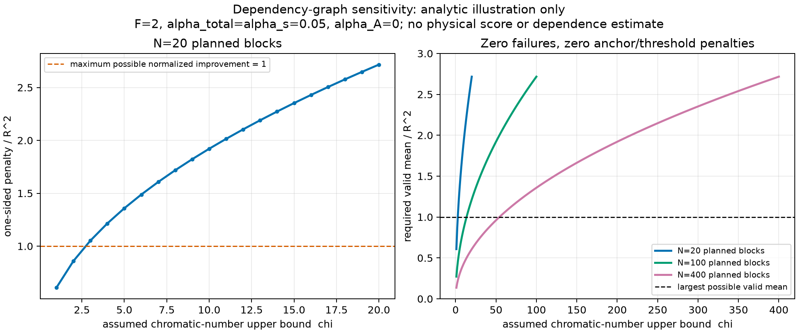
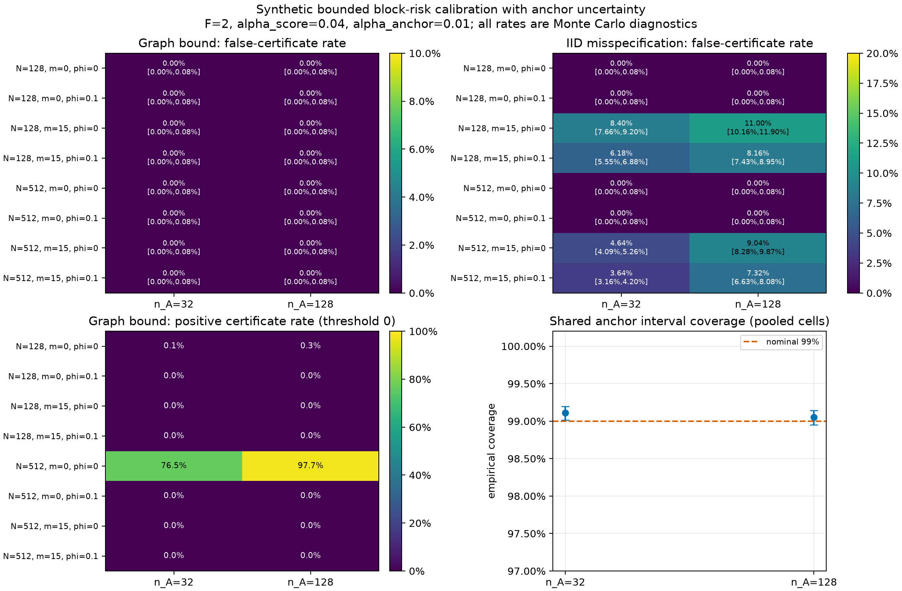

# Pion projection: bounded block-risk calibration handoff

## 决策状态

- 用户接受 **bounded block-risk** 作为一个独立 estimand；它不等价于原 ensemble-risk，也尚未给出物理分数认证。
- 继续保持 `NOT_READY/UNCERTIFIED`、`physical_score=null` 和封存数据状态。不访问 E anchor、gap、validation、shared holdout；不启动 GPU/QUDA。
- 此文件给下一位 agent 的开工顺序。每项新诊断都要同时保留 planned/valid/failed/abstained 分母，并附图或可复查的文字流程图。

## 已完成且可复核的工作

1. [依赖图敏感度报告](../../results/pion_projection/bounded_score_dependence_sensitivity_20261123_v1/README.md) 给出有条件的图染色 Hoeffding 界、推导、输入假设和示意图。新版本 [bounded block-risk 校准报告](../../results/pion_projection/bounded_block_risk_calibration_20261123_v2/README.md) 补上总错误预算校验、anchor Lipschitz 条件、失败 block 的固定分母定义与替代稳健统计量的边界。
2. [独立 block/anchor receipt 审计](../../results/pion_projection/independent_block_anchor_receipt_audit_20261122/README.md) 核对了已有开发 receipts：100 个 D 配置可按 length-5 规则划成 20 个候选块；独立块数仍是 `NOT_ESTABLISHED`。trajectory 间距 5 和 block bootstrap 都不构成独立性证明。E anchor 只有计划，没有 correlator receipt，因此没有可用 anchor 值或 common-bias 界。
3. [`dependency_graph_bound.py`](dependency_graph_bound.py) 是纯解析 CPU 工具；[对应测试](../../tests/test_pion_dependency_graph_bound.py) 覆盖浓缩项、anchor/score alpha 总预算、失败编码和阈值反解。它不读取物理输入。
4. [`bounded_block_risk_score.py`](bounded_block_risk_score.py) 将每个计划 block 的配对平方误差差和显式成功掩码映射为 bounded score，失败 block 固定记为 `-1`，并按全部 planned block 计算条件 LCB；它不连物理 evaluator，始终返回 `physical_score=null`。测试见 [`test_pion_bounded_block_risk_score.py`](../../tests/test_pion_bounded_block_risk_score.py)。
5. [合成校准压力网格](../../results/pion_projection/bounded_block_risk_stress_20261123_v2/README.md) 横扫 `N, chi, alpha_s, alpha_A, B/R, failure_fraction, delta_star/R^2` 的 1,728 个情景，并输出分母表、失败/依赖/anchor 热图和 alpha 分配图。严格边界 `m_required >= 1` 被标成 `ABSTAIN`，没有裁剪成可行；这里的 “valid scenario” 仅指数学上可达，不是观测有效或物理认证。
6. [框架扩展点地图](../../doc/framework_extensibility.md) 总结 LatticeArena 可复用的 task/operator、measurement capability、search、score、state、ledger、artifact 接口及目前缺少的跨 task 集成层。
7. [bounded block-risk v1 合同草案](bounded_block_risk_contract_v1.md) 将 estimand、clipping/failure 变换、条件浓缩式、anchor Lipschitz 修正和缺失输入整理为独立版本化 handoff；所有需研究者冻结的物理与推断字段仍为 `null`，不会给出物理分数。



图中 `N=20`、`F=2`、`alpha_total=alpha_s=0.05`、`alpha_A=0`、无 anchor 偏差/阈值/失败只是乐观 what-if。色数界 `chi=1,2,3` 对应惩罚约 `0.607, 0.859, 1.052`；后者已超过 `[-1,1]` score 能达到的最大均值。该图没有估计实际 `chi` 或效果。

新增压力图将每个输入组合作为一个 planned synthetic scenario；1,728 个情景中 1,132 个数学上有可达均值、596 个因 `m_required >= 1` 应 `ABSTAIN`。场景加权的假设 block 汇总是 planned/valid/failed/abstained = `299520/269568/29952/0`；这些是假设分母，不是新的测量样本，也不代表独立块。测试覆盖严格等于 1 的边界与全 planned blocks 失败时的 abstention。

### 已知有限依赖图下的 Monte Carlo 覆盖诊断（合成，见 v2）

[Conditional coverage report](../../results/pion_projection/bounded_block_risk_coverage_mc_20261123_v2/README.md) 补上解析可行性网格没有回答的方法学问题：若依赖图已知，graph-color LCB 在有限样本下的覆盖/保守性，与错误使用 IID 惩罚相比如何。30 个 cell 横扫 `N={32,128,512}`、真实依赖范围 `m={0,1,3,7,15}`、失败率 `{0,0.1}`；每格 5,000 次 MC，`F=2`、`alpha_s=0.05`。有效 score 是 `0.2 + 0.8 tanh` 的对称滑窗噪声；`m+1` 个同余类使用互不重叠的高斯创新，故本合成过程的依赖图与色数界 `chi=m+1` 已知。paired failure mask 在两个 score family 间共享，失败 block 保留在 planned `N` 并编码为 `-1`。


正确 `chi=m+1` 的 graph-color LCB 在全部 30 个 cell 的实测 familywise coverage 均为 `1.0`（每格 5,000 次；最小 MC 95% Wilson 下界约 `0.9992`）。故意错误地用 `chi=1` 时，最差 cell `N=512,m=15,phi=0` 的 coverage 为 `0.8362`，MC 95% 区间约 `[0.8257,0.8462]`。这验证的是**已知合成 m-dependence**下公式的条件行为，绝不证明项目真实 `chi`。


graph-color LCB 在高 `m` 下虽保持覆盖，正下界通过率也可能降至 0（例如该模拟中 `m=15`），说明有限样本有效性与有用检出率是两项不同性质。MC denominator 分层保存：30/30 simulation cell 有效、150,000/150,000 replicate 完成；paired planned block events `33,600,000` 中 `1,679,993` 个假设失败并编码为最差分数，未删除。所有 replicate 下界/覆盖指示、种子规则、源快照和 SHA-256 都在报告目录。

此实验不含 anchor error（`alpha_A=0`）、不估计效应分布、没有物理阈值，并且用可证明的创新构造直接给定依赖图；真实流程仍须先证明 score-specific 图或带常数的 mixing bound。`IID`/`graph-color` 模拟差异不能用来替代那项证明，也不能把剪裁后 estimand 换回 ensemble-risk。

### 有限样本共同覆盖：依赖分数 + 独立 anchor（合成，见 v1）

[联合校准报告](../../results/pion_projection/bounded_block_risk_anchor_coverage_mc_20261123_v1/README.md) 补上上一版 `alpha_A=0` 的方法学缺口。16 个 cell 横扫 `N={128,512}`、已知依赖范围 `m={0,15}`、假设失败率 `{0,0.1}`、独立 anchor 样本数 `n_A={32,128}`；每 cell 5,000 个 replicate，共 80,000。`F=2` 的 score 误差预算为 `alpha_s=0.04`，anchor 双侧精确正态区间预算为 `alpha_A=0.01`，总计 `alpha_total=0.05`。score 生成器用已知 `m` 的滑窗高斯创新，anchor 误差与 score 独立；anchor 的 `sigma=0.05` 已知。这些都是明确的合成假设，不是从项目数据估得的参数。



在该生成器下，正确 `chi=m+1` 的 graph-color 规则 16/16 cell 均观测到零 false certificate；每格 5,000 次对应的最大 Monte Carlo 95% Wilson 上界为 `0.000768`。故意用 IID `chi=1` 时，最大误认证率为 `11.0%`（`N=128,m=15,phi=0,n_A=128`）；anchor 区间实测覆盖率跨 cell 为 `98.92%–99.22%`，标称 99%。图左下的正证书率展示效用损失：`N=512,m=0,phi=0,n_A=128` 为 `97.74%`，而 `m=15` 时为 0。零观测误认证只是有限次模拟结果，不是实际数据覆盖证明；正证书阈值 0 也只是演示值。

每 cell 保存分层分母：MC replicate、paired block event、family-block score、anchor estimate 和 anchor observation 的 planned/valid/failed/abstained 数。假设失败 block 留在计划分母并记 `-1`；all-failed replicate abstain。源码、随机种子、replicate 级结果、图、协议和哈希随报告保存。此诊断只验证**已知依赖图、独立且已知方差正态 anchor**下的联合校准路径；不估计真实 `chi`、anchor 覆盖、共同偏差、目标质量/物理效应，也不满足 reference gate。任务仍为 `NOT_READY/UNCERTIFIED`，`physical_score=null`，封存数据未访问。

### Anchor 分布稳健性：正态 z 区间 vs 有界样本 Hoeffding 区间（精确合成枚举）

[精确 coverage 报告](../../results/pion_projection/bounded_block_risk_anchor_robustness_exact_20261123_v1/README.md)补查前一项的正态模型假设。对三个均值为 0、方差同为 `sigma^2=0.05^2` 的二点分布（稀有上侧事件概率 `p={0.5,0.1,0.005}`）及 `n_A={16,32,128,512}`，枚举每格 `n_A+1` 个二项计数状态及其精确概率，不使用 Monte Carlo，也不读取 anchor/物理数据。


比较的正态 z 半径 `B_z=z_(1-alpha_A/2)*sigma/sqrt(n_A)` 使用生成器的 oracle 方差，但其 99% coverage 解释要求正态母体；有界独立样本 Hoeffding 半径为 `B_H=(U-L)*sqrt(log(2/alpha_A)/(2*n_A))`。稀有事件 case `p=0.005,n_A=16` 的 exact z coverage 只有 `92.2931%`，而 Hoeffding exact coverage 为 `99.9999999999%`；12 格内 Hoeffding 的最小 exact coverage 为 `99.8767%`，最大宽度代价 `B_H/B_z=8.959`。这说明可用分布无关界换覆盖保证，但 `2B/R` 可能变得很宽；它不证明项目 anchor 的支持范围或 iid 条件。

分母报告明确区分 2,064 个假设 anchor observations 与 2,076 个 exact count states；均为精确枚举的合成规划数量，不是物理样本或 MC replicates。Hoeffding 路径只有在 anchor observations 的独立性和事前已知有限支持均可证明时可用；支持未知、anchor 有系统偏差或配置间相关时，这个界不能认证。当前仍缺 E-anchor receipt、共同偏差界及其与 score 样本的独立性证据。正态和 Hoeffding 两条路都不能替代 reference gate；状态继续为 `NOT_READY/UNCERTIFIED`，`physical_score=null`。

### Planned-block 评分函数合同测试（CPU；未接入 evaluator）

`conditional_block_risk_lcb` 的数据流是：`D_i(A)=(A-y_ref)^2-(A-y_candidate)^2` → 对有效 block 计算 `clip(D_i/R^2,-1,1)` → 失败 block 记 `-1` → 以完整 planned `N` 计算均值与 graph-color LCB。四块测试例的原始差为 `[8,-8,2,NaN]`、`R=2`、掩码为 `[valid,valid,valid,failed]`，因此 bounded scores 为 `[1,-1,0.5,-1]`，分母为 planned/valid/failed/abstained=`4/3/1/0`。全失败时函数返回 `ABSTAIN_NO_VALID_BLOCKS` 且不输出 LCB。

函数只实现合同算术；`chi`、anchor 覆盖和 `|y_candidate-y_reference|<=R` 都是调用方必须提供的条件，代码不会验证它们。函数对所有调用固定返回 `physical_score=null`；这项测试不访问任何 correlator/ensemble，也不证明依赖结构、anchor 或物理 reference。

### 颜色类 empirical-Bernstein 备选界（合成条件诊断，新增）

为判断 Hoeffding 是否能在低方差时减少保守性，增加了 [`bounded_block_risk_empirical_bernstein.py`](bounded_block_risk_empirical_bernstein.py) 和 [30-cell 对照报告](../../results/pion_projection/bounded_block_risk_empirical_bernstein_20261123_v4/README.md)。对事前固定的 dependency-graph coloring，在每个颜色类内应用 Maurer–Pontil Theorem 11 的有界独立样本 empirical-Bernstein 界，再以 `n_c/N` 加权；候选族与 `chi` 个颜色类用 `alpha_s/(F*chi)` 做 Bonferroni。颜色类只有一个 block 时退回 Hoeffding。原论文定理允许独立但不同分布的变量；仍要求类内联合独立，方差自适应不能推断或修复错误依赖图。

沿用已知 `m`-dependent 合成生成器，30 格、每格 5,000 个 paired replicate，graph-color Hoeffding 与 empirical-Bernstein 实测 familywise coverage 都是 `1.0`；每格 Wilson Monte Carlo 95% 下界最小 `0.9992`。功效并未普遍改善：`N=512, phi=0, m=0` 的正 LCB 率仅由 `0.9996` 到 `1.0000`；`m=1` 则由 `0.6994` 降为 `0.3550`；`m>=3` 两者接近零，EB 不优。颜色数增大后类样本缩小，EB 的加性项主导。全网格 replicate planned/valid/failed/abstained=`150000/150000/0/0`；失败 block 留在计划分母并记 `-1`。

因此目前保留 graph-color Hoeffding 作为主校准路线，只把 empirical-Bernstein 留作有已证明着色且颜色类足够大时的敏感度选项。该结果不证明真实图、anchor 覆盖、支持范围、common-bias 或物理目标；没有图色数来源时两者都必须 abstain。函数测试见 [`test_pion_bounded_block_risk_empirical_bernstein.py`](../../tests/test_pion_bounded_block_risk_empirical_bernstein.py)；图、分母、源码快照和 hash 在报告目录。

## 可审阅的 estimand 与校准合同草案

令 `D_i(A)` 为预先限定的配对平方误差差，并定义 `Z_i=clip(D_i(A)/R^2,-1,1)`。bounded block-risk 是有限计划的 `theta_N=(1/N) sum_i E[Z_i | protocol, anchor]`；若有平稳性可简化为共同期望，但有界浓缩推导本身不要求同分布。它只针对这个 block 级 estimand，不替代 ensemble-risk 或物理真值。剪裁界限和剪裁前后的解释必须在看确认数据前冻结，因为 clipping 会改变 estimand。

若 planned block 数为 `N`，候选确认族为 `F`，score dependency graph 的一个可证明色数上界为 `chi`，且每个颜色类内部的 block score 在给定共享 anchor/protocol 后联合独立，则单侧惩罚为

```text
epsilon = sqrt(2 * chi * log(F / alpha_s) / N)
```

失败 block 不删除：记 planned 样本失败比例为 `phi_hat`，有效块观测均值为 `zbar_valid`，并把每个失败编码成最差改善 `-1`，则 `zbar=(1-phi_hat)*zbar_valid-phi_hat`。浓缩项仍使用全部 planned `N`，图也必须包含失败状态。若这类失败编码不符合科学问题，应改成单独、事前定义的 failure-augmented estimand，而不能只分析成功样本。

对平方误差差 `D(A)=(A-y_ref)^2-(A-y_candidate)^2`，有精确恒等式

```text
D(A)-D(m*) = 2 (A-m*) (y_candidate-y_ref)
```

所以 `|A-m*|<=B` 只能推出 `2B/R` 归一化偏差项，前提是预测差事前满足 `|y_candidate-y_ref|<=R`，且实际评分只有该平方误差差项。若加入拟合不确定性、方差惩罚或其他非线性组件，需逐项推导 Lipschitz 上界；不允许自动沿用 `2B/R`。

总不覆盖率须预先拆成 score 误差 `alpha_s` 与 anchor 覆盖误差 `alpha_A`，校准 API 要求显式传入全部 alpha 且检查 `alpha_s + alpha_A <= alpha_total`，避免把图示默认值误当物理设定。相应 lower bound 和规划边界为

```text
LCB/R^2 = zbar - epsilon - 2B/R
zbar_valid > (delta_star/R^2 + epsilon + 2B/R + phi_hat) / (1-phi_hat)
```

报告中的 `alpha_total=0.05, alpha_A=0` 仅是依赖图敏感度图的乐观演示，不是用户冻结的校准值。`N/chi` 只是代数记号，不是估计的 ESS。

块有界可阻止极端观测支配 Hoeffding 项，但剪裁不制造独立性。Paired block bootstrap、HAC/ESS、median-of-means 可作为敏感度检查；如果依赖结构/混合率未获证明，它们不能单独认证有限样本覆盖。trajectory 间距、RHS 数和 bootstrap 重抽样都不能当作独立 block 数。

## 下一位 agent 的工作顺序

1. **版本化评分合同草案已整理**：见 [`bounded_block_risk_contract_v1.md`](bounded_block_risk_contract_v1.md)。下一步由研究者冻结 `m*` 单位/范围、`R`、剪裁函数、失败编码、目标 `delta_star`、`F` 和总 alpha 分配；现阶段不从 toy 或开发误差反推物理阈值。
2. **合成规划/覆盖诊断已完成：**1,728 点解析可行性网格、30-cell 已知 `m`-dependence MC、16-cell 共同 score+anchor MC、12-cell exact anchor-distribution 枚举，以及 30-cell color-class empirical-Bernstein vs graph-Hoeffding MC 均有图/表、明确分母和可复现输入。它们只检验已知合成图、正态或有界 iid anchor 条件下的公式/效用；不估计真实覆盖、支持或依赖。经验方差界没有显示对高色数网格的普遍功效改进，故不替代 Hoeffding 基线。
3. 对 block 独立性路径二选一并先写可审阅证明：提供 score-specific dependency graph 与 `chi` 上界；或提出带明确常数的 mixing/spectral-gap 浓缩定理。若两者都没有，维持 `NOT_READY`，不拿经验有效样本数代替。现有 MC 的 `chi=m+1` 是生成器已知值，不是项目估计。
4. anchor 路径需要独立、匹配的 E correlator receipt，以及 `B` 的来源、覆盖率与和 score 样本的条件独立说明。若使用正态区间，需支持正态/已知方差或改作敏感度近似；若使用 Hoeffding，需事前证明有限支持和 iid anchor 单位，并报告 `2B/R` 的效用代价。多个待覆盖 anchor 时事前分配 `alpha_A`；同一个共享 anchor 供候选族复用不因 `F` 自动重复分配。现有 `n_A/sigma/alpha_A` 仅为合成设计值；尚无此证据时不要读取封存 E/gap/validation/holdout。
5. 通过独立审阅并获数据授权后，才进行确认测量；冻结候选族后报告全量 paired block 原始 score、planned/valid/failed/abstained、剪裁前后诊断、图色数来源、alpha 分配和 `LCB`。即使统计门通过，也必须单独通过原先失败的 reference/model-identification gate 才能产生物理分数。

停止规则：没有可审阅的 dependence bound、anchor bias 覆盖界或通过的物理 reference 时，输出 `ABSTAIN/NOT_READY` 并保持 `physical_score=null`；不以更窄的 bootstrap 区间代替缺失假设。
