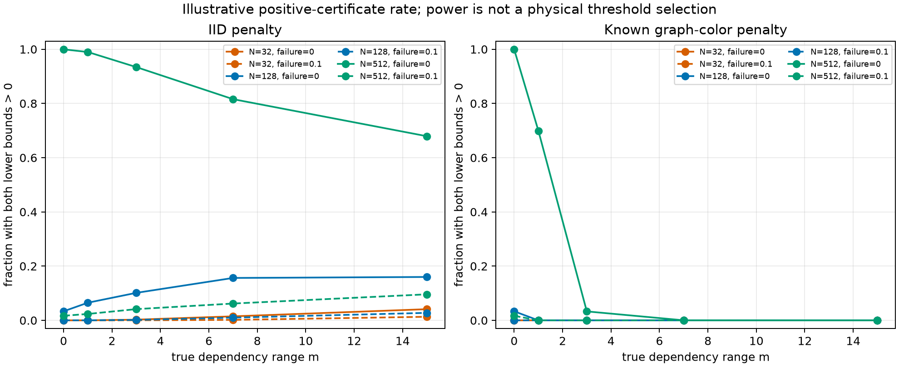

# Pion projection: bounded block-risk calibration handoff

## 2026-11-25 我自行选定的 bounded block-risk 输入

用户已要求我自行给出方法输入。以下是可以直接作为下一版方案默认值的选择，**不是测量结果、收据或外部授权**。本节覆盖前文“等待用户选择 target、R、clipping、delta_star”的候选问题；经验量和状态仍按下文的封存/未认证规则处理。

| 输入 | 我选定的值 | 性质与理由 |
|---|---|---|
| 目标 | `m* = a_t m_{pi,0}`，S16T16 quenched Wilson ensemble、`kappa=0.14`、零动量、最低质量 valence isovector pseudoscalar 能级 | 目标定义取自 [Pion task specification](../../doc/pion_projection.md)；数值必须由独立 anchor 得到，不能从当前失败的单-cosh pilot 填入 |
| anchor/reference | 独立 E-chain 上的 candidate-blind 联合谱拟合：PP 的 `n=0,8,16` 三通道加局域 A4P；共享两态能量、各通道独立振幅，拟合 `t=3..8`，比较 `t_min=2,3,4` 及二态/三态模型；PP 偶折、A4P 奇折 | 这是新的参考协议选择；它不复用候选调参结果。协方差仍用冻结的 25% diagonal shrinkage 与 `1e-10` 特征值地板。通过门：`m0` 相对误差≤5%、拟合 `p>=0.01`、模型/窗口质量位移≤2.5 paired SE、PP/A4P 相容且无边界命中；任何一项失败即 reference unresolved |
| 预测域与归一化 | 两个预测质量都必须落在 `(0.1,3.0)` `a_t m_pi` 内；`R=2.9 a_t m_pi` | 取自当前固定拟合搜索域，只是保证 `|y_candidate-y_reference|<=R` 的合同域，不是物理质量先验 |
| score | `Z_i=clip(D_i/R^2,-1,1)`，其中 `D_i=(A-y_ref)^2-(A-y_candidate)^2`；失败 block 记 `-1`，全失败 comparison abstain | 预先固定 bounded estimand；不再对分数作随 block 变化的重标度 |
| 最小效应 | `delta_star=0.05 R^2=0.4205 (a_t m_pi)^2`；要求 familywise LCB `>0.05` | 把最大归一化损失差的 5% 选作最低有意义改善门槛；这是工程/研究判据，不是由旧 pilot 推出的物理常数 |
| 比较族与显著性 | `F=3`：候选对 local identity、tuned `H^32`、frozen signed-SLSQP；`alpha_total=0.05`, `alpha_score=0.04`, `alpha_anchor=0.01` | 三个比较均固定在 development 选择完成之后的 confirmation family 中；必须在报告里保留每个 comparison 的 planned denominator |
| score 依赖 | 主路选 fixed-score non-reversible block-Markov pseudo-gap Bernstein；block 是连续 5 个配置，固定同一个 score map。设计门槛：`N=4000` 个 scored blocks、`gamma_ps_lower>=0.20`、burn-in 8 blocks 后 `delta_TV<=0.001` | `F*delta=0.003<alpha_score`；按现有实现与剩余 `alpha=0.037` 计算，浓缩半径约 `0.3863`。这说明该证明路线很保守，旧 D receipt 的 20 个 length-5 blocks 远不足以给出非平凡 LCB。数值是下一版设计要求，不是现有 chain 的估计 |
| anchor 覆盖 | 选 bounded-IID Hoeffding：`n_A=1000` 个独立 stationary anchor 单位、每个输出限制在 `[0.1,3.0]`、双侧 `alpha_A=0.01` | 随机覆盖半径 `R*sqrt(log(2/alpha_A)/(2*n_A))=0.1493 a_t m_pi=0.05147R`；common-bias 预算定为 `C<=0.01R=0.029`，故 `B=radius+C<=0.1783 a_t m_pi=0.06147R`，score anchor correction `2B/R<=0.12294`。独立性、stationarity 和 C 上界都必须有单独收据；没有这些条件就不能调用 Hoeffding |

既有 `F=2` 依赖/coverage 模拟是历史敏感度诊断；本次已按选定的 `F=3` 比较族完成纯公式敏感度图、CSV 和流程说明，见 [`F3_markov_sensitivity_v1/README.md`](F3_markov_sensitivity_v1/README.md)。图示网格含245个公式情景，其中140个可计算、105个因 alpha/LCB 条件弃权、0个数值失败；物理测量分母仍为0/0/0/0。规划点 `N=4000, gamma_ps=0.20, TV=0.001` 在假设 score mean 达到理论最大1时给出半径0.386316、最佳可能归一化 LCB 0.488744；这些只是条件算术，不是测量或覆盖证据。不要重跑 F=3 网格，也不要把 `F=2` 覆盖率移植到 `F=3` 合同。


**目前不能由我填造的证据：**实际 `m*` 数值、Markov chain 的 `gamma_ps` 下界、8-block 后 TV 界、1000 个独立 anchor 单位、common-bias `C` 证据和 E-chain correlator receipt。旧的 D0–99 receipt 只对应 20 个长度 5 的候选块，既不证明独立性也不支持上述覆盖。现有 S16T16 reference gate 已失败；所以这些设计数值不能把状态升级为 `READY`，合同的物理数据收据保持缺失，`physical_score=null`，sealed E/gap/validation/holdout 继续关闭。

文字流程：`独立 candidate-blind E 谱拟合 -> 通过 reference/model gate -> 单一 bounded score map 与三比较族 -> 证明 block-Markov gamma/TV -> 独立 anchor 的 99% Hoeffding 半径 + C -> 对完整 N=4000 计划块计算 LCB -> LCB>0.05 且所有门通过才可申请新 confirmation；否则 ABSTAIN`。

**交接规则：**本文件下方较早的“等待用户选择 target/R/clipping/delta_star”均为历史记录，现由本节默认值覆盖；machine-readable contract 与 `F=3` 公式诊断均已完成。后续不再重复合同/模拟工作，只补独立 E-chain reference、score-specific `gamma_ps`/TV 收据、anchor 覆盖与 common-bias `C` 证据、独立审阅和授权。bounded-IID Hoeffding 的1000个 anchor 单位必须真为相互独立且来自目标平稳分布；同一 HMC 链的1000个配置、trajectory gap、ESS 或 bootstrap 次数都不满足此假设。若无法证明 IID，就不能套 Hoeffding，须另行实现并审阅 Markov-aware anchor coverage bound。无这些证据时保持 `NOT_READY/UNCERTIFIED`、`physical_score=null`；不要读封存 split 或把 synthetic fixture 升格为实测证据。

## 决策状态

- 用户接受 **bounded block-risk** 作为一个独立 estimand；它不等价于原 ensemble-risk，也尚未给出物理分数认证。
- 继续保持 `NOT_READY/UNCERTIFIED`、`physical_score=null` 和封存数据状态。不访问 E anchor、gap、validation、shared holdout；不启动 GPU/QUDA。
- 此文件给下一位 agent 的开工顺序。每项新诊断都要同时保留 planned/valid/failed/abstained 分母，并附图或可复查的文字流程图。

## 已完成且可复核的工作

1. [依赖图敏感度报告](../../results/pion_projection/bounded_score_dependence_sensitivity_20261123_v1/README.md) 给出有条件的图染色 Hoeffding 界、推导、输入假设和示意图。新版本 [bounded block-risk 校准报告](../../results/pion_projection/bounded_block_risk_calibration_20261123_v2/README.md) 补上总错误预算校验、anchor Lipschitz 条件、失败 block 的固定分母定义与替代稳健统计量的边界。
2. [独立 block/anchor receipt 审计](../../results/pion_projection/independent_block_anchor_receipt_audit_20261122/README.md) 核对了已有开发 receipts：100 个 D 配置可按 length-5 规则划成 20 个候选块；独立块数仍是 `NOT_ESTABLISHED`。trajectory 间距 5 和 block bootstrap 都不构成独立性证明。E anchor 只有计划，没有 correlator receipt，因此没有可用 anchor 值或 common-bias 界。
3. [`dependency_graph_bound.py`](dependency_graph_bound.py) 是纯解析 CPU 工具；[对应测试](../../tests/test_pion_dependency_graph_bound.py) 覆盖浓缩项、anchor/score alpha 总预算、失败编码和阈值反解。它不读取物理输入。
4. [`bounded_block_risk_score.py`](bounded_block_risk_score.py) 将每个计划 block 的配对平方误差差和显式成功掩码映射为 bounded score，失败 block 固定记为 `-1`，并按全部 planned block 计算条件 LCB；它不连物理 evaluator，始终返回 `physical_score=null`。测试见 [`test_pion_bounded_block_risk_score.py`](../../tests/test_pion_bounded_block_risk_score.py)。
5. [合成校准压力网格](../../results/pion_projection/bounded_block_risk_stress_20261123_v2/README.md) 横扫 `N, chi, alpha_s, alpha_A, B/R, failure_fraction, delta_star/R^2` 的 1,728 个情景，并输出分母表、失败/依赖/anchor 热图和 alpha 分配图。严格边界 `m_required >= 1` 被标成 `ABSTAIN`，没有裁剪成可行；这里的 “valid scenario” 仅指数学上可达，不是观测有效或物理认证。
6. [框架扩展点地图](../../doc/framework_extensibility.md) 总结 LatticeArena 可复用的 task/operator、measurement capability、search、score、state、ledger、artifact 接口及目前缺少的跨 task 集成层。
7. [bounded block-risk v1 合同草案](bounded_block_risk_contract_v1.md) 将 estimand、clipping/failure 变换、条件浓缩式、anchor Lipschitz 修正和缺失输入整理为独立版本化 handoff。当前 [`bounded_block_risk_contract_v1.json`](bounded_block_risk_contract_v1.json) 的 `selected_protocol` 已写入 2026-11-25 选定的方法默认值；实际 `m*`、依赖、anchor、common-bias 与 reference receipts 仍为 `null`。检查器只可给出 `CONTRACT_COMPLETE_REQUIRES_HUMAN_REVIEW`，不会认证物理分数。
8. [v1/v2 Markov pseudo-gap reports](../../results/pion_projection/bounded_block_risk_markov_gap_20261124_v1/README.md) are retained as historical artifacts; their displayed Bernstein constants match the corrected statement, but their original theorem citation was stale. The [v3 report](../../results/pion_projection/bounded_block_risk_markov_gap_20261124_v3/README.md) cites Paulin arXiv v5 Theorem 3.11 / Eq. (3.25), flags the author's correction to an incomplete earlier proof, and implements the Proposition 3.15 / Eq. (3.29) initial-law TV correction. It adds a 12-cell burn-in/TV what-if table and three fixed helper fixtures. That v3 implementation supported one fixed score function across blocks; the optional time-varying Eq. (3.26) route is now separately implemented and documented below. No report estimates the actual block-chain gap, post-burn-in TV, coverage, or physical score.
9. [合同结构检查器与报告](../../results/pion_projection/bounded_block_risk_contract_diagnostic_20261124_v6/README.md) 为当前 `DRAFT_NOT_READY` 评分草案提供 machine-readable JSON 与 fail-closed inspector。它检查图染色 Hoeffding 或固定-score Markov pseudo-gap 路线、stationary 起点或带 receipt 的 post-burn-in TV、`F*delta < alpha_score`、anchor 覆盖方法、总误差界 `B` 与共偏差子界 `C<=B`、`B >= random_coverage_radius + C`、`R` 与预测差界及独立 reference gate。合成的 Markov stationary/TV 形状只返回 `CONTRACT_COMPLETE_REQUIRES_HUMAN_REVIEW`；收据内容仍须人工审核。测试见 [`test_pion_bounded_block_risk_contract.py`](../../tests/test_pion_bounded_block_risk_contract.py)。


图中 `N=20`、`F=2`、`alpha_total=alpha_s=0.05`、`alpha_A=0`、无 anchor 偏差/阈值/失败只是乐观 what-if。色数界 `chi=1,2,3` 对应惩罚约 `0.607, 0.859, 1.052`；后者已超过 `[-1,1]` score 能达到的最大均值。该图没有估计实际 `chi` 或效果。

新增压力图将每个输入组合作为一个 planned synthetic scenario；1,728 个情景中 1,132 个数学上有可达均值、596 个因 `m_required >= 1` 应 `ABSTAIN`。场景加权的假设 block 汇总是 planned/valid/failed/abstained = `299520/269568/29952/0`；这些是假设分母，不是新的测量样本，也不代表独立块。测试覆盖严格等于 1 的边界与全 planned blocks 失败时的 abstention。

### 已知有限依赖图下的 Monte Carlo 覆盖诊断（合成，见 v2）

[Conditional coverage report](../../results/pion_projection/bounded_block_risk_coverage_mc_20261123_v2/README.md) 补上解析可行性网格没有回答的方法学问题：若依赖图已知，graph-color LCB 在有限样本下的覆盖/保守性，与错误使用 IID 惩罚相比如何。30 个 cell 横扫 `N={32,128,512}`、真实依赖范围 `m={0,1,3,7,15}`、失败率 `{0,0.1}`；每格 5,000 次 MC，`F=2`、`alpha_s=0.05`。有效 score 是 `0.2 + 0.8 tanh` 的对称滑窗噪声；`m+1` 个同余类使用互不重叠的高斯创新，故本合成过程的依赖图与色数界 `chi=m+1` 已知。paired failure mask 在两个 score family 间共享，失败 block 保留在 planned `N` 并编码为 `-1`。


正确 `chi=m+1` 的 graph-color LCB 在全部 30 个 cell 的实测 familywise coverage 均为 `1.0`（每格 5,000 次；最小 MC 95% Wilson 下界约 `0.9992`）。故意错误地用 `chi=1` 时，最差 cell `N=512,m=15,phi=0` 的 coverage 为 `0.8362`，MC 95% 区间约 `[0.8257,0.8462]`。这验证的是**已知合成 m-dependence**下公式的条件行为，绝不证明项目真实 `chi`。



graph-color LCB 在高 `m` 下虽保持覆盖，正下界通过率也可能降至 0（例如该模拟中 `m=15`），说明有限样本有效性与有用检出率是两项不同性质。MC denominator 分层保存：30/30 simulation cell 有效、150,000/150,000 replicate 完成；paired planned block events `33,600,000` 中 `1,679,993` 个假设失败并编码为最差分数，未删除。所有 replicate 下界/覆盖指示、种子规则、源快照和 SHA-256 都在报告目录。

此实验不含 anchor error（`alpha_A=0`）、不估计效应分布、没有物理阈值，并且用可证明的创新构造直接给定依赖图；真实流程仍须先证明 score-specific 图或带常数的 mixing bound。`IID`/`graph-color` 模拟差异不能用来替代那项证明，也不能把剪裁后 estimand 换回 ensemble-risk。

### 有限样本共同覆盖：依赖分数 + 独立 anchor（合成，见 v1）

[联合校准报告](../../results/pion_projection/bounded_block_risk_anchor_coverage_mc_20261123_v1/README.md) 补上上一版 `alpha_A=0` 的方法学缺口。16 个 cell 横扫 `N={128,512}`、已知依赖范围 `m={0,15}`、假设失败率 `{0,0.1}`、独立 anchor 样本数 `n_A={32,128}`；每 cell 5,000 个 replicate，共 80,000。`F=2` 的 score 误差预算为 `alpha_s=0.04`，anchor 双侧精确正态区间预算为 `alpha_A=0.01`，总计 `alpha_total=0.05`。score 生成器用已知 `m` 的滑窗高斯创新，anchor 误差与 score 独立；anchor 的 `sigma=0.05` 已知。这些都是明确的合成假设，不是从项目数据估得的参数。


在该生成器下，正确 `chi=m+1` 的 graph-color 规则 16/16 cell 均观测到零 false certificate；每格 5,000 次对应的最大 Monte Carlo 95% Wilson 上界为 `0.000768`。故意用 IID `chi=1` 时，最大误认证率为 `11.0%`（`N=128,m=15,phi=0,n_A=128`）；anchor 区间实测覆盖率跨 cell 为 `98.92%–99.22%`，标称 99%。图左下的正证书率展示效用损失：`N=512,m=0,phi=0,n_A=128` 为 `97.74%`，而 `m=15` 时为 0。零观测误认证只是有限次模拟结果，不是实际数据覆盖证明；正证书阈值 0 也只是演示值。

每 cell 保存分层分母：MC replicate、paired block event、family-block score、anchor estimate 和 anchor observation 的 planned/valid/failed/abstained 数。假设失败 block 留在计划分母并记 `-1`；all-failed replicate abstain。源码、随机种子、replicate 级结果、图、协议和哈希随报告保存。此诊断只验证**已知依赖图、独立且已知方差正态 anchor**下的联合校准路径；不估计真实 `chi`、anchor 覆盖、共同偏差、目标质量/物理效应，也不满足 reference gate。任务仍为 `NOT_READY/UNCERTIFIED`，`physical_score=null`，封存数据未访问。

### Anchor 分布稳健性：正态 z 区间 vs 有界样本 Hoeffding 区间（精确合成枚举）

[精确 coverage 报告](../../results/pion_projection/bounded_block_risk_anchor_robustness_exact_20261123_v1/README.md)补查前一项的正态模型假设。对三个均值为 0、方差同为 `sigma^2=0.05^2` 的二点分布（稀有上侧事件概率 `p={0.5,0.1,0.005}`）及 `n_A={16,32,128,512}`，枚举每格 `n_A+1` 个二项计数状态及其精确概率，不使用 Monte Carlo，也不读取 anchor/物理数据。


比较的正态 z 半径 `B_z=z_(1-alpha_A/2)*sigma/sqrt(n_A)` 使用生成器的 oracle 方差，但其 99% coverage 解释要求正态母体；有界独立样本 Hoeffding 半径为 `B_H=(U-L)*sqrt(log(2/alpha_A)/(2*n_A))`。稀有事件 case `p=0.005,n_A=16` 的 exact z coverage 只有 `92.2931%`，而 Hoeffding exact coverage 为 `99.9999999999%`；12 格内 Hoeffding 的最小 exact coverage 为 `99.8767%`，最大宽度代价 `B_H/B_z=8.959`。这说明可用分布无关界换覆盖保证，但 `2B/R` 可能变得很宽；它不证明项目 anchor 的支持范围或 iid 条件。

分母报告明确区分 2,064 个假设 anchor observations 与 2,076 个 exact count states；均为精确枚举的合成规划数量，不是物理样本或 MC replicates。Hoeffding 路径只有在 anchor observations 的独立性和事前已知有限支持均可证明时可用；支持未知、anchor 有系统偏差或配置间相关时，这个界不能认证。当前仍缺 E-anchor receipt、共同偏差界及其与 score 样本的独立性证据。正态和 Hoeffding 两条路都不能替代 reference gate；状态继续为 `NOT_READY/UNCERTIFIED`，`physical_score=null`。

### Planned-block 评分函数合同测试（CPU；未接入 evaluator）

`conditional_block_risk_lcb` 的数据流是：`D_i(A)=(A-y_ref)^2-(A-y_candidate)^2` → 对有效 block 计算 `clip(D_i/R^2,-1,1)` → 失败 block 记 `-1` → 以完整 planned `N` 计算均值与 graph-color LCB。四块测试例的原始差为 `[8,-8,2,NaN]`、`R=2`、掩码为 `[valid,valid,valid,failed]`，因此 bounded scores 为 `[1,-1,0.5,-1]`；block 分母 planned/valid/failed/abstained=`4/3/1/0`，单个比较结果的分母=`1/1/0/0`。全失败时 block 分母=`2/0/2/0`，单个比较结果分母=`1/0/0/1`，状态为 `ABSTAIN_NO_VALID_BLOCKS` 且不输出 LCB。这样区分了 block failure 与 panel-level abstention。

函数只实现合同算术；`chi`、anchor 覆盖和 `|y_candidate-y_reference|<=R` 都是调用方必须提供的条件，代码不会验证它们。函数对所有调用固定返回 `physical_score=null`；这项测试不访问任何 correlator/ensemble，也不证明依赖结构、anchor 或物理 reference。

### 颜色类 empirical-Bernstein 备选界（合成条件诊断，新增）

为判断 Hoeffding 是否能在低方差时减少保守性，增加了 [`bounded_block_risk_empirical_bernstein.py`](bounded_block_risk_empirical_bernstein.py) 和 [30-cell 对照报告](../../results/pion_projection/bounded_block_risk_empirical_bernstein_20261123_v4/README.md)。对事前固定的 dependency-graph coloring，在每个颜色类内应用 Maurer–Pontil Theorem 11 的有界独立样本 empirical-Bernstein 界，再以 `n_c/N` 加权；候选族与 `chi` 个颜色类用 `alpha_s/(F*chi)` 做 Bonferroni。颜色类只有一个 block 时退回 Hoeffding。原论文定理允许独立但不同分布的变量；仍要求类内联合独立，方差自适应不能推断或修复错误依赖图。

沿用已知 `m`-dependent 合成生成器，30 格、每格 5,000 个 paired replicate，graph-color Hoeffding 与 empirical-Bernstein 实测 familywise coverage 都是 `1.0`；每格 Wilson Monte Carlo 95% 下界最小 `0.9992`。功效并未普遍改善：`N=512, phi=0, m=0` 的正 LCB 率仅由 `0.9996` 到 `1.0000`；`m=1` 则由 `0.6994` 降为 `0.3550`；`m>=3` 两者接近零，EB 不优。颜色数增大后类样本缩小，EB 的加性项主导。全网格 replicate planned/valid/failed/abstained=`150000/150000/0/0`；失败 block 留在计划分母并记 `-1`。

因此目前保留 graph-color Hoeffding 作为主校准路线，只把 empirical-Bernstein 留作有已证明着色且颜色类足够大时的敏感度选项。该结果不证明真实图、anchor 覆盖、支持范围、common-bias 或物理目标；没有图色数来源时两者都必须 abstain。函数测试见 [`test_pion_bounded_block_risk_empirical_bernstein.py`](../../tests/test_pion_bounded_block_risk_empirical_bernstein.py)；图、分母、源码快照和 hash 在报告目录。

### Markov block-chain pseudo-spectral-gap 备选界（解析敏感度，新增）

[v3 敏感度报告](../../results/pion_projection/bounded_block_risk_markov_gap_20261124_v3/README.md)依据 Paulin 的 corrected arXiv v5 Theorem 3.11 / Eq. (3.25) 实现 non-reversible Markov-chain Bernstein 路径。把一个预先固定、非重叠的 score block 作为 block-chain 状态；依 Assumption 3.1，该齐次链需为 `phi`-irreducible、aperiodic、state space 为 Polish 且有唯一 stationary law，定理主体针对 stationary chain。对 `Z_i in [-1,1]` 可取 `C=2`、`V_f<=1`。令 `L=log(2F/alpha_s)`，用 worst-case `V_f=1` 解定理指数，得到

```text
epsilon_ps = [20*C*L + sqrt((20*C*L)^2 + 32*gamma_ps*L*(N + 1/gamma_ps)*V_f)] / (2*gamma_ps*N)
```

再以 `LCB = zbar - epsilon_ps - 2B/R` 接入现有 squared-error anchor correction；`alpha_s/alpha_A` 和原物理 reference gate 仍独立保留。这里必须用 block chain 自身的、可审阅的 `gamma_ps` 正下界；采样间隔、block bootstrap 或 empirical ESS 都不能替代。初始分布非 stationary 时还须单独加入 burn-in/初始律修正。全失败的 panel 继续按当前 helper 规则 abstain。

图比较 `N={20,50,100,200,500}` 与假设 `gamma_ps={0.005,...,1}`，固定 illustrative `F=2, alpha_s=0.05`，并以 `chi={1,2,4}` graph-color Hoeffding 惩罚作不同假设下的背景。scenario 分母 planned/valid/failed/abstained=`40/2/0/38`；valid 仅指在假设全部成立且所有样本分数取最大值 1 时，零阈值 LCB 才数学上可达。physical block-score 分母 `0/0/0/0`，没有测量。`N=20,gamma_ps=1` 的最优乐观半径仍为 `8.969`；`N=500,gamma_ps=1` 为 `0.493`。这是定理与 worst-case range term 的保守度，不是项目 mixing rate 或功效估计。

**来源支持的内容：**Paulin 当前 arXiv v5 的 Assumption 3.1 列出齐次、`phi`-irreducible、aperiodic、Polish state space 和唯一 stationary law；Theorem 3.11 / Eq. (3.25) 对 stationary chain 的同一固定 `f` 给出 pseudo-gap Bernstein 界，Proposition 3.15 / Eq. (3.29) 给出初始 law TV 扰动。作者说明此前版本（包括发表版）的一般状态 Bernstein 证明论证不完整，v5 作了修正。原文也给出时间变化的 `f_i` 路线 Eq. (3.26)，包含 `V_sum` 与 `M/k_ps`。固定函数与变时函数现由两个分开的 helper/合同分支实现；新的变时分支要求完整 score schedule、最小 maximizer `k_ps`、正的逐余数类方差和上界、anchor-score shift 界及对应 receipts，仍不替用户验证 receipts。见[原文](https://arxiv.org/html/1212.2015v5)。

**初始分布修正：**设 burn-in 后第一个 scored state 的 law `q_t` 满足 receipt 所支持的 `d_TV(q_t,pi)<=delta`。Prop. 3.15 Eq. (3.29) 使每个比较的事件概率额外至多 `delta`；`F` 个比较占用 `F*delta`，要求 `F*delta<alpha_s`，剩余 stationary score alpha 为 `alpha_s-F*delta`。score 在 `[-1,1]` 时，helper 对 operational finite-plan mean 再保守扣除 `2delta`。v6 contract inspector 已要求 stationary 模式的 `burn_in_blocks=0, delta=0` 或 post-burn-in TV、receipt 与 alpha 条件；它不验证 receipt 真伪。项目仍无 burn-in/TV receipt，不能用任意示意值替代。

## 可审阅的 estimand 与校准合同草案

令 `D_i(A)` 为预先限定的配对平方误差差，并定义 `Z_i=clip(D_i(A)/R^2,-1,1)`。bounded block-risk 是有限计划的 `theta_N=(1/N) sum_i E[Z_i | protocol, anchor]`；若有平稳性可简化为共同期望，但有界浓缩推导本身不要求同分布。它只针对这个 block 级 estimand，不替代 ensemble-risk 或物理真值。剪裁界限和剪裁前后的解释必须在看确认数据前冻结，因为 clipping 会改变 estimand。

若 planned block 数为 `N`，候选确认族为 `F`，score dependency graph 的一个可证明色数上界为 `chi`，且每个颜色类内部的 block score 在给定共享 anchor/protocol 后联合独立，则单侧惩罚为

```text
epsilon = sqrt(2 * chi * log(F / alpha_s) / N)
```

失败 block 不删除：记 planned 样本失败比例为 `phi_hat`，有效块观测均值为 `zbar_valid`，并把每个失败编码成最差改善 `-1`，则 `zbar=(1-phi_hat)*zbar_valid-phi_hat`。浓缩项仍使用全部 planned `N`，图也必须包含失败状态。若这类失败编码不符合科学问题，应改成单独、事前定义的 failure-augmented estimand，而不能只分析成功样本。

对平方误差差 `D(A)=(A-y_ref)^2-(A-y_candidate)^2`，有精确恒等式

```text
D(A)-D(m*) = 2 (A-m*) (y_candidate-y_ref)
```

所以 `|A-m*|<=B` 只能推出 `2B/R` 归一化偏差项，前提是预测差事前满足 `|y_candidate-y_ref|<=R`，且实际评分只有该平方误差差项。若加入拟合不确定性、方差惩罚或其他非线性组件，需逐项推导 Lipschitz 上界；不允许自动沿用 `2B/R`。

总不覆盖率须预先拆成 score 误差 `alpha_s` 与 anchor 覆盖误差 `alpha_A`，校准 API 要求显式传入全部 alpha 且检查 `alpha_s + alpha_A <= alpha_total`，避免把图示默认值误当物理设定。相应 lower bound 和规划边界为

```text
LCB/R^2 = zbar - epsilon - 2B/R
zbar_valid > (delta_star/R^2 + epsilon + 2B/R + phi_hat) / (1-phi_hat)
```

报告中的 `alpha_total=0.05, alpha_A=0` 仅是依赖图敏感度图的乐观演示，不是用户冻结的校准值。`N/chi` 只是代数记号，不是估计的 ESS。

块有界可阻止极端观测支配 Hoeffding 项，但剪裁不制造独立性。Paired block bootstrap、HAC/ESS、median-of-means 可作为敏感度检查；如果依赖结构/混合率未获证明，它们不能单独认证有限样本覆盖。trajectory 间距、RHS 数和 bootstrap 重抽样都不能当作独立 block 数。

## 当前下一位 agent 开工顺序（2026-11-25；只剩证据与授权门）

1. **reference：**自选的 candidate-blind 联合谱方案已进合同；旧 single-cosh `FAIL` 仍有效。只有独立 E-chain receipt 和数据授权到位后才运行新 reference；交付拟合残差/窗口与态数稳定性图、PP/A4P 一致性、边界命中表、planned/valid/failed/abstained 分母及独立审阅。任一 reference gate 失败就保持 unresolved。
2. **score dependence：**如未来获准，固定同一 score map、每 block 连续5个配置，按 `N=4000`、`gamma_ps>=0.20`、8-block burn-in 后 TV `<=0.001` 的预注册要求提交 score-specific 证明和 receipt。D0–99 的20个候选 length-5 blocks、trajectory spacing 和 bootstrap 不能代替这些证据。
3. **anchor：**合同选择 `n_A=1000`、support `[0.1,3.0]`、`alpha_A=0.01`、`C/R<=0.01`。1000 units 必须是相互独立且来自目标平稳分布的真实 IID draws；同一 HMC 链的配置数不能充作 IID 样本。若无法证明 IID，Hoeffding 路线不可用，先另提并审阅 Markov-aware anchor coverage bound，不能用 ESS 代入。
4. **独立审阅与确认：**只有 reference、dependence、anchor、source identity 与 common-bias receipts 全部齐全并获未封存数据/资源 owner 授权后，才运行 F=3 confirmation。任何缺项均 `ABSTAIN/NOT_READY`；不得读取 sealed split、启动 GPU/QUDA 或产生 `physical_score`。
5. **诊断交付：**每项都附图或可复查文字数据流，列清 planned/valid/failed/abstained、原因、剪裁前后 score、各误差扣减、`LCB` 和输入 hashes。现有 F=3 公式图与 CSV 已完成，不再重跑同一网格。

## 历史开工清单（已由 2026-11-25 自选输入更新替代）

1. **版本化评分合同及结构检查器已整理**：人类可读草案见 [`bounded_block_risk_contract_v1.md`](bounded_block_risk_contract_v1.md)，当前 null JSON 为 [`bounded_block_risk_contract_v1.json`](bounded_block_risk_contract_v1.json)，检查器见 [`bounded_block_risk_contract.py`](bounded_block_risk_contract.py)。下一步仍需研究者冻结 `m*` 单位/范围、`R`、剪裁函数、失败编码、目标 `delta_star`、`F` 和总 alpha 分配；现阶段不从 toy 或开发误差反推物理阈值。
2. **合成规划/覆盖诊断已完成：**1,728 点解析可行性网格、30-cell 已知 `m`-dependence MC、16-cell 共同 score+anchor MC、12-cell exact anchor-distribution 枚举，以及 30-cell color-class empirical-Bernstein vs graph-Hoeffding MC 均有图/表、明确分母和可复现输入。它们只检验已知合成图、正态或有界 iid anchor 条件下的公式/效用；不估计真实覆盖、支持或依赖。经验方差界没有显示对高色数网格的普遍功效改进，故不替代 Hoeffding 基线。
3. **两条 Markov 路线均有独立代码，但项目依赖证据仍未完成：**固定 `f` 用 Eq. (3.25)；预先冻结的时变 `f_i` 用 Eq. (3.26)，并保留 `M/k_ps` 原项。两路均需核验未封存 receipt 是否支持 block-chain 条件、`gamma_ps` lower bound、stationarity 或 post-burn-in TV 修正、以及 anchor 条件/联合界。时变路线另需 `k_ps` 最小 maximizer 证明、每个 residue class 的严格正方差和上界、schedule/variance/anchor-shift receipts。不要读取封存 E/gap/validation/holdout，也不得用 trajectory spacing、bootstrap 或 ESS 替代这些证据。没有 review 通过的 graph `chi` 或 Markov gap/initial-law 证据时保持 `ABSTAIN/NOT_READY`。
4. anchor 路径需要独立、匹配的 E correlator receipt，以及总误差界 `B` 的来源、显式 common-bias 子界 `C<=B`、两者的合并规则和与 score 样本的条件独立说明。v1 保守结构要求 `B >= random_coverage_radius + C`：正态区间需支持正态/已知方差；Hoeffding 需事前证明有限支持和 iid anchor 单位。两者都要给 coverage receipt，并报告 `2B/R` 的效用代价。多个待覆盖 anchor 时事前分配 `alpha_A`；同一个共享 anchor 供候选族复用不因 `F` 自动重复分配。现有 `n_A/sigma/alpha_A` 仅为合成设计值；尚无此证据时不要读取封存 E/gap/validation/holdout。
5. 通过独立审阅并获数据授权后，才进行确认测量；冻结候选族后报告全量 paired block 原始 score、planned/valid/failed/abstained、剪裁前后诊断、图色数来源、alpha 分配和 `LCB`。即使统计门通过，也必须单独通过原先失败的 reference/model-identification gate 才能产生物理分数。

停止规则：没有可审阅的 dependence bound、anchor bias 覆盖界或通过的物理 reference 时，输出 `ABSTAIN/NOT_READY` 并保持 `physical_score=null`；不以更窄的 bootstrap 区间代替缺失假设。

## 2026-11-24 本轮复核记录

- 对 Pion 依赖图、bounded block-risk、anchor 稳健性与经验 Bernstein 的 7 个 CPU 测试模块重跑：**54 passed**。这是公式/实现与合成诊断的验证，不是物理校准或 coverage 证明。
- 当前 PR #5 中，7 份已跟踪报告 manifest 的 **60 个**文件哈希全部匹配；三份 task TODO 中的 26 个本地 Markdown 引用均解析到已跟踪文件；三份 TODO 的 21 个 GitHub commit URLs 已通过 GitHub Git-tree API 核对，所有目标存在；7 个 README 文件的 /tree/ 链接已更正为 /blob/。
- 未读取封存 E/gap/validation/holdout，也未做 GPU/QUDA 测量；NOT_READY/UNCERTIFIED 与 physical_score=null 保持不变。
- 下一步仍需研究者提供 score-specific dependence receipt（或 block-chain gamma_ps 下界）、独立 anchor/common-bias 覆盖依据及物理 reference；没有这些证据时，后续 agent 应停止在 ABSTAIN/NOT_READY，不要重跑相同合成网格来替代缺失输入。

## 2026-11-24 跨任务复核同步

- companion PR #6 新增 Optimize degree-4 Chebyshev 系数在连续区间 `[-1,1]` 上的正性诊断，含报告图、区间最小值表、协议、分母和哈希；结果仅针对三个 synthetic fit，不能作为任意配置或物理算符的 PSD 证明。
- PR #6 源码/测试提交 `f25acababd490729328af1189a5934f56bde7f89` 上，9 个 Optimize/Wilson 专项 CPU 测试模块共 **65 passed**；后续报告提交为 `337bc99b87952c4c866c6f55ea000427c00273b5`。这不是完整仓库测试，也未运行 GPU/QUDA。
- 在后续 v5 inspector 与 Markov LCB follow-up 之前，复核 PR #5 的 Pion 报告为 7 个 tracked manifest / 60 个 payload 文件，PR #6 的 Optimize/Wilson 合计 10 个 manifest / 70 个 payload 文件，所有 SHA-256 匹配；三份 TODO 中 26 个相对链接均解析，28 个 GitHub commit/tree 链接均解析，带文件路径的目标均存在。
- Pion 的 bounded block-risk 合同及其 `NOT_READY/UNCERTIFIED`、`physical_score=null` 状态没有变化；仍需 score-specific dependence receipt（或 block-chain `gamma_ps` 下界）、独立 anchor/common-bias 覆盖证据和物理 reference。未读取 sealed 输入。

## 2026-11-24 Pion contract inspector follow-up

- 增加 machine-readable null contract 和纯结构检查器；`graph_color_hoeffding` 与 `markov_pseudo_gap_bernstein` 两个条件路线都能进入结构完整分支，但输出仅为 `CONTRACT_COMPLETE_REQUIRES_HUMAN_REVIEW`，始终 `certified=false`、`physical_score=null`、`data_access=none`。
- 检查器要求 anchor 的 total error bound `B`、common-bias 子界 `C<=B`、合并规则及各自 receipt；并按 normal/Hoeffding 路线检查已知 sigma/分布假设或有限支持/iid 单位字段。v5 进一步计算相应随机覆盖半径，并要求 `B >= random_coverage_radius + C`。当前合同所有物理与证据输入仍为 null。
- 合成报告为 6 个合同形状检查，planned/valid/failed/abstained=`6/2/4/0`；valid 只表示字段形状完整。v5 inspector 13 项测试通过；合计 8 个 Pion bounded-risk/dependence 专项模块 **67 passed**。
- 当前未访问 E/gap/validation/holdout、未运行 GPU/QUDA。真实 dependence receipt、anchor 覆盖/共偏差证据、`m*`/`R`/阈值与独立 reference 仍是外部输入；本诊断不关闭 Pion 物理门。
- 截至 v5 contract diagnostic 的当时复核，9 份 tracked Pion report manifest / 74 个 payload 文件通过 SHA-256；三份 TODO 的 34 个相对链接均解析到 tracked 文件，28 个 GitHub commit/tree 链接跨 7 个 commit tree 均有目标。该项保留为历史快照；当前报告/链接数量见下方 Markov LCB follow-up。

## 2026-11-24 Markov LCB software integration follow-up

- 将 `conditional_block_risk_markov_lcb` 接入 corrected Theorem 3.11；完整 planned block 数进入 Bernstein 半径与均值；有效 block 先按 `R^2` 缩放并裁剪至 `[-1,1]`，失败 block 记为 `-1`；all-failed panel abstain。helper 明确 anchor 条件假设，并实现 burn-in 后 initial-law TV 的 `F*delta` 概率预算和 `2*delta` finite-plan mean shift；始终 `certified=false`、`data_access=none`、`physical_score=null`。
- 新增 [v3 文字/图报告](../../results/pion_projection/bounded_block_risk_markov_gap_20261124_v3/README.md)：校正 theorem version/citation，保留旧报告及其历史 source snapshots，新增 12-cell TV 敏感度图/表、protocol、源码快照、哈希和三种 helper fixtures。synthetic comparison 分母=`3/2/0/1`，block-slot 分母=`10/6/4/0`；这些是固定输入算术，不检验理论覆盖率，也不提供项目 gap、TV 或 anchor 证据。
- [`test_pion_bounded_block_risk_markov_score.py`](../../tests/test_pion_bounded_block_risk_markov_score.py) 有 18 项测试，覆盖 corrected radius、TV 概率预算及均值修正、失败编码、全失败 abstention、anchor/fixed-score 条件说明和不合法输入。
- 实际 `gamma_ps` lower-bound receipt、score-specific Markov/stationarity 条件、anchor 覆盖/共偏差、用户冻结阈值和独立物理 reference 仍缺；不访问 sealed 数据、不运行 GPU/QUDA，状态不变。
- 本轮 Pion 相关 CPU suite 与报告/链接复核结果更新见下方最新记录；当前 Markov v3、contract v6 和测试文件需一起纳入 PR #5。

## 2026-11-24 Markov theorem-contract closure

- 按 arXiv v5 原文补齐合同边界：Markov route 必须声明固定 score function；要求 stationary initial law（zero burn-in/zero TV）或带 receipt 的 post-burn-in TV bound，并对 `F*delta < alpha_score` fail closed。测试 fixture 覆盖缺 receipt、alpha 被 TV 用尽、时变 score function 三类失败。
- contract v6 文本诊断共 10 个结构 fixture：planned/valid/failed/abstained=`10/3/7/0`；stationary 与 post-burn-in TV synthetic shape 均标为须人工审阅，物理输入仍 null。此处为历史快照；下方 v7/varying-score 更新已补 Eq. (3.26) 路线。
- Markov LCB 测试新增 theorem exponent 独立代数核对及 malformed-input fail-closed 检查；生成的两张敏感度图只使用固定分析网格。最终复核：9 个 Pion bounded-risk/dependence CPU test modules 为 **93 passed**；12 份已跟踪 Pion report manifest 覆盖 99 个 payload 文件，SHA-256 全匹配；三份 task TODO 的 43 个相对 Markdown 链接均指向 tracked 文件；`git diff --check` 通过。旧的 28 个 GitHub commit/tree 链接未在本轮更改，仍沿用前一轮已通过 Git-tree API 的检查结果。

## 2026-11-24 Eq. (3.26) time-varying score route

- 原文依据是 [Paulin corrected arXiv v5, Theorem 3.11 / Eq. (3.26), Remark 3.12](https://arxiv.org/html/1212.2015v5)。固定-score 的 Eq. (3.25) helper 保持不变；新增 [`bounded_block_risk_markov_varying.py`](bounded_block_risk_markov_varying.py) 计算变时 `f_i(X_i)` 的 Bernstein 置信半径及条件 LCB。此路线估计 `theta_N=N^-1 sum_i E_pi[f_i(X_i)]`；若 `f_i` 改变了原先的目标/归一化，可能是不同 estimand，必须先由研究者冻结并审阅目标等价性。
- 变时路线使用每个 `k_ps` residue class 的正方差和上界 `V'_r>=V_r`，`V'_sum=ΣV'_r`，`M'=(Σ√V'_r)/min√V'_r`，并在指数中保留 `M'/k_ps`。原文明确称是否能把 `M/k_ps` 替换为 1 尚不确定；实现不作该替换。`k_ps>N`、缺少任何 residue class、零/非有限方差上界、缺 schedule/gap/variance/k_ps/TV/anchor-shift receipt，或 `F*delta>=alpha_score` 都 fail closed。
- [`bounded_block_risk_contract.py`](bounded_block_risk_contract.py) 的 Markov 合同现在区分 fixed-score 与 time-varying score route；变时合同额外需要完整 score schedule receipt、最小 pseudo-gap maximizer `k_ps` 及 receipt、每个 residue class 的严格正方差和上界及 receipt、以及以 normalized score units 表示且至少覆盖现有 paired-loss `2B/R` 的 anchor shift bound 与 receipt。synthetic complete 仍只到 `CONTRACT_COMPLETE_REQUIRES_HUMAN_REVIEW`，并要求人工确认 schedule 是否保留目标 estimand。
- [Eq. (3.26) 图/文字报告](../../results/pion_projection/bounded_block_risk_markov_varying_20261124_v1/README.md) 包含 72 个公式敏感度格、`N={20,100,500}`、`k_ps={1,2,4,8}`、三个假设 pseudo-gap 下界、balanced/imbalanced 方差上界图、TV-alpha 表、部分失败/全失败 fixtures 与 SHA-256。情景分母 planned/valid/failed/abstained=`72/5/0/67`；`valid` 只表示若均值达到最大 1 则有可能超过零阈值。helper fixture 的 block-slot 分母 `20/18/2/0`；全失败比较保留 `4/0/4/0` 并 abstain。没有做 coverage Monte Carlo，因为真实 gap、`k_ps`、方差和 anchor receipts 缺失。
- 更新后的 [contract v7 结构诊断](../../results/pion_projection/bounded_block_risk_contract_diagnostic_20261124_v7/README.md) 有 14 个 synthetic contract fixtures，分母 `14/4/10/0`；新的 Eq. (3.26) 完整形状仍要求人工审阅，缺 schedule receipt、零 class variance 或 anchor shift 低于 `2B/R` 会被拒绝。两份报告均含文本流程图；变时敏感度另有图。物理状态、reference gate、sealed data 与 `physical_score=null` 均未变。
- 本轮 Pion 三个 Markov/contract test modules **62 passed**；完整 `test_pion_bounded_block_risk_*.py` + `test_pion_dependency_graph_bound.py` 专项 suite **116 passed**。合并本次两份新报告后，PR #5 共 14 个 tracked report manifests / 116 个 payload files，PR #6 共 10/70；全部 SHA-256 匹配。三份 TODO 的 47 个相对 Markdown 链接均存在；`git diff --check` 与提交前复核完成。
- **下一步给其他 agent：**不要再实现 Eq. (3.26) 或重跑相同的 72-cell 网格。只在研究者提供并 review 真实 `gamma_ps`/`k_ps`、逐类方差上界、`f_i` schedule、初始 law/TV 和 anchor-score shift receipts 后，比较 Eq. (3.25)/(3.26) 的可用性与功效；同时继续等目标 `m*`/单位/`R`/`delta_star`、独立 anchor/common-bias 证据和 reference gate。缺任一项时保持 `ABSTAIN/NOT_READY`，不得从模拟补值。


## 2026-11-24 Astra 输入审阅：候选端点与授权边界

GPT-6.2-Astra 子代理完成的是只读协议审阅，随后已关闭。它没有数据所有者或集群授权能力；本记录继续服从用户此前的决定：保持 NOT_READY/UNCERTIFIED、physical_score=null，封存 split 不读。

**候选端点（历史草案，不能直接冻结）：**在本机历史审阅分支 codex/continue-research-todos-20261123 的提交 f9603b4 中，protocol_fresh_20261120.json（SHA-256 1568592a9263bc3bbedd2d9c50ad740e307aa02175736f4deb795defccefa5e7）记载拟合域 mass_bounds=[0.1,3.0]、block_length=5、anchor IDs=[0,59]；配套 M2 草案（SHA-256 338e01ce31c22e4d51f89ce1eef60ca16649919e40ee7157d18b541cba2d97d1）将 m0 用格点单位报告。该文件不在 PR #5 当前树中，协议的 target/reference 字段仍为空，所以它只支持“可以把格点单位的 m0 作为待确认候选”；若将 m0 记作 a_t E0，是对时间格距单位的记号映射解释。它不证明端点是 pion 基态质量，也不证明这个区间是物理先验。若用户确认两支模型的预测都必须留在 [0.1,3.0]，当前评分合同里的预测差上界可取 R_pred=3.0−0.1=2.9；这只界定两支预测的最大差，不界定真值 m*、anchor common bias 或独立性，也不能替代用户对 clipping/estimand 的批准。

当前 PR #5 的 receipt 审计仍只支持 100 个 D development 配置可切成 20 个 length-5 候选块；独立块数 NOT_ESTABLISHED。E[0,59] 只是历史计划，没有 correlator/anchor receipt。trajectory spacing 和 block bootstrap 均不能补成独立性证据。

**下一位 agent 的具体工作：**先把上面内容作为待答决策卡，而不是修改 null contract。请研究者确认或改写：(1) endpoint 是否为格点单位 a_t E0，还是另一个 observable；(2) 是否接受 [0.1,3.0] 的预测域和由此得出的 R_pred=2.9；(3) 目标 m*、score clipping 与 delta_star；(4) 提供未封存 D receipt 可支持的 score-specific dependency graph/color bound，或 block-chain gamma_ps、stationarity/post-burn-in TV 和时变 score schedule 收据；(5) 独立匹配 anchor receipt、覆盖方式及 common-bias C 的上界。收到这些后先更新 machine-readable contract 和诊断；不访问封存 E/gap/validation/shared holdout。任一关键收据缺失仍 ABSTAIN。

文字数据流：D correlator 与 block IDs → 冻结预测域/score → 证明 dependency 或 Markov 条件 → 独立 anchor 与 C 界 → 全 planned denominator 的 paired block-risk LCB → reference gate；任一缺口即 ABSTAIN。此轮没有新测量，新增诊断分母 planned/valid/failed/abstained=0/0/0/0。

## 2026-11-24 shared abstention-state follow-up

PR #6 [`710eeb2`](https://github.com/Greyyy-HJC/LatticeArena/commit/710eeb27b5d94de37a646ee52ec743be18894786) extends generic `RunState` with a terminal `abstained` status and a required human-readable reason. A run may move from `not_run` or `draft` to abstained; it cannot silently move from abstained to draft/validated, and `score_or_null()` remains null. This change is on the separate PR #6 branch: the current PR #5 `core/state.py` has not yet incorporated it, and the task-specific Pion evaluator/contract inspector is not connected to `RunState`. Pion's existing `ABSTAIN/NOT_READY` outputs and sealed-data boundary remain unchanged. After the PRs are integrated, a future adapter may record a task-specific no-certificate reason, but it must not mark any stage validated or change the user's `NOT_READY/UNCERTIFIED` and `physical_score=null` decision. The repository-wide `python3 -m pytest -q` run passed **134 tests** on PR #6 head [`710eeb2`](https://github.com/Greyyy-HJC/LatticeArena/commit/710eeb27b5d94de37a646ee52ec743be18894786); this is CPU/software validation, not GPU/MPI physics validation.

文字流程：`missing dependence/anchor/reference evidence -> abstained(reason) terminal -> physical_score=null`; only a new run after reviewed receipts can begin a fresh validation path. This is a status-model extension, not evidence that the Pion dependence or anchor requirements are met.

## 2026-11-24 shared TaskSpec split preflight

PR #6 head [`3b9c772`](https://github.com/Greyyy-HJC/LatticeArena/commit/3b9c77201be97d300dfce98b0c3e0d67dc57146f) strengthens `core.specs.task_spec`: split values must be inclusive integer `[start,end]` ranges, start must not exceed end, names must be nonempty strings, and declared ranges must not overlap. Pion's current development/gap/validation ranges pass this structural preflight. The full repository test suite passed **134 tests** on that head.

文字数据流：`protocol 的 split endpoints -> TaskSpec 检查格式/闭区间/不重叠 -> downstream data loader 再核对实际 IDs 与 protocol hash`。前半段只能排除合同中写明的区间重叠；它不核验文件内容、receipt、独立性、anchor 覆盖或 reference，因此 Pion 的 `NOT_READY/UNCERTIFIED`、`physical_score=null` 与 sealed-data gate 保持不变。

## 2026-11-24 shared ScenarioSpec/RunReceipt handoff

PR #6 head [`f209015`](https://github.com/Greyyy-HJC/LatticeArena/commit/f209015337b08f26e34b733771d56142a5288806) 新增 [`core/receipts.py`](https://github.com/Greyyy-HJC/LatticeArena/blob/f209015337b08f26e34b733771d56142a5288806/core/receipts.py)：`ScenarioSpec` 记录情景单位、假设、seed 与来源哈希；`RunReceipt` 记录按阶段拆分的 planned/valid/failed/abstained/not_run、失败/弃权/未运行原因、报告 payload 哈希和文字数据流。PR #5 纳入相同 API/测试后，Pion 的 [v8 bounded-risk contract report](../../results/pion_projection/bounded_block_risk_contract_diagnostic_20261124_v8/README.md) 成为合同检查消费者：14 个 fixture 为 `14/4/10/0/0`，10 个 blocker 均有原因，receipt 绑定 8 个 payload、外层 manifest 覆盖 9 项且哈希匹配。

另将已保存的 [known-graph coverage MC v2](../../results/pion_projection/bounded_block_risk_coverage_mc_20261123_v2/README.md) 只读包裹为 [shared-receipt overlay v1](../../results/pion_projection/bounded_block_risk_coverage_receipt_20261124_v1/README.md)：没有重跑 150,000 个 replicate；分别保留 scenario cells `30/30/0/0`、replicates `150000/150000/0/0`、paired block events `33600000/31920007/1679993/0` 和 family scores `67200000/63840014/3359986/0`（均按 planned/valid/failed/abstained）。后两种 failed 是预设的 synthetic Bernoulli 失败编码，不是测量失败；reason totals 与失败计数精确相等。receipt 覆盖 18 个 payload，外层 manifest 覆盖 19 项；原 v2 的 10 项 manifest 和报告副本也逐项核验。定向 contract+receipt tests 为 **35 passed**，coverage overlay 的 no-rerun/hash test 为 **1 passed**；当前 PR #5 全仓 suite 为 **164 passed**。

上述两个 saved-report receipt overlay 已在后续完成，见下节；不要重复构建 overlay 或重跑 Monte Carlo/公式网格。

## 2026-11-24 saved score/anchor 与 Eq. (3.26) receipt overlays

- [`joint score/anchor coverage receipt v1`](../../results/pion_projection/bounded_block_risk_anchor_coverage_receipt_20261124_v1/README.md) 只读验证并复制已保存的 80,000-replicate synthetic report，原图和源报告 manifest 保留；未重跑模拟。receipt 将 16 cells、80 cell-by-unit rows 展开为 replicate `80000/80000/0/0`、paired block event `25600000/24321134/1278866/0`、family block score `51200000/48642268/2557732/0`、anchor estimate `80000/80000/0/0`、anchor observation `6400000/6400000/0/0`。后两种 score failure 是假设 Bernoulli 编码，不是测量失败。receipt 绑定 21 个 payload，外层 manifest 覆盖 22 项，源 manifest 11 个 payload 均核验；图显示 synthetic known-graph 的 false-certificate rate 与 IID misspecification 对照，以及假设 known-sigma anchor coverage，不能支持项目 anchor 独立性、common-bias 或真实依赖图。
- [`Eq. (3.26) time-varying Markov receipt v1`](../../results/pion_projection/bounded_block_risk_markov_varying_receipt_20261124_v1/README.md) 只读复制并核验原 10-entry manifest；未重算 72 格公式网格或 coverage MC。receipt 分开记录 analytic cells `72/5/0/67`、TV what-if cells `6/0/0/6`、partial fixture block slots `20/18/2/0` 与 result `1/1/0/0`、all-failed block slots `4/0/4/0` 与 result `1/0/0/1`。它保留 Eq. (3.26) 半径与 `M/k_ps` 图，区分假设方差/gap/TV 输入和失败 fixture；这只是条件公式账本，不证明 theorem assumptions 或 coverage。receipt 绑定 20 个 payload，外层 manifest 覆盖 21 项。
- 两份 overlay 的 README 均有文字数据流，保留原图、源报告与分层分母；receipt `complete` 仅表示 planned 项均被记账，不能解释成物理有效或统计覆盖。anchor 与 Eq. (3.26) no-rerun/hash 定向测试共 **2 passed**；本轮 PR #5 完整 CPU suite 为 **166 passed**。receipt payload/外层/source manifest 核验结果分别为 anchor `21/22/11`、Eq. (3.26) `20/21/10`，SHA-256 全匹配；`git diff --check` 和四份项目说明中的本地相对链接检查通过。报告均保持 `physical_score=null`、sealed data closed。

**下一位 Pion agent 的工作：**CPU 侧已没有可通过重复 synthetic 网格解决的未决项。先让研究者审阅并冻结：目标 endpoint/单位、预测域与 `R`、score clipping 和 `delta_star`、family 与 alpha 分配；再接收未封存 D 数据对应的 score-specific dependency graph/color receipt，或固定/时变 Markov 所需 `gamma_ps`、stationarity/TV、schedule、`k_ps` 与 residue-class variance receipts；此外要有独立 anchor receipt、覆盖方式和 common-bias `C` 上界，以及 independent physical reference。按完整分母运行合同 inspector；缺一项就 `ABSTAIN/NOT_READY`。不得从这些 synthetic overlays 反推候选值、不得打开 sealed E/gap/validation/holdout、不得启动 GPU/QUDA 或把 receipt 完整性当成物理授权。

## 2026-11-24 GPT-6.2-Astra review and support-only Eq. (3.26) route

Astra 的只读结论没有提供可冻结的 Pion 物理输入或外部授权；它不能代替数据/资源 owner。Pion 继续 `NOT_READY/UNCERTIFIED`、`physical_score=null`，不读取 sealed inputs。

为减少对理论最大化点与逐类方差收据的依赖，新增候选 route `markov_time_varying_support_gap_bernstein`，见 [`bounded_block_risk_markov_varying.py`](bounded_block_risk_markov_varying.py) 与 [contract inspector v9](../../results/pion_projection/bounded_block_risk_contract_diagnostic_20261124_v9/README.md)。若所有已编码的时变分数满足 `f_i∈[-1,1]`，则 `Var_pi(f_i)≤1`。独立 gap 下界 `g≤gamma_ps` 给出 `k_ps≤1/g`；实现以输入浮点数的精确有理表示计算保守整数上界 `K=ceil(1/g)`。对任意真 `k_ps`，将每个 residue class 方差上界统一放宽到 `ceil(N/k_ps)`，则 `M/k_ps=1` 且 `V_sum≤k_ps*ceil(N/k_ps)≤N+k_ps−1≤N+K−1`。因此令 `V=N+K−1`、`L=log(2F/alpha_s)`，分数和的保守浓缩半径 `t` 解 `g*t^2−40*L*t−8*L*V=0`，均值半径为 `t/N`。这是条件公式候选，不是 gap 估计；`g`、block-chain 假设和 score schedule 仍须独立验证。

v9 合同诊断为 15 个结构 fixture，planned/valid/failed/abstained=`15/5/10/0`；support-gap synthetic fixture 只表明字段合同能进入 `CONTRACT_COMPLETE_REQUIRES_HUMAN_REVIEW`。定向 Markov/contract tests 为 **54 passed**，PR #5 全仓 CPU suite 为 **176 passed**；v9 receipt 绑定 9 个 payload、外层 manifest 覆盖 10 个文件，SHA-256 全部匹配。输出仍保持 `physical_score=null`。时变 route 仍需 schedule、initial-law/TV、anchor-score shift 与独立 reference；新方法只免除精确 `k_ps`/逐类方差收据，不免除真实 gap lower-bound receipt。

**下一位 Pion agent：**不再重复 Eq. (3.26) synthetic 网格。先让研究者确认评分目标与单位、预测域/`R`、clipping、`delta_star`、候选族和 alpha；然后只用未封存的 D provenance 审查 score-specific graph 或 block-chain/gap receipt，以及 stationarity/TV、完整 schedule 与 anchor 偏移。若使用 support-gap route，提供独立 `gamma_ps_lower` receipt 并审计是否足以让这个最坏界有用；若提供 `k_ps`/逐类方差证据，也可沿 exact-k route。两条路线均须独立 anchor 覆盖/common-bias 证据和 reference。输出保留公式、依赖流、planned/valid/failed/abstained 分母与失败原因；输入不全就 `ABSTAIN/NOT_READY`。不解封数据、不补示例值、不启动 GPU/QUDA。

## 2026-11-24 time-varying LCB 收据接口闭合

本轮复核发现旧文件尾部的第二个同名 `markov_time_varying_score_lcb` 会遮蔽共享核心入口；已删除重复实现，使精确 `k_ps`/逐类方差路线和 support-gap 路线分别只有一个定义。两条 helper 现在都要求 SHA-256 形状的 dependence-evidence、block-chain 和 `gamma_ps_lower` 收据；精确路线另外要求 variance、`k_ps`，support-gap 路线保留 schedule、initial-law/TV 与 anchor-shift 收据。合同检查器也对每条 Markov 路线检查 gamma 下界收据，且仅校验格式/存在，不读取或认可收据内容。

- [contract v11 结构诊断](../../results/pion_projection/bounded_block_risk_contract_diagnostic_20261124_v11/README.md) 有 16 个 synthetic checks，planned/valid/failed/abstained=`16/5/11/0`；新增缺失 Markov gamma 收据反例。报告含文字决策流，明确所有 Markov 路线都要 chain/gap/evidence receipts。
- [Eq. (3.26) v3 解析诊断](../../results/pion_projection/bounded_block_risk_markov_varying_20261124_v3/README.md) 保留图和文字流程；72 个假设解析格 planned/valid/failed/abstained=`72/5/0/67`，部分失败 fixture 为 `20/18/2/0`，全失败为 `4/0/4/0`。本次未做 coverage Monte Carlo，也未访问任何测量/封存输入。
- 定向合同/变时 helper tests **62 passed**；完整仓库 CPU suite **184 passed**。两份新报告的 payload manifest 均逐项通过 SHA-256 核验（各 10 个 payload）；helper 现在只剩两个预期入口定义。报告与测试仍只验证结构、算术和收据字符串格式，不建立真实链 gap、anchor 独立性、统计覆盖或物理 reference。

文字数据流：`planned bounded scores + valid mask -> shared LCB core -> require schedule/chain/gap/initial-law/anchor receipts -> retain failed slots at -1 and full N -> conditional bound or ABSTAIN -> physical_score=null`。用户对研究输入/外部授权的最新答复是继续保持 `NOT_READY/UNCERTIFIED` 与 sealed data closed，因此 Pion TODO **保留**。下一位 agent 不应再次询问相同授权或重跑 synthetic 网格；只有收到目标/单位/`R`/clipping/`delta_star`、依赖或 Markov receipts、独立 anchor/common-bias 界和 reference 后，才更新合同并运行新的诊断。缺一项继续 abstain；不访问封存 E/gap/validation/holdout，不启动 GPU/QUDA。

## 2026-11-25 当前 Pion 接手点

前文关于目标、单位、`R`、clipping、`delta_star`、family 与 alpha 的提问已由本轮选定默认值覆盖；不得再次向用户询问这些方法选择。后续合同和 `F=3` 敏感度诊断见本文件末尾 2026-11-25 续记。实际 gap/TV、独立 anchor 与 common-bias/reference receipts 仍未提供，故不得输出物理分数或解封数据。

## 2026-11-25 自选输入后的 CPU 合同与 F=3 诊断

- [`bounded_block_risk_contract_v1.json`](bounded_block_risk_contract_v1.json) 现包含方法选择：目标与参考拟合协议、`R=2.9`、`delta_star/R^2=0.05`、`F=3`/alpha 分配、length-5 与 `N=4000` 计划、`gamma_ps>=0.20`/burn-in 8/TV `<=0.001` 要求，以及 1000 个 bounded-IID anchor 单位和 `C/R<=0.01` 设计门。**测量/独立审阅 receipts 仍为 null**；不得把规划阈值理解成已测 gap、TV 或 anchor 证据。
- [`bounded_block_risk_f3_plan.py`](bounded_block_risk_f3_plan.py) 生成的 [`F=3` 诊断包](F3_markov_sensitivity_v1/README.md) 展示 `N/gamma_ps/TV` 半径及最佳情形 LCB，并附 CSV、SVG、protocol 与 SHA-256。公式网格分母 planned/valid/failed/abstained=`245/140/0/105`，全部是解析情景；新的物理 block/anchor 测量分母是 `0/0/0/0`。在所选演示点 `N=4000, gamma_ps=0.20, TV=0.001`，epsilon=`0.386316`，扣除 TV 与 anchor 修正后的最大可能 LCB=`0.488744`。这只说明在所有设计假设成立且样本均值达到理论最大 1 时，阈值 0.05 可达；并未估计项目 gap/TV、coverage 或效应。
- 文字流程：`独立 E-chain reference gate -> 固定 bounded score/F=3 -> 审阅 block-chain/gamma/TV receipts -> 独立 anchor coverage+C -> 全 planned N 的 LCB -> >0.05 才能进入另行授权的 confirmation；缺 receipt 则 ABSTAIN`。
- Pion bounded-risk 与依赖图专项回归：`tests/test_pion_bounded_block_risk_*.py tests/test_pion_dependency_graph_bound.py` **139 passed**；其中新 contract/F=3 模块 **37 passed**。未运行 Pion 全仓测试；未读取 E/gap/validation/holdout，未做物理测量或 GPU/QUDA 运算，`physical_score=null` 与 `NOT_READY/UNCERTIFIED` 保持不变。

**下一位 Pion agent：**不要再重跑合成网格或把上述最佳情形当项目效应。只接收并独立审核 score-specific block-chain/gamma 与 post-burn-in TV receipts、1000 个独立 anchor 的 coverage 和 common-bias `C` receipts，以及 candidate-blind E-chain reference 拟合结果。任何缺项都保留 `ABSTAIN/NOT_READY`；只有新的未封存 confirmation 输入和数据 owner 授权到位后才能计算物理 bounded block-risk。GPU/QUDA 仍需单独资源授权。

## 2026-11-25 Markov-aware anchor fallback 完成（条件式软件/公式）

- 由于 `n_A=1000` 的 Hoeffding route 只有在 1000 个真正独立、平稳 anchor 单位时才成立，本次新增 [`bounded_block_risk_anchor_markov.py`](bounded_block_risk_anchor_markov.py)：固定有界 anchor scalar 的 pseudo-gap Bernstein 覆盖半径，支持独立 anchor-chain `gamma_ps` 下界、burn-in 后 TV 预算、support cap、common-bias `C` 及 `2B/R` score 修正。anchor 区间被三项比较共享，因此 anchor coverage 用 family size 1；post-burn-in TV 按 Paulin Prop. 3.15 Eq. (3.29) 从 `alpha_anchor` 中扣除。它不把 score-chain 的 TV mean-shift 重复加到 anchor CI。
- [`bounded_block_risk_contract.py`](bounded_block_risk_contract.py) 与 null 合同现允许 `markov_pseudo_gap_bernstein` anchor route，并 fail closed 要求：每个 anchor-chain state 的固定有界 scalar map、其目标 `m*` 对应/bias 桥接、独立 anchor-chain 和 gap 收据、stationary 或 post-burn-in TV 收据、support/common-bias/score-independence 收据。结构完整也只到 `CONTRACT_COMPLETE_REQUIRES_HUMAN_REVIEW`。
- 新增 [`bounded_block_risk_anchor_markov_20261125_v1`](../../results/pion_projection/bounded_block_risk_anchor_markov_20261125_v1/README.md) 分析包，含 175 个 `n_A/gamma_ps/TV` 公式情景的分母表、敏感度图、文字流程、协议和哈希。情景分母 planned/valid/failed/abstained=`175/140/0/35`；TV=`0.01` 的 35 格因耗尽 `alpha_anchor` 而弃权。所选备选点 `n_A=4000, gamma_A=0.20, TV_A=0.001` 仅为条件规划算术：random radius/R=`0.202040`、B/R=`0.212040`、`2B/R=0.424079`；在 score mean 假设为理论最大 1 且使用当前 score-chain 计划时，最佳 LCB=`0.187605`。它比 IID n_A=1000 规划惩罚 `0.122940` 更保守，不能当作更高功效方案。真实物理 anchor 与 score 测量分母仍为 `0/0`。
- **关键适用性限制：**该定理要求每个链状态有固定 scalar `f(X_i)`。当前 candidate-blind PP/A4P ensemble-level nonlinear fit 不自动构成这种逐态 scalar；必须另行定义/审核状态映射，并用有证据的 `C` 桥接到全局拟合 `m*`。因此这条 fallback 尚不能用于当前 E-chain 拟合；没有 mapping/gap/TV/bias receipts 时继续 `NOT_READY/UNCERTIFIED`、`physical_score=null`，不触碰封存数据。
- 理论依据：[Paulin corrected arXiv v5, Theorem 3.11 Eq. (3.25), Proposition 3.15 Eq. (3.29)](https://arxiv.org/html/1212.2015v5)。独立标量函数、Markov gap、TV 和 bias 这些条件都必须真实成立；解析图只展示假设变化如何改变覆盖半径，不做覆盖率 Monte Carlo。
- Markov fallback 是为依赖结构可被证明时提供覆盖路线，并非自动优于 IID Hoeffding；当前最关键的未解方法点是从全局联合拟合输出到逐 anchor-chain state 有界 scalar 的合法映射及其 `C` 界。
- [`contract_diagnostic_20261125_v13`](../../results/pion_projection/bounded_block_risk_contract_diagnostic_20261125_v13/README.md) 增加 Markov anchor complete/missing-map/alpha-exhausted 三类合同 fixture；结构检查分母 `19/6/13/0`，所有物理字段仍保持 null。两个新报告的 payload/outer manifests 与 receipt payload hashes 均逐项匹配；Pion bounded-risk/dependency 全部 13 个专项模块 **142 passed**，PR #5 当前 head `2427dff` 的全仓 CPU suite **189 passed**，`git diff --check` 通过。

文字流程：`IID receipt 有效 -> bounded-IID Hoeffding；否则 -> 固定 scalar-per-anchor-state 映射 + 独立 anchor gamma/TV 收据 + target-bias bridge -> Markov Bernstein CI(alpha_A-delta_A) -> 加 C 得 B -> 减去 2B/R；任一输入缺失 -> ABSTAIN/NOT_READY`。

**后续只剩实证门：**独立 reviewer 需审阅 scalar map 是否估计同一 `m*` 及其 `C` 界；owner 需提供真实 anchor chain、其独立 `gamma_ps` 与 stationarity/post-burn-in TV receipts，以及与 score chain 的条件独立证据。不得把本分析点的 `gamma_A`、TV 或单位数当实测输入，也不要将 Markov route 当作 IID route 已成立。

## 2026-11-25 可选向量 anchor 均值盒（不改主合同）

为避免把 PP/A4P ensemble-level 非线性拟合误写成逐配置标量，新增可选 helper [`bounded_block_risk_anchor_vector.py`](bounded_block_risk_anchor_vector.py)。对同一 anchor-chain state 的 `d` 个预先固定、有界实值 feature，逐坐标调用既有 corrected Markov Bernstein 半径，并以 family=`d` 作 union bound。若初始 law 的路径级 TV 上界为 `delta_A`，联合事件一次性支付该项后使用 `alpha_A-delta_A`；不把同一个 path-level TV 误乘 `d`。坐标 `j` 的半径为

```text
r_j = min(U_j-L_j, BernsteinRadius(n_A, gamma_A, family=d,
                                    alpha_A-delta_A,
                                    variance <= (U_j-L_j)^2/4,
                                    centered_abs <= U_j-L_j))
I_j = [max(L_j, mean_j-r_j), min(U_j, mean_j+r_j)]
```

联合 box 在共同链、固定 feature、事前 support、合法 pseudo-gap 与 stationarity/TV 假设下覆盖 `E[f]`。之后仍须对冻结的 candidate-blind PP/A4P fit map `g(mu)` 在整个 box 上做可审计的全局区间传播，只有 `g(box)` 唯一且有界时才可得到 `m*` 区间；未收敛、非唯一、碰边界、特征支持或协方差条件不成立时一律 `ABSTAIN`。由该区间导出的 common-bias `C` 和与 score chain 独立性仍要独立 receipt。**当前 helper 不做 `g(box)`，`target_fit_interval=null`、`common_bias_bound_C=null`，未接入主合同，也不替代 selected IID/标量 Markov route。**

[向量 anchor 诊断包](../../results/pion_projection/bounded_block_risk_anchor_vector_20261125_v1/README.md)包含文字数据流、协议、fixture 结果、RunReceipt 与 SHA-256。4,000 行确定性正弦/余弦只用于公式算术 fixture，不是 Markov path、配置、coverage Monte Carlo 或物理数据；输入的 `gamma_A=0.20`、TV=`0.001` 和三维 support 均为假设。诊断分母 vector box=`1/1/0/0`、feature coordinates=`3/3/0/0`；拟合目标区间与 `C` 未计算。该 v1 收据的 helper 源哈希匹配提交 [`dc6831e`](https://github.com/Greyyy-HJC/LatticeArena/commit/dc6831eae462f26f7b4be858fff4a4148d802988)。随后提交 [`27001ea`](https://github.com/Greyyy-HJC/LatticeArena/commit/27001ea68cc902c122fcb89b49a8b6cc577355b2) 加入超范围数值输入 fail-closed；当前 anchor-vector tests **11 passed**，Pion bounded-risk/dependency 专项 **153 passed**，PR #5 全仓 CPU suite **200 passed**。v1 报告的 receipt 与 outer manifest 均逐项匹配其对应文件哈希。

文字数据流：`fixed bounded per-state feature vector -> componentwise Markov intervals -> family-d union bound -> joint mean box -> certified frozen-fit image g(box) -> m* interval + independent C bridge -> score LCB`。当前实现只到 `joint mean box`；后续先需推导并实现对既定 PP/A4P estimator 的 verified interval image，再用 synthetic edge fixtures 检查单值/非唯一/边界/跨奇异面等 abstention。未完成该区间映射与独立审阅前，不把此路写为可认证 anchor 方法，不估物理 `m*`，也不打开封存输入。

## 2026-11-25 RunState 与 Pion 合同诊断接线

PR #5 的 [`core.RunState`](../../core/state.py) 现与 PR #6 一致支持有原因的终态 `abstained`。Pion 合同诊断 [v14](../../results/pion_projection/bounded_block_risk_contract_diagnostic_20261125_v14/README.md) 把 operator/reference/numerical/statistical/comparison 五个物理认证阶段明确记录为 abstained，`physical_ready=false`、`score=null`；RunReceipt 单列该 gate 分母 `5/0/0/5`。19 个 synthetic schema fixture 仍单独计为 `19/6/13/0`；合并后的 receipt 分母为 20 项、planned/valid/failed/abstained=`24/6/13/5`。`complete` 只表示所有 schema 检查和无证书 gate 都已记账，不代表物理测量或认证。

v14 文本表格逐项列出 blocker；`physical_score=null`、`NOT_READY/UNCERTIFIED` 和 sealed-data 边界不变。定向 `test_pion_bounded_block_risk_contract.py tests/test_framework.py tests/test_receipts.py` **57 passed**；改动后的 PR #5 全仓 CPU suite **201 passed**。报告快照包括 `core/state.py`，其 receipt/manifest 哈希均由测试逐项复核。未来拿到授权后必须建立新 RunState，不能将当前 abstained 状态直接推进成 validated。

## 2026-11-25 本轮继续复核：区间映射的真实前置条件

当前唯一仍可讨论的向量 anchor 方法工作是把联合均值盒传播到冻结的 candidate-blind PP/A4P 拟合；现有代码没有拟合器、均值支持收据、固定协方差收据或区间优化器。不得用观测样本 min/max 冒充对单态 correlator 的有限支持，也不得只在盒中心或角点重跑非线性拟合后声称覆盖整个盒。

后续实现前须先把拟合输入精确定义为单个 anchor 状态的 24 维向量（PP `n=0,8,16` 与 A4P，`t=3..8`，按协议奇偶折叠），并取得每一维的事前有限支持证明；固定或同时覆盖协方差/正则化输入；写明两态/三态模型、质量与振幅参数域、优化容差及 reference 的窗口/模型接受门。之后对整个联合均值盒和全部全局极小值做可审计的区间 branch-and-bound，返回所有可接受 `m0` 的外包区间。若无法证明全局最优、映射不唯一、质量碰边界、协方差/模型门在盒内翻转，或区间过宽以致 `C` 无法闭合，就 `ABSTAIN`。区间结果仍须由独立 reviewer 审核，并另有 target-bias/common-bias `C` 与 score-chain 独立性收据。

文字流程：`证明 24 个 feature 的固定支持 + 协方差输入 -> simultaneous mean box -> 全盒/全全局极小值区间求解 -> 对每个 admissible m0 检查模型与窗口门 -> 输出 m0 hull 和数值证书；任何未封闭子盒、退化协方差或多解 -> ABSTAIN`。在上述前置条件尚无数据来源时，不为形式完整而编写会接受未经证明支持的“认证”API，也不重跑 synthetic 网格。Pion 当前测试记录仍为 anchor-vector **11 passed**、bounded-risk/dependency **153 passed**、PR #5 全仓 CPU **200 passed**；这些仅是现有软件验证，不覆盖拟合映射。

## 2026-11-25 当前接手结论

本文件开头已冻结研究设计默认值；旧日期段落中“请研究者选择目标、`R`、clipping 或 `delta_star`”均是历史记录，不再是开工要求。现阶段没有证据支持打开 anchor/reference/validation 数据，用户要求维持 `NOT_READY/UNCERTIFIED` 与 sealed data closed，因此本 TODO 保留。下一步是接收独立 E-chain reference 与 anchor-chain 的 feature-support、gap/TV、协方差、`C` 和独立性 receipts，先由独立 reviewer 核准，再实现/运行全盒拟合映射；物理 `m*` 与 bounded score 仍为 `null`，不得由公式 fixture 补值。


## 2026-11-25 本轮可用输入盘点（仅 tracked tree）

我核对了 PR #5 工作树中 `tasks/pion_projection/` 与 `results/pion_projection/` 的 Git 跟踪文件名。匹配 `.csv/.npz` 的文件属于 coverage、敏感度和合同诊断包；没有发现作为新输入的逐配置 correlator、独立 E-chain reference 或 anchor-chain receipt。任务 README 提到被 `.gitignore` 排除的 `.cache/pion_projection/propagators/`，本轮没有检查该缓存，因此本盘点不代表缓存或外部存储中不存在可用配置。

当前下一步仍是由数据 owner 提供可访问且身份/分割清楚的独立 E-chain 与 anchor receipts，再审核有限支持、gap/TV、协方差、common-bias `C` 和 score-chain 独立性；没有这些输入时，不运行区间拟合映射或 confirmation，保留 `NOT_READY/UNCERTIFIED`。

## 2026-11-25 继续推进：现有 D-chain reuse audit 的边界

本轮只读了本机已存在的 Optimize D-chain adapter/reuse audit 摘要，没有打开 `.cache/pion_projection/propagators/` 文件。该摘要记载 D0–99 point propagators 的 byte-hash 检查为 100/100、最大记录 residual 为 `9.997510675285575e-11`；同时明确 Pion reference gate 为 `False`。这些是已有本地 ignored-results 报告中的开发输入审计记录，不是本轮新测量，也没有随 PR #5 打包。

该结果只能支持“开发 split 的缓存身份与 residual receipt 可供后续 RunSpec 检查”，不能提供独立 E-chain reference、anchor feature 的有限支持、Markov `gamma_ps`/TV、common-bias `C` 或 target/score 覆盖。文字流程：`D0–99 propagator hashes/residual receipt -> Pion reference gate 仍失败 -> 不得据此生成 m* / anchor coverage -> 继续等待独立 E/anchor receipts`。不读取可能包含其他 split 的 cache，不读取封存输入，也不把该 adapter receipt 当作物理 reference。

## 2026-11-25 继续推进：开放 D 参考拟合归档与向量 anchor 区间映射方案

开放 S16T16D IDs 0–99 的既有参考拟合、两态诊断与 effective-mass 图已归档在 [`d_development_reference_archive_20261125_v1`](d_development_reference_archive_20261125_v1/README.md)，附原说明、四张图及源输入/输出 hash manifest。单态拟合 `a_t m=1.0961829 ± 0.00305` 的 approximate fit p=`1.081e-15`，两个窗口偏移 `20.41σ`、`15.78σ`，故冻结 reference gate 为失败。事后两态拟合的 p 值为 `0.90–0.997`、窗口偏移降至 `0.86σ`/`1.92σ`，但 `[6,7,8]` 的激发态 bootstrap 碰上界，条件数约 `2.99e5`；effective mass 在 `t=7` 随 sink power 仍从 `1.034` 变化至 `1.093`。这说明增加模型自由度能吸收 D 开发样本中的曲率，却没有稳健识别 excited state 或独立确定 `m*`。它是已存在 D-development 诊断归档，不是本轮新测量；E anchor、validation、gap、shared holdout 和 confirmation 均未打开，runner 未打包，所以该归档可审阅但不能 standalone rerun。

文字流程：`开放 D0–99 -> 单态 reference gate FAIL -> 两态拟合改善 in-sample p-value -> 晚时窗碰界/条件数约 3e5 -> effective mass 仍随 t 与 sink power 变化 -> 不升级为独立 E anchor / score coverage`。

### 向量 anchor `g(box)` 的可验证全局区间映射：后续设计，不是已认证算法

当前 Markov vector helper 只覆盖逐态固定 feature 均值的同时置信盒；它不覆盖非线性拟合输出。今后只有在精确 fit map、协方差/正则化、参数有界域及 acceptance gates 均冻结且来源可审阅后，才实现 branch-and-bound。令 24 维固定 feature 的同时均值盒为 `X`，冻结模型参数为 `theta`，对每个模型/窗口定义唯一的目标函数 `Q(theta; x)=(x-mu(theta))^T W (x-mu(theta))`，其中 `W` 必须是固定且可验证正定的权重矩阵，或其不确定性也被联合区间覆盖。不得让观察到的 anchor 数据改变时间窗、协方差、正则项、模型、参数域或边界。

理论证书流程：

1. 将 `X` 与每个紧致参数域 `Theta` 分成子盒；区间算术为每个 `(X_k, Theta_l)` 计算 `Q` 的外包下界。对 `X_k` 找一个经整个子盒核验均可行的固定参数 `theta0`，计算 `sup_{x in X_k} Q(theta0; x)` 作为该盒内全局最小值的可行上界；找不到时细分 `X_k`，不能用中心拟合替代。
2. 仅当 `inf Q(X_k,Theta_l) > sup Q(X_k,theta0)` 时，才可证明 `Theta_l` 中没有任何 `X_k` 的全局最小值并剪枝。其余子盒继续细分；二态、三态和全部事前允许的窗口都要纳入，模型选择/窗口门在子盒内不确定时保留所有可能接受的分支。
3. 对全部未剪枝参数盒投影 `m0` 并作向外舍入，形成包含所有可能全局最小值的 `m0` hull。报告各模型/窗口的 objective lower/upper gap、expanded/pruned/unresolved 子盒数、参数边界命中与模型门翻转；必须证明域外不存在遗漏的全局极小值。
4. 只有所有盒都闭合、模型/window gate 在相关盒内确定、协方差保持正定、最小值映射唯一且 `m0` 区间有限/窄到预先约定的 bias bridge 才可进入独立 review。多解、未闭盒、最小值贴边、协方差退化、门限翻转或数值 gap 未闭合一律 `ABSTAIN`。该 `m0` 区间本身不提供物理 model-bias/common-bias `C`，也不证明 anchor 与 score chain 独立；这两者仍需分开的 receipts。

图文交付应至少包含 `X -> interval fit -> admissible global-minimizer boxes -> m0 hull/C bridge -> ABSTAIN or human review` 的流程图，以及每次细分的 objective bound/gap 与 unresolved/pruned 分母图；同时逐项保留 planned/valid/failed/abstained。解析已知最优解的线性/二次小模型、双极小/近退化模型、最优值贴边、协方差奇异、模型门在盒内翻转和故意预算耗尽应作为实现验证 fixtures。上述是理论可行路线和证书要求；因当前精确拟合器、事前 feature support/covariance receipts 与 E anchor 映射均缺失，本轮没有编写会把未经证明输入包装成“认证”的 API，也没有运行新的模拟网格。

当前决定不变：D0–99 只可作为已观察 development 诊断；Pion reference/anchor/dependence/`C` 门仍缺，`NOT_READY/UNCERTIFIED`、`physical_score=null` 与 sealed-data closed 不变。下一位 agent 可先审阅本归档并据此冻结真实 E-anchor estimator/parameter/gate 规范；收到独立 E 与 anchor-chain receipts、feature support、协方差及 `gamma_ps`/TV/独立性证据之后，才实现区间证书，并交独立 reviewer 复核。

### 非线性拟合区间求解的降维机会（有条件的方法建议）

若最终冻结的 finite-`T` PP/A4P 模型确认为每个态对 mass 非线性、对各通道振幅线性（PP 使用偶折 cosh basis、A4P 使用奇折 sinh basis），可在 branch-and-bound 中用 variable projection 消去振幅，避免直接搜索 10 维两态或 15 维三态参数。把 24 个拟合特征写成 `x`，mass 参数写成 `m`，按通道构造设计矩阵 `Phi(m)`，固定权重 `W=C^{-1}`，无约束线性振幅时 profile objective 为

```text
Q_prof(m;x) = x^T W x
              - x^T W Phi(m) [Phi(m)^T W Phi(m)]^{-1} Phi(m)^T W x
```

前提是 `W` 经验证正定、`Phi^T W Phi` 在每个保留 mass 子盒上满秩且其逆/解有可靠区间界；秩变、近简并 mass、条件数过大、任何拟合约束/截断或模型门不确定均不得用普通 float64 伪逆静默继续，应细分并出具 rank/condition interval 或 abstain。若冻结合同对振幅加符号/幅度约束，需把内层改为有验证界的凸二次子问题，不能套用上式的无约束闭式投影。mass 域、最小 state gap、边界、PP/A4P 归一化与 covariance 都必须先冻结；不得从本次 D 样本反推它们。

该路线只降低优化维度，不绕过“找全所有全局最小值”证明，也不能修复 D0–99 暴露的谱不可辨识。定向数值诊断应覆盖已知两态/三态的精确解、双极小与近简并、质量触边、`Phi` 降秩/高条件数、协方差奇异、PP/A4P 模型门在盒内翻转，以及 branch budget 耗尽。报告图建议画 `m0` 认证 hull 随 subdivision budget 的收敛带、每轮 `expanded/pruned/unresolved` 盒数和 objective gap；始终保留全局最小值未证明时的 abstention denominator。该为 conditional algorithm proposal，未实现、未测试，也未对物理数据作推断。
