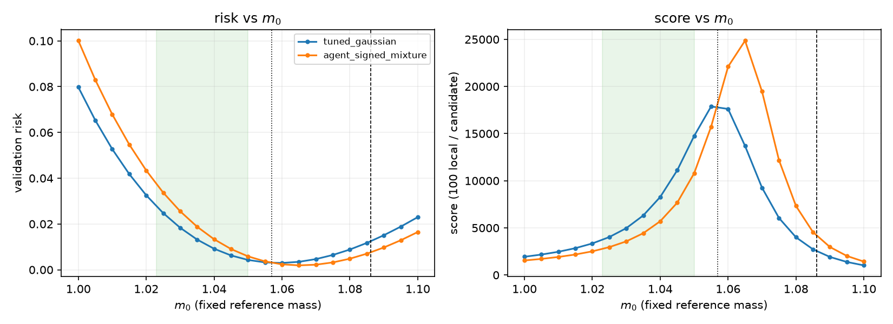

# pion_projection：审计后的下一轮开工单

审计日期：2026-11-18；代码与结果基线：`dfa63fe`。**本文件保留：PARTIAL_NOT_FINAL。**
原来的算子/反射修复、参考 factory 和诊断脚本已有成果；稳健评分、GEVP 统计、完整校准及独立 anchor 尚未通过验收。
本轮核查了源码、测试、NPZ/JSON 和已有图，并复跑全部 CPU 测试：**51 passed**。
环境为 Python 3.13.12、NumPy 2.5.1、SciPy 1.18.0、pytest 9.1.1；本地无 CuPy/MPI/PyQUDA，未重新执行 GPU 测量。
GPU 数字在本文均属于归档证据，CPU 复算与理论判断另行标明。

本文件替代旧版的活跃待办；已解决的旧 bug 不再要求重做。关闭任务不要求得到正结果：可复现的否定或信息不足也是合格研究交付。
不能因已有同名模块或合成测试通过，就将原来的端到端验收记为完成。
跨任务公共接口与证据规则见 [Wilson todo 的框架部分](../wilson_loop/todo.md)，学习算符实验见 [optimize_gaussian todo](../optimize_gaussian/todo.md)。

## 1. 此 task 做了什么，以及哪些工作已经完成

任务固定 quenched Wilson 系综、point source 和测量/分析流程，允许优化零动量 pseudoscalar 的空间 sink。
核作用在 quark field 上保持线性；当前实 Hermitian、spin-scalar 核用 `Re <S,K S>` 收缩。
协议几何为 `[x,y,z,t]`，核 links 为 `(3,z,y,x,3,3)`、方向 x/y/z，field 为 `(z,y,x,color,nrhs)`。
κ=0.14、空间周期、费米子时间反周期；meson 折叠采用周期 cosh。所有质量为格点单位 am。
signed sink/cross-correlator 的 overlap 不必全部非负；Hermitian 也不等于正定。

| 原任务 | 本次判定与证据 | 不应扩大成什么结论 |
| --- | --- | --- |
| A：参考身份和工厂 | [reference.py](reference.py) 已冻结 kind、statistics/implementation hash；主流程和 candidate 使用 factory | 尚非完整依赖闭包；不是所有入口都已统一认证 |
| A：T16/T32 反射 | [experiment.py](experiment.py) 动态 `reflection_odd`；回归测试覆盖 | T32 旧 274.269 是索引假警报，修正 2.398 不会消除 χ²/窗口失败 |
| B：档案/参考/窗口诊断 | [score_diagnostics_v2](../../results/pion_projection/score_diagnostics_v2/README.md) 已有 inventory、扫描、谱、图、模型平均 | 大多基于旧 60 dev；不能自动解释新 120 dev |
| B：两态诊断 | [reference_twostate.py](reference_twostate.py) 已返回 gap/幅度/条件信息；有 profile 和模型平均尝试 | 极低 χ² 或 AIC/BIC 权重集中，单独都不是过拟合的证明 |
| S1：保守评分 | [scoring.py](scoring.py) 已实现给定 risk draws 的 log 改善及 Bonferroni 分位汇总 | 未实现/强制完整参考认证、联合 draws 和端到端覆盖率 |
| C2：矩阵探索 | 有 Hankel、多 source、两族/三族 Gram 数据及 GEVP 程序 | Gram 正定不等于标准 source–sink 变分矩阵；误差实现需修复 |
| C3：能量目标 | [energy_target.py](energy_target.py) 已实现配对平方误差差及简单独立 Gaussian 实验 | 尚未验证从相关函数提取能量的整个估计器；真实 anchor 未取得 |
| D：新 campaign | `s16t16_gevp200` 有 120 dev / 60 val，8 个 powers，T=16；生成器已入库 | 不能再称“没有新数据/生成器”；也不能据此宣布参考成立 |
| LLM 说明 | prompt 已按 protocol 生成，Note.md 已更新入口说明 | 候选约束和 validation 身份检查仍须接入公共 evaluator |

可复核的最新质量读数来自 [200 配置运行结果](../../results/pion_projection/s16t16_gevp200/validation_results.json)：
`am=1.077112714 ± 0.003357843`，名义窗口 `[5,6,7,8]` 的 `χ²=90.641168/8`、`p_approx=3.44593e-16`；窗口漂移约 27.92σ/12.61σ，反射约 1.224。正式分数仍应为空。
旧 T16 `am=1.086166941`、两态约 1.057，连同新的结果说明分析依赖需要继续诊断；不能把它们直接拼成已认证的基态置信区间。

## 2. 当前诊断：有图，也要说明图能支持什么



上图由 [m0_scan.json](../../results/pion_projection/score_diagnostics_v2/m0_scan.json) 对固定候选扫描参考质量得到。
横轴是**假定的** m0，左图是条件 risk，右图是 `100 R_local/R_candidate`。
曲线在约 1.06 附近交换排序，证明当前排名依赖参考；它不认证任何一个 m0。
图中绿色区域对应旧 Gram 解释，应在修正 GEVP 后重标为探索范围，不能当 anchor 误差带。
重新缩放分数、取 log 或压到有限区间，都不能消除排序对参考的依赖。

本轮只读 CPU 复算了 `s16t16_gevp200` 的 covariance：先逐配置 fold，再每 5 配置分块，24 blocks。
下表为**未 shrink/floor 的样本 covariance**；channel-scaled 使用 `ReferenceFit.samples` 的通道归一化。

| 窗口 | 矩阵维数 | rank | raw condition number | channel-scaled condition number |
| --- | ---: | ---: | ---: | ---: |
| 4–8 | 15 | 15 | 3.55255e8 | 1.62987e8 |
| 5–8（名义） | 12 | 12 | 5.53935e7 | 2.65186e7 |
| 6–8 | 9 | 9 | 8.40727e6 | 3.64030e6 |

旧 12 blocks 的 rank≤11 是事实，其中 4–8 为 15 维、5–8 为 12 维；不能混写“名义15维”。
新数据已解除这一代数秩限制，仍存在病态与参考窗口不稳；高条件数本身也不证明能谱不可识别。
因此“只因12 blocks所以失败”“增加统计量一般无效”均超出目前证据。

## 3. P0：先修 GEVP 的统计和物理解释（CPU）

**确认的问题。** [gevp.py](gevp.py) 对每个输入 row 单独解 GEVP；Gram 入口传入的是 configuration 数组。
随后 `summary` 对逐配置能量取平均，`se_boot` 实际为各时间的配置标准差均值除以 `sqrt(时间点数)`。
它没有进行 bootstrap，也没有传播时间相关性；不能继续把此字段解释为能量均值的标准误。
[gram_gevp.py](gram_gevp.py) 又逐配置、逐时间给 eigenvalues 加 floor；同族 `power=0` 是重复 identity，不能把结构零模填正后当新增物理自由度。

- [ ] **P0.1 推导测量对象。** 从 [measure_gram.py](measure_gram.py) 的
  `M_ij(t)=<K_i S(t),K_j S(t)>=<S,K_i†K_j S>` 出发，写明两指标都来自 sink 操作。
  与标准 `C_ij(t)=<O_i(t)O_j†(0)>` 及其 factorized spectral overlap 比较；若要使用变分定理，必须证明所需结构。
  对 [measure_multisource.py](measure_multisource.py) 另核对 source smearing 参数、两条 quark 腿、sink powers 与 source–sink 标签的实际对应；先报告未对称化矩阵的反 Hermitian 部分，不先用 `(C+C†)/2` 隐藏不匹配。
  **产物：**拟议 `gram_operator_identity.md`，给明确 Wick/指标/轴推导和至少一个显式小体积收缩对照。
- [ ] **P0.2 重做估计顺序。** configuration/Markov blocks 共享重采样 → 每个 replica 的平均矩阵 → development 冻结的独立子空间 → GEVP → mode matching → 相关平台分析。
  先剔除精确重复核，记录 metric 的谱与有效秩。子空间选择的误差应预声明为固定条件分析或在完整外层重新估计，不能默默混用。
  t0、basis、截断和窗口在开发阶段确定。保留失败 replica 数量和原因，禁止只平均成功解。
- [ ] **P0.3 有限 T 与稳定性。** 在适用谱模型下比较 forward exponential 与包含回绕的估计；扫描预声明 t0/截断，检验 mode crossing、负本征值、近简并及噪声偏差。
  用已知谱生成器验证 bias/coverage；bootstrap 数增加不能被当作配置数增加。
  **图与文字：**拟议 `gram_rank_floor.png`（原谱、去重后谱、floor 相对改变量），`gevp_bootstrap.png/json`（有效能量、t0/窗口、联合区间和失败率），每图附 3–6 句解读。

**验收：**加入/删除重复 identity 不改变可识别结果；已知谱覆盖率在预声明 Monte Carlo 容差内；修改 draw 数只减少模拟误差、不伪造更多数据精度；失配/不可识别情形明确拒绝认证。
上述完成前，旧“1.02–1.05 的 GEVP 质量及其 SE”只作待复核的 Gram estimator 读数，不能用其 σ 值论证偏向哪一个参考或充当独立 anchor。
标准 GEVP 的适用结构见 [Blossier 等 §2.1，式(2.3)–(2.6)](https://arxiv.org/html/0902.1265v2)；其有限 T 和谱假设需要在这里单独检查。

## 4. P0：让稳健评分具备真正的认证边界（CPU）

本轮内存 CPU 反例：最简 spec 没有认证信息，模型名为 `unapproved`，baseline draws 全 1，candidate 全 0.5，
现有 `improvement_certificate` 返回 `status=certified`、lower bound=2。
这说明它目前是**调用者提供 draws 的汇总函数**，不能单独当物理认证器。
[score_spec.example.json](score_spec.example.json) 中 accepted_models、anchor_id、metric_hash 等存在，不代表代码检查了它们。

上述接口边界可从仓库根目录只读复现；当前返回 certified 是待收紧的行为，修复后认证入口应拒绝或仅返回明确的条件统计量：

```sh
PYTHONDONTWRITEBYTECODE=1 python3 -B - <<'PY'
import numpy as np
from tasks.pion_projection.scoring import improvement_certificate
spec = dict(schema='pion-score-v1', version='audit', estimand='toy',
            baseline_id='base', alpha=.05,
            comparison_family=dict(candidates=1, models=1))
risks = {'unapproved': {'base': np.ones(100), 'candidate': np.full(100, .5)}}
print(improvement_certificate(risks, spec))
PY
```

- [ ] **P0.4 明确 estimand。** 原指标 `Var_boot(q)+(qhat−1)^2` 可定义为条件扰动 risk。
  若想估计频率学 MSE，则 `E[(qhat−1)^2]=Var(qhat)+(q*−1)^2`，额外相加可能重复计入估计噪声。
  幅度拟合/参考相关性使直接减 variance 也不自动正确。先用已知谱比较旧指标、cross-fitted 损失及候选修正，不能钳零后宣告完成。
  **产物：**拟议 `score_contract.md`，列目标、估计器、独立样本单位、条件量、有效性范围和无分数条件。
- [ ] **P0.5 强制 schema 与身份。** 认证层接收冻结 reference/metric/candidate/数据身份，核对 accepted model 的精确集合、J 个候选、baseline、分析版本和共有 draw IDs；空模型集合明确 abstain。
  模型接受规则只使用 development，并保留其预测/识别/校准证据；能量主终点还须 anchor 身份和隔离证据。
  所有风险数组 shape 必须完全一致且一维，禁止广播；在加 floor 前检查原值合法性。
  非有限值、无效 replica 和近零/不可分辨 baseline 必须单独记录。若顶层 abstain，任何候选都不能仍以 `certified=True` 向外暴露。
- [ ] **P0.6 联合 resampling 接入 evaluator。** 由共用的开发/验证 block draws 重拟合 reference 参数，保留共同 latent 参数与幅度/协方差依赖；同一 draw 对所有候选和模型配对。
  将它接入 `experiment.evaluate`、candidate 和比较入口，输出新的诊断目录；不能仍由旧 ratio 充当新证书。
  若暂时仅接受外部 risk draws，就将接口明确命名为条件汇总，并由独立认证器强制 gate。
  **产物：**拟议 `joint_draws.npz`（draw IDs/模型/候选/联合参考）、`metric_results.json` 和认证拒绝条件的文字表。

保留的近期比较方案是：

\[
D_{cm}^{(r)}=\log(R_{bm}^{(r)}+\delta^2)-\log(R_{cm}^{(r)}+\delta^2),\quad
L_c=\min_{m\in M} L_{cm},\qquad G_c=\exp(L_c).
\]

每个 `L_cm` 使用预声明的单侧 `α/(J K)` 下界；δ 是开发阶段确定的共同分辨尺度，不是随候选调整的救分常数。
Bonferroni 只在各下界有相应覆盖时提供同时覆盖目标，不能修复失效的 bootstrap。
没有合格 reference 时必须 abstain；有合格 reference 且下界超过预声明实际收益阈值，才认证**所列模型集合内**的改善。
这也不覆盖集合外未知系统误差；不能因模型不利就在 validation 后删除它。

**验收反例：**未批准模型、身份改变、空集合、错配 draw、广播 shape、负风险加 floor、无效比例过高、近零 baseline、错误激发态假装基态，均必须按契约拒绝/abstain。
固定错误 reference 的纯激发态可以获得极小旧 q-risk；高 SNR 和非零幅度不足以证明它是基态，必须保留这个物理反作弊测试。

## 5. P1：重新校准完整流水线，并利用现有 200 配置（CPU）

**已确认的实现边界：** [calibration_blocks.py](calibration_blocks.py) 的内层会重建部分 covariance，但 `coverage` 把模拟均值传回原 `model`，仍以原 samples 定义协方差和标度。
这不是每个独立 synthetic dataset 都重建模型的完整外层 coverage。
其“inverse-Wishart 后验不可能 proper”的解释也未由代码支持；proper 性取决于 prior 和参数，不是简单的 `d>n` 定理。
同数据估计 plug-in 参数并不自动使 parametric bootstrap 无效；应检查实际生成/拟合/重估流程的一致性。

- [ ] **P1.1 双层校准。** 外层生成独立 dataset，每次重做 channel scales、covariance/shrinkage、reference 拟合和选择；内层模拟/重采样使用该外层模型。
  分开报告 fixed-metric 条件校准和完整估计器校准。加入相关噪声、非 Gaussian、Markov 自相关、signed overlap、弱 gap、有限 T、错误参考。
  block 数至少覆盖历史 6/12、新 24 及功效设计所需更大范围；候选数/模型数也要扫描。
- [ ] **P1.2 校准分辨率。** 使用 `(k+1)/(Nsim+1)`、记录 k/Nsim/invalid 和二项区间。
  `Nsim=100` 时最小 corrected p≈0.009901，在 1% 门槛附近分辨率不足；依据目标 MC 误差选 Nsim，不能将零次失败称“完全正确”。
  **图与文字：**拟议 `score_calibration.png/json`，画假认证率/coverage 随 blocks、失配程度、模型数变化，带 MC 区间；记录所有失败实验。
- [ ] **P1.3 200-run 参考诊断。** 将 inventory、stability_scan、calibration、两态 profile 扩展到当前 120 dev，保存 raw/scaled covariance 谱、floor 触发数、预声明 block×shrinkage 图、mass–window 图及有效独立样本估计。
  对两态做多起点、gap/profile、边界/prior 敏感性和预测验证。比较 Δχ² 区间的半宽/左右端点与 SE，不能用全宽0.04除以SE0.0098宣称误差低估4倍。
  Δχ²=1 的解释也需识别性/Wilks条件；极低χ²不能独自证明过拟合。
- [ ] **P1.4 全链 nested CV。** 按 chain/configuration blocks 划分；每个 outer training fold 重新选择/拟合 reference、通道归一化、covariance 和候选超参数。
  不复用完整 development 的 mass bootstrap 给内部 folds；source/time/basis 不是独立划分单位。
  **产物：**拟议 `fold_plan.json`、每 fold 的失败/质量表与风险分解图；不能运行的部分记 NOT_RUN。

**验收：**预注册 coverage/假改善容差内通过；若失败，输出可定位的生成条件和反例并保持未认证。
现有数据足以完成这些 CPU 诊断；无需先生产更多 gauge field。

## 6. P1/P2：更稳健的物理目标及替代赛道

### 6.1 优先研究：最终能量误差改善

冻结能量提取程序，使用独立、无偏且目标相同的 anchor `Ehat_*` 时，

\[
\mathbb E[(\widehat E_c-\widehat E_*)^2]
=\operatorname{MSE}(\widehat E_c)+\operatorname{Var}(\widehat E_*),\qquad
\Delta_c=\frac{(\widehat E_b-\widehat E_*)^2-(\widehat E_c-\widehat E_*)^2}{\tau_E^2}.
\]

差值避免近零 baseline 作分母，τE 为预先规定的物理精度。独立 anchor 的共同方差在期望差中抵消，但单个 batch 的 Δ 仍有噪声。
若共享配置，必须传播 cross-covariance；anchor bias 也会留下交叉项，不能靠公式消除。

- [ ] 在已知谱上真正从相关函数拟合 `Ehat`，比较 bias、variance、MSE 和 interval coverage，包含基态消失/错误态反例。
- [ ] 区分 `energy_target.lower_bound` 的两种样本语义：独立重复实验的均值误差可以除以 sqrt(N)；同一数据的 bootstrap replicas 不能再除以 sqrt(Nboot) 当物理标准误。
  目前 Gaussian toy 是前者，不能原样接给真实 bootstrap draws。定义并校准适当的 Δ 推断。
- [ ] 取得真实 anchor 前，只交付模拟/敏感性研究；完整 source–sink 矩阵、长时/高统计参考是可选采集方案，逐一给资源和识别性预算。
  当前 Gram、同配置多 source 及原 validation 都不能自动获得“独立 anchor”身份。

**图与验收：**拟议 `energy_bias_variance.png`、`anchor_sensitivity.png`、coverage/false-certification 文字表。
固定真实样本数增加 Nboot 时，物理区间应趋于稳定；不能任意变窄。anchor 冲突或失配时主结论为 abstain。

### 6.2 可选：共同目标预测与质量约束成本

若 ground-state 认证仍不可行，可单独定义 shape-prediction 任务：所有候选预测**同一个**冻结 anchor-channel 目标，使用训练 fold 的共同 metric。
平方损失评估共同条件均值；若预测 Gaussian 分布，要包含 `log det Σ` 项，不能仅奖励大方差。
不能各自缩小 candidate C 后用自己的小幅度目标获胜。这个赛道测预测能力，不宣称改善基态提取。

成本比较先固定 bias/coverage/SE 质量门槛，再估计达到目标所需 `C_setup+N*C_per-config`。
分别报告含反演总成本和增量 sink 成本，包含 source 数、apply、IO、分析与硬件/精度；不使用未定义的“risk×秒”。
**产物：**共同目标预测残差图、缩幅/方差膨胀反例表、质量–成本曲线；目标未达到则 unresolved，不强行外推加速。
这些是有明确终点的可选扩展，不能用它们替代 P0/P1 的必做验收。

## 7. P2：新测量的先决条件与框架适配

- [ ] 新 run 绑定 gauge/propagator 摘要、source 插入与12 RHS残差、真实 QUDA/设备/精度、生成链和 trajectory IDs。
  [pilot/hmc_generate.py](../../pilot/hmc_generate.py) 已存在，但 HMC 的 force/reversibility/ΔH、热化/自相关审计仍需证据，不能由接受率自动认证。
- [ ] 先在小体积检查 γ5/self-contraction 指标和 fast/generic 一致；新 source–sink matrix 必须有实际测量或严格恒等式，禁止按名称猜测矩阵。
  记录每个 source 内平均与 configuration 外分块，不能将 sources 当独立配置。
- [ ] 预先冻结候选、reference/score spec、主要终点、分析器、比较族、算力与新 validation IDs；按功效模拟决定统计量。
  旧 validation 已公开反复探索，换目录/版本号不恢复盲性。新 campaign 的盲性要由实际访问/冻结记录判断，而非生成日期或机器相同与否。
- [ ] 给公共 `ReferenceProvider/Metric/Comparator` 提供适配器：联合参数、draw IDs、质量状态、条件/物理 estimand；由一名公共层负责人统一实现，避免三个任务各建一套 resampling。
  CPU/CUDA/ROCm、多 rank 和非零动量扩展分别认证，不能继承旧单 rank 零动量证据。

新 GPU 生产依赖 P0/P1 的明确验收与资源计划；本轮审计不启动这些生产。

## 8. 下一 agent 的交付格式、顺序与关闭条件

每次新分析写入**新的** `results/pion_projection/<audit_id>/`，不要覆盖 score_diagnostics_v2 或历史 submission。
所有以下新文件名都是拟议交付；当前已存在的文件链接只作证据。
每条诊断至少交付 `JSON/NPZ 数值 + 图或有数值的文字表 + 解释`，包含输入/代码 hash、协议、seed、split/blocks、方法、阈值、观察值和 `PASS/FAIL/NOT_RUN/INCONCLUSIVE`。
图需标轴/单位、样本与区间含义；解释写清“观察到什么、支持什么、不能支持什么、下一步如何区分”。单有 PNG 或测试计数不算完成。

| 顺序 | 范围 | 本轮关闭要求 |
| --- | --- | --- |
| 1 | P0.1–P0.3 | 修正 GEVP 统计与矩阵解释；输出去重/floor/误差诊断及已知谱验收 |
| 2 | P0.4–P0.6 | score 身份与拒绝反例、共同 draws、真实 evaluator 接入；历史参考未合格仍 abstain |
| 3 | P1.1–P1.4 | 完整 outer calibration、200-run 诊断、fold-local CV，附图表与失败范围 |
| 4 | §6.1 | energy estimator 实验与 bootstrap/独立重复语义分离；真实 anchor 缺失则明确 NOT_RUN |
| 5 | §7 | 冻结可执行的新测量/功效/资源计划；有条件再测新数据，不提前声称物理胜出 |

同时修正 [覆盖报告](../../doc/todo_coverage.md)、[总报告](../../doc/final_report.md)、task README 和诊断 README 中对应旧结论：
“CPU已全部完成”、把 `s16t16_gevp` 的 T16 数据称为 T32、Gram SE 的统计解释、极低χ²即过拟合、profile全宽即SE倍数、有限模拟零失败即校准正确。
各 risk ratio 表头明确分子/分母，从 JSON 自动生成，避免正文方向反写。
这些文档更正由后续实施者与结果一起提交；本次只更新本开工单。

只在必做项目的代码、负例测试、真实/合成证据和解释全部到位，且未执行的新测量明确独立移交后，才可讨论删除本 todo。
目前保留的原因是存在具体可修复、可检验的缺口，不是要求无休止扩展，也不是要求一定证明某候选更好。
