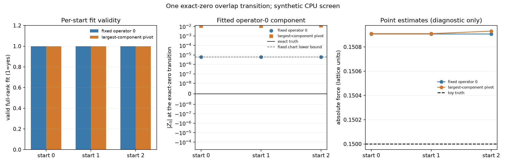

# Exact-zero operator-0 phase-chart fit screen

**Classification:** one oracle-seeded, open synthetic panel for numerical feasibility only. This is not profile coverage or a physical force result.

## Frozen synthetic panel and fits

The DGP uses the existing positive finite-`N_t` 2-vacuum × 3-static toy with one exact zero transition component `Z_0(R=2,m=0,n=2)=0`; the other two operator components remain nonzero. It contains 96 correlated AR(1) blocks (`rho=0.5`), one fixed seed and 0.3% relative matrix noise. Both charts use the same sampled matrix mean, regularized covariance, three paired starts, analytic Jacobian, TRF, `x_scale='jac'`, `max_nfev=2000`, and `1e-10` tolerances. The initial energies/overlaps are oracle-derived from this synthetic DGP, not estimated from data.

- Source snapshot files: `3/3/0/0` (planned/valid/failed/abstained).
- Fixed operator-0 fits: `3/3/0/0`.
- Largest-component pivot fits: `3/3/0/0`.
- Both charts valid for `3/3` paired starts.
- At the target transition the pivot chart selects operator indices `[2]`; the fixed chart imposes `|Z_0| >= exp(-12) = 6.14e-06`.
- Maximum initial model difference between paired coordinates: `8.05e-08`.

## What this establishes

The pivot chart can place an exact zero in its non-pivot operator coordinate while retaining the positive spectral outer product. The fixed chart is strictly positive in operator 0 at finite coordinates and represents this DGP only by approaching its configured lower bound. The fit outcomes show whether the local solver reached acceptable solutions under these fixed starts; three fits are not a convergence-rate or coverage estimate.

## Limits and reproduction

This single DGP does not test the measured-`N_t=32` initializer, production overlap conventions, profile intervals, finite-sample coverage, contamination bounds, GPU/QUDA, or a physical force. Every failure remains in `fit_results.csv`. Raw synthetic matrices, manifest and lane contract are retained in `source_package/`; source and artifact SHA-256 maps bind this local report.

Run `python tasks/wilson_loop/f_lane_pivot_chart_exact_zero_screen.py --output <new-empty-directory>`. The no-clobber output includes the frozen protocol, per-fit progress, raw input snapshot, denominator table, figure and hashes.
