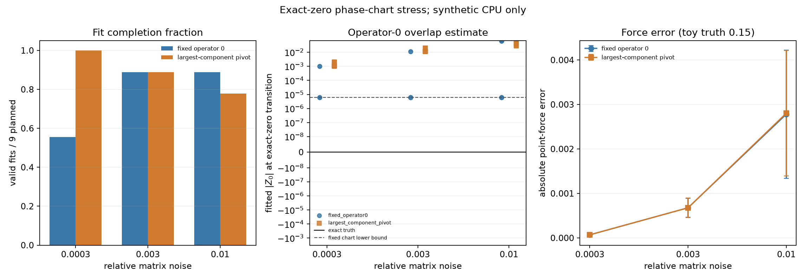

# Exact-zero operator-0 chart screen across noise levels

**Classification:** nine deliberately constructed open synthetic panels; this is a small optimizer feasibility screen, not a coverage study or physical result.

## Frozen design

The same positive finite-`N_t` 2-vacuum × 3-static truth has exactly `Z_0(R=2,m=0,n=2)=0`, with nonzero operators 1 and 2. Three seeds are crossed with relative matrix-noise levels `0.0003`, `0.003`, and `0.01`. For each seed, the same standardized Hermitian AR(1) noise realization is scaled to each noise level. Each panel uses 96 blocks, `rho=0.5`, three paired oracle-derived starts, a panel-specific regularized covariance, analytic chart Jacobians, TRF, `max_nfev=2000`, and `1e-10` tolerances. No production initializer is used.

- Panels: `9/9/0/0` (planned/valid/failed/abstained).
- Captured panel source files: `27/27/0/0`.
- Fixed chart fits: `{'planned': 27, 'valid': 21, 'failed': 6, 'abstained': 0}`.
- Largest-pivot chart fits: `{'planned': 27, 'valid': 24, 'failed': 3, 'abstained': 0}`.
- Paired starts valid in both: `18/27`.

Per-noise summaries for the fitted zero-component magnitude, force error and solver evaluations are in `summary.json`; every fit and failure reason is retained in `fit_results.csv`, and panel-level counts/covariance condition numbers are in `panel_summary.csv`. The force-error whiskers show the standard deviation across the three seed-level means, not across starts.

## Interpretation limits

The pivot chart has an exact coordinate for zero operator-0 amplitude, while the fixed chart has a positive finite lower bound. A fitted nonzero `|Z_0|` in the pivot chart does not invalidate its representation; it can indicate that this noisy one-point dataset does not identify the component as zero. Three seeds per noise level are too few for coverage, risk, or population claims. The force points are toy fit diagnostics, not certified estimates.

Raw captured matrices and their manifests are retained under `source_package/`. `artifact_hashes.json` covers the report, figure and all panel input files; `source_hashes.json` binds the producer and reader dependencies. Reproduce with `python tasks/wilson_loop/f_lane_pivot_chart_exact_zero_multireplicate_screen.py --output <new-empty-directory>`.

No production/sealed data, GPU, QUDA, interval coverage, thermal/mixed contamination bound, or physical score is produced.
