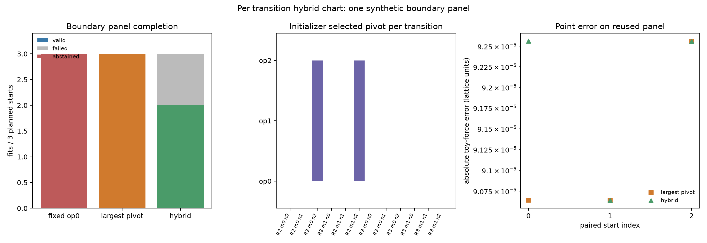

# Per-transition hybrid phase chart on the matched-Nt=32 boundary panel

**Classification:** one reused, open synthetic panel; chart feasibility only, not independent confirmation, interval coverage or physical validation.

## Data flow

`artifact-hash-bound 96-block matrices -> matched-Nt=32 per-R three-state initializer -> for each (R,m,n), keep op0 when log|Z0| >= -12, otherwise pivot on argmax_i |Zi| -> re-encode same start -> full finite-Nt 2-vacuum x 3-static fit -> compare with saved fixed/pivot fits from the same panel and starts`.

The captured source package is **3/3** files. Across the 12 transition vectors, hybrid uses op0 for **10** and an alternate operator for **2**. Re-encoding changes the model by at most `5.55e-17` in absolute component units.

| Chart | Planned | Valid | Failed | Abstained |
|---|---:|---:|---:|---:|
| fixed op0 | 3 | 0 | 0 | 3 |
| largest pivot | 3 | 3 | 0 | 0 |
| hybrid | 3 | 2 | 1 | 0 |

Hybrid force errors for its three paired starts are `[9.256209919206171e-05, 9.064012718801306e-05, 9.256110578370613e-05]` lattice units; saved fixed/pivot point estimates and all full rows are in `paired_results.csv`. These toy errors compare with generator truth only and are not uncertainty estimates.

The hybrid middle start is **not a valid fit**: it reached `max_nfev=2000` with local Jacobian rank `67/67`. Its finite endpoint force is retained in the CSV and plotted as a diagnostic, but it does not count as a successful estimate. The other two hybrid starts are valid. The saved largest-pivot baseline is valid for all three starts; its local condition numbers span about `6.27e5` to `1.16e10`, while the hybrid's two valid starts are about `2.89e5`. Thus this one panel shows a chart-coordinate tradeoff: hybrid keeps op0 on 10/12 transitions and has lower conditioning for its successful starts, but it does not match the pivot chart's 3/3 completion. The point errors are similar on this one panel and do not establish a ranking.

The hybrid map is selected once from each initializer transition and remains fixed during that optimizer call; it is not a dynamically switching chart. It tests whether localizing the chart change can retain the fixed chart's coordinates elsewhere while rescuing an out-of-domain component. The full-fit objective, covariance, bounds, solver and validity rule are unchanged.

This is one panel already used by both preceding exact-zero reports, with three starts and no new seed. The figure's first panel gives the planned/valid/failed/abstained counts; the right panel also shows the finite endpoint from the failed hybrid start, which the text and CSV mark as invalid. This cannot rank charts generally, establish estimator coverage, certify an overlap floor, validate production Wilson conventions, or bound excited-state/thermal contamination. No GPU, QUDA or sealed input was used. C finite-T Creutz and F ground-state force remain separate; both lanes are `NOT_READY/UNCERTIFIED`, F is `GROUND_STATE_FORCE_UNCERTIFIED`, `physical_score=null`, and sealed data remain closed.

For a next CPU step, predeclare a small untouched synthetic panel set and compare fixed, global pivot and this hybrid map with identical data splits and starts; retain every failed/abstained fit. If hybrid only reduces abstentions while worsening point error or conditioning, keep it as a numerical fallback rather than promoting it to the primary chart.
