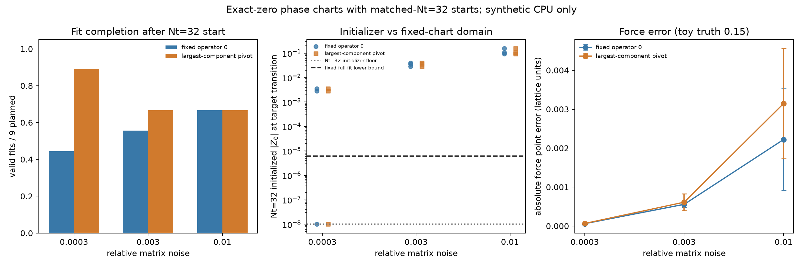

# Exact-zero phase-chart screen with matched-Nt=32 initialization

**Classification:** reused open synthetic panels; initializer/fit feasibility only, not a coverage or physical study.

## Data flow

`hash-bound exact-zero 96-block matrices -> capture manifest/NPZ/contract -> fit a 3-state, 3-operator spectrum at Nt=32 separately for each R -> use fitted energies/overlaps (no oracle starts) -> paired fixed/pivot full finite-Nt 2-vacuum x 3-static point fits -> preserve all initializer and chart outcomes`.

The source artifact-manifest SHA-256 is `8e39266384626f1353e5104928b42638b4c43c578a21ad14cc931e2fdf7def5d`. The immutable source capture is **27/27** files. Per-R Nt=32 initializer fits: `18/18/0/0` planned/valid/failed/abstained. Full-fit planned/valid/failed/abstained: fixed `27/15/9/3`; pivot `27/20/7/0`.

The Nt=32 initializer's fixed operator-0 amplitude floor is `1e-8`, whereas the full-fit fixed chart requires log amplitude at least `-12` (`|Z_0| >= 6.144e-6`). If an initializer estimate falls below the latter, the fit comparison preserves the fixed-chart start as an out-of-bounds abstention; it does not silently clip the estimate. The pivot chart re-encodes the same physical start and can keep a small operator-0 component as a non-pivot coordinate.

The figure shows completion fractions, the initialized target overlap against both lower bounds, and per-seed force-error means. Force error bars show the standard deviation across available seed-level means, not an uncertainty interval. Exact toy truth is used only for the final force-error calculation.

Only three seeds per noise level are used, and these are the same panels as the preceding oracle-start screen. The Nt=32 single-vacuum initializer itself is an approximation to the finite-Nt truth; no independent sample, interval coverage, production convention, contamination bound, GPU, QUDA or physical score is established. See CSVs for all fits, failed initializers and denominators.
