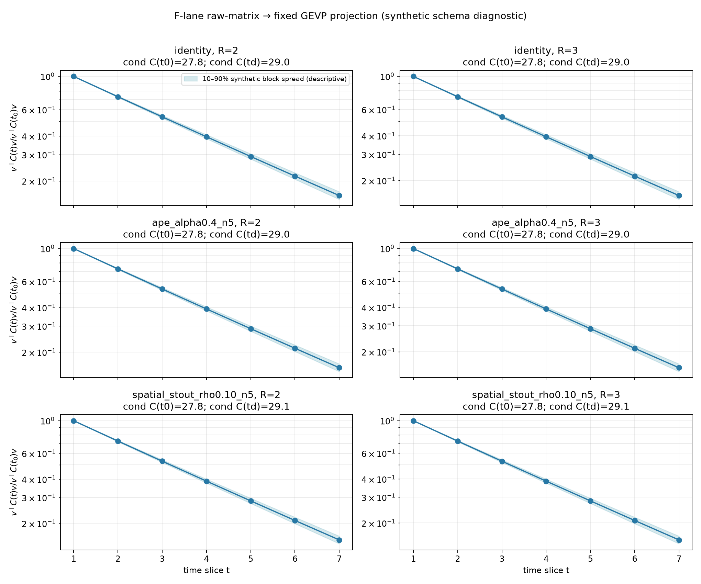

# F-lane raw matrix snapshot reader: synthetic diagnostic

This package validates a two-file immutable source snapshot (`manifest` + NPZ), checks NPZ size before allocation, enforces the ordered cross-correlator axes, and projects each block with one fixed `t0=1`, `td=2` principal GEVP vector per operator/R cell. The projection is `v† C_block(R,t) v`; it returns condition numbers and block-level projected correlators only.

The bands show the 10–90% spread across 24 deterministic synthetic blocks. They are descriptive, not confidence intervals and not evidence that blocks are independent. The data are generated from a four-state forward spectral toy with small deterministic parameter variation. `physical_score=null`; the F lane remains `GROUND_STATE_FORCE_UNCERTIFIED`.

## Data-flow and limits

`captured manifest + NPZ bytes → strict schema/hash/split/axis validation → NPZ preflight → mean C(t0), C(td) → fixed principal GEVP → same-vector block projection → CSV/figure`.

No fit of energies or overlaps, q envelope, interval, coverage calibration, finite-`N_t` backward propagation, thermal `h`, mixed `x`, force propagation, or physical gate is implemented. The current project does not contain a raw cross-correlator producer; its diagonal loop arrays do not determine off-diagonal matrix elements. A production exporter must measure and document those cross terms and receive independent review before this reader is considered for gate integration.

Denominators (planned/valid/failed/abstained): source files `2/2/0/0`; operator/R projection cells `6/6/0/0`; projected operator/R/time values `42/42/0/0`; physical q/interval/certification `1/0/0/1`.

See `protocol.json`, `summary.json`, and `artifact_hashes.json` for exact source identities and scope.
