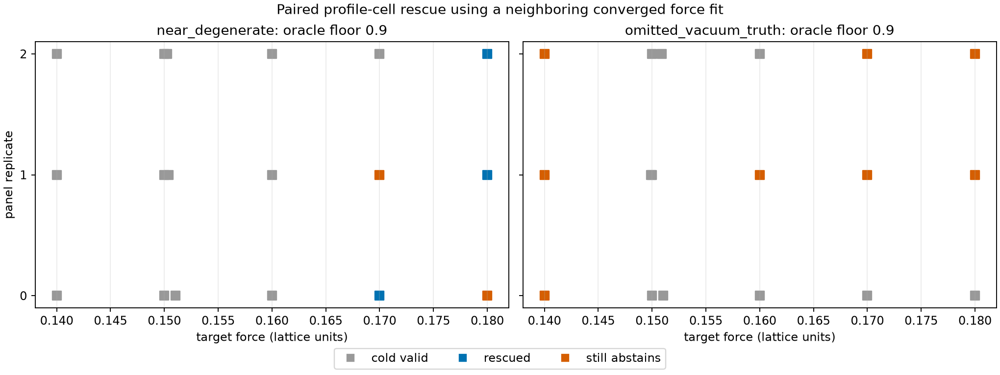

# Wilson profile continuation start-rescue screen

**Classification:** paired numerical-rescue experiment on existing synthetic panels; not calibration.

The screen reruns 13 failed cells from three near-degenerate and three omitted-vacuum panels. Each rerun keeps the original captured point fit as one start and adds a second start copied from the nearest cold-valid force cell at the same floor.

Neighbor continuation recovered 3 cells; continuation starts valid **3/26**. These are paired retries on the same matrices, not independent fits or new coverage samples.

| Stratum | Phase | Complete profiles | Truth containment | Incomplete profiles | Wilson 95% interval |
| --- | --- | ---: | ---: | ---: | ---: |
| near_degenerate | cold | 0/3 | NA | 3 | NA |
| near_degenerate | neighbor_continuation | 1/3 | 0/1 | 2 | [0.000, 0.793] |
| omitted_vacuum_truth | cold | 0/3 | NA | 3 | NA |
| omitted_vacuum_truth | neighbor_continuation | 0/3 | NA | 3 | NA |

Containment uses complete, unclipped intervals only; `NA` means no eligible interval. The panel count is three per stratum, so binomial intervals are descriptive and very wide. The force grid and nominal `Δobjective<=3.84` rule remain uncalibrated.

All raw matrices and cold receipts were reused after checking their source report's artifact hashes and capturing one immutable byte snapshot per panel. A post-run import-closure audit added the three unchanged runtime dependency sources to `source_snapshot/`; `protocol.json` records this audit, while the saved execution-script snapshot remains the exact code used for the run. No new RNG panels, production Wilson matrices, sealed inputs, GPU or QUDA were used. The physical reader still returns `ABSTAIN_NO_INDEPENDENT_OVERLAP_FLOOR`; both lanes remain `NOT_READY/UNCERTIFIED`, F=`GROUND_STATE_FORCE_UNCERTIFIED`, and `physical_score=null`.
