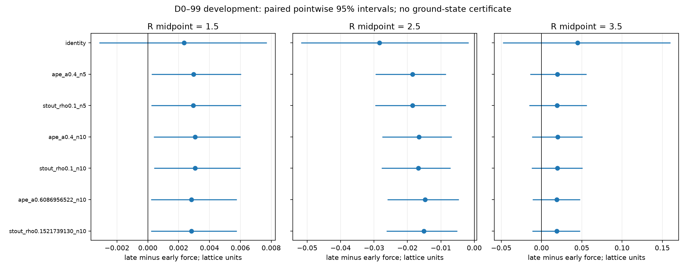

# Wilson D0–99: paired force window drift

**Status: DEVELOPMENT_DESCRIPTIVE_ONLY; physical_score=null.**

The previous force receipt supplied per-window intervals. This replay forms the window differences on the same resampling row, preserving covariance between overlapping windows. No new gauge data or independent synthetic datasets were generated.

`D(k,w_b,w_a,R) = f(k,w_b,R) - f(k,w_a,R)`; candidate difference of drifts is `D(k)-D(identity)`. All three later-minus-earlier pairs are retained: nominal−early, late−nominal, late−early. There are 63 drift contrasts and 54 candidate-minus-identity contrasts; intervals are pointwise and exploratory. No multiplicity control or equivalence margin has been supplied.

Source: complete D0–99 development transaction, protocol_d_20261120.json, 20 contiguous length-5 blocks, original 5,000 shared draws and seed. Transaction hashes, original protocol hash, all old window-force rows and saved resampling indices match exactly before deriving these contrasts. Full identity and code hashes are in receipt.json. Draw denominator: 5,000 planned, 5,000 valid, 0 failed. These are bootstrap draws over 20 blocks, not 5,000 independent configurations.

## Identity early/late contrast

| R midpoint | late−early force | paired SD | pointwise 95% interval |
|---|---:|---:|---:|
| 1.5 | 0.002348 | 0.002815 | [-0.003148, 0.007715] |
| 2.5 | -0.028420 | 0.012796 | [-0.051845, -0.001723] |
| 3.5 | 0.044858 | 0.052723 | [-0.048075, 0.159858] |



## What changes in the decision

The paired table quantifies window sensitivity directly; overlapping individual window error bars do not substitute for this contrast. A small or zero-compatible drift cannot bound a bias shared by all windows. Candidate drift closer to zero can reflect altered overlap, cancellation, or loss of sensitivity; it cannot identify ground-state accuracy. The CSV contains every contrast, including all failures in the denominator, rather than selecting a winning kernel.

The current development evidence therefore supports planning finite-T controls, but cannot certify ground-state force. If the chosen target is finite-T Creutz χ, T is part of the estimand and a force plateau is unnecessary; the research question and simultaneous comparison family must still be frozen before new confirmation data. If the chosen target is absolute potential, independent zero-point and shape-bias evidence remains necessary. These distinctions cannot be decided from this exploratory drift plot.

## Reproduce and verify

Run from the repository root, selecting a new output directory (existing outputs are refused):

```text
PYTHONDONTWRITEBYTECODE=1 python3 -B -m tasks.wilson_loop.force_window_contrast --self-check
PYTHONDONTWRITEBYTECODE=1 python3 -B -m tasks.wilson_loop.force_window_contrast --output-dir tasks/wilson_loop/force_window_contrast_20261121_v1
```

Five analytic/input checks pass: exact cancellation of shared fluctuations; invariance to window-common R-dependent shifts; known late-window contamination; pair order; nonfinite/wrong-shape refusal. Existing force tests should also be run when modifying the estimator. No validation, gap or holdout input was accessed.

## 实际执行与下一步解释

聚焦回归：`PYTHONDONTWRITEBYTECODE=1 python3 -B -m pytest -q -p no:cacheprovider tests/test_wilson_development_force_diagnostic.py` → **4 passed in 0.06s**；本脚本5项self-check PASS。图已视检标签和区间可读。这里95%区间描述配置block重采样的不确定度，未另估bootstrap分位数的Monte Carlo误差；不能当作独立MC datasets下的错误接受率或coverage。

Rmid=2.5 identity区间不含0，仅能作为已观察development的窗口漂移警示。六个候选的late−early相对identity改变约+0.00993–+0.01371，六个paired区间都跨0；不能据此证明smearing降低漂移。Rmid=1.5候选漂移区间各自不含0，也仅是未校准开发观察。各窗口共同的R依赖偏差严格不进入这些contrast；精确测出0漂移也不能认证基态力。

数组轴：`window_point=(kernel,window,Rmid)`，`window_draws=(draw,kernel,window,Rmid)`；drift数组用pair轴替代window；DoD数组移除identity kernel。kernel顺序同protocol（identity排首）；window为[[4,5,6],[4,5,6,7],[5,6,7,8]]；pair顺序[(0,1),(1,2),(0,2)]；Rmid=[1.5,2.5,3.5]。draw d的全部kernel/window/R均使用 `bootstrap_indices[d]` 指定的20个配置block，DoD明确使用同一draw的identity，而非独立重采样。完整的63 drift +54 DoD contrast保留在CSV和NPZ；没有挑选可通过窗口。
