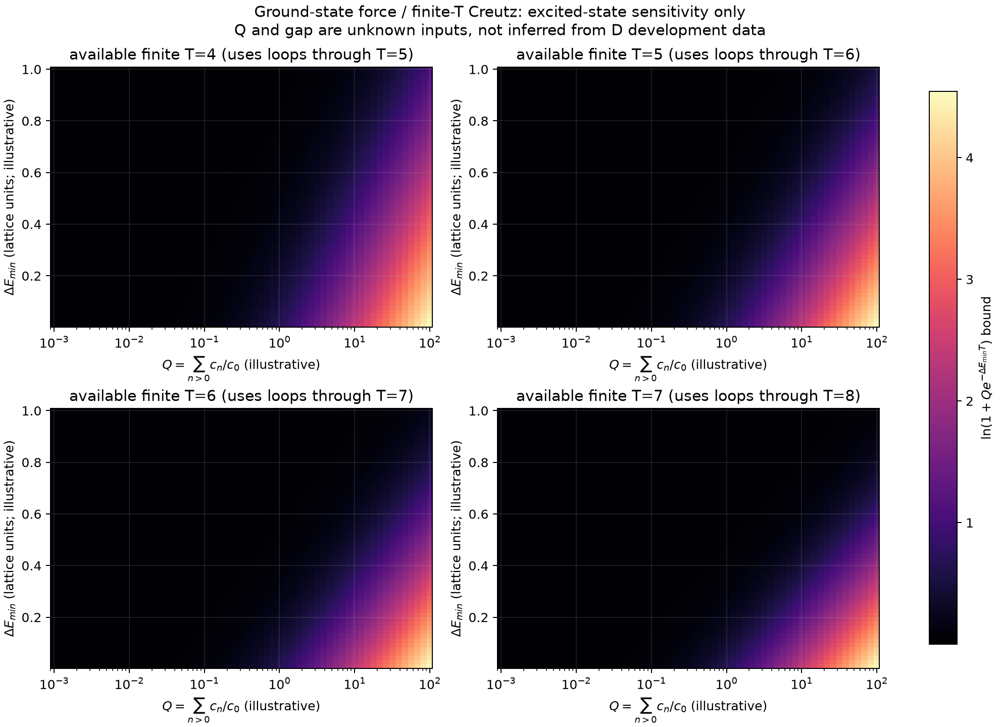
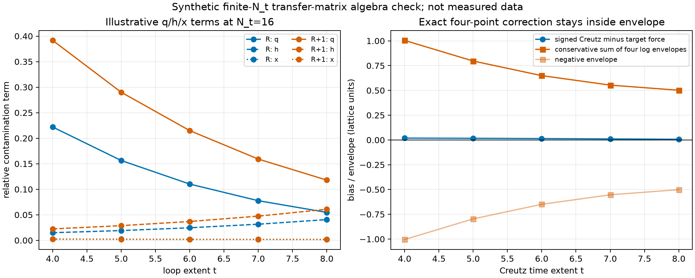

# wilson_loop: finite-T Creutz 与基态离散静态力 handoff

## 用户已选择的两个独立 estimand

1. **C lane：有限时间 Creutz observable** `chi_k(R,T)`。在 protocol 冻结后，它可作为有限 `T` 的直接观测量报告；不能自动改名为基态精度或改善。
2. **F lane：基态离散静态力** `f0(R+1/2)=U0(R+1)-U0(R)`。只有激发态、有限 `N_t` 热/绕回和混合项的总系统误差有独立可审阅上界时才可认证。

目前仍为 `NOT_READY/UNCERTIFIED`、`GROUND_STATE_FORCE_UNCERTIFIED` 和 `physical_score=null`。不读取 gap、validation、shared holdout；不启动 GPU/QUDA。

## 已完成的解析与源核对

- [零温正谱敏感度报告](https://github.com/DianjunZhao/LatticeArena/blob/6f1aa442d4f8b1121899fb6515bcd5b51501b161/results/wilson_loop/ground_state_bound_sensitivity_20261123_v1/README.md)：实现 `|chi-f0| <= log(1+Q exp(-Delta_min*T))` 的条件界，并在 `Q=1e-3…1e2`、`Delta_min=0.01…1.0` 格点单位、`T=4…7` 上生成 14,884 行解析网格和四面板图。`Q` 和能隙全是插图输入，不是估计值；这个公式不包含有限 `N_t` 热迹。
- [有限 `N_t` 热/绕回理论审阅](https://github.com/DianjunZhao/LatticeArena/blob/6f1aa442d4f8b1121899fb6515bcd5b51501b161/results/wilson_loop/finite_nt_thermal_bound_review_20261122/README.md)：从 trace 展开静态对与无源两套 Hilbert sector，保留 pair excited `q`、thermal `h` 和 mixed `x`。如果各项有独立非负 envelope，则先构成 `B_k(R,t)=log(1+q_bound+h_bound+x_bound)`，再把四个 loop 点的 `B` 传播进 `Delta_R Delta_t` 的力/Creutz 系统界。当前没有任何物理 `Q,H,X,Delta` 输入，推导不等于认证。
- 原文编号已复核：有限温热迹和谱分解在 Bala et al. Appendix A 的 Eq. (35)–(36)；零温 Wilson-loop 正谱展开在 Brambilla et al. Eq. (3)。更复杂空间路径/链接 smear 会改谱权重，不改固定 action 下能级位置这一点来自有限温论文对静态介子算符的讨论。来源与适用边界见上述报告文末链接。
- [框架扩展点地图](../../doc/framework_extensibility.md)建议将 C/F 写成两个 versioned estimand contract：共享 loop/block IDs 和 paired draws，但分别设数值门和系统误差门。



文字流程图：`W_k(R,t;N_t)` → `q: pair excitations ~ Q exp(-Delta_Q t)` + `h: no-pair thermal ~ H exp(-Delta_0(N_t-t))` + `x: mixed sector` → `C lane 保留有限t的chi`；`F lane 经 log 后做 Delta_R Delta_t` → 加总统计、激发态、热/绕回、混合、finite-a/volume 误差 → 与事前容差比较 → 缺任一独立 bound 时保持 `GROUND_STATE_FORCE_UNCERTIFIED`。

### 有限 `N_t` q/h/x 四点式 toy 验证（CPU 代数检查已完成）

[Finite-`N_t` toy report](https://github.com/DianjunZhao/LatticeArena/blob/6f1aa442d4f8b1121899fb6515bcd5b51501b161/results/wilson_loop/finite_nt_toy_validation_20261123_v2/README.md) 用手设、无量纲正谱 toy 参数生成

```text
log W(R,t;N_t) = log A0(R) - V0(R)t + log1p(q+h+x)
chi - Delta_R V0 = -Delta_R Delta_t delta
|chi - Delta_R V0| <= sum_of_four_points log1p(q+h+x)
```

5 个 `t=4...8` stencil 的直接 bias 与 `-Delta_R Delta_t delta` 恒等式最大差为 `7.63e-16`；四点保守 envelope 覆盖全部 5 个 toy bias。`q` 随 `t` 下降，而 complementary-time `h` 在图示参数下上升，展示两类污染的竞争。测试另将 `H=X=0` 的极限与已有零温正谱 `creutz_excited_correction` 逐点交叉核对。



这只验证符号、索引和误差传播。输入不是 measurement、fit 或独立物理上界；保守 envelope 也未证明有用。C lane 仍是有限-T Creutz observable；F lane 仍需要真实、独立的激发态/热/绕回/mixed-sector 界和事前容差，状态保持 `GROUND_STATE_FORCE_UNCERTIFIED`。

### 正谱参数范围的随机代数压力测试（已完成）

[Randomized finite-`N_t` stress report](https://github.com/DianjunZhao/LatticeArena/blob/6f1aa442d4f8b1121899fb6515bcd5b51501b161/results/wilson_loop/finite_nt_randomized_stress_20261123_v1/README.md) 对 4,000 个独立 seed case 重复计算同一四点恒等式和正污染 envelope。输入范围是 `N_t=4…64`、`t` 均匀取 `1…N_t-1`、`A0` 对数均匀 `[0.1,10]`、`V0` 均匀 `[0,1.5]`、各半径独立 `Q/H/X` 对数均匀 `[1e-3,1e2]`、各 gap 对数均匀 `[0.01,1]`。这些是压力测试区间，不是格点谱的先验或估计。


4,000/4,000 个情景的 `-Delta_R Delta_t delta` identity 与 envelope 检查通过；最大浮点 identity 差为 `3.20e-14`。`|bias|/envelope` 中位数 `0.0118`、95th percentile `0.117`、最大 `0.398`，显示这个解析 envelope 在抽样域里通常偏松。分母为 randomized cases `4000/4000/0/0`、四点 loop evaluations `16000/16000/0/0`（planned/valid/failed/abstained）。报告保存所有参数、逐情景诊断、源码快照和哈希。

该结果只加强 toy 代码在宽正参数域内的代数验证，并显示保守界的松弛程度会随任意参数域变化。它不证明真实 `Q/H/X/gap` 落在该范围，也不提供有限样本物理覆盖概率或 F-lane 误差预算。

### C/F lane contract inspector（结构诊断，companion PR #6）

[`lane_contract.py`](https://github.com/DianjunZhao/LatticeArena/blob/75537cbbbef0e1234dbb53a71c81b3a0476ef2f4/tasks/wilson_loop/lane_contract.py) 为 C/F 两条用户选定 estimand 提供独立 schema 检查；[v3 诊断报告](https://github.com/DianjunZhao/LatticeArena/blob/75537cbbbef0e1234dbb53a71c81b3a0476ef2f4/results/wilson_loop/lane_contract_diagnostic_20261124_v3/README.md) 保存当前 null draft、C-only/C+F 完整 fixture 和四类刻意损坏的 synthetic fixture，附文本决策流、逐 fixture/lanes 分母、源码快照及 5/5 artifact hashes。共享字段检查包括 action/geometry/边界/单位、kernel 与 split/paired-block receipts；C lane 检查 `R/T/kernel`、几何范围、正 ensemble-mean log 规则、失败处理、比较族、precision 与 alpha/multiplicity；F lane 检查候选/参考力差分、单位、dimensionless q/h/x receipts、已传播到 force units 的 excited-state bound、thermal/mixed/finite-a/volume/other force-level bounds、独立 receipt、alpha 分配与总误差预算。q/h/x 原始谱比值不能直接与力的 tolerance 相加。

v2 将 `finite_nt_toy.py` 的有符号有限-T Creutz 约定固定为 `chi = -[log W(R+1,T+1)+log W(R,T)-log W(R+1,T)-log W(R,T+1)]`，并要求 F stencil 表示 candidate force minus reference force。4 类负向 fixture 验证：整体反转 C 符号、整体反转 F 符号、把 F statistical precision 误标为 dimensionless、以及将公共 `kernel_ids` 置空时都 fail closed；最后一种返回 blockers 而不抛异常。七个 fixture 对两条 lane 的分母合计 planned/valid/failed/abstained=`14/6/8/0`；无效 fixture 的 `failed` 是预期诊断结果。v3 修正 README 结果表遗漏 `abstained` 列的问题，并新增断言核对表格列和总分母：planned/valid/failed/abstained=`14/6/8/0`，逐行满足 planned=valid+failed+abstained。Wilson 专项测试 `10 passed`，v3 报告哈希 `5/5`，`git diff --check` 通过；测试见 [`test_wilson_lane_contract.py`](https://github.com/DianjunZhao/LatticeArena/blob/75537cbbbef0e1234dbb53a71c81b3a0476ef2f4/tests/test_wilson_lane_contract.py)。

仍未冻结任何真实 primary `R/T/kernel`、单位、污染容差或 multiplicity；真实 q/h/x、finite-`N_t`、mixed-sector、格距和体积上界也尚不存在。v2 只验证合约程序能拒绝错误输入，不提供物理不确定度或认证。

## 解析公式与注意事项

零温正谱下写

```text
W_k(R,T)=A0_k(R) exp[-E0(R)T] [1+rho_k(R,T)]
rho_k(R,T) <= Q_k(R) exp[-Delta_min(R) T]
g_k(R,T)=log[(1+rho_k(R,T))/(1+rho_k(R,T+1))]
chi_k(R,T)=f0(R+1/2)+g_k(R+1,T)-g_k(R,T)
```

当 overlap 系数非负且能隙为正，`0<=g<=log(1+rho)`，可得单 kernel 的条件界。candidate-minus-identity 需要两侧污染界并相加。该界条件是正向、零温的谱和；有限时间窗拟合稳定或 bootstrap 区间很窄都不证明此条件。

有限 `N_t` 下，热迹可写成相对 ground-ground 项的

```text
W ~ exp[-V0(R)t] * [1 + q(R,t) + h(R,N_t-t) + x(R,t,N_t-t)]
```

增大 `t` 会压低 `q`，但缩短 `N_t-t`，可能放大 `h`。若每个污染项有可证的 envelope，定义其和的 log 上界 `B_k(R,t)`；保守的单 kernel 力/Creutz bias 界为参与的四个 `B` 之和。只有 `Q/gap` 的数值不能覆盖热迹和 mixed term，partition function 在差分中约去也不会抹掉 numerator 热项。

## 下一位 agent 的工作顺序

1. **C lane contract：**冻结 primary `R/T/kernel`、有限 `N_t`/边界与空间单位、loop mean 的正值/log 规则、坏点处理、候选族、多重性、配对 block 方案与精度目标。它的结论名称必须保留“finite-T Creutz”。开发数据不得反复用于选择确认点。
2. **F lane contract：**明确 `U0`、`f0` 的 lattice/physical units 和静态源约定；冻结 force finite-difference stencil、目标 `R`/`T`、谱模型/截断、置信度和总系统预算。给 `Q_k(R), Delta_Q(R), H_k(R), Delta_0, X_k(R)` 的独立来源，或提交有完整失败诊断的多态/变分谱方案。
3. **q/h/x 代数验证已完成**（见上方 companion PR #6：固定 toy、零温极限交叉测试，以及跨 4,000 个宽正参数 case 的恒等式/envelope 压力图、逐例原始表和哈希收据）。不要把 toy 或随机范围推广为真实系统误差界。
4. 比较可审阅的证据路线：独立 static-source operator basis 的谱/overlap 稳定性；或 matched `N_t`（相同 action、`a_t`、空间体积、`R`、kernel）的热污染差异。任一路径均须冻结 rank/截断、重采样和失败/abstain 规则；短单 `N_t` 数据不可识别每个 sector 的上界。
5. 只有方案通过审阅并获数据/GPU 授权后才测量。报告 C/F 两条 lane 各自的 planned/valid/failed/abstained、paired intervals、统计误差、激发态界、热界、mixed 界、格距/体积误差及其图示。禁止把 C lane 数值重命名为 F lane。

## 停止规则

若 `R/T/kernel`、单位、失败和多重性规则未冻结，不做确认性比较；若 F lane 的任一独立谱/热/混合界无法以事前容差认证，则保留 `GROUND_STATE_FORCE_UNCERTIFIED`。有限-T 精度、窗口稳定、单一能隙假设或 narrow bootstrap 都不能代替缺失系统界。

## 2026-11-24 本轮复核记录

- 在 companion PR #6 当前代码提交 [75537cbb](https://github.com/Greyyy-HJC/LatticeArena/tree/75537cbbbef0e1234dbb53a71c81b3a0476ef2f4) 上，对 Optimize/Wilson 共 8 个 CPU 测试模块重跑：**61 passed**；其中 Wilson 覆盖有限 Nt toy、随机正谱恒等式、bound 和 lane contract。
- PR #6 中 Wilson 的 6 份已跟踪报告 manifest、**32 个**报告文件的 SHA-256 全部匹配；当前 lane-contract 报告 v3 的表格包含 planned/valid/failed/abstained，逐行与汇总分母恒等式成立。
- 没有读取 sealed data 或运行 GPU/QUDA；有限-T Creutz 和基态离散静态力仍为不同 estimand，NOT_READY/UNCERTIFIED、GROUND_STATE_FORCE_UNCERTIFIED 与 physical_score=null 不变。
- 下一步只有在用户冻结 C lane 的 primary R/T/kernel、精度/多重性规则，以及 F lane 的独立激发态/热/混合污染界与误差预算后，才可进入确认测量；不得由 toy 参数或单一 Nt 数据推定这些物理界。

## 2026-11-24 后续复核同步

- companion PR #6 新增 Optimize degree-4 Chebyshev 系数在 `[-1,1]` 连续区间上的正性诊断，报告包含图、逐 panel 区间最小值、分母和哈希。它只覆盖三个 synthetic fit；对 Wilson 的 estimand 或物理结论没有影响。
- PR #6 源码/测试提交 `f25acababd490729328af1189a5934f56bde7f89` 上，9 个 Optimize/Wilson 专项 CPU 测试模块共 **65 passed**；这不是完整仓库测试或生产验证。
- C lane 与 F lane 仍分别是有限-T Creutz observable 和基态离散静态力；没有封存数据或 GPU/QUDA 测量。C lane 仍缺 primary `R/T/kernel`、精度及多重性规则；F lane 仍缺独立污染上界与总误差预算，状态保持 `NOT_READY/UNCERTIFIED`、`GROUND_STATE_FORCE_UNCERTIFIED` 和 `physical_score=null`。

## 2026-11-24 Pion contract structure check follow-up

- PR #5 增加 [Pion contract inspector](../pion_projection/bounded_block_risk_contract.py) 和 [诊断报告](../../results/pion_projection/bounded_block_risk_contract_diagnostic_20261124_v5/README.md)，覆盖 null draft、两条依赖理论路线、anchor 的 `B/C` 共偏差结构与覆盖假设、alpha 分配及独立 reference gate。报告分母 `6/2/4/0` 统计合同检查，不是 Wilson measurement。
- Pion 的 8 个 bounded-risk/dependence CPU 专项模块共 67 passed；v5 还校验总 anchor 界覆盖随机半径加 common-bias `C`；该工作没有访问 Wilson 数据或改变 C/F lane 的任何物理状态。
- PR #5 当前共 9 个 tracked Pion report manifest / 74 个 payload 文件，PR #6 的 Optimize/Wilson 报告分别为 4/38 与 6/32，SHA-256 均已复核。C/F lane 仍缺各自 TODO 列明的研究者输入与物理证据；三份 task TODO 的 34 个相对链接与 28 个 GitHub commit/tree 链接本轮也全部解析通过。

## 2026-11-24 Pion Markov-score follow-up

- PR #5 的 Pion Markov pseudo-gap 路线现有条件式 block-risk LCB helper 与 [v3 图/文字报告](../../results/pion_projection/bounded_block_risk_markov_gap_20261124_v3/README.md)，按 corrected arXiv v5 theorem version 记载 stationary/nonstationary-TV 条件路径，含部分失败、全失败与 post-burn-in TV synthetic panel，并分别报告 planned block 和 comparison denominator。它没有访问 Wilson 输入、改变 C/F estimand，或提供 Wilson 污染界。
- 此历史快照的 Pion bounded-risk/dependence 专项 suite 为 **78 passed**；后续 theorem-contract closure 的当前结果为 **93 passed**，manifest/hash 与本地 TODO 链接复核见 Pion TODO 最新记录。Wilson 的 C lane primary `R/T/kernel` 与精度/多重性规则、F lane 独立污染界和总误差预算仍未冻结，状态保持 `NOT_READY/UNCERTIFIED` 与 `GROUND_STATE_FORCE_UNCERTIFIED`。

## 2026-11-24 Pion theorem-contract closure

- PR #5 的 [Markov 报告](../../results/pion_projection/bounded_block_risk_markov_gap_20261124_v3/README.md) 与 [contract v6 报告](../../results/pion_projection/bounded_block_risk_contract_diagnostic_20261124_v6/README.md)现明确要求 fixed score function、stationary 起点或带 receipt 的 post-burn-in TV 界，并检查 `F*delta < alpha_score`。这只是 Pion synthetic contract 诊断，不是 Wilson measurement，也不提供 Wilson 的 q/h/x 污染界。
- 当时的 Pion Markov helper 仅支持固定 score；Eq. (3.26) 的变时路线已在 PR #5 最新更新中独立实现并加结构合同，但这不改变 Wilson 的两条独立 estimand，也不提供 Wilson 的物理污染界。
- 下一位 Wilson agent 仍按本文件原顺序推进：C lane 等待 primary `R/T/kernel`、精度和多重性规则；F lane 等待独立谱/热/绕回/mixed 污染界及总误差预算。不得从 Pion 的 TV 校准、Wilson toy 或单一 `N_t` 推导这些量；收到相应研究者输入后再冻结 protocol 与执行授权。

## 2026-11-24 companion PR #6 最新 handoff

- PR #6 当前报告头为 [`337bc99b`](https://github.com/Greyyy-HJC/LatticeArena/tree/337bc99b87952c4c866c6f55ea000427c00273b5)；lane contract v3 的文本决策流程和完整分母表已经包含两个独立 estimand、两种 stencil 符号 fail-closed 例、单位错配与空 kernel-ID 例。该结构诊断只检查字段/收据格式，未读取 Wilson measurements。
- C lane 仍要由研究者冻结 primary `R/T/kernel`、有限 `N_t`/边界和单位、正 ensemble-mean/log 规则、坏点、候选族、多重性、paired-block 方案与统计精度；最终名称仍为有限-T Creutz。
- F lane 仍需 independent `Q_k, Delta_Q, H_k, Delta_0, X_k` 或可审阅的多态/变分方案，并把激发态、热/绕回、mixed、finite-a、volume 等传播到 force units 后列入总误差预算；不能从 q/h/x 无量纲量直接与力容差相加。ground-state force 继续 `GROUND_STATE_FORCE_UNCERTIFIED`。
- Pion Eq. (3.26) 变时集中界只改善 Pion 的可选统计合同，与 Wilson 的 C/F 物理输入无关。没有新的 R/T/kernel、谱界、总误差预算和数据/GPU 授权时，不生成 C/F 物理分数，保持 `NOT_READY/UNCERTIFIED`、sealed data 关闭与 `physical_score=null`。
- 本轮在 PR #6 head `337bc99b87952c4c866c6f55ea000427c00273b5` 上连同 Optimize 一起重跑 9 个 CPU 专项模块：**65 passed**；Wilson 代码验证仍只覆盖 toy 恒等式、正谱范围和合同 fail-closed 行为。
