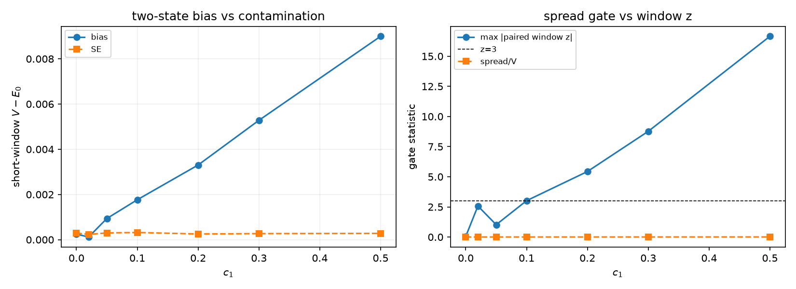

# Wilson loop 与公共框架：剩余 CPU 验收单

基线 `b3f03a7`，2026-11-19。**保留本文件：有限 CPU 包尚未完成。**
主agent复跑104 CPU tests通过（23.36s），不替代下面已确认入口反例。
本轮只更新三份task开工单；下一轮使用新run、新目录，不覆盖历史results。以下CPU验收无需API或远程生产。
下列新增产物路径均为拟议。负结果、受控拒绝与明确延期均可验收，不要求positive结果。

## 1. 已完成，移出活跃待办

| 已完成 | 证据范围与边界 |
|---|---|
| Gram–Schmidt改polar、α/4、双侧协变 | 旧核bug已修，不重复列待修 |
| 逐矩阵投影scale/收敛检查 | 混尺度测试与audit已交；不重复修全batch scale |
| measure旧浮点slice | completed/cfg_start分离已修；真实pending恢复另见P0 |
| 基本输入校验 | NPZ shape/finite/ID、NERSC格式/payload/geometry |
| 三文件事务基础 | NPZ/provenance/marker hash、records/gauge互验已建 |
| 配对诊断 | 精确档案点值与诊断seed分列、jackknife修正、非退化coverage切片 |
| W无效值拒绝 | risk已拒非正/非有限W；候选错误报告断路见P2 |
| 两态物理反例 | `spectral_physical_v1/`已有非零基态overlap、图/JSON |
| 公共draw shape | 一维等长约束已修，旧广播问题关闭 |
| 搜索入口 | loop实际接SearchAdapter、拒NaN结果；u约束/no-validation已做 |
| 其他公共防线 | fixed-U covariance范围已说明，missing kernel hash不再PASS |

既有v2原点score为96.669/103.253/105.535；nested中位数比值3.013/3.425/3.410。
v3原点263.3/232.8/221.9；已有paired图柱为100×nested中位数，不能混用。
v4同系综扩R=4仅相关诊断；不同R集合评分不可直接比较。
现risk衡量固定窗口精度/稳定性，不证明E0准确度；旧run保留archived_diagnostic。

## 2. P0：真实 pending 恢复入口（最高优先，必做CPU）

位置 `measure.py:69–94`：rows已预载completed条，再append新row；
`saved=completed+len(rows)`双计旧前缀。
主agent/子agent无盘mock相同spec实际输出：

```text
resuming development from row 2/3
RuntimeError: row accounting mismatch: saved=5 len(rows)=3 len(records)=3
save_called: False
```

现测试limit=2再limit=2只有完整run重开，没有真实pending；改变limit又改变generation。

- [ ] 修总行数计数，明确rows为全部还是新增，不混合两种语义。
- [ ] 相同完整spec中断于第2条，再续至第3条；不得靠改limit模拟同spec续测。
- [ ] 覆盖空run、部分前缀、完整重开；检查IDs/loops/records每次一致。
- [ ] 续测ledger保留历史成本或明确标增量，不把增量冒充全run总成本。

拟议产物 `results/wilson_loop/audit_<new-id>/resume_entry.json`及数值文字表。
验收：不中断与中断续测的物理数组、IDs、逐行输入摘要一致，无重复/遗漏；保存确实发生。
计时和时间戳可不同，应分别验证各自manifest，不能要求整个provenance文件逐字节相同。
依赖：mock reader/合成小场即可。失败则停止新生产，不需GPU。

### P0b 投影支持域：保留原待办中的有限扫描

已有良态矩阵双侧SU3协变、I/1e4 I/A/1e−6 A混batch、rank-2拒绝与失败batch索引。
尚无已知奇异值谱的条件数扫描、det相位±π两侧扫描，不能把这些也标完成。

- [ ] 冻结有限singular-value×scale×phase网格，包含非零近奇异输入并声明支持范围。
- [ ] 支持域内检查独立左右SU3变换、det/unitarity残差；域外给明确拒绝原因。
- [ ] 说明det相位分支切口，不要求切口处不存在的全局连续性。

拟议产物 `projection_domain.json`和残差/失败表或热图。
验收：范围内达预设容差、范围外可定位拒绝；固定网格完成即关闭，不无限扩大scale。

## 3. P1：事务与真实 NERSC checksum（必做CPU）

### P1a 恢复与身份的有限闭环

- [ ] 各替换步骤故障注入，NPZ/provenance/marker不一致一律拒绝混拼。
- [ ] marker本身改原子保存，或明确损坏时只能拒绝/新run，不声称自动恢复。
- [ ] trust验证实际generation/commit、依赖hash必需字段，不仅要求非None。
- [ ] 身份相符与physical认证分开；当前unknown状态不得自动physical。
- [ ] 同步实际恢复策略与报告，不重建已有identity模块。

拟议产物同audit目录 `transaction_matrix.json`，含每个故障点与拒绝原因文字表。
验收：可信完整前缀或明确拒绝；缺字段不当成功；legacy不补造来源。

### P1b 标准头 checksum 与私有 MD5 分名

当前common验证的是自定义16-byte MD5尾，未验证标准header `CHECKSUM`。
主agent无盘BytesIO反例：1⁴冷场32-bit word sum=`ff400000`，header故意写`ff400001`：
无尾仍返回absent，附正确MD5尾反而verified。因此不能宣称标准NERSC checksum支持完成。

原始实现依据：
[Grid NerscIO.h](https://raw.githubusercontent.com/paboyle/Grid/develop/Grid/parallelIO/NerscIO.h)
读取头CHECKSUM（约L111）；
[Grid BinaryIO.h](https://raw.githubusercontent.com/paboyle/Grid/develop/Grid/parallelIO/BinaryIO.h)
定义32-bit word加和（约L100–128）。

- [ ] 明确支持的DATATYPE/FLOATING_POINT/字节序与标准头checksum算法。
- [ ] 正确头通过、错误头拒绝；覆盖payload改变和字节序边界。
- [ ] 私有MD5若保留，独立命名/状态；MD5通过不能覆盖标准头失败。
- [ ] absent明确缺少哪种校验，禁止笼统verified造成误认证。

拟议产物 `nersc_checksum.json`及BytesIO测试矩阵，原始标准实现作为依据。
验收：上述错误头反例被拒；格式不支持时明确拒绝/标范围，不需真实gauge。

## 4. P2：invalid真实闭环与有限统计口径（必做CPU）

### P2a 候选无效不能让evaluate二次崩溃

`experiment.evaluate`捕获候选ValueError写risk=None，后续却无条件算risk+eps。
非identity无效将TypeError，无法按预期记录invalid_reason；identity已有明确拒绝。

- [ ] 无效候选比值/score为null并保留reason，合法候选仍可报告。
- [ ] 加完整evaluate回归：一个坏候选、一个好候选、坏identity分别验收。
- [ ] risk检查Vref零/近零/非有限，避免W检查通过却输出Inf。
- [ ] paired传协议nominal，禁止默认1与evaluate口径漂移。
- [ ] invalid计数对应实际outer/inner路径，声明拒绝策略，不只给另一个seed的audit计数。

拟议产物 `invalid_evaluate.json`：各触发输入、结果、保存行为文字表。
验收：无TypeError/Inf分数；坏候选可审计、坏identity受控拒绝。

### P2b 校准已有切片，修正其结论即可

`paired_audit_v2/`已交非退化mean→log→risk→outer链；60模拟coverage=0.983。
known-gain truth=4为噪声比平方近似，并非严格有限样本risk真值；
应保留MC不确定性，不能由此称“证明保守”。不要求无限扩大模拟数。

- [ ] 报告区分近似目标覆盖、原始点值和诊断seed重算。
- [ ] README删“invalid尚未接入”等过时描述，按P2a实际结果同步。
- [ ] block/τint依据、多比较/最小增益若本轮未设计，明确仅探索区间并移交新实验。

拟议产物 `statistics_scope.md`，数值逐一对应已有JSON；允许INCONCLUSIVE。
验收：不把exceedance当p值/posterior，不混点值和中位数，不虚构统计功效。

## 5. P3：有限 Nt 说明与 paired-window 术语（必做CPU文字）

两态c0=1、E0=.5、E1=1.2反例和bias/SE最高32.5已完成，不重复生成。
但现谱文稿把有限Nt写成等幅cosh，下一句又说只是特例，前后矛盾。



左图显示短窗偏差随污染增大而SE仍小；右图比较窗口变化指标与spread/V。
这证明现gate有盲点，不证明新的window_z已校准；其相关误差口径仍须下述修正。

- [ ] 给一般静态源sector热迹/适用条件，明确零温谱与有限Nt修正。
- [ ] 等幅正反指数仅标为特例，不称一般Wilson圈有限Nt谱。
- [ ] window_z当前分母为两SE平方和，非paired difference SE；改名称或按配对差计算。
- [ ] 对unused window_z明确“诊断而未入gate”，不用新标签伪造已认证物理质量。

拟议产物 `finite_nt_scope.md`和必要时window差数值表，无需新GPU。
验收：公式、代码、术语一致；当前risk不能排除共同偏差的边界保留。

## 6. 公共 F0–F3：现有接口的有限集成（必做CPU）

五接口/evidence/state/search均已建，不重建schema；单一负责人集成core与agents。

### F0 receipt可信入口

- [ ] scripts.audit_run.pion除正确行数外校验完整ID，不能只验证n。
- [ ] evidence PASS必须有本run/code/input绑定的可信receipt；空code/inputs不能PASS。
- [ ] 校验receipt内容/身份与实际输入，不把任意hash字符串当执行证据。

拟议产物 `results/framework/audit_<new-id>/receipt_matrix.json`。
验收：空证据、错ID/错run/错输入被拒；两task合法receipt可重放。

### F1 比较器正值契约与两task调用

主agent实际反例：baseline=[1,1,1]、candidate=[0,0,0]返回median=Inf、CI=[NaN,NaN]。

- [ ] 按风险比语义检查原始正值、空draw、ID与spec一致；不只shape/finite。
- [ ] 将校验接入两task现有比较路径，避免另建仅供测试调用的函数。

拟议产物 `comparator_paths.json`及非法输入/合法一致性表。
验收：零分母/空draw明确拒绝，合法路径有有限比值与同一draw身份。

### F2 外部预算与畸形提案

loop已走SearchAdapter且拒NaN结果；剩下预算每轮Budget(len(proposals))由模型输出决定。
np.asarray('not-a-number')实际ValueError会中止，未进入rejection记录。

- [ ] 配置外部固定全局/每轮上限，模型不得自行增加预算。
- [ ] 捕获畸形候选转换错误并记录拒绝，mock覆盖字符串/容器/越界/超预算。

拟议产物 `mock_budget_trace.json`，不调用API；验收超预算不再评估、畸形提案不中止整轮。

### F3 有限 conditional-only 契约或真实 receipt 链

develop两task仍用测试源码/历史diagnostics/datafile digest直接标validated；
RunState只查字符串长度，`unverified-text`可使五state全valid返回42，不能证明执行。
evaluate继承status丢evidence_hash，comparison永远draft，报告存在两套状态口径。

- [ ] 本轮可明确conditional-only，禁止伪认证operator/numerical/statistical。
- [ ] 若交physical，必须由本run可信receipt链驱动，不仅改标签或断言scoreNone。
- [ ] evaluate保留绑定证据并产出一致comparison；顶层score与RunState语义一致。
- [ ] 同步doc/run_state、STATUS、coverage的已/未接项和实际状态。

拟议产物 `state_receipt_paths.json`、两task状态转移表；验收伪字符串不生成physical证书。

## 7. F4 / P4 延期与本轮关闭

F4生产ΔH/接受率/热化证据仍NOT_RUN；toy与τint=.512不替代生产，分类正确。
P4 stout/GEVP/multilevel/多体积动量/训练网络/新盲测是可选延期，不阻止有限CPU结项。
GEVP需新cross loops，估计器与kernel-only分赛道；不以旧validation改名恢复盲性。
关闭顺序：P0→P1/P2a→F0/F1/F3→F2→P2b/P3文字同步。
每包交命令、身份、数值表或图；上述必做全部验收且延期明确后才删todo。
不要求新GPU或正收益；当前CPU断路尚在，不能写“剩余都需GPU/授权”。
